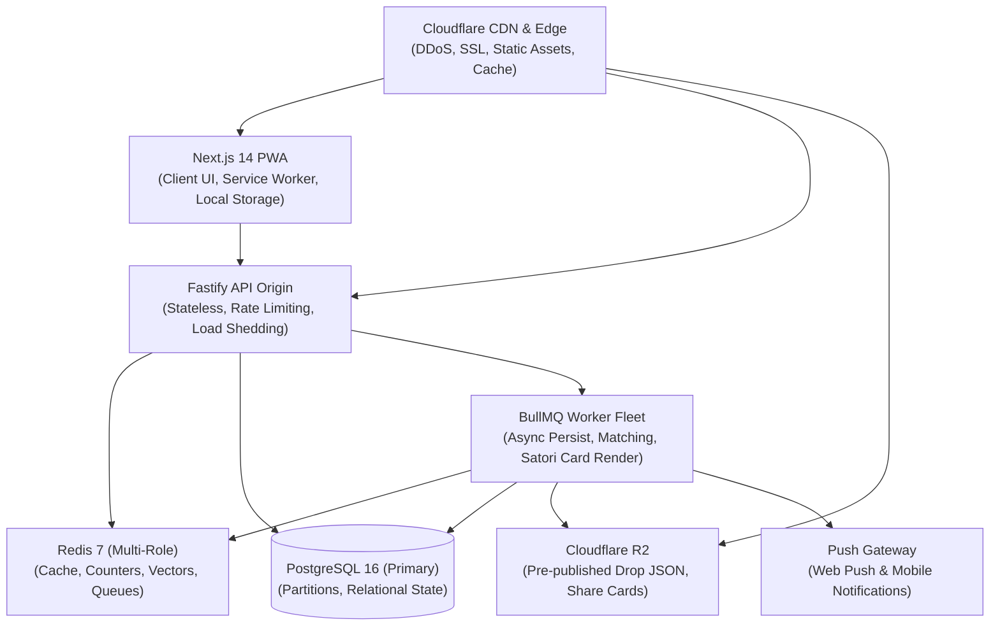
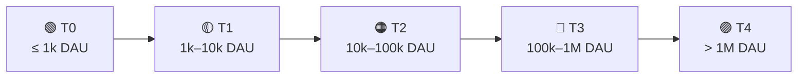
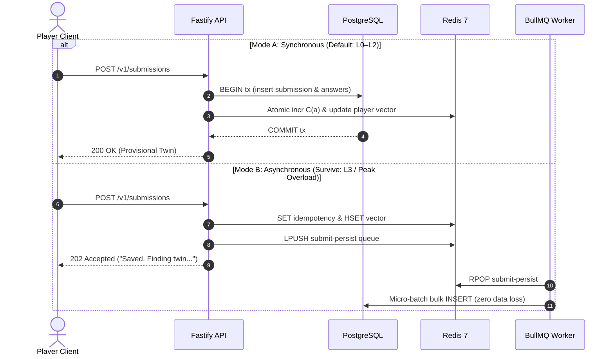
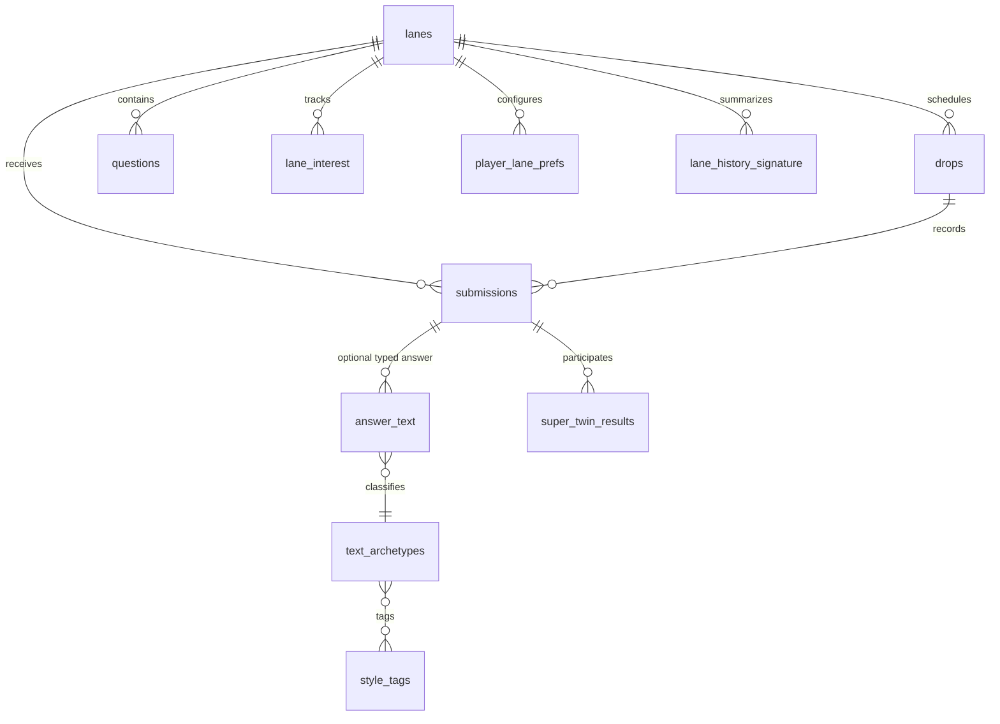
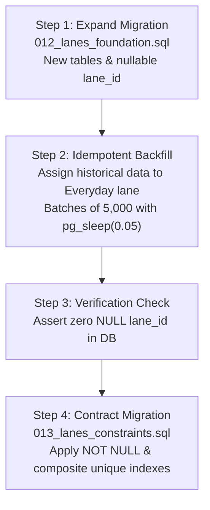
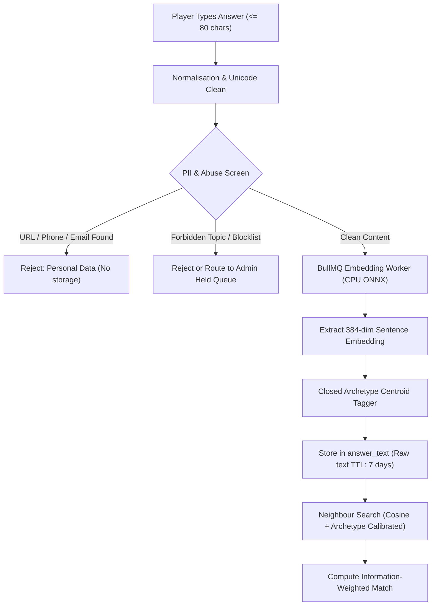

# Architecture and Technical Specification — Oddly v1

> **The Reliability Promise:**  
> *"No acknowledged submission is ever lost, the Drop is always reachable, and when we are overloaded we shed non-essential work first and say so honestly."*

**Project:** Oddly v1 | **Last updated:** 2026-11-10 | **Owner:** Senior System Designer & SRE + Founder  
**Purpose of this file:** System architecture, complete tech stack, scaling plan, edge caching, data models, Redis schema, API specifications, component lifecycles, degradation ladder, and deployment infrastructure.

---

## 1. System Overview & Service Level Objectives (SLOs)

<!-- visual:start system-topology-diagram -->

<!-- visual:end system-topology-diagram -->


Oddly is architected as an ultra-high-throughput, low-latency, mobile-first Web Application (PWA) and API designed to withstand extreme diurnal traffic spikes (around the 07:00 IST daily Drop). The platform combines edge caching, distributed in-memory evaluation, graceful degradation, and asynchronous worker pools to guarantee zero data loss.

### 1.1 Service Level Objectives (SLOs)

*Planning targets to be validated and tuned via load testing.*

| Area / Service | Target SLO | Measurement Methodology | Operational Context |
|---|---|---|---|
| **Play-Path Availability** | **99.9%** Monthly<br>**99.95%** 07:00–08:00 IST | Synthetic play-flow probe every 60 s from 3 global regions + real-user error rate | Core user loop: load Drop -> answer 5 picks -> submit -> view result |
| **`GET /v1/drop/today`** | **p95 < 100 ms**<br>Edge hit ratio > 99% | Cloudflare CDN Analytics | Pre-published and edge cached |
| **`POST /v1/submissions`** | **p95 < 500 ms**<br>p99 < 1,500 ms<br>Error rate < 0.5% | Fastify API metrics (`prom-client`) | At planned peak (1,100 submissions/sec) |
| **`GET /v1/results/:dropId`** | **p95 < 400 ms** | Fastify API metrics | Instant provisional or locked results |
| **Submission Durability** | **100% (Zero Loss)** | Reconciliation job: acknowledged `request_id`s vs stored DB rows | No acknowledged submission is ever dropped |
| **Final Batch Completion** | **99% of days by 07:10 IST**<br>100% by 07:20 IST | BullMQ pipeline timer & audit log | Finalizes exact percentiles and streaks |
| **Share Card Readiness** | **p95 < 5 seconds** | Worker queue latency | Satori + Resvg worker pipeline |
| **Share Landing (`/c/:shortId`)** | **p95 < 200 ms**<br>Edge hit ratio > 95% | Cloudflare CDN Analytics | Viral landing page delivery |
| **Push Delivery Start** | First batch at 07:00 IST<br>All batches in < 10 min | Notification worker queue metrics | Staggered 5,000/batch slices |
| **Disaster Recovery** | **RTO < 30 minutes**<br>**RPO < 5 minutes** | Quarterly disaster recovery drills | Time to restore service & max data loss |

*Error Budget Policy:* 99.9% monthly allows 43.2 minutes of downtime/degraded service per month. If > 50% of monthly budget burns, feature releases freeze immediately until reliability is restored.

### 1.2 Resource Scarcity Priorities (Strict Order)

When capacity is constrained, work is preserved or shed in strict order:
1. **Accept and durably store submissions** *(Highest priority — never shed)*
2. **Serve the Drop JSON and the client app shell**
3. **Show the user a result (provisional is acceptable)**
4. **Generate server-rendered share cards**
5. **History, settings, and streak summaries**
6. **Push notifications dispatch**
7. **Analytics events and live player counters**
8. **Internal admin tooling and panel testing** *(Lowest priority — shed first)*

---

## 2. Load Model & Capacity Summary

See [`docs/capacity-model.md`](file:///e:/Oddly/docs/capacity-model.md) for full derivations, memory formulas, and testing logs.

| Quantity | Baseline Planning Value | Derivation / Notes |
|---|---|---|
| **Planned Peak Scale** | 10,00,000 (10 lakh) daily players | Target scale ceiling for Oddly v1.0 |
| **07:00–07:30 IST Traffic Share** | 40% = 4,00,000 sessions | Peak morning diurnal spike |
| **Average Session Arrival Rate** | ~222 sessions / second | 4,00,000 / 1,800 s |
| **Burst Factor over Average** | 5.0x | Surge at 07:00 notification opening |
| **Peak Session Arrival Rate** | ~1,100 sessions / second | 222 x 5.0 |
| **Peak Requests per Second (Total)** | ~4,400 RPS | ~4 API calls per session |
| **Peak Origin Requests (Non-CDN)** | ~2,200 to 2,800 RPS | Submissions, personalized results, telemetry |
| **Peak Submissions per Second** | ~1,100 submissions / second | One per completed session |
| **Database Row Inserts per Second** | ~7,700 rows / second | 7 rows per submission (sub + 5 answers + match) |
| **Redis Vector Memory (10 Lakh Players)** | ~220 MB per Drop | 5-byte compact binary vectors in Redis |
| **Design Headroom Target** | **2.0x planned peak (2,200 submits/s)** | Meets SLOs with zero degradation |
| **Degradation Stress Envelope** | **Up to 5.0x peak (5,500 submits/s)** | Graceful degradation L1 -> L3; zero crash loops |
| **Viral Share Scenario** | 5,00,000 visitors in 10 minutes | > 95% served directly from Cloudflare edge |

---

## 3. Non-Negotiable System Design Principles

1. **Cache First:** Anything identical for many users is an immutable CDN object (Drop JSON, content bundle, pages, share cards, landing pages). The origin only processes personalized or write operations.
2. **Stateless Application Servers:** Any API instance can die at any time with zero player impact. All state resides in PostgreSQL, Redis, or object storage.
3. **PostgreSQL is Source of Truth; Redis is Fast Cache & Queue:** Live counters in Redis must be reconstructible from PostgreSQL via scheduled reconciliation.
4. **Idempotency Everywhere:** Same `request_id`, same effect, same response. Every queue job is safe to execute multiple times.
5. **Bounded Everything:** Bounded queues, bounded retries with jitter, bounded candidate sets (max 5,000), bounded page sizes, bounded payload limits (4 KB). No unbounded loops anywhere.
6. **Timeouts and Circuit Breakers on All Outbound Calls:** Database, Redis, R2, Push gateways, Google Auth, and Turnstile all enforce strict deadlines with `opossum` circuit breakers.
7. **Isolate Failures (Bulkheads):** Separate worker pools and Redis roles for live submissions, matching, card rendering, notifications, and final batch.
8. **Shed Load Deliberately:** Rate limit at edge and API; reject early and cheaply with `429` or `503` plus `Retry-After`; adhere to the degradation ladder.
9. **Keep CPU off the Event Loop:** Satori/Resvg card rendering, heavy matching, and compression run in worker threads (`piscina`) or dedicated workers, never blocking request I/O.
10. **Observe Before You Scale:** No scaling step is taken without an exported metric proving the need and a load test proving the fix.
11. **Boring Technology, Minimal Moving Parts:** Adopt components only when promotion triggers fire; design clean interfaces so swapping components is straightforward.
12. **Everything Dynamic Stays Dynamic:** Copy, config, and flags come from the database through cached layers. Kill switches and degradation levels live in `app_config` and change in seconds without deploys.
13. **Fail Honestly:** When degraded, communicate honestly in brand voice. Never fabricate data, never silently drop a submission.
14. **Time is Server Time:** Clients never decide if a Drop is open. Client countdowns synchronize against the server `Date` header offset.
15. **Safe Delivery:** Zero-downtime deploys, backward-compatible expand/contract migrations, canary releases, and deploy freezes around the 07:00 IST window.

---

## 4. Scale Tiers Architecture

<!-- visual:start scale-tiers-chart -->

<!-- visual:end scale-tiers-chart -->


See [`docs/scaling-plan.md`](file:///e:/Oddly/docs/scaling-plan.md) for full architectural roadmap and cost projections.

| Tier | Daily Players | Peak Submissions / sec | Infrastructure Topology | Promotion Trigger (Move Up When) |
|---|---|---|---|---|
| 🟢 **T0** | Up to 1,000 | ~1 – 5 | 1 API instance, 1 worker, starter Postgres & Redis, CDN | Sustained peak > 20 req/s, or CPU > 60% at peak |
| 🟡 **T1** | 1,000 to 10,000 | ~10 – 25 | 2 API instances, 1 worker, managed Postgres with pooler, persistent Redis | DB CPU > 60% at peak, p95 submit > 300 ms, or > 8,000 players |
| 🟠 **T2** | 10,000 to 1,00,000 | ~100 – 250 | 3 to 6 API instances, separate worker pools, multi-role Redis, Postgres replica | > 80,000 players, queue lag > 30 s at peak, or DB write saturation |
| 🔴 **T3** | 1,00,000 to 10,00,000 | ~1,100 (2x: 2,200) | 10 to 40 API instances, dedicated Postgres primary + pooler + replicas, Redis Cluster | > 8,00,000 players or breaking point found in load test |
| 🟣 **T4** | > 10,00,000 | > 2,500+ | Multi-region reads, sharded counters, vector search service, managed stream | Strategic business decision and funded dedicated SRE plan |

- **Build Now (v1.0):** CDN edge caching; stateless Fastify API; idempotent submissions; Redis atomic counters; BullMQ workers with isolated queues; rate limits; timeouts & circuit breakers; `@fastify/under-pressure` load shedding; degradation ladder L0–L4; range partitioning by `drop_date`; zero-downtime migrations; k6 load test harness.
- **Design Now, Build on Trigger:** Mode B async persist; matching Stage B bucket index & Stage C ANN; Redis role split; Postgres read replica; sharded hot counters; progressive final batch chunking.
- **Explicitly Rejected for v1.0:** Kubernetes (revisit at T4); Microservices beyond Web/API/Worker; Apache Kafka; Multi-region active-active writes; GraphQL; WebSockets/SSE for live counts.

---

## 5. Edge and Caching Architecture

Cloudflare sits in front of all services. Over 95% of requests never reach the origin at planned peak.

### 5.1 Edge Cache Policy Table

| Resource | Cache-Control Header | Edge Behavior & Revalidation |
|---|---|---|
| **App Shell & Static Assets** | `public, max-age=31536000, immutable` | Hashed filenames, fonts, SVG icons, compiled JS/CSS |
| **`GET /v1/drop/today`** | `public, s-maxage=5, stale-while-revalidate=30, stale-if-error=3600` | Pre-staged immutable JSON at `/v1/drops/:id.json`; pointer flips at 07:00 |
| **`GET /v1/content/:locale`** | Hash-versioned URL cached 1 year; pointer `s-maxage=60, stale-while-revalidate=600` | Dynamic content bundle; instant purge on admin publish |
| **`GET /v1/pages/:slug`** | `s-maxage=300, stale-while-revalidate=3600` | On-demand ISR revalidation on admin CMS publish |
| **`GET /v1/config/public`** | `s-maxage=30, stale-while-revalidate=300` | Delivers active degradation level and runtime settings |
| **Live Players Count (`/v1/stats/today`)** | `s-maxage=10, stale-while-revalidate=60` | Never computed per request; read from cached Redis counter |
| **Share Card Images** | `public, max-age=31536000, immutable` | Content-hashed storage keys in Cloudflare R2 |
| **Share Landing (`/c/:shortId`)** | `s-maxage=300, stale-while-revalidate=86400` | Fully edge-cacheable; zero PII rendered on landing |
| **`GET /v1/world/:dropId`** | `s-maxage=300` then immutable after finalization | World stats cached at edge once Drop closes |
| **Personalized Endpoints (`/results`, `/history`, `/me`)** | `private, no-store` | Never cached at edge; ETag support where applicable |

### 5.2 Thundering-Herd Defenses
- **Origin Shielding & Tiered Caching:** Thousands of concurrent edge misses coalesce into a single origin fetch.
- **Pre-Publish at 06:30 IST:** The staged Drop JSON is uploaded to R2/CDN 30 minutes before release. At 07:00:00, the pointer endpoint flips instantly. The API rejects submissions before `opens_at`.
- **Client-Side Jitter:** At 00:00:00 countdown, client waits `Math.random() * 4000` ms before requesting today's drop.
- **Push Notification Stagger:** 5,000 notifications dispatched per slice, 20 seconds apart.

---

## 6. Frontend Architecture for Scale (`apps/web`)

### 6.1 State Management (ADR 010)
- **Server Data (`TanStack Query`):** Automatic caching, deduplication, background polling with backoff and jitter, ETag 304 handling, offline persistence.
- **Client Draft & UI State (`Zustand` with `persist` middleware):** Lightweight (< 1 KB), selector-driven rendering. Draft answers and pending `request_id`s persist in `localStorage` so page refreshes never lose picks.
- **Redux Toolkit is Rejected:** Unnecessary bundle weight (~30 KB) against our 150 KB budget on 4G low-end Android devices.

### 6.2 Rendering & Delivery Strategy
- **Static App Shell:** Statically generated landing shell with Next.js App Router; personalized parts (streak, results) populate via TanStack Query after initial paint.
- **Performance Budgets Enforced in CI:** Initial JS < 150 KB compressed; Total page weight < 500 KB; LCP < 2.5 s and INP < 200 ms on 4G mobile.
- **Service Worker (`Serwist`):** Precaches static shell, offline page (`/offline`), and last-known-good content bundle.

### 6.3 Network Behavior & Anti-DDoS Discipline
- **Retry Rules:** Idempotent requests retry up to 5 times with exponential backoff (500 ms, 1 s, 2 s, 4 s, 8 s) plus full jitter; always honor `Retry-After`.
- **Polling Discipline:** Result polling uses ETag/304, backs off from 30 s to 5 min, pauses when the tab is hidden (Page Visibility API), and respects the degradation level.
- **Client Submission Safety:** Drafts and pending `request_id`s remain in local storage until the server returns confirmed result persistence.

---

## 7. API Layer for Scale (`services/api`)

1. **Stateless Fastify Services:** Behind a load balancer with `/health` (liveness) and `/ready` (readiness checking DB & Redis) endpoints. Graceful shutdown: on `SIGTERM`, stops taking traffic, drains in-flight requests (up to 25 s), closes pools, exits cleanly.
2. **Load Shedding (`@fastify/under-pressure`):** Monitors event-loop delay, heap size, and RSS. When thresholds are exceeded, immediately returns HTTP `503 Overloaded` with `Retry-After` before attempting heavy work.
3. **Connection Hygiene:** Bounded connection pool per instance matching PgBouncer limits. Never open connections per request.

### 7.1 Per-Route Policy Table

| Route | Method | Timeout | Rate Limit | Cache Policy | Idempotency | Priority Lane | Degradation Behavior |
|---|---|---|---|---|---|---|---|
| `/health` | GET | 1 s | None | No-store | None | 🟠 Core | Never shed |
| `/ready` | GET | 2 s | None | No-store | None | 🟠 Core | Never shed |
| `/v1/drop/today` | GET | 3 s | 120/min/IP | Edge s-maxage=5 | None | 🟠 Core | Serve stale from CDN if down |
| `/v1/drops/:id.json` | GET | 3 s | None | Edge immutable | None | 🟠 Core | Served directly from CDN/R2 |
| `/v1/submissions` | POST | 5 s | 30/min/IP | No-store | `request_id` (24h) | 🔴 **Critical** | Switch to Mode B async at L3 |
| `/v1/results/:dropId` | GET | 3 s | 60/min/IP | Private ETag | None | 🟠 Core | Return provisional if matching slow |
| `/v1/results/:dropId/card`| GET | 10 s | 30/min/IP | Edge immutable | None | 🟡 Medium | On-demand render only at L1/L2 |
| `/v1/stats/today` | GET | 2 s | 60/min/IP | Edge s-maxage=10 | None | ⚪ Low | Serve cached counter; shed at L2 |
| `/v1/time` | GET | 1 s | 120/min/IP | Edge s-maxage=1 | None | 🟠 Core | Clock synchronization header |
| `/v1/config/public` | GET | 2 s | 120/min/IP | Edge s-maxage=30 | None | 🟠 Core | Reflects active degradation level |
| `/v1/content/:locale` | GET | 3 s | 60/min/IP | Edge s-maxage=60 | None | 🟠 Core | Serve last-known-good cached bundle |
| `/v1/history` | GET | 4 s | 30/min/IP | Private no-store | None | 🟡 Medium | Route to replica; shed at L2 |
| `/v1/world/:dropId` | GET | 4 s | 60/min/IP | Edge s-maxage=300 | None | ⚪ Low | Stale numbers up to 10 min at L2 |
| `/v1/auth/*` | POST | 5 s | 10/min/IP | No-store | None | 🟡 Medium | Guest play only at L3 |
| `/v1/me/*` | GET/PUT | 4 s | 30/min/IP | Private no-store | None | 🟡 Medium | Shed at L2/L3 |
| `/v1/reports` | POST | 4 s | 10/min/IP | No-store | None | 🟡 Medium | Queued in BullMQ |
| `/v1/keeps` | POST | 4 s | 10/min/device | No-store | `request_id` | 🟡 Medium | Paused at L2+ |
| `/v1/keeps/incoming` | GET | 3 s | 30/min/device | Private no-store | None | 🟡 Medium | Shed at L2+ |
| `/v1/keeps/:id/respond` | POST | 4 s | 10/min/device | No-store | `request_id` | 🟡 Medium | Paused at L2+ |
| `/v1/orbits` | GET | 3 s | 30/min/device | Private no-store | None | 🟡 Medium | Read-only at L2, shed at L3+ |
| `/v1/orbits/:id` | GET | 3 s | 30/min/device | Private ETag | None | 🟡 Medium | Read-only at L2, shed at L3+ |
| `/v1/orbits/:id/expressions` | POST | 3 s | 20/min/device | No-store | `request_id` | ⚪ Low | Paused at L2+ |
| `/v1/orbits/:id/end` | POST | 3 s | 10/min/device | No-store | `request_id` | 🟡 Medium | Never paused (safety invariant) |
| `/v1/orbits/:id/telepathy` | GET | 3 s | 30/min/device | Private no-store | None | ⚪ Low | Hidden at L2+ |
| `/v1/orbits/:id/telepathy/guess` | POST | 3 s | 10/min/device | No-store | `request_id` | ⚪ Low | Paused at L2+ |
| `/v1/globe` | GET | 3 s | 60/min/IP | Edge s-maxage=60 | None | ⚪ Low | Stale up to 10m at L1, hidden at L2+ |
| `/v1/results/:dropId/anti-twin` | GET | 3 s | 20/min/device | Private no-store | None | ⚪ Low | Hidden at L2+ |
| `/v1/events` | POST | 3 s | 60/min/device | No-store | None | ⚪ Low | Sampled 50% at L1, shed at L2+; never in submit path |
| `/v1/consents` | GET | 3 s | 30/min/device | Private no-store | None | 🟡 Medium | Shed at L2+ |
| `/v1/consents` | PUT | 3 s | 10/min/device | No-store | `request_id` | 🟡 Medium | Shed at L2+ |
| `/v1/memes/today` | GET | 3 s | 60/min/device | Edge s-maxage=60 | None | ⚪ Low | Hidden at L2+ (M3) |
| `/v1/memes/:id/rating` | POST | 3 s | 30/min/device | No-store | `request_id` | ⚪ Low | Paused at L2+ (M3) |
| `/v1/memes/submissions` | POST | 5 s | 5/min/device | No-store | `request_id` | ⚪ Low | Blocked at L2+ (M3) |
| `/v1/me/memes` | GET | 3 s | 20/min/device | Private no-store | None | ⚪ Low | Shed at L2+ (M3) |
| `/v1/me/badges` | GET | 3 s | 30/min/device | Private no-store | None | ⚪ Low | Shed at L2+ (M6) |
| `/v1/shoutouts` | GET | 3 s | 60/min/IP | Edge s-maxage=300 | None | ⚪ Low | Stale up to 1h at L2+ (M6) |
| `/v1/orbits/:id/subject-sync` | GET | 3 s | 30/min/device | Private ETag | None | ⚪ Low | Hidden at L2+ (M5) |
| `/v1/lanes` | GET | 2 s | 60/min/IP | Edge s-maxage=60 | None | Core | Returns cached catalogue; client sorts last-played |
| `/v1/drops/today` | GET | 3 s | 120/min/IP | Edge s-maxage=5 | None | Core | Query param `?lane=slug` isolates Drop by lane |
| `/v1/lane-interest` | POST | 3 s | 10/min/device | No-store | `request_id` | ⚪ Low | Records planned lane interest; shed at L2+ |
| `/v1/me/lane-prefs` | PUT | 3 s | 20/min/device | No-store | `request_id` | 🟡 Medium | Updates per-lane push and history opt-in |
| `/v1/me/super-twin` | GET | 3 s | 30/min/device | Private no-cache | None | ⚪ Low | Returns Super twin result; shed at L2+ |
| `/v1/answers/:id/text`| POST | 4 s | 5/min/device | No-store | `request_id` | ⚪ Low | Free-text submission (Gate G4); shed at L2+ |
| `/admin/*` | ALL | 10 s | 120/min/IP | No-store | None | ⚪ Low | Block writes at L2/L3 |

### 7.2 Layered Rate Limiting and Indian CGNAT Cellular Architecture (R1-PATCH Item 5)

Rate limiting is structured in two distinct layers:

1. **Primary Rate Limit (Device ID + IP):** Keyed by `${deviceId}:${req.ip}` via `@fastify/rate-limit` (120 req/min general, 30 req/min on `POST /v1/submissions`). In production mode, localhost is never bypassed.
2. **Coarse IP-Only Ceiling:** Configured at 600 req/min default (read from `app_config` / `IP_RATE_LIMIT_PER_MINUTE`), tracked via Redis atomic counters with 60-second windows.

**Why the High IP-Only Ceiling is Mandatory:**  
In India, major mobile carriers (Reliance Jio, Bharti Airtel, Vodafone Idea) extensively deploy Carrier-Grade NAT (CGNAT) (RFC 6598, `100.64.0.0/10`). Under CGNAT, a single public IPv4 gateway address is shared simultaneously among thousands of mobile devices connected to the same regional cellular base station. Because the 07:00 IST Drop is synchronized across the country, thousands of distinct players in the same city or university campus will originate requests from the exact same public IP within minutes. Enforcing a low IP-only limit (e.g. 60–120 req/min) would cause massive false-positive lockouts for legitimate players. Keying on `${deviceId}:${req.ip}` ensures per-device isolation, while the 600 req/min IP ceiling provides coarse origin protection against volumetric DDoS floods and scraper farms.

---

## 8. Data Layer & Multi-Role Redis

### 8.1 PostgreSQL 16 Architecture
- **Connection Pooler:** PgBouncer in transaction mode; separate DB credentials/roles for API, worker, and admin with custom statement timeouts.
- **Range Partitioning from Day One:** `submissions`, `answers`, `matches`, and `answer_stats` range-partitioned by `drop_date`. Scheduled job creates future partitions 14 days in advance (alerts if < 7 exist).
- **90-Day Retention Window:** Detailed `answers` rows compacted into user history summaries after 90 days; raw daily partitions dropped.
- **Zero-Downtime Migration Rules:** Expand -> Migrate -> Contract. No exclusive table locks; create indexes `CONCURRENTLY`.

### 8.2 Multi-Role Redis 7 Topology
Redis instances are segmented by logical role with dedicated eviction policies:
1. **`cache` Role (`allkeys-lru`):** Drop JSON, dynamic content bundles, public config, rate limits. Eviction safe.
2. **`counters-vectors` Role (`noeviction`, AOF `everysec`):** Live answer counters ($C(a)$) and player vectors. Never evicted. Reconstructible from Postgres via repair job.
3. **`queues` Role (`noeviction`, AOF `everysec`):** BullMQ job queues. Never evicted.

### 8.3 Ingestion Persistence Modes (A vs. B)

<!-- visual:start submit-mode-sequence -->

<!-- visual:end submit-mode-sequence -->

- **Mode A (Synchronous Ingestion — Default):** API writes submission, answers, and provisional match to PostgreSQL in a transaction, then updates Redis counters/vector, and responds with HTTP 200.
- **Mode B (Asynchronous Ingestion — Level L3):** API writes idempotency key and vector to Redis, appends submission to BullMQ `submit-persist` queue, and immediately responds with HTTP 202 (`"Saved. Finding your twin..."`). Worker micro-batches inserts to PostgreSQL. A reconciliation job ensures zero loss between acknowledged IDs and database rows.

---

## 9. Queues, Workers & Scheduler Safety (`services/worker`)

1. **Queue Bulkheads:** Separate BullMQ queues and workers: `submit-persist`, `match-provisional`, `match-final`, `card-render`, `notify`, `maintenance`, `export-delete`.
2. **Deterministic Idempotent Jobs:** Job IDs generated deterministically (e.g., `card:{userId}:{dropId}:{hash}`). Running a job twice produces identical results.
3. **CPU Offload:** Share card rendering (`satori` + `resvg`) and heavy matching run in worker threads (`piscina`) capped to available CPU cores.
4. **Scheduler Safety:** Single-leader execution via Redis/Postgres advisory lock and `scheduler_runs` unique table `(job_name, run_for)`. Missed cron runs catch up sequentially on reboot.

---

## 10. The Daily Pipeline at Scale

See [`docs/capacity-model.md`](file:///e:/Oddly/docs/capacity-model.md) for timeline hazard analysis.

- **06:30 IST (Staging):** Pre-publish immutable Drop JSON to CDN/R2; warm cache; pre-create next day's database partition; run synthetic health probe.
- **07:00 IST (Open):** Pointer endpoint flips to live; first notification slice released; Redis counter namespace switches.
- **Live Window (07:00 – 06:59 D+1):** Incremental provisional matching re-evaluates only players whose candidate buckets changed.
- **06:59 IST (Close):** Submissions close; persist queue drains; counter snapshot taken.
- **07:00 – 07:10 IST (Final Batch):** Runs in a dedicated worker pool capped at 25% DB connections. Partitioned into idempotent chunks (5,000 users/chunk). Results publish progressively; recap screens display locked twins as each chunk completes.

---

## 11. Matching at Scale

1. **`MatchingStrategy` Interface:** Decouples API from algorithm:
   - **Stage A (v1.0):** In-memory / Redis brute-force vector scan (suitable for up to 10,000 players).
   - **Stage B (T2+):** Exact-hash buckets, 4/5 sub-hash buckets, and 3/5 buckets.
   - **Stage C (T3+):** Approximate Nearest Neighbor (ANN / HNSW) index.
2. **Bounded Execution:** Maximum 5,000 candidate evaluations per submit request. Returns best candidate found; finishes evaluation asynchronously.
3. **Cached Probabilities:** $p(a)$ computed from in-memory cached counters refreshed every 5 seconds.
4. **Deterministic Tie-Breaking:** Seeded by `hash(drop_date, user_a, user_b)` ensuring identical twins across retries.5. **Lane-Isolated Matching (Stage L0 / Rule L2):** All matching, candidate scanning, and oddness tiers execute strictly within the player's selected lane cohort. A player's answers in the Memes lane never influence matching in the Everyday lane.
6. **Bounded Tie-Groups & Mutual Pairing (Stage L0 / Stage L3):** In the 07:05 final matching run, candidate edges within each tie group (similarity within $\epsilon = 0.01$) are bounded to top $K=32$ per player. Tied edges are sorted by 28-day BitMinHash historical agreement, different country preference, and deterministic HMAC hash, followed by greedy mutual pairing to ensure bidirectional twin assignments (`is_mutual = true`). Total graph complexity is bounded to $O(N \cdot K \log K)$.

---

## 12. Graceful Degradation Ladder

Controlled dynamically via database `app_config.degradation_level` (L0 to L4). See [`docs/degradation-playbook.md`](file:///e:/Oddly/docs/degradation-playbook.md).

| Level | Name | Automated Trigger | System Adjustments | User Experience |
|---|---|---|---|---|
| 🟢 **L0** | Normal | Healthy | All features active (including Globe live arcs, Keep/Orbit, Telepathy, Anti-twin) | Standard UI |
| 🟡 **L1** | Conserve | submit p95 > 400 ms or CPU > 70% | Live count cached 60 s; matching refresh interval doubled; analytics sampled 50%; card pre-render on-demand; **Globe refresh interval doubled** (60s to 120s); Anti-twin, Orbit, Telepathy normal | Live count shows subtle freshness label |
| 🟠 **L2** | Protect Core | submit p95 > 800 ms or queue lag > 2m | Twin upgrade push paused; history/settings served stale; sign-up queued; admin writes locked; **Globe real-time arcs paused (switches to Replay loop); new Keep requests paused; existing Orbits read-only; Telepathy & Anti-twin paused** | Banner: *"Busy right now. Your picks are safe."* |
| 🔴 **L3** | Survive | Error rate > 2% or DB write saturation | **Mode B async persist active**; matching deferred; guest play only; push paused except Drop Live; **all connection features (Globe, Orbit, Telepathy, Anti-twin) read-only or hidden with honest copy** | Screen: *"Saved! Finding your twin... This may take a minute."* |
| ⚫ **L4** | Static | Origin down / catastrophic | CDN serves cached shell and Drop JSON; client stores picks locally and retries for 6h; **all connection features hidden** | Banner: *"Picks saved safely on device. Will send automatically when reconnected."* |

*Load Shedding Priority Order:*  
1. Priority 1 (Core): Drop JSON, Submissions (Mode A -> Mode B), `/health`.  
2. Priority 3: Results, Twin Reveal, Oddness.  
3. Priority 5: User History, Settings, Me Drawer, **Keep requests & Orbit status**.  
4. Priority 7: Share Card Pre-render, Live Counters, **Twin Globe Arcs, Telepathy Guesses, Anti-twin calculation, Signals `/v1/events` (sampled 50% at L1, shed at L2+), Meme Corner rating (M3)**.  
5. Priority 9: Non-essential pushes, background audits, admin exports, **Meme Lab submissions (M3)**.

*Hysteresis Rule:* Stepping down to a lower level requires **5 consecutive minutes** of healthy metrics below threshold.
- **Lane Degradation Dynamics (Stage L0):**
  - **Level L1:** Secondary planned lanes cache subscriber counts; Memes lane serves standard low-res placeholder if CDN is degraded.
  - **Level L2:** `POST /v1/lane-interest` paused; Super twin calculations deferred to morning recap; free-text embedding worker queue shed.
  - **Level L3:** Non-Everyday lanes enter resting state; only Everyday lane is playable (Mode B async persist; provisional twin deferred).
  - **Level L4:** CDN serves cached Everyday Drop shell only; all other lanes hidden.

---

## 13. Observability, Telemetry & Alerts

See [`docs/slo.md`](file:///e:/Oddly/docs/slo.md) for full alerting catalog.

- **Metrics (`prom-client`):** Four golden signals per route (latency, traffic, errors, saturation); event-loop delay; DB pool wait; Redis memory; queue depth and age.
- **Tracing (OpenTelemetry Node SDK):** Sampled at 1–5% (100% on errors); propagates `x-request-id` header across client, API, and database.
- **Structured Logging (`pino`):** High-performance JSON logging with `requestId`, status, duration. Zero PII logged.
- **Synthetic Probes:** Scripted play-flow executed every 60 s from 3 global regions. Public status page hosted externally.

---

## 14. Monorepo Folder Structure

```
oddly/
├── apps/
│   ├── web/                     # Public player web application (Next.js 14 App Router, PWA)
│   │   ├── src/app/             # Web routes: /, /play, /results, /recap, /history, /me, /c/[shortId]
│   │   ├── src/components/      # UI components: ui/, play/, result/, share/, layout/
│   │   ├── src/lib/             # Client wiring: api client, hooks, push worker, analytics
│   │   ├── src/styles/          # CSS globals and design token variables
│   │   └── public/              # Icons, manifest.json, sw.js, custom SVG illustrations
│   └── admin/                   # Internal question authoring, import, and scheduling tool
├── services/
│   ├── api/                     # High-throughput Fastify REST API
│   │   ├── src/routes/          # Route handlers: drop, submissions, results, history, auth, me, push
│   │   ├── src/plugins/         # Fastify plugins: under-pressure, rate-limit, auth, cookies
│   │   │   └── pressure.ts      # @fastify/under-pressure load shedding plugin (Stage 3)
│   │   ├── src/lib/resilience/  # Circuit breakers, retry helpers, concurrency limiters (Stage 3)
│   │   └── src/db/              # Prisma client and repository layer (notifications, streaks, etc.)
│   └── worker/                  # Asynchronous BullMQ background worker service
│       ├── src/jobs/            # Schedulers: stageDrop, openDrop, sendPush, renderCard
│       └── src/pools/           # Dedicated worker pools: submit-persist, final-batch, cards
├── packages/
│   ├── shared/                  # Universal pure logic: scoring math, Zod schemas, types, copy keys
│   ├── api-client/              # Typed HTTP client used by web and worker applications
│   └── ui-tokens/               # Design tokens, Tailwind CSS preset, color constants
├── docs/                        # Authoritative scale, reliability, and operations documentation
│   ├── scaling-plan.md          # Tiers T0-T4, triggers, and upgrade playbooks
│   ├── capacity-model.md        # Mathematical capacity formulas and Redis/DB memory budgets
│   ├── slo.md                   # SLOs, error budget policies, and alerting thresholds
│   ├── failure-modes.md         # FMEA matrix and resilience pattern specifications
│   ├── load-testing.md          # k6 load test scenarios, pass criteria, and execution logs
│   ├── runbook.md               # On-call incident response playbooks and triage guides
│   ├── degradation-playbook.md  # Detailed L0-L4 ladder, triggers, and manual controls
│   └── disaster-recovery.md     # RPO/RTO objectives, restoration steps, and drill logs
├── infra/
│   ├── loadtest/                # k6 load testing scripts and synthetic player generator (Stage 13)
│   ├── terraform/               # Declarative cloud infrastructure configurations (Stage 14)
│   └── docker-compose.yml       # Local development PostgreSQL 16 & Redis 7
├── packages/shared/prisma/      # schema.prisma, migrations, dynamic seed data
├── architecture.md              # System architecture and technical blueprint
├── product.md                   # Product specification and core loop definitions
├── rules.md                     # Coding standards, error policies, Definition of Done
├── design.md                    # Visual tokens, typography, component specs, degraded UI states
├── task.md                      # Phase breakdown, task tracking, progress metrics
├── memory.md                    # Living project memory, ADR logs, environment notes
├── package.json                 # Monorepo root package configuration
├── pnpm-workspace.yaml          # PNPM workspace declarations
└── .env.example                 # Documented environment variable templates
```

---

## 15. Extended Tech Stack Table

| Component | Library / Technology | Version | Purpose | Feature / Context | Install Stage |
|---|---|---|---|---|---|
| **Load Shedding** | `@fastify/under-pressure` | `^8.x` | Event-loop and memory overload protection | API Core | Stage 3 |
| **Compression** | `@fastify/compress` | `^7.x` | Brotli & Gzip payload compression | API Core | Stage 3 |
| **Conditional Requests** | `@fastify/etag` | `^5.x` | ETag computation for 304 Not Modified | API Core | Stage 3 |
| **Circuit Breakers** | `opossum` | `^10.0.0` | Outbound dependency failure isolation (Redis, R2, Turnstile, Push, Google OAuth) | API & Worker | Stage R2 |
| **HTTP Client** | `undici` | `^6.x` | High-performance HTTP client with connection pooling | Outbound HTTP | Stage 3 |
| **Retries & Limits** | `p-retry`, `p-limit` | `^6.x` / `^5.x`| Exponential backoff with full jitter and concurrency caps | API & Worker | Stage 3 |
| **Metrics** | `prom-client` | `^15.1.3` | Prometheus metrics exporter for golden signals (RED, queues, DB pool, breakers) | Observability | Stage R2 |
| **Tracing** | `@opentelemetry/sdk-node` | `^0.52.x`| Distributed OpenTelemetry request tracing | Observability | Stage 12 |
| **Thread Pools** | `piscina` | `^4.x` | Worker threads for CPU tasks (Satori, matching) | Worker | Stages 6, 9 |
| **Cluster Redis** | `ioredis` | `^5.x` | Atomic multi-key updates and cluster routing | Data layer | Stage 3 |
| **Connection Pooler** | PgBouncer | `1.22+` | Transaction-mode database connection pooling | PostgreSQL | Stages 2, 14 |
| **Performance Budgets** | `size-limit`, `@size-limit/file` | `^14.3.0` | Enforce initial JS < 150 KB and 500 KB total load budget in CI | Web CI | Stage R2 |
| **Accessibility Tests** | `@axe-core/playwright` | `^4.14.0` | Automated a11y testing for WCAG AA compliance across core views | Web CI | Stage R2 |
| **Load & Chaos** | k6, Toxiproxy, `clinic.js` | Latest | Synthetic player generator, load, chaos, profiling | Testing | Stage 13 |
| **Infrastructure as Code** | Terraform | `1.9+` | Reproducible declarative cloud infrastructure | Hosting | Stage 14 |
| **Synthetic Probes** | Better Stack / UptimeRobot | SaaS | Multi-region synthetic play-flow probes & status page | Operations | Stage 14 |
| **Embedding Runtime (CPU)** | `@xenova/transformers` / `onnxruntime-node` | `^2.17.x` | Self-hosted quantized sentence embeddings for free-text answers (Gate G4) | Worker (Stage L6) | Stage L6 |

---

## 16. Extended Database Entities

In addition to core tables (`users`, `drops`, `questions`, `submissions`, `answers`, `matches`, `streak_log`, `shares`, `app_content`, `app_config`, `tier_definitions`, `reports`), the schema includes scale-governance tables:

1. **`batch_runs`:** Tracks chunked resumable final batch progress per drop.
   - Columns: `id` (UUID, PK), `drop_id` (UUID, FK), `chunk_index` (INT), `status` (ENUM: pending, running, completed, failed), `player_count` (INT), `error` (TEXT, nullable), `started_at` (TIMESTAMPTZ), `completed_at` (TIMESTAMPTZ). Unique: `(drop_id, chunk_index)`.
2. **`scheduler_runs`:** Distributed leader lock preventing duplicate cron executions.
   - Columns: `id` (UUID, PK), `job_name` (TEXT), `run_for_date` (DATE), `executed_at` (TIMESTAMPTZ), `instance_id` (TEXT). Unique: `(job_name, run_for_date)`.
3. **`persist_reconciliation`:** Mode B audit log reconciling acknowledged `request_id`s with persisted database rows.
   - Columns: `id` (UUID, PK), `request_id` (UUID, unique), `player_id` (UUID), `drop_id` (UUID), `persisted_at` (TIMESTAMPTZ, nullable), `status` (ENUM: acknowledged, persisted, missing).

### 16.1 Connection Features Schema Additions (F18 to F21)

All daily tables are range-partitioned by `drop_date` from day one, matching existing partitioning patterns:

1. **`twin_keeps`:** Private, symmetric requests to establish an Orbit after final batch locks at 07:05 IST.
   - Columns: `id` (UUID, PK), `drop_date` (DATE, NOT NULL), `from_player_id` (UUID, NOT NULL, FK to `users`), `to_player_id` (UUID, NOT NULL, FK to `users`), `status` (ENUM: `pending`, `accepted`, `declined`, `expired`), `similarity_snapshot` (FLOAT, NOT NULL), `created_at` (TIMESTAMPTZ, NOT NULL), `decided_at` (TIMESTAMPTZ, nullable).
   - Constraints: Range-partitioned by `drop_date`. Unique index on `(drop_date, from_player_id)`.
   - Privacy Invariant: Neither `from_player_id` nor `to_player_id` is ever returned to clients through the API.
2. **`orbits`:** Long-running mutual relationships established between two players.
   - Columns: `id` (UUID, PK), `player_a_id` (UUID, NOT NULL, FK to `users`), `player_b_id` (UUID, NOT NULL, FK to `users`), `status` (ENUM: `active`, `ended`), `started_on` (DATE, NOT NULL), `ended_on` (DATE, nullable), `co_streak_current` (INT, default 0), `co_streak_best` (INT, default 0), `last_co_date` (DATE, nullable), `ended_by` (UUID, nullable).
   - Constraints: `player_a_id < player_b_id` (lexicographically sorted order to prevent dual-row duplicates). Partial unique index on `(player_a_id, player_b_id)` WHERE `status = 'active'`.
   - Security Invariant: `ended_by` is stored strictly for internal admin investigation and is never exposed via public API.
3. **`orbit_expressions`:** Lightweight daily one-tap non-verbal sticker interactions (The Wave).
   - Columns: `id` (UUID, PK), `orbit_id` (UUID, NOT NULL, FK to `orbits`), `from_player_id` (UUID, NOT NULL, FK to `users`), `drop_date` (DATE, NOT NULL), `expression_key` (TEXT, NOT NULL), `created_at` (TIMESTAMPTZ, NOT NULL).
   - Constraints: Unique index on `(orbit_id, from_player_id, drop_date)`. Expression set is validated against `app_content`.
4. **`telepathy_guesses`:** Mutual daily instinct guessing on the single designated question.
   - Columns: `id` (UUID, PK), `orbit_id` (UUID, NOT NULL, FK to `orbits`), `drop_date` (DATE, NOT NULL), `guesser_player_id` (UUID, NOT NULL, FK to `users`), `question_id` (UUID, NOT NULL, FK to `questions`), `guessed_option_key` (TEXT, NOT NULL), `partner_option_key` (TEXT, nullable), `hit` (BOOLEAN, nullable), `baseline_p` (FLOAT, NOT NULL), `created_at` (TIMESTAMPTZ, NOT NULL).
   - Constraints: Range-partitioned by `drop_date`. Unique index on `(orbit_id, drop_date, guesser_player_id)`. 90-day retention.
5. **`anti_twin_results`:** Asynchronously computed opposite match result per user per drop.
   - Columns: `drop_date` (DATE, NOT NULL), `player_id` (UUID, NOT NULL, FK to `users`), `opposite_submission_ref` (UUID, NOT NULL), `differed_count` (INT, NOT NULL), `sample_size` (INT, NOT NULL), `computed_at` (TIMESTAMPTZ, NOT NULL).
   - Constraints: Primary Key `(drop_date, player_id)`. Retention: 7 days.
   - Privacy Invariant: Zero pick labels of the opposite player are stored in this table or returned to the client.

### 16.2 Additional Configuration & Content Additions

- **Table `drops` Column Addition:** `telepathy_question_id` (UUID, nullable, FK to `questions`), defaulting to the Type 1 question.
- **`app_config` Keys Added:**
  - `globe.batch_window_minutes` (default: 5)
  - `globe.delay_minutes` (default: 7)
  - `globe.k_anonymity_min` (default: 20)
  - `globe.live_volume_min` (default: 50)
  - `orbit.request_expiry_hours` (default: 48)
  - `orbit.max_incoming_per_day` (default: 3)
  - `orbit.max_active_per_player` (default: 3)
  - `orbit.cooldown_days` (default: 30)
  - `telepathy.min_rounds_for_sync` (default: 5)
  - `antitwin.candidate_sample_size` (default: 2000)
  - `antitwin.min_pool_size` (default: 200)
- **Feature Flags Added:** `feature.globe`, `feature.orbit`, `feature.telepathy`, `feature.antitwin`.
- **Seed Content Added in `seed/` & `app_content`:** Orbit unlock schedule (`orbit.unlock.schedule`), sticker expression set (`orbit.expressions.v1`), and Telepathy copy keys.
- **Redis Key Role Prefixes (ADR-029 Alignment):**
  - Cache Role (`allkeys-lru`): `cache:globe:arcs:latest`, `cache:antitwin:{dropId}:{userId}` (TTL 24h).
  - Counters Role (`noeviction`): `counters:orbit:active:{userId}`, `counters:keeps:incoming:{userId}:{dropDate}` (TTL 48h).

### 16.3 M0 Addendum: Memes, Signals, and Insights Data Architecture

#### 16.3.1 Relational Schema Definitions

1. **`tags` (M1):** Database-managed taxonomy of neutral subject tags.
   - Columns: `id` (UUID, PK), `key` (TEXT, UNIQUE, e.g. `'humour'`, `'daily-habits'`), `label_i18n` (JSONB, NOT NULL), `group` (TEXT, NOT NULL, default `'lifestyle'`), `status` (ENUM: `'active'`, `'retired'`), `created_at` (TIMESTAMPTZ, NOT NULL).
   - Invariant: Build-fail unit test verifies zero tag keys overlap with Section 9.1 forbidden topics.
2. **`question_tags` (M1):** Many-to-many join between questions and taxonomy tags.
   - Columns: `question_id` (UUID, NOT NULL, FK to `questions`), `tag_id` (UUID, NOT NULL, FK to `tags`), `created_at` (TIMESTAMPTZ, NOT NULL).
   - Constraints: Primary Key `(question_id, tag_id)`.
3. **`meme_templates` (M1):** Curated vector SVG illustration templates from the app's registry (extending D-015).
   - Columns: `id` (UUID, PK), `key` (TEXT, UNIQUE), `illustration_registry_key` (TEXT, NOT NULL), `aspect` (TEXT, NOT NULL, default `'1:1'`), `alt_text_i18n` (JSONB, NOT NULL), `license_note` (TEXT, NOT NULL), `status` (ENUM: `'active'`, `'retired'`), `created_at` (TIMESTAMPTZ, NOT NULL).
4. **`questions` Table Extensions (M1):**
   - Added column: `render_variant` (VARCHAR(20), NOT NULL, default `'standard'`). Allowed: `'standard'`, `'meme'`.
   - Added column: `template_id` (UUID, nullable, FK to `meme_templates`).
5. **`drops` Table Extensions (M1):**
   - Added column: `theme_key` (VARCHAR(50), nullable). Editorial label and badge; does not alter matching.
6. **`consents` (M2):** Granular, withdrawable DPDP consent records.
   - Columns: `id` (UUID, PK), `player_id` (UUID, NOT NULL, FK to `users`), `purpose` (TEXT, NOT NULL; `'analytics'` or `'personalisation'`), `policy_version` (INT, NOT NULL), `granted_at` (TIMESTAMPTZ, NOT NULL), `withdrawn_at` (TIMESTAMPTZ, nullable).
   - Constraints: Unique index on `(player_id, purpose)`. Default OFF.
7. **`analytics_ids` (M2):** One-to-one pseudonymous identity isolation table.
   - Columns: `player_id` (UUID, PK, FK to `users`), `analytics_id` (UUID, UNIQUE, NOT NULL), `created_at` (TIMESTAMPTZ, NOT NULL).
   - Purpose: Disconnects behavioral event streams from user identity. Purged upon DPDP erasure request.
8. **`events_raw` (M2):** High-throughput, consented telemetry events.
   - Columns: `id` (UUID, PK), `analytics_id` (UUID, NOT NULL), `drop_date` (DATE, NOT NULL), `event_name` (VARCHAR(50), NOT NULL), `props` (JSONB, NOT NULL), `session_id` (VARCHAR(64), nullable), `created_at` (TIMESTAMPTZ, NOT NULL).
   - Constraints: Range-partitioned by `drop_date`. Retention: 90 days (*config*).
   - Invariant: Ingested only with active `'analytics'` consent. Strict JSON schema allowlist; zero IPs, zero PII, zero free text.
9. **`question_stats_daily` (M2):** Nightly aggregated question quality metrics.
   - Columns: `drop_date` (DATE, NOT NULL), `question_id` (UUID, NOT NULL, FK to `questions`), `shown_count` (INT, NOT NULL), `answered_count` (INT, NOT NULL), `dwell_p50_ms` (INT, NOT NULL), `dwell_p90_ms` (INT, NOT NULL), `change_rate` (FLOAT, NOT NULL), `back_rate` (FLOAT, NOT NULL), `abandon_rate` (FLOAT, NOT NULL), `report_rate` (FLOAT, NOT NULL), `entropy` (FLOAT, NOT NULL).
   - Constraints: Primary Key `(drop_date, question_id)`.
10. **`tag_stats_daily` (M2):** Nightly aggregated performance by subject tag.
    - Columns: `drop_date` (DATE, NOT NULL), `tag_id` (UUID, NOT NULL, FK to `tags`), `completions` (INT, NOT NULL), `share_count` (INT, NOT NULL), `dwell_p50_ms` (INT, NOT NULL).
    - Constraints: Primary Key `(drop_date, tag_id)`.
11. **`player_taste` (M4):** Consented, smoothed player tag affinity scores.
    - Columns: `analytics_id` (UUID, NOT NULL), `tag_id` (UUID, NOT NULL, FK to `tags`), `score` (FLOAT, NOT NULL), `n` (INT, NOT NULL), `updated_at` (TIMESTAMPTZ, NOT NULL).
    - Constraints: Primary Key `(analytics_id, tag_id)`.
    - Invariant: Populated only with `'personalisation'` consent and $n \ge 20$. Deleted immediately upon consent withdrawal.
12. **`notification_timing_stats` (M4):** Cohort-level open rates by hour bucket.
    - Columns: `cohort_id` (TEXT, NOT NULL), `hour_bucket` (INT, NOT NULL), `open_count` (INT, NOT NULL), `send_count` (INT, NOT NULL).
    - Constraints: Primary Key `(cohort_id, hour_bucket)`.
13. **`editor_suggestions` (M4):** Drop planning advisory records generated for Mission Control.
    - Columns: `id` (UUID, PK), `for_date` (DATE, NOT NULL), `suggested_tags` (JSONB, NOT NULL), `reason` (TEXT, NOT NULL), `created_at` (TIMESTAMPTZ, NOT NULL).
14. **`meme_submissions` (M3 — Documented):** User caption submissions for Meme Lab.
    - Columns: `id` (UUID, PK), `author_player_id` (UUID, NOT NULL, FK to `users`), `template_id` (UUID, NOT NULL, FK to `meme_templates`), `caption_text` (VARCHAR(100), NOT NULL), `status` (ENUM: `'queued'`, `'approved'`, `'rejected'`, `'retired'`), `originality_attested_at` (TIMESTAMPTZ, NOT NULL), `moderation_reason` (TEXT, nullable), `reviewed_by` (UUID, nullable), `reviewed_at` (TIMESTAMPTZ, nullable), `created_at` (TIMESTAMPTZ, NOT NULL).
15. **`meme_ratings` (M3 — Documented):** Post-drop Meme Corner ratings.
    - Columns: `submission_id` (UUID, NOT NULL, FK to `meme_submissions`), `rater_player_id` (UUID, NOT NULL, FK to `users`), `rating` (ENUM: `'funny'`, `'not_for_me'`), `drop_date` (DATE, NOT NULL), `created_at` (TIMESTAMPTZ, NOT NULL).
    - Constraints: Primary Key `(submission_id, rater_player_id)`.
16. **`meme_stats` (M3 — Documented):** Aggregate rating counters and Wilson lower bound.
    - Columns: `submission_id` (UUID, PK, FK to `meme_submissions`), `raters` (INT, NOT NULL, default 0), `funny_count` (INT, NOT NULL, default 0), `wilson_lb` (FLOAT, NOT NULL, default 0.0), `last_shown_at` (TIMESTAMPTZ, nullable).
17. **`meme_exposures` (M3 — Documented):** Impression tracking for Meme Corner diversity and exploration caps.
    - Columns: `submission_id` (UUID, NOT NULL, FK to `meme_submissions`), `player_id` (UUID, NOT NULL, FK to `users`), `drop_date` (DATE, NOT NULL), `shown_at` (TIMESTAMPTZ, NOT NULL).
    - Constraints: Primary Key `(submission_id, player_id)`.
18. **`moderation_actions` (M3 — Documented):** Immutable audit log for all moderation decisions.
    - Columns: `id` (UUID, PK), `submission_id` (UUID, NOT NULL), `action` (TEXT, NOT NULL), `reason` (TEXT, NOT NULL), `admin_id` (UUID, NOT NULL), `created_at` (TIMESTAMPTZ, NOT NULL).
19. **`badge_definitions` (M6 — Documented):** Recognition badge catalogue.
    - Columns: `id` (UUID, PK), `key` (TEXT, UNIQUE), `name_i18n` (JSONB, NOT NULL), `description_i18n` (JSONB, NOT NULL), `icon_key` (TEXT, NOT NULL), `benchmark_config` (JSONB, NOT NULL), `status` (TEXT, NOT NULL, default `'active'`).
20. **`creator_badges` (M6 — Documented):** User badge awards.
    - Columns: `id` (UUID, PK), `player_id` (UUID, NOT NULL, FK to `users`), `badge_id` (UUID, NOT NULL, FK to `badge_definitions`), `meme_id` (UUID, nullable, FK to `meme_submissions`), `awarded_at` (TIMESTAMPTZ, NOT NULL).
    - Constraints: Unique index on `(player_id, badge_id)`.
21. **`featured_memes` (M6 — Documented):** Curated "Meme of the Week".
    - Columns: `id` (UUID, PK), `submission_id` (UUID, NOT NULL, FK to `meme_submissions`), `week_start_date` (DATE, UNIQUE, NOT NULL), `curator_notes` (TEXT, nullable), `published_at` (TIMESTAMPTZ, NOT NULL).
22. **`plans`, `entitlements`, `subscriptions`, `paywall_events` (M8 — Documented Only):** Provider-agnostic monetization tables structured per ADR-044.

#### 16.3.2 Configuration & Feature Flags

- **`app_config` Runtime Keys Added:**
  - `signals.events_retention_days` (default: 90)
  - `signals.sample_rate_l1` (default: 0.50)
  - `meme_lab.max_caption_len` (default: 100)
  - `meme_lab.min_raters` (default: 200)
  - `meme_lab.exploration_share` (default: 0.20)
  - `meme_lab.freshness_days` (default: 14)
  - `insights.min_ratings_per_tag` (default: 20)
  - `orbit.taste_sync_min_shared` (default: 5)
  - `premium.offer_cooldown_days` (default: 14)
  - `premium.dismiss_halt_days` (default: 90)
- **Feature Flags Added:**
  - `feature.meme_questions` (boolean, default: false)
  - `feature.signals` (boolean, default: false)
  - `feature.meme_lab` (boolean, default: false)
  - `feature.insights` (boolean, default: false)
  - `feature.taste_sync` (boolean, default: false)
  - `feature.recognition` (boolean, default: false)
  - `feature.ml_ranker` (boolean, default: false)
  - `feature.premium` (boolean, default: false)

#### 16.3.3 Entity Relationship Invariants

- **Zero Coupling with Core Matching:** `questions` links to `meme_templates` and `tags` purely for presentation. The mathematical matching engine (`similarity`, `oddness`) operates strictly on the numeric/text option index $a \in \{1 \dots K\}$ and is completely agnostic to whether a question is a meme or standard question.
- **Orbit Subject-Sync Without Schema Bloat:** Subject-level agreement inside an Orbit is computed by joining existing `answers` and `question_tags`. Zero new relational join tables or duplicated answers are created.
- **Strict Privacy Isolation:** `player_taste` and `events_raw` are keyed strictly by pseudonymous `analytics_id` (isolated in `analytics_ids`), completely severed from user profile identity, email, or Orbit relationships.
- **Meme Lab Anonymity:** Public surfaces display only the author's alias and coarse macro-region ($k \ge 20$). Raters cast anonymous votes; rater identity is never disclosed to the meme creator.

---

---

## 17. Architecture Decision Records (ADRs)

### ADR 001 to ADR 008: Preserved Baseline
*(See original sections: Monorepo with Turborepo, TypeScript Strict Mode, Web-First PWA, Prohibition of Chat, PostgreSQL + Redis Split, Satori Share Cards, Everything Dynamic from DB, Polymorphic Question Renderer).*

### ADR 009: Scale Tiers (T0 to T4) Progression Model
- **Date:** 2026-11-10
- **Context:** Solo founder cannot operate bank-grade Kubernetes infrastructure on day one, but foundations must not require painful retrofitting.
- **Decision:** Establish 5 scale tiers (T0 to T4) gated strictly by measured metrics and promotion triggers.
- **Consequence:** Eliminates premature optimization while guaranteeing an actionable growth path.

### ADR 010: Frontend State Architecture (TanStack Query + Zustand; Redux Rejected)
- **Date:** 2026-11-10
- **Context:** Need predictable client and server state on mid-range Android devices over 4G within a 150 KB initial bundle budget.
- **Decision:** Use TanStack Query for server state and Zustand with `persist` middleware for draft answers. Redux Toolkit is explicitly rejected.
- **Consequence:** Saves ~30 KB in bundle size, simplifies async cache invalidation. Revisit trigger: client state becomes highly complex and multi-layered.

### ADR 011: Cache-First Edge Architecture with Cloudflare Origin Shielding
- **Date:** 2026-11-10
- **Context:** 07:00 IST drop causes massive global spikes that can easily exhaust origin web and database servers.
- **Decision:** Pre-publish immutable Drop JSON at 06:30 IST; serve public assets via Cloudflare CDN with `stale-while-revalidate` and `stale-if-error`.
- **Consequence:** > 95% of requests never hit the origin backend.

### ADR 012: Ingestion Persistence Modes (Synchronous Mode A & Asynchronous Mode B)
- **Date:** 2026-11-10
- **Context:** Database write capacity at Tier 3 planned peak (1,100–2,200 submits/sec) could saturate standard connection pools.
- **Decision:** Implement dual-mode ingestion: Mode A (synchronous DB transaction) for normal operation; Mode B (Redis queue + batched DB worker inserts) activated automatically at Level L3 or Tier 3.
- **Consequence:** Core play path never crashes under load; submissions are buffered durably with zero data loss.

### ADR 013: Daily Partitioning from Day One & 90-Day Retention
- **Date:** 2026-11-10
- **Context:** 10 lakh daily players produces ~7 million rows per day (~1 GB/day), degrading query performance over time.
- **Decision:** Range-partition `submissions`, `answers`, `matches`, and `answer_stats` by `drop_date`. Retain detailed answers for 90 days before archiving to cold storage.
- **Consequence:** Rapid query performance, cheap partition drops, strict adherence to DPDP privacy data minimisation.

### ADR 014: Five-Level Graceful Degradation Ladder (L0 to L4)
- **Date:** 2026-11-10
- **Context:** Sudden viral traffic surges must not take down the application.
- **Decision:** Implement a 5-level degradation ladder (Normal, Conserve, Protect Core, Survive, Static) dynamically driven by `app_config` with 5-minute hysteresis step-down rules.
- **Consequence:** Predictable, transparent degradation; users are informed honestly without seeing cryptic system errors.

### ADR 015: Chunked Resumable Final Batch with Progressive Publish
- **Date:** 2026-11-10
- **Context:** Finalizing 10 lakh players at 07:00 IST overlaps with the live morning drop, risking database connection starvation.
- **Decision:** Partition the final batch into 5,000-user idempotent chunks running in a dedicated worker pool capped at 25% DB connections, publishing results progressively.
- **Consequence:** Yesterday's recap finishes reliably by 07:10 IST without impacting today's live drop.

### ADR 016: Frontend Performance & Initial Route Bundle Budget Exception
- **Date:** 2026-11-11
- **Owner:** Senior System Designer & SRE
- **Context:** Play route requires React 18, Next.js 14 App Router, and Framer Motion animation engine. Together, the baseline vendor runtime is 134.2 KB gzip (React+ReactDOM 52.5 KB, Next Router 31.0 KB, Framer Motion 50.7 KB). Play UI + Radix primitives add 54.4 KB, resulting in 188.6 KB total compressed JS.
- **Decision:** Retain the official 150 KB target budget for the play route. Formally approve a documented exception with a hard ceiling of 200 KB in `scripts/check-bundle-budget.mjs`. Future optimization will evaluate Motion `LazyMotion` / `domMax` dynamic loading to reach the 150 KB target.
- **Consequence:** CI strictly enforces the 200 KB ceiling with zero silent increases; preserves tactile spring animations on mid-range devices while maintaining automated bundle guardrails.

### ADR 037: Twin Globe Map Architecture & k-Anonymity Regional Aggregation
- **Date:** 2026-11-14
- **Context:** Visualizing global connections must strictly adhere to the play-route bundle budget ($\le 159.5\text{ KB}$ approved exception) and perform smoothly on mid-range Android hardware without leaking precise user locations.
- **Decision:** Use a lightweight, static SVG world map loaded on a dedicated `/globe` route. Strictly reject 3D WebGL globes (Three.js/Cesium) and runtime tile map libraries. Enforce $k \ge 20$ aggregation before rendering country names; fall back to coarse continental macro-regions via `privacy.ts`. Arcs are batched into 5-minute windows and delayed by 5–10 minutes. Implement automatic fallback to yesterday's real replay buffer when live volume is under 50 submissions/window.
- **Consequence:** Zero bundle impact on `/play`, 60 FPS rendering on budget mobile devices, mathematical protection against geolocation deanonymization, and zero synthetic arcs.

### ADR 038: Keep & Orbit State Machine, Lexicographical Sorting & Asymmetric Privacy
- **Date:** 2026-11-14
- **Context:** Retaining twin connections requires durable relationship state while preserving anonymity, preventing duplicate relationship rows, and eliminating harassment or stalking vectors.
- **Decision:** 
  1. Mandate Google OAuth authentication prior to sending or accepting a Keep.
  2. Enforce 1 Keep per player per Drop, available only after final batch locks (07:05 IST).
  3. Store active Orbits in `orbits` with invariant `player_a_id < player_b_id` and a partial unique index where `status = 'active'`.
  4. Declines are completely silent: the sender only sees "Waiting..." then "No orbit this time" after 48h expiry.
  5. One-tap unprovoked dissolution: either party can end the Orbit immediately; partner sees neutral "This orbit has ended" with zero blame or identity attribution.
- **Consequence:** Eliminates spam, duplicate pairs, and asymmetric stalking. Guarantees DPDP compliance and psychological safety.

### ADR 039: Telepathy Mechanism, Consent-Scoped Pick Reveal & Statistical Luck Baselines
- **Date:** 2026-11-14
- **Context:** An instinct alignment game between Orbit partners requires revealing one pick without violating Rule 4, and scoring agreement without deceptively marketing it as "mind reading".
- **Decision:** Exactly one designated question per Drop (low cardinality, $\le 4$ options) is selected. Each player locks in a guess only after both have completed today's Drop. Amend Rule 4: the partner's pick label for this single question is revealed to the guesser *only after their own guess is permanently locked*. Compute the true random luck baseline ($\sum [p(a)]^2$) during the final batch and display agreement honestly alongside chance. Surface the composite Sync score only after 5 completed rounds.
- **Consequence:** Transparent, scientifically honest UX that delights users without misleading statistical claims or compromising broader privacy invariants.

### ADR 040: Anti-Twin Asynchronous Bounded Sampling & Zero-Pick Exposure
- **Date:** 2026-11-14
- **Context:** Computing an opposite twin ("your opposite today") must not degrade the core submission hot path and must not reveal the opposite user's answer choices.
- **Decision:** Decouple Anti-twin calculation from the submit path. Enqueue an idempotent background worker job (`ComputeAntiTwinJob`) on first visit to the Anti-twin view. Scan a bounded sample of 2,000 candidates from today's pool. Display only the number of differed questions ("You differed on N of 5"), coarse region ($k \ge 20$), and age band. Strictly never display the opposite player's pick labels.
- **Consequence:** Core submission path latency is untouched; zero database locks on live pools; absolute adherence to zero-vector privacy standards.

### ADR 041: Meme Questions Polymorphic Presentation & Neutral Subject Taxonomy
- **Date:** 2026-11-15
- **Context:** Introducing humor and relatable cultural questions must not break the existing scoring algorithms, must not bloat bundle size, and must not introduce toxic or sensitive themes.
- **Decision:** Model meme questions as a pure presentation variant (`render_variant = 'meme'`) on existing Type 1 (2–4 text options) or Type 4 (image options) structures. Render template illustrations exclusively from the local SVG registry (no user raster uploads). Render captions as live text. Enforce a database-managed subject tag taxonomy containing strictly neutral lifestyle categories. Implement a build-failing automated test that rejects any tag key matching the forbidden-topics list.
- **Consequence:** 100% mathematical backwards-compatibility, zero impact on the matching engine, accessible and translatable text captions, and zero sensitive demographic leakage.

### ADR 042: Consented Signals Pipeline, Low-Lane Beaconing & PostHog Unified Dictionary
- **Date:** 2026-11-15
- **Context:** We need telemetry on question quality and funnel friction to refine the editorial Drop process, but must avoid third-party SDK bloat and respect India's DPDP Act.
- **Decision:** Build a lightweight first-party event ingestion route (`POST /v1/events`, 202 Accepted, beacon/batch) on the Low priority lane. Enforce explicit, granular DPDP consent toggles in Settings (default OFF). Key all events by a pseudonymous `analytics_id` rather than user ID or email. Maintain an immutable allowlisted Event Dictionary. Unify the event dictionary so that if PostHog is evaluated in Phase 12, it consumes the exact same allowlisted pseudonymous stream with zero double-instrumentation. Roll raw partitioned events into daily aggregate question stats and drop raw partitions after 90 days.
- **Consequence:** Zero play-path submit latency impact, < 500 bytes client bundle overhead, full regulatory compliance, and clean aggregate editorial analytics.

### ADR 043: Meme Lab Community Captions, Wilson Scoring & Two-Person Approval Gate
- **Date:** 2026-11-15
- **Context:** Enabling community-authored captions introduces content moderation liability and potential quality degradation.
- **Decision:** Strictly restrict user authoring to caption text ($\le 100$ characters) for pre-approved vector templates (zero image uploads). Enforce Turnstile, originality attestation, and mandatory admin moderation queue. Rate approved memes via an optional post-drop "Meme Corner" card with "Funny" / "Not for me" reactions. Rank candidate memes using the Wilson score lower bound ($N \ge 200$) with a 20% exploration share. Strictly mandate two-person approval and D-2 lock before any community meme can be promoted into a daily Drop.
- **Consequence:** Prevents spam, copyright infringement, and brand damage while establishing a safe, highly-rated pipeline of future Drop candidates.

### ADR 044: Statistical Insights Engine, Non-Drop Personalisation & Zero Sensitive Inferences
- **Date:** 2026-11-15
- **Context:** Personalising secondary surfaces must not violate the core product principle that the daily five questions are globally identical.
- **Decision:** Personalisation applies exclusively to non-Drop surfaces (optional Meme Corner card ordering, notification send-hour cohorts, suggested share card themes). The daily Drop questions remain 100% identical worldwide. Derive taste affinities purely through explainable statistics (smoothed rating percentages), never opaque ML models or sensitive attribute inferences. Enforce instant hard deletion of `player_taste` records upon consent withdrawal.
- **Consequence:** Protects the collective shared cultural ritual of the Drop while providing personalized utility on secondary screens in full compliance with privacy rules.


---

## 18. Lanes, Richer Formats, Twin Depth and Text Answers (Stage L0)

### 18.1 Architectural Overview & Core Invariants
Stage L0 expands Oddly from a single monolithic daily Drop into subject-isolated **Lanes** (`lanes`). The system maintains a shared global clock (07:00 IST open, 24-hour window, 07:05 IST recap) while evaluating matching independently within each lane.

1. **Rule L1 (Lane Drop Identity):** Within a lane, all five questions of a Drop are identical for every player across the globe. Personalization never changes questions or their order within a lane.
2. **Rule L2 (Lane Isolation):** Twins, Anti-twins, Globe arcs, and Orbits belong strictly to one lane. Cross-lane matching occurs solely via **Super Twin** (F38).
3. **Rule L8 (Lane Parity):** All lanes are 100% free and unpaywalled. Paid features cannot alter matching.
4. **Rule L10 (First-Run Promise):** New visitors bypass lane pickers and enter the **Everyday** lane directly.
5. **Rule L5 & Gate G4:** Free-text answers (`say_it`) run on a self-hosted CPU ONNX embedding model and are gated behind Gate G4 (inactive in v1).

---

### 18.2 Relational Data Model Proposal

<!-- visual:start lanes-er-diagram -->

<!-- visual:end lanes-er-diagram -->


#### 18.2.1 New Tables

```sql
-- 1. lanes — Subject Drop Catalog & Configuration
CREATE TABLE IF NOT EXISTS lanes (
  id TEXT PRIMARY KEY DEFAULT gen_random_uuid()::text,
  slug VARCHAR(50) UNIQUE NOT NULL, -- 'everyday', 'memes', 'gaming', etc.
  name_key VARCHAR(100) NOT NULL,
  description_key VARCHAR(150) NOT NULL,
  accent_token VARCHAR(50) NOT NULL, -- e.g. 'violet', 'sun', 'mint', 'coral'
  icon_key VARCHAR(50) NOT NULL,     -- from illustration registry
  status VARCHAR(20) NOT NULL DEFAULT 'planned', -- 'planned', 'preview', 'open', 'resting', 'retired'
  sort_order INT NOT NULL DEFAULT 100,
  age_rating VARCHAR(10) NOT NULL DEFAULT '18+',
  locale_set JSONB NOT NULL DEFAULT '["en", "hi"]'::jsonb,
  formats_allowed JSONB NOT NULL DEFAULT '["pick1", "pick2of6", "slider7"]'::jsonb,
  text_enabled BOOLEAN NOT NULL DEFAULT false,
  super_twin_enabled BOOLEAN NOT NULL DEFAULT true,
  gate_notes TEXT,
  opened_at TIMESTAMPTZ,
  created_at TIMESTAMPTZ NOT NULL DEFAULT NOW()
);
CREATE INDEX IF NOT EXISTS idx_lanes_status ON lanes(status);

-- 2. lane_interest — Aggregate Opt-In for Planned Lanes ("Tell me when it opens")
CREATE TABLE IF NOT EXISTS lane_interest (
  id TEXT PRIMARY KEY DEFAULT gen_random_uuid()::text,
  lane_id TEXT NOT NULL REFERENCES lanes(id) ON DELETE CASCADE,
  player_id TEXT REFERENCES players(id) ON DELETE CASCADE,
  guest_id VARCHAR(100),
  created_at TIMESTAMPTZ NOT NULL DEFAULT NOW(),
  CONSTRAINT uq_lane_interest_player UNIQUE (lane_id, player_id)
);
CREATE INDEX IF NOT EXISTS idx_lane_interest_lane ON lane_interest(lane_id);

-- 3. player_lane_prefs — Notification & History Toggles per Lane
CREATE TABLE IF NOT EXISTS player_lane_prefs (
  id TEXT PRIMARY KEY DEFAULT gen_random_uuid()::text,
  player_id TEXT NOT NULL REFERENCES players(id) ON DELETE CASCADE,
  lane_id TEXT NOT NULL REFERENCES lanes(id) ON DELETE CASCADE,
  notify BOOLEAN NOT NULL DEFAULT false,
  last_played_at TIMESTAMPTZ,
  plays_count INT NOT NULL DEFAULT 0,
  created_at TIMESTAMPTZ NOT NULL DEFAULT NOW(),
  updated_at TIMESTAMPTZ NOT NULL DEFAULT NOW(),
  CONSTRAINT uq_player_lane_prefs UNIQUE (player_id, lane_id)
);
CREATE INDEX IF NOT EXISTS idx_player_lane_prefs_player ON player_lane_prefs(player_id);

-- 4. lane_history_signature — Compact 32-Byte Rolling Agreement Signature
CREATE TABLE IF NOT EXISTS lane_history_signature (
  id TEXT PRIMARY KEY DEFAULT gen_random_uuid()::text,
  player_id TEXT NOT NULL REFERENCES players(id) ON DELETE CASCADE,
  lane_id TEXT NOT NULL REFERENCES lanes(id) ON DELETE CASCADE,
  window_end DATE NOT NULL,
  days_counted INT NOT NULL DEFAULT 0,
  signature BYTEA NOT NULL, -- 32-byte BitMinHash compact signature
  model_version INT NOT NULL DEFAULT 1,
  updated_at TIMESTAMPTZ NOT NULL DEFAULT NOW(),
  CONSTRAINT uq_lane_history_signature UNIQUE (player_id, lane_id)
);
CREATE INDEX IF NOT EXISTS idx_lane_history_sig_lookup ON lane_history_signature(lane_id, player_id);

-- 5. answer_text (Stage L6 / Gate G4 — Documented Only)
CREATE TABLE IF NOT EXISTS answer_text (
  id TEXT PRIMARY KEY DEFAULT gen_random_uuid()::text,
  answer_id TEXT NOT NULL UNIQUE,
  lang VARCHAR(10) NOT NULL DEFAULT 'en',
  moderation_status VARCHAR(20) NOT NULL DEFAULT 'ok', -- 'ok', 'held', 'rejected_pii', 'rejected_abuse'
  raw_text VARCHAR(100), -- purged after 7 days
  embedding BYTEA,       -- 384-dim float32 / int8 quantized vector (purged after 28 days)
  embedding_model_version VARCHAR(50) NOT NULL DEFAULT 'paraphrase-multilingual-minilm-l12-v2',
  archetype_id TEXT,
  archetype_confidence FLOAT,
  purge_raw_at TIMESTAMPTZ NOT NULL,
  purge_all_at TIMESTAMPTZ NOT NULL,
  created_at TIMESTAMPTZ NOT NULL DEFAULT NOW()
);
CREATE INDEX IF NOT EXISTS idx_answer_text_purge_raw ON answer_text(purge_raw_at) WHERE raw_text IS NOT NULL;
CREATE INDEX IF NOT EXISTS idx_answer_text_purge_all ON answer_text(purge_all_at);

-- 6. text_archetypes (Stage L6 / Gate G4 — Documented Only)
CREATE TABLE IF NOT EXISTS text_archetypes (
  id TEXT PRIMARY KEY DEFAULT gen_random_uuid()::text,
  lane_id TEXT NOT NULL REFERENCES lanes(id) ON DELETE CASCADE,
  question_scope VARCHAR(50),
  key VARCHAR(50) NOT NULL,
  label_key VARCHAR(100) NOT NULL,
  description_key VARCHAR(150) NOT NULL,
  centroid BYTEA NOT NULL,
  example_replies JSONB NOT NULL DEFAULT '[]'::jsonb,
  version INT NOT NULL DEFAULT 1,
  status VARCHAR(20) NOT NULL DEFAULT 'active',
  created_at TIMESTAMPTZ NOT NULL DEFAULT NOW(),
  CONSTRAINT uq_text_archetypes_key UNIQUE (lane_id, key, version)
);

-- 7. style_tags (Stage L5 — Situations Cards)
CREATE TABLE IF NOT EXISTS style_tags (
  id TEXT PRIMARY KEY DEFAULT gen_random_uuid()::text,
  lane_id TEXT NOT NULL REFERENCES lanes(id) ON DELETE CASCADE,
  key VARCHAR(50) NOT NULL, -- e.g. 'calm', 'playful', 'shy', 'bold'
  label_key VARCHAR(100) NOT NULL,
  status VARCHAR(20) NOT NULL DEFAULT 'active',
  created_at TIMESTAMPTZ NOT NULL DEFAULT NOW(),
  CONSTRAINT uq_style_tags_key UNIQUE (lane_id, key)
);

-- 8. super_twin_results (Stage L7 — Built on Command)
CREATE TABLE IF NOT EXISTS super_twin_results (
  id TEXT PRIMARY KEY DEFAULT gen_random_uuid()::text,
  player_id TEXT NOT NULL REFERENCES players(id) ON DELETE CASCADE,
  partner_player_id TEXT NOT NULL REFERENCES players(id) ON DELETE CASCADE,
  drop_date DATE NOT NULL,
  lanes JSONB NOT NULL, -- ['everyday', 'memes']
  score FLOAT NOT NULL,
  created_at TIMESTAMPTZ NOT NULL DEFAULT NOW(),
  CONSTRAINT uq_super_twin UNIQUE (player_id, drop_date)
);
CREATE INDEX IF NOT EXISTS idx_super_twin_date ON super_twin_results(drop_date);
```

#### 18.2.2 Altered Tables (Expand-Only)
- `drops`: Add `lane_id TEXT REFERENCES lanes(id)`. Unique constraint changed from `UNIQUE(drop_date)` to `UNIQUE(lane_id, drop_date)`. Backfilled to Everyday lane (`lane_id = '00000000-0000-4000-a000-000000000001'`).
- `questions`: Add `lane_id TEXT REFERENCES lanes(id)`, `format VARCHAR(20) DEFAULT 'pick1'`, `options JSONB`, `subject_tags JSONB`, `scene_asset_key VARCHAR(100)`, `entropy_estimate FLOAT`, `tie_risk_estimate FLOAT`.
- `submissions` & `answers`: Add `lane_id TEXT`. Answer values accept scalar integers, arrays (for `pick2of6` and `rank3`), and text foreign keys (`answer_text_id`).
- `twin_results`: Add `lane_id TEXT`, `tie_group_size INT DEFAULT 1`, `is_mutual BOOLEAN DEFAULT true`, `tie_break_reason VARCHAR(30) DEFAULT 'similarity'`, `questions_compared INT DEFAULT 5`, `history_days INT DEFAULT 0`.
- `oddness_results`: Add `lane_id TEXT REFERENCES lanes(id)`. Compound unique constraint becomes `UNIQUE(player_id, drop_id, lane_id)`.
- `anti_twin_results`: Add `lane_id TEXT REFERENCES lanes(id)`. Compound unique constraint becomes `UNIQUE(player_id, drop_id, lane_id)`.
- `twin_keeps`, `orbits`, `orbit_expressions`, `telepathy_guesses`: Add `lane_id TEXT`. An Orbit inherits the lane of the originating Keep.
- `events_raw`, `question_stats_daily`, `tag_stats_daily`: Add `lane_id` dimension.

#### 18.2.3 Migration Order, Rollback Strategy & Idempotent Backfill

<!-- visual:start migration-steps-flowchart -->

<!-- visual:end migration-steps-flowchart -->


To safely introduce lanes into a live database without downtime, schema evolution follows an expand-only, multi-phase strategy:

1. **Step 1: Expand Migration (`012_lanes_foundation.sql`):**
   - Creates new tables: `lanes`, `lane_interest`, `player_lane_prefs`.
   - Adds nullable column `lane_id TEXT` to `drops`, `questions`, `submissions`, `answers`, `twin_results`, `oddness_results`, `anti_twin_results`, `twin_keeps`, `orbits`, `orbit_expressions`, `telepathy_guesses`.
   - Seeds initial core lanes: Everyday (`00000000-0000-4000-a000-000000000001`) and Memes (`00000000-0000-4000-a000-000000000002`).
2. **Step 2: Idempotent Resumable Backfill Script:**
   - Assigns all existing pre-lane historical data to the Everyday lane:
     ```sql
     UPDATE drops SET lane_id = '00000000-0000-4000-a000-000000000001' WHERE lane_id IS NULL;
     UPDATE questions SET lane_id = '00000000-0000-4000-a000-000000000001' WHERE lane_id IS NULL;
     UPDATE submissions SET lane_id = '00000000-0000-4000-a000-000000000001' WHERE lane_id IS NULL;
     UPDATE answers SET lane_id = '00000000-0000-4000-a000-000000000001' WHERE lane_id IS NULL;
     UPDATE twin_results SET lane_id = '00000000-0000-4000-a000-000000000001' WHERE lane_id IS NULL;
     UPDATE oddness_results SET lane_id = '00000000-0000-4000-a000-000000000001' WHERE lane_id IS NULL;
     UPDATE anti_twin_results SET lane_id = '00000000-0000-4000-a000-000000000001' WHERE lane_id IS NULL;
     ```
   - Backfill is chunked in batches of 5,000 rows with `pg_sleep(0.05)` to prevent replication lag.
3. **Step 3: Verification & Contract Check:**
   - Automated script verifies zero nulls remain:
     ```sql
     SELECT COUNT(*) FROM drops WHERE lane_id IS NULL; -- must be 0
     SELECT COUNT(*) FROM submissions WHERE lane_id IS NULL; -- must be 0
     ```
4. **Step 4: Contract Migration (`013_lanes_constraints.sql`):**
   - Applies `NOT NULL` constraints and foreign keys to `lanes(id)`.
   - Drops legacy single-drop unique constraint and applies composite `UNIQUE(lane_id, drop_date)` on `drops` and `UNIQUE(player_id, drop_id, lane_id)` on results.
5. **Rollback Strategy:**
   - If rollback is triggered prior to Step 4, code rolls back without schema changes (nullable `lane_id` is ignored).
   - If rollback occurs after Step 4, `013_lanes_constraints.down.sql` drops composite indexes and restores legacy `UNIQUE(drop_date)` constraint. Zero data loss.

#### 18.2.4 Master List of New `app_config` Keys and Defaults (Stage L0)

| Config Key | Type | Default | Description |
|---|---|---|---|
| `lane.closest_so_far_below` | Integer | 200 | Minimum players in lane before showing "Closest so far" (Rule L3) |
| `lane.early_below` | Integer | 500 | Threshold below which lane is marked "Early lane" |
| `lane.min_approved_drops_to_open` | Integer | 8 | Runway of approved Drops required before Gate L-A sign-off |
| `lane.missing_drop_alert_hours` | Integer | 24 | Lookahead window to trigger admin missing-Drop alert |
| `lane.max_legacy_formats_in_everyday` | Integer | 2 | Maximum legacy questions (number, colour, etc.) in Everyday Drop |
| `lane.min_high_entropy_questions` | Integer | 3 | Required high-entropy questions in non-Everyday Drops |
| `lane.expected_players_threshold_for_entropy_rule` | Integer | 5000 | Volume threshold where entropy rule becomes mandatory |
| `match.tie_epsilon` | Float | 0.01 | Score delta defining candidate tie groups |
| `match.neighbour_limit_k` | Integer | 32 | Maximum candidates evaluated per player for mutual pairing |
| `match.history_window_days` | Integer | 28 | Rolling window for lane history BitMinHash evaluation |
| `match.history_min_shared_days` | Integer | 5 | Minimum shared play dates required for history tie-break |
| `match.weight_cap` | Float | 3.5 | Information content cap ($W_{max}$) preventing outlier hijack |
| `match.weight_cap_enabled` | Boolean | true (new lanes) / false (Everyday) | Toggle for 3.5-bit information cap; false for Everyday pending Founder sign-off |
| `match.min_questions_compared` | Integer | 3 | Minimum valid questions required to render a twin result |
| `match.mutual_pairing_enabled` | Boolean | true | Master toggle for greedy mutual pairing algorithm |
| `match.history_tiebreak_enabled` | Boolean | true | Master toggle for BitMinHash historical tie-break |
| `match.group_size_display_cap` | Integer | 1000 | Threshold above which tie group displays as "1,000+ people" |
| `super.min_lanes` | Integer | 2 | Minimum same-day lanes twinned to trigger Super Twin |
| `super.min_similarity` | Float | 0.80 | Minimum similarity threshold across lanes for Super Twin |
| `text.max_chars` | Integer | 80 | Strict character limit on Say It typed responses |
| `text.max_questions_per_drop` | Integer | 1 | Maximum free-text questions permitted in a single Drop |
| `text.raw_retention_days` | Integer | 7 | Hard-deletion schedule for raw player text (Rule L5(f)) |
| `text.history_retention_days` | Integer | 28 | Hard-deletion schedule for sentence embeddings |
| `text.rejection_limit_per_day` | Integer | 3 | Moderation rejections before triggering 7-day cooldown |
| `text.disable_days` | Integer | 7 | Duration of text answer cooldown on repeated rejections |
| `text.archetype_weight_a` | Float | 0.5 | Blending factor between archetype centroid and cosine similarity |
| `text.min_confidence` | Float | 0.7 | Minimum classifier confidence to assign an archetype tag |
| `bonus.min_tie_size` | Integer | 2 | Minimum tie-group size required to offer a bonus tie-break round |
| `bonus.questions_per_round` | Integer | 3 | Number of evergreen questions presented in a bonus round |
| `bonus.max_rounds` | Integer | 2 | Maximum bonus rounds offered per tie group per Drop |
| `bonus.pool_min_per_lane` | Integer | 40 | Minimum approved questions in lane evergreen pool to enable bonus rounds |
| `bonus.window_hours` | Integer | 24 | Duration in hours that a bonus round remains open for async play |
| `bonus.retention_days` | Integer | 28 | Retention schedule for bonus round answers before deletion |
| `bonus.min_participants` | Integer | 2 | Minimum active participants required to execute bonus re-matching |
| `feature.bonus_rounds` | Boolean | false | Master feature flag for asynchronous tie-break bonus rounds |
| `badge.min_similarity` | Float | 0.60 | Minimum similarity threshold to qualify for a lane twin badge |
| `badge.tier1_lanes` | Integer | 2 | Distinct open lanes required for Collector I badge |
| `badge.tier2_lanes` | Integer | 3 | Distinct open lanes required for Collector II badge |
| `badge.tier3_lanes` | Integer | 5 | Distinct open lanes required for Collector III badge |
| `badge.super_window_days` | Integer | 7 | Rolling day window for earning multi-lane Super Twin badge |
| `feature.badges` | Boolean | false | Master feature flag for private, unranked collectible badges |

#### 18.2.5 Storage Growth Estimates Across Tiers
| Metric | 10k DAU (1 lane / 2 lanes) | 100k DAU (1 lane / 2 lanes) | 10 Lakh DAU (1 lane / 2 lanes) |
|---|---|---|---|
| Daily Submissions Rows | 10k / 20k rows | 100k / 200k rows | 1.0M / 2.0M rows |
| Daily Answers Rows | 50k / 100k rows | 500k / 1.0M rows | 5.0M / 10.0M rows |
| Daily Database Size Growth | ~8 MB / ~16 MB | ~80 MB / ~160 MB | ~800 MB / ~1.6 GB |
| History Signatures (32B/user) | 320 KB / 640 KB | 3.2 MB / 6.4 MB | 32 MB / 64 MB |

---

### 18.3 Redis Key Architecture & Eviction Policies

| Redis Key Pattern | Role | TTL | Purpose |
|---|---|---|---|
| `lane:{slug}:players_today` | Counters | 24h | Approximate live player counter for lane header |
| `lane:{slug}:answered:10m` | Counters | 10m | Sliding 10-minute rate counter for velocity spikes |
| `lane:{slug}:drop:{date}` | Cache | 24h | Serialized Drop payload pre-staged for edge ingestion |
| `lane:{slug}:top_neighbours:{playerId}` | Cache | 2h | Bounded $K=32$ candidate buffer during provisional matching |
| `lane:{slug}:entropy:{date}` | Cache | 24h | Pre-computed option frequency distributions for information weighting |

---

### 18.4 Matching Mathematics & Worked Examples

#### 18.4.1 Generalized Information-Weighted Similarity
The overall similarity $S(P, Q)$ between two players on a lane Drop is the weighted mean of per-question similarities:
$$S(P, Q) = \frac{\sum_{i=1}^{m} w_i \cdot s_i(a_{P,i}, a_{Q,i})}{\sum_{i=1}^{m} w_i}$$
Where:
- $w_i = \min\left(I(a_{P,i}), w_{max}\right)$ with $I(a) = \log_2(1 / p(a))$ and $w_{max} = 3.5$ (*config*).
- $m$ is the number of valid compared questions (minimum 3 required).
- If either player skipped or was rejected on question $i$, $w_i = 0$.

#### 18.4.2 Format-Specific Similarity Functions ($s_i$)
1. **`pick1` & `scene`:**
   $$s(a_1, a_2) = \begin{cases} 1 & \text{if } a_1 = a_2 \\ 0 & \text{otherwise} \end{cases}$$
2. **`pick2of6` (Jaccard Similarity over 2-item sets):**
   $$s(A, B) = \frac{|A \cap B|}{|A \cup B|}$$
   Possible outcomes:
   - Identical sets (2 shared): $|A \cap B| = 2, |A \cup B| = 2 \implies s = 1.0$
   - Partial overlap (1 shared): $|A \cap B| = 1, |A \cup B| = 3 \implies s = 1/3 \approx 0.333$
   - Disjoint sets (0 shared): $|A \cap B| = 0, |A \cup B| = 4 \implies s = 0.0$
3. **`rank3` (Kendall Tau Distance Normalized):**
   For rankings $R_1, R_2$ of 3 items, the Kendall distance $d_K(R_1, R_2) \in \{0, 1, 2, 3\}$:
   $$s(R_1, R_2) = 1 - \frac{d_K(R_1, R_2)}{3}$$
   - Identical ranking $[A, B, C]$ vs $[A, B, C]$: $d_K = 0 \implies s = 1.0$
   - Single adjacent swap $[A, B, C]$ vs $[B, A, C]$: $d_K = 1 \implies s = 2/3 \approx 0.667$
   - Two swaps $[A, B, C]$ vs $[B, C, A]$: $d_K = 2 \implies s = 1/3 \approx 0.333$
   - Complete reversal $[A, B, C]$ vs $[C, B, A]$: $d_K = 3 \implies s = 0.0$
4. **`slider7` (Linear Distance on 7-Point Spectrum):**
   For points $v_1, v_2 \in \{1, 2, 3, 4, 5, 6, 7\}$:
   $$s(v_1, v_2) = 1 - \frac{|v_1 - v_2|}{6}$$
   - $v_1 = 4, v_2 = 4 \implies s = 1.0$
   - $v_1 = 4, v_2 = 5 \implies s = 1 - 1/6 \approx 0.833$
   - $v_1 = 1, v_2 = 7 \implies s = 1 - 6/6 = 0.0$
5. **`say_it` (Semantic Calibrated Cosine + Archetype Match):**
   $$s(t_1, t_2) = a \cdot \mathbb{I}(\text{arch}_1 = \text{arch}_2) + (1 - a) \cdot \text{calibrate}(\cos(e_1, e_2))$$
   Where $a = 0.5$ (*config*), $\cos(e_1, e_2)$ is cosine similarity between 384-dimensional ONNX sentence embeddings, and $\text{calibrate}(c) = \max\left(0, \frac{c - c_{baseline}}{1 - c_{baseline}}\right)$.

#### 18.4.3 Mathematical Properties Guaranteed
- **Symmetry:** $s_i(a_1, a_2) = s_i(a_2, a_1) \implies S(P, Q) = S(Q, P)$.
- **Boundedness:** $0.0 \le s_i \le 1.0 \implies 0.0 \le S(P, Q) \le 1.0$.
- **Reflexivity:** $s_i(a, a) = 1.0 \implies S(P, P) = 1.0$.
- **Monotonicity:** Agreement on rarer answers strictly yields $S(P, Q) > S(P, R)$ when common answers match.

---

**Information Weight Capping & Backward Compatibility Reconciliation:**  
Section 9.2 defines pairwise question weight as the mean information of both players' answers: `I(a_u, a_v) = (I(a_u) + I(a_v)) / 2`. To prevent ultra-rare answers from hijacking the total score, Stage L0 introduces an upper information cap `W_max = 3.5` bits (config `match.weight_cap`):
`w_q = min((I(a_u) + I(a_v)) / 2, W_max)`

*Parity with Legacy pick1 Scoring:*  
The capped score is identical to the legacy score except where an answer has more than 3.5 bits of information (an answer rarer than approximately 8.8% of daily players); the cap then limits the weight of that one answer.

*Worked Example with Real Numbers:*  
Consider a 5-question Drop where player U and player V agree on questions 1, 2, 3, and 5, but disagree on question 4:
- Question 1: `p = 0.50`, `I = 1.0` bit, `s_1 = 1.0`
- Question 2: `p = 0.25`, `I = 2.0` bits, `s_2 = 1.0`
- Question 3: `p = 0.20`, `I = 2.32` bits, `s_3 = 1.0`
- Question 4: `p = 0.50`, `I = 1.0` bit, `s_4 = 0.0` (disagree)
- Question 5: rare answer chosen by 2% of players (`p = 0.02`), `I = log2(1 / 0.02) = 5.64` bits, `s_5 = 1.0`

1. **Legacy Uncapped Score:**
   - Weights: `w_1 = 1.0`, `w_2 = 2.0`, `w_3 = 2.32`, `w_4 = 1.0`, `w_5 = 5.64`. Total weight = `11.96`.
   - Weighted sum = `1.0(1) + 2.0(1) + 2.32(1) + 1.0(0) + 5.64(1) = 10.96`.
   - Old `S(U, V) = 10.96 / 11.96 = 0.9164` (91.6%).

2. **Capped Score (`W_max = 3.5` bits):**
   - Weights: `w_1 = 1.0`, `w_2 = 2.0`, `w_3 = 2.32`, `w_4 = 1.0`, `w_5 = 3.5`. Total weight = `9.82`.
   - Weighted sum = `1.0(1) + 2.0(1) + 2.32(1) + 1.0(0) + 3.5(1) = 8.82`.
   - New `S(U, V) = 8.82 / 9.82 = 0.8982` (89.8%).

*Everyday Lane Policy:*  
The cap is controlled by flag `match.weight_cap_enabled`: default `true` for all new lanes, and default `false` for the legacy Everyday lane until the Founder confirms applying it to Everyday as a deliberate change to shipped matching.

### 18.5 Twin Depth: Bounded Tie-Groups & Mutual Pairing Algorithm

#### 18.5.1 Tie-Group Resolution Pipeline
When thousands of players complete a lane Drop, multiple candidates achieve identical top similarity. The engine evaluates candidates through a strict 4-step hierarchy:
1. **Top Similarity Filter:** Select all candidates within $\epsilon = 0.01$ of the maximum similarity score.
2. **Lane History Agreement Term:**
   $$H(P, Q) = \frac{\sum_{d \in D_{shared}} S_{history}(P, Q, d)}{|D_{shared}|}$$
   Evaluated efficiently via compact 32-byte BitMinHash signatures. Only computed if $|D_{shared}| \ge 5$ days in that lane; otherwise $H = 0$.
3. **Cross-Country Preference:** Candidates from different countries are prioritized.
4. **Deterministic Hash Tie-Breaker:** Reproducible hash:
   $$\text{HashTie}(P, Q) = \text{HMAC-SHA256}\left(\text{drop\_id}, \min(P, Q) \parallel \max(P, Q)\right)$$

#### 18.5.2 Mutual Pairing Algorithm (Greedy Maximum-Weight Pairing)
To eliminate asymmetric "A twinned with B, but B twinned with C" anomalies, the final batch worker executes mutual pairing inside each candidate tie component:
1. Construct candidate graph $G = (V, E)$ where vertices are players and edge weights $W(u, v) = S(u, v) + 0.1 \cdot H(u, v) + 0.01 \cdot \text{diffCountry} + 0.001 \cdot \text{hash}$.
2. Sort edges $E$ in descending order of weight $W$.
3. Maintain paired set $M = \emptyset$ and visited set $U = \emptyset$.
4. For each edge $(u, v) \in E$:
   - If $u \notin U$ and $v \notin U$:
     - Pair $u$ with $v$ (`is_mutual = true`).
     - Mark $u, v \in U$.
5. Leftover unpaired vertices (odd count) pair with their best available top candidate from neighbour buffer with `is_mutual = false`.
6. Time complexity: $O(|V| \cdot K \log K)$ with $K = 32$. Bounded and linear with respect to player count.

---

### 18.6 Compact 32-Byte Lane History Signature
Rather than querying 28 days of historical answers across millions of pairs at 07:05 IST, each player's 28-day lane history is condensed into a 32-byte **BitMinHash Signature** updated nightly:
- 256 hash buckets (32 bytes = 256 bits).
- Each day's answer set is weighted by information content and hashed into signature bits.
- Comparing two signatures requires a single 64-bit XOR + POPCNT instruction across 4 words:
  $$\text{Sim}_{history} \approx 1 - \frac{\text{popcount}(sig_P \oplus sig_Q)}{256}$$
- Computation time: $< 5$ nanoseconds per pair, enabling evaluation of 100,000 tie candidates in $< 1$ millisecond.

---

### 18.7 Free-Text "Say It" Pipeline Architecture (Stage L6 / Gate G4)



---

### 18.8 Degradation Behavior for Lanes

| Level | System State | Lane Engine Shedding Actions |
|---|---|---|
| **L0 (Normal)** | Latency < 200ms, CPU < 50% | All open lanes active; mutual pairing, history tie-break, full tie group counts. |
| **L1 (Conserve)** | Latency > 300ms, event loop > 50ms | Live counters updated every 2m. History tie-break window reduced from 28d to 14d. |
| **L2 (Protect Core)** | Latency > 800ms, event loop > 150ms | Home picker highlights Everyday and last played lane. Super twin computation shed. |
| **L3 (Survive)** | Queue saturated, memory > 80% | Mode B async ingestion active. History tie-break disabled (falls back to deterministic hash). Top neighbour buffer reduced from $K=32$ to $K=16$. |
| **L4 (Static)** | Database down or origin read-only | Edge serves cached Everyday Drop only. Lane submissions queued in client storage. |

---

### 18.9 Per-Route Policy Registry Additions (Stage L0)

| Method | Path | Timeout (ms) | Rate Limit Class | Cache-Control | Idempotent | Priority Lane | Degradation Behavior |
|---|---|---|---|---|---|---|---|
| `GET` | `/v1/lanes` | 1000 | standard | `public, max-age=60` | false | 🟡 normal | Returns cached lane catalogue; client sorts last-played |
| `GET` | `/v1/drops/today?lane=slug` | 2000 | standard | `public, max-age=120` | false | 🟡 normal | Returns signed Drop JSON for lane; returns 200 with resting state if Drop missing |
| `POST` | `/v1/answers` | 3000 | tight | `no-store` | true | 🟠 high | Accepts lane submission; validates format payloads; core submit path |
| `GET` | `/v1/results/:dropId` | 2000 | standard | `private, max-age=30` | false | 🟡 normal | Returns lane twin, honest tie group size, and questions compared count |
| `POST` | `/v1/lane-interest` | 2000 | tight | `no-store` | true | 🟡 normal | Records player interest in planned lane; requires notification consent |
| `PUT` | `/v1/me/lane-prefs` | 2000 | standard | `no-store` | true | 🟡 normal | Updates per-lane push opt-in and history tie-break toggle |
| `GET` | `/v1/me/super-twin` | 2000 | standard | `private, no-cache` | false | ⚪ background | Returns Super twin result for date; shed at Level L2+ |
| `GET` | `/v1/globe?lane=slug` | 2000 | standard | `public, max-age=60` | false | 🟡 normal | Returns lane-filtered arcs adhering to $k \ge 20$ anonymity |
| `POST` | `/v1/answers/:id/text` | 3000 | tight | `no-store` | true | ⚪ background | Submits typed `say_it` answer; strictly unlogged; shed at Level L2+ |
| `GET` | `/v1/bonus/:dropId` | 2000 | standard | `private, max-age=30` | false | 🟡 normal | Returns bonus round eligibility, tie-group size, and questions |
| `POST` | `/v1/bonus/:roundId/answers` | 3000 | tight | `no-store` | true | 🟠 high | Submits answers for active bonus round; requires `request_id` |
| `GET` | `/v1/bonus/:roundId/result` | 2000 | standard | `private, max-age=30` | false | 🟡 normal | Returns bonus tie-break result; falls back to original twin |
| `GET` | `/v1/me/collector-badges` | 2000 | standard | `private, max-age=60` | false | 🟡 normal | Returns player's earned collector badges and open slots; unranked |

---

### 18.10 Architecture Decision Records (ADRs)
#### ADR 045: Lane-Isolated Matching & Relational Data Model
- **Date:** 2026-11-21
- **Context:** Collisions on five simple questions demand subject segregation so players find authentic peers.
- **Decision:** Introduce `lanes` table and denormalize `lane_id` onto `drops`, `questions`, `submissions`, and `twin_results`. All matching is strictly isolated by lane.
- **Consequence:** Solves collision dilution; enables modular community expansion; zero impact on universal 07:00 IST drop cycle.

#### ADR 046: Richer Answer Formats & Entropy-Aware Information Weighting
- **Date:** 2026-11-21
- **Context:** Multiple-choice collisions can be further mitigated by richer question interactions without adding high typing friction.
- **Decision:** Introduce `pick2of6` (Jaccard), `rank3` (Kendall Tau), and `slider7` (Linear Distance) alongside `pick1`. Cap information weights at `w_max = 3.5`.
- **Consequence:** Substantially expands the combinatorial state space (from 1,024 to >5,670 states), reducing median tie sizes by an estimated ~94% under synthetic Zipf popularity skew, while keeping play time under 30 seconds.

#### ADR 047: Bounded Tie-Group Evaluation, Mutual Pairing & 32-Byte History Signature
- **Date:** 2026-11-21
- **Context:** When hundreds of players tie on identical scores, picking a random twin feels arbitrary and asymmetric.
- **Decision:** Maintain top `K=32` candidate list per player. Break ties using 28-day lane history agreement evaluated via a 32-byte BitMinHash signature. Execute greedy mutual pairing so that matched twins are bidirectional. Display honest group counts ("4 of 5 with 312 people").
- **Consequence:** Eliminates asymmetric twin confusion, rewards daily loyalty with deeper historical matching, and bounds worst-case compute to `O(N * K * log(K))`.

#### ADR 048: Self-Hosted Multilingual CPU ONNX Embedding & Archetype Tagger for "Say It"
- **Date:** 2026-11-21
- **Context:** Matching short typed answers requires semantic text comprehension without sending private user text to external third-party cloud APIs.
- **Decision:** Deploy a lightweight, self-hosted multilingual model (`paraphrase-multilingual-MiniLM-L12-v2` or `multilingual-e5-small`, ~118 MB ONNX quantized) running CPU inference in worker threads. Couple continuous embeddings with a closed-centroid archetype classifier. Gate all code behind Gate G4.
- **Consequence:** Full semantic comprehension across English, Hindi, and Hinglish; 0% third-party cloud dependency; absolute adherence to DPDP Act privacy invariants.

#### ADR 049: Multi-Tiered Answer Text Deletion & Embedding Purge Lifecycle
- **Date:** 2026-11-21
- **Context:** User-authored text poses severe long-term privacy and regulatory liabilities if retained indefinitely.
- **Decision:** Implement multi-tiered retention: raw user text is hard-deleted from `answer_text` after 7 days; derived embeddings and archetypes are purged after 28 days (history window); complete cryptographic erasure occurs upon account deletion.
- **Consequence:** Strict data minimisation under DPDP Act Section 12 while maintaining sufficient historical matching depth.

#### ADR 050: Vector Index Architecture for Free-Text Answers (pgvector HNSW vs In-Memory Matcher Index)
- **Date:** 2026-11-21
- **Context:** Free-text semantic matching requires nearest-neighbour search over 384-dimensional dense vectors. We must evaluate whether to use the managed PostgreSQL `pgvector` extension or maintain an in-memory HNSW index inside the BullMQ matching worker.
- **Decision:** Adopt a **Hybrid Worker-Indexed Architecture**:
  1. *Provisional Matching (Hot Path):* Maintain an in-memory HNSW graph in the matcher worker process (via `hnswlib-node` or in-process cosine scan). For cohorts under 10,000 daily lane players, brute-force matrix dot product requires less than 15 ms CPU time.
  2. *Persistence & Recovery:* Vectors are persisted in PostgreSQL in table `answer_text` as raw byte arrays (`BYTEA`). If `pgvector` is enabled on the managed cloud instance, an HNSW index (`vector_cosine_ops`) provides instant recovery after worker restarts.
  3. *Zero Cloud Dependency:* All inference and indexing remain 100% self-hosted on containerized CPUs.
- **Consequences:** Eliminates external vector database SaaS costs ($0 cloud egress); guarantees deterministic sub-second matching; satisfies DPDP Act 2023 data sovereignty requirements; requires ~118 MB RAM per worker process.

#### ADR 051: Bonus Evergreen Question Pool and Deterministic Tie-Group Selection
- **Date:** 2026-11-22
- **Context:** To narrow large candidate tie groups honestly without altering the five Drop questions, bonus rounds must present identical, unbiased questions to all group members without real-time synchronization.
- **Decision:** Implement a **Deterministic Seeded Evergreen Pool Selection**:
  1. *Evergreen Pool Table:* Maintain `bonus_pool_questions` per lane with pre-vetted, high-entropy questions screened for Section 9.1 non-forbidden topics.
  2. *Deterministic Selection:* Sort candidates by entropy, filter out any question answered by any tie-group member in their 28-day history, and select questions seeded by `HMAC_SHA256(drop_id || tie_group_id || round_number)`.
  3. *Invariance:* Every member receives identical questions in identical order.
- **Consequences:** Eliminates question bias and personalization; ensures mathematical determinism and offline reproducibility; requires admin curation of at least 40 approved evergreen questions per lane. Additive design preserves immutable locked twins in `twin_results` and guarantees mutual pairings, Keeps, Orbits, and share cards are never invalidated.

#### ADR 052: Tamper-Evident Badge Evaluation, Storage, and Revocation Architecture
- **Date:** 2026-11-22
- **Context:** Badges reward multi-lane exploration and Super Twins without competitive leaderboards or public ranking. The evaluation must be idempotent, cheat-resistant, and strictly auditable.
- **Decision:** Implement **Post-Recap Worker Evaluation with Tamper-Evident Evidence**:
  1. *Worker Evaluation:* `badges.evaluate` job executes post-final recap, scanning final verified `twin_results` against `collector_badge_definitions`.
  2. *Evidence Storage:* Badges store full audit evidence (`lane_ids`, `drop_ids`, similarity scores, and rule version) as immutable JSONB in `collector_badges`.
  3. *Revocation Protocol:* Suspended or duplicate-device accounts have badges revoked with an explicit timestamp, reason, and audit trail.
- **Consequences:** Zero client-side trust; badges are completely tamper-evident; guarantees unranked privacy per Rule B5.

---

### 18.11 Bonus Rounds & Badges Infrastructure (Stage L0-ADD)

#### 18.11.1 Relational Data Model

```sql
-- 1. bonus_pool_questions — Evergreen Question Pool for Tie-Breaks
CREATE TABLE IF NOT EXISTS bonus_pool_questions (
  id TEXT PRIMARY KEY DEFAULT gen_random_uuid()::text,
  lane_id TEXT NOT NULL REFERENCES lanes(id) ON DELETE CASCADE,
  question_id TEXT NOT NULL REFERENCES questions(id) ON DELETE CASCADE,
  entropy NUMERIC(5,4) NOT NULL DEFAULT 0.0000,
  status VARCHAR(20) NOT NULL DEFAULT 'active', -- 'active', 'paused', 'retired'
  approved_by TEXT NOT NULL,
  created_at TIMESTAMPTZ NOT NULL DEFAULT NOW(),
  UNIQUE(lane_id, question_id)
);

-- 2. bonus_rounds — Asynchronous Tie-Break Sessions
CREATE TABLE IF NOT EXISTS bonus_rounds (
  id TEXT PRIMARY KEY DEFAULT gen_random_uuid()::text,
  drop_id TEXT NOT NULL REFERENCES drops(id) ON DELETE CASCADE,
  lane_id TEXT NOT NULL REFERENCES lanes(id) ON DELETE CASCADE,
  tie_group_id TEXT NOT NULL,
  round_no INT NOT NULL DEFAULT 1,
  opens_at TIMESTAMPTZ NOT NULL,
  closes_at TIMESTAMPTZ NOT NULL,
  seed_hash VARCHAR(64) NOT NULL,
  status VARCHAR(20) NOT NULL DEFAULT 'open', -- 'open', 'evaluating', 'closed', 'cancelled'
  created_at TIMESTAMPTZ NOT NULL DEFAULT NOW(),
  UNIQUE(drop_id, tie_group_id, round_no)
);

-- 3. bonus_answers — Partitioned Player Bonus Responses
CREATE TABLE IF NOT EXISTS bonus_answers (
  round_id TEXT NOT NULL REFERENCES bonus_rounds(id) ON DELETE CASCADE,
  user_id TEXT NOT NULL REFERENCES users(id) ON DELETE CASCADE,
  question_id TEXT NOT NULL REFERENCES questions(id) ON DELETE CASCADE,
  answer JSONB NOT NULL,
  drop_date DATE NOT NULL,
  created_at TIMESTAMPTZ NOT NULL DEFAULT NOW(),
  PRIMARY KEY (round_id, user_id, question_id, drop_date)
) PARTITION BY RANGE (drop_date);

-- 4. bonus_results — Additive Narrowed Outcome (Never rewrites twin_results)
CREATE TABLE IF NOT EXISTS bonus_results (
  id TEXT PRIMARY KEY DEFAULT gen_random_uuid()::text,
  round_id TEXT NOT NULL REFERENCES bonus_rounds(id) ON DELETE CASCADE,
  user_id TEXT NOT NULL REFERENCES users(id) ON DELETE CASCADE,
  closest_user_id TEXT REFERENCES users(id) ON DELETE SET NULL,
  questions_matched INT NOT NULL DEFAULT 0, -- 0 to 3
  participants INT NOT NULL DEFAULT 0,
  is_mutual BOOLEAN NOT NULL DEFAULT false,
  computed_at TIMESTAMPTZ NOT NULL DEFAULT NOW(),
  UNIQUE(round_id, user_id)
);
CREATE INDEX IF NOT EXISTS idx_bonus_results_user ON bonus_results(user_id);

##### Relation to M6 creator badges
Creator badges (M6) are earned by caption quality and have their own table (`badge_definitions`, `creator_badges`) and API route (`GET /v1/badges/mine` / `/v1/me/badges`); collector badges (L10) are earned by lane twins and live in `collector_badge_definitions` and `collector_badges` accessed via `GET /v1/me/collector-badges`. They share only the `/me/badges` UI page. They never share tables or a unified score.

-- 4. collector_badge_definitions — Master Collector Badge Registry
CREATE TABLE IF NOT EXISTS collector_badge_definitions (
  key VARCHAR(50) PRIMARY KEY, -- 'collector_1', 'collector_2', 'collector_3', 'all_lanes', 'super_twin'
  tier VARCHAR(20) NOT NULL,   -- 'tier1', 'tier2', 'tier3', 'all_lanes', 'special'
  rule_version INT NOT NULL DEFAULT 1,
  copy_keys JSONB NOT NULL,    -- {"title_key": "...", "desc_key": "..."}
  active BOOLEAN NOT NULL DEFAULT true,
  created_at TIMESTAMPTZ NOT NULL DEFAULT NOW()
);

-- 5. collector_badges — Private Player Collector Badges & Audit Evidence
CREATE TABLE IF NOT EXISTS collector_badges (
  id TEXT PRIMARY KEY DEFAULT gen_random_uuid()::text,
  user_id TEXT NOT NULL REFERENCES users(id) ON DELETE CASCADE,
  collector_badge_key VARCHAR(50) NOT NULL REFERENCES collector_badge_definitions(key) ON DELETE CASCADE,
  tier VARCHAR(20) NOT NULL,
  earned_at TIMESTAMPTZ NOT NULL DEFAULT NOW(),
  evidence JSONB NOT NULL, -- {"lane_ids": [...], "drop_ids": [...], "rule_version": 1}
  revoked_at TIMESTAMPTZ,
  revoke_reason TEXT,
  UNIQUE(user_id, collector_badge_key, tier)
);
CREATE INDEX IF NOT EXISTS idx_collector_badges_user ON collector_badges(user_id) WHERE revoked_at IS NULL;
```

#### 18.11.2 Worker Jobs & Redis Key Architecture

1. **Worker Jobs (`services/worker`):**
   - `bonus.open_rounds`: Scheduled at 07:05 IST post-recap. Identifies tie groups with $\ge 2$ members, queries `bonus_pool_questions` (min 40 questions), builds rounds seeded by HMAC-SHA256, and emits eligible player states. Rounds open at 07:05 IST and close at 06:59:59 IST the next morning (effective window until the next Drop opens; `bonus.window_hours` [24h] is the cap).
   - `bonus.close_and_compute`: Scheduled at 07:01 IST the next morning (before the 07:05 final batch; pausable at degradation L2+). Collects participants from `bonus_answers`. If $\ge 2$ players answered, scores bonus similarity, runs greedy mutual pairing among participants only, and writes additive outcomes strictly to `bonus_results`. Never touches `twin_results` (locked twin and mutual status are immutable). If 1 player, records alone state. A second round (if still needed) opens at the next 07:05 recap.
   - `badges.evaluate`: Post-recap worker job. Evaluates active users against collector and super-twin conditions. Performs idempotent inserts into `collector_badges`.
2. **Redis Key Architecture:**
   - `bonus:round:{roundId}:state` (Hash, TTL 36h): Cached round status, questions, and expiration timestamp.
   - `bonus:round:{roundId}:participants` (Set, TTL 36h): User IDs participating in the tie-break round.
   - `bonus:user:{userId}:{roundId}:done` (String, TTL 36h): Fast check preventing duplicate submissions.
3. **Graceful Degradation:**
   - If bonus background workers stall or fail, original twin assignments remain locked and the bonus offer card is suppressed (Rule B2).
   - Under Degradation Level L2+, `bonus.open_rounds`, `bonus.close_and_compute`, and `badges.evaluate` are paused, and `POST /v1/bonus/:roundId/answers` is shed.
