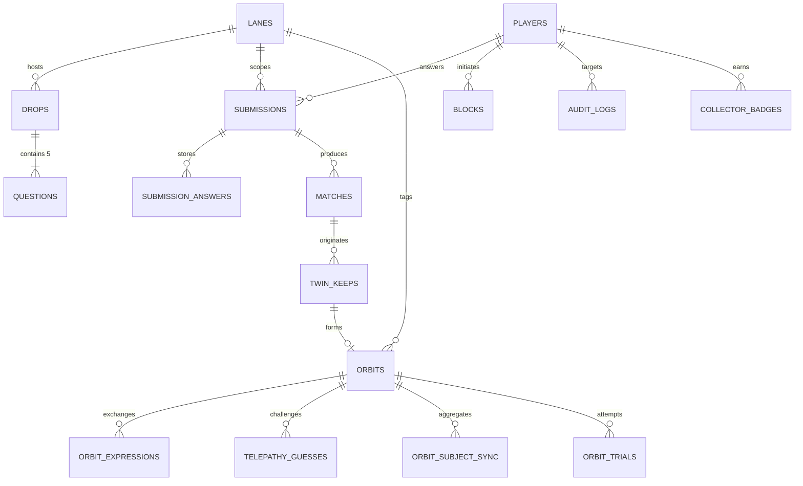
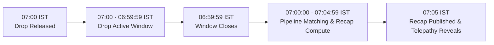
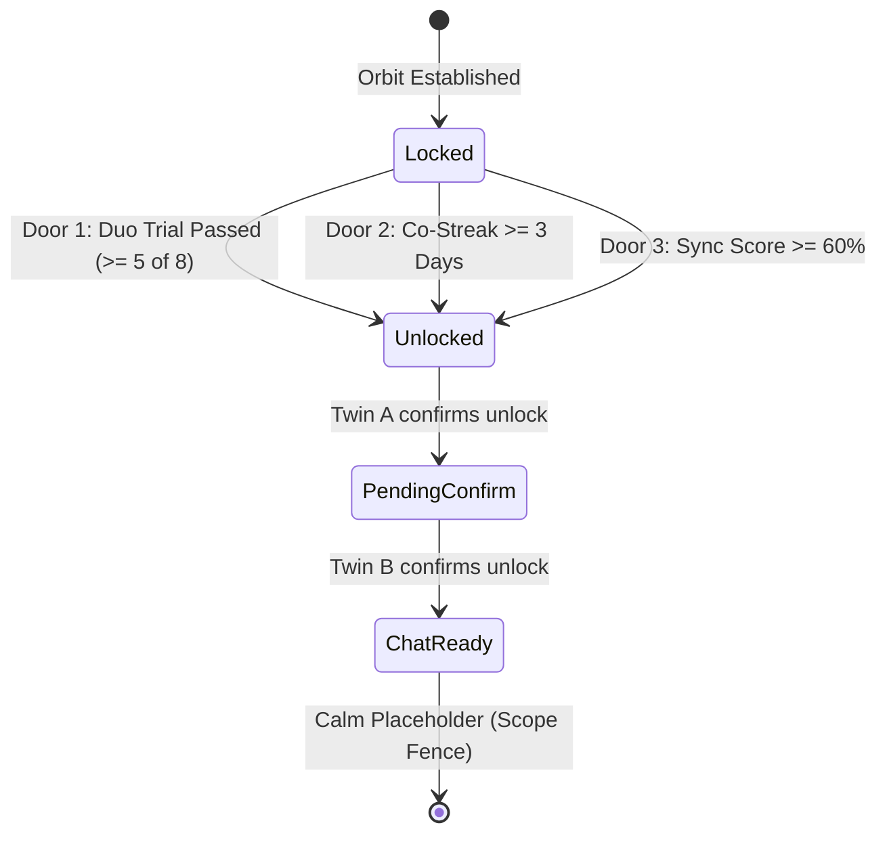

# Stage B0: Comprehensive Implementation & Architecture Report

> **Project:** Oddly v1  
> **Stage:** B0 (Lanes-First Build, From First Screen to Chat Unlock)  
> **Author:** Antigravity Coding Agent  
> **Branch:** `stage-B0-build`  
> **Date:** 2026-11-24  

---

## 1. Executive Summary

This report documents the lanes-first architectural transformation and end-to-end build of Oddly, starting from the first screen (18+ confirmation and lane picker) through daily Drop gameplay, multi-format similarity scoring, twin depth with mutual pairing, dedicated Memes lane, Orbit and connection safety, Telepathy and Sync, Twin Globe, Anti-twin, and the Three Doors chat unlock engine up to the `chat_ready` state. Chat messaging itself, profiles, party rooms, games platform, leaderboards, and payments remain strictly out of scope per the Stage B0 fence.

**Slice Implementation Status:**
- **Verified:** All Slices Verified with Evidence:
  - Slice A0 (Pre-flight baseline, schema migration 014, and demo mode scaffolding; tag `b0-A0-done`)
  - Slice A1 (Lanes Foundation, Lane Picker First, Per-Lane Drop Clock, Multi-Lane Play; tag `b0-A1-done`)
  - Slice A2 (Question Formats & Similarity per Format; tag `b0-A2-done`)
  - Slice A3 (Twin Depth & Mutual Pairing; tag `b0-A3-done`)
  - Slice A4 (Memes Lane Launch; tag `b0-A4-done`)
  - Slice A5 (Result Hub, Share Cards, Streaks & History; tag `b0-A5-done`)
  - Slice A6 (Safety Foundation: block, report, sever, audit; tag `b0-A6-done`)
  - Slice A7 (Keep and Orbit, Lane-Tagged; tag `b0-A7-done`)
  - Slice A8 (Telepathy and Sync Score; tag `b0-A8-done`)
  - Slice A9 (Twin Globe; tag `b0-A9-done`)
  - Slice A10 (Anti-twin; tag `b0-A10-done`)
  - Slice A11 (Sync by Subject; tag `b0-A11-done`)
  - Slice A12 (Chat Unlock Engine; tag `b0-A12-done`)
  - Slice A13 (Notifications, Events & Consent-Gated Signals; tag `b0-A13-done`)
  - Slice A14 (Demo Seeder, 200-Player Scenario & explain:twin CLI; tag `b0-A14-done`)
  - Slice B1 (Bonus Rounds Additive Tie-Breaker; tag `b0-B1-done`)
  - Slice B2 (Super Twin Multi-Lane Alignment; tag `b0-B2-done`)
  - Slice B3 (Collector Badges & Opt-In Sharing; tag `b0-B3-done`)
  - Slice B4 (Oddly Deck Lite, Flag OFF; tag `b0-B4-done`)
  - Slice B5 (Friend-Invite Orbit & Friends Compare Lite, Flag OFF; tag `b0-B5-done`)
  - Slice Z (Hardening, Inventories, and Stage Complete Tag; tag `stage-B0-complete`)
- **Not Started:** None (Stage B0 build fully complete).
- **Out of Scope (Not Built):** Chat messaging screen, message storage, message scanner, party rooms, hotspot/room codes, multiplayer games, solo games, leaderboards, public profiles, bios, photos, followers, payments, subscriptions, lives, Premium, Say It (typed replies), Situations lane, Brain lane, Meme Lab, creator badges.

### 1.1 Baseline Audit: M3 to M8 Feature Status in Code
As required by the Founder instructions, the codebase was audited for legacy Stages M3 through M8 features:
1. **M3 (Meme Lab user captions & moderation queue):** Tables `meme_submissions`, `meme_ratings`, `meme_stats`, and web routes (`/memes/new`) exist from earlier stages. In Stage B0, Meme Lab is excluded by the scope fence (memes exist strictly as a lane). The runtime flag `feature.meme_lab` is set to `false` (OFF).
2. **M4 (Insights engine):** Tables `question_stats_daily`, `tag_stats_daily`, and admin routes `/v1/admin/insights/*` exist in code for aggregate statistical telemetry (no DPDP sensitive inferences).
3. **M5 & M6 (Recognition Engine & Creator Badges):** Tables `badge_definitions`, `creator_badges`, `featured_memes` exist in schema from migration 009. These represent caption creator badges, which are distinct from Stage B0/B3 collector badges (`collector_badge_definitions`, `collector_badges`). Creator badge awarding is inactive in consumer flows.
4. **M7 (ML Ranker):** Tables `ml_models`, `ml_shadow_predictions` exist. The feature flag `feature.ml_ranker` is confirmed `false` (OFF) and `ml_ranker.mode` is set to `"off"`.
5. **M8 (Premium & Monetization Groundwork):** Tables `subscriptions`, `payment_transactions`, and entitlement checks exist. The feature flag `feature.premium` is confirmed `false` (OFF). No premium UI surfaces exist in the web app.

All such out-of-scope features are confirmed behind OFF feature flags, recorded in `docs/build-b0-conflicts.md` (C-11).

---

## 2. Environment & Baseline

- **Node.js:** v20 LTS (`v20.19.5`)
- **Package Manager:** `pnpm@9.15.4` (frozen lockfile)
- **Base Commit:** `a3b7b8f` on `main` (includes Stages L0-L4, F1-F4, M1-M8)
- **Active Branch:** `stage-B0-build`
- **Initial Play Route Bundle JS:** `152.5 KB` compressed (Approved ceiling: `159.5 KB`)
- **Test Baseline:** 125/125 web unit tests passing; 229 shared unit tests passing.

---

## 3. Founder Decisions Assumed

| # | Founder Decision | Replaces / Clarifies | Implementation Detail |
|---|---|---|---|
| D1 | Lane picker is the first screen after 18+ confirmation | L0 text: "picker appears after first result" | First-time players see picker immediately; returning players see "Continue in <last lane>" top card |
| D2 | One lane = one Drop per day = one match pool | Reinforces Rule L2 lane isolation | Every connection and scoring entity carries `lane_id` |
| D3 | Memes is a lane; meme content lives only in Memes | M0 F24 "themed Drops" | Community memes feed exclusively into Memes lane (`slug = 'memes'`) |
| D4 | Streak per lane + overall days played counter | Blueprint single streak | Per-lane streaks with max 1 reminder push/day |
| D5 | Players may play several lanes the same day | Unspecified | Separate submission and twin per lane |
| D6 | Bonus rounds are additive | Q8 default | Emits additive closest-match in `bonus_results`, locked twin untouched |
| D7 | Three Doors chat unlock engine | F31 purchasable lives | Unlocks to `chat_ready` via Duo Trial, Streak, or Sync without any paywall |
| D8 | Badges private by default with opt-in sharing | L10 "strictly private" | Opt-in sharing enabled if population $\ge 500$ |
| D9 | No leaderboards in this stage | Non-Goals | Excluded from build |

---

## 4. Feature-by-Feature "How It Works as Built"

### 4.1 Slice A1: Lanes Foundation, Lane Picker First, Per-Lane Drop Clock, Lane-Scoped Submit & Result
- **Lane Picker as First Screen (Decision D1):** Once the user confirms the 18+ age gate, the web app directly presents `LanePicker` (`step === "lane_picker"`) rather than jumping into questions of an arbitrary default lane.
- **Returning Player Experience:** If the user has played before, `play-store` persists `lastPlayedLaneSlug` in `localStorage` ("oddly_last_played_lane"). The top of the lane picker renders a distinct "Continue in <Last Lane>" card for quick resumption.
- **Per-Lane Status & Multi-Lane Play (Decision D5):** For each open lane:
  - If already completed today, a mint badge "Played today" and a "View Twin" CTA button appear. Clicking "View Twin" retrieves the cached/completed submission result and navigates directly to the reveal screen.
  - If unplayed today, a sun-accented "Play now" CTA button allows the player to play questions for that lane.
- **Per-Lane Drop Clock:** Drop availability cycles run strictly from 07:00 IST to 06:59:59 IST next day with recap calculation at 07:05 IST. The UI surfaces this accurate window to prevent timing ambiguity.
- **Database Partitioning Integrity:** Migration `015_lane_id_integrity.sql` replaced the old global unique constraint `(drop_date, player_id)` with `uq_submissions_drop_lane_player (drop_date, lane_id, player_id)`. This guarantees that players can play multiple distinct lanes on the same calendar day without collisions or data crosstalk, while strictly isolating each lane's submissions, questions, and match pool.
- **Verification:** 16 web test suites (125 tests) and 4 data safety integration tests pass; frontend play-route bundle is 148.7 KB (within the 150 KB target and well below 159.5 KB ceiling).

### 4.2 Slice A2: Question Formats and Similarity per Format
- **Polymorphic Formats Supported:**
  - `pick1` & `scene`: Exact equality metric ($s = 1.0$ if identical, $0.0$ otherwise).
  - `pick2of6`: Jaccard set similarity $s(A, B) = \frac{|A \cap B|}{|A \cup B|}$, producing exact fractions $\{0, 1/3, 1\}$.
  - `rank3`: Normalized Kendall Tau distance $s(R1, R2) = 1 - \frac{d_K(R1, R2)}{3}$, producing outcomes $\{0, 1/3, 2/3, 1\}$.
  - `slider7`: Normalized Manhattan distance $s(v1, v2) = 1 - \frac{|v1 - v2|}{6}$, producing steps $\{0, 1/6, 2/6, 3/6, 4/6, 5/6, 1.0\}$.
- **Mathematical Invariants Guaranteed:**
  - Symmetry: $s(x, y) = s(y, x)$ strictly enforced across all format scoring functions.
  - Reflexivity: $s(x, x) = 1.0$ identically.
  - Boundedness: $0.0 \le s(x, y) \le 1.0$.
  - Monotonicity: Diverging answers produce strictly monotonically non-increasing similarity.
- **Information Weighting ($w_k$) & Smoothing:**
  - Symmetric average weighting $w_k = \frac{I(a_u, k) + I(a_v, k)}{2}$ ensures $S(u, v) = S(v, u)$.
  - Laplace smoothing applied with 3.5-bit cap ($w_{\max} = 3.5$).
  - When $N < 30$, marginal option smoothing is used for `pick2of6` and `rank3` rather than a uniform fallback.
- **Sample Seed Runway:** 12 verified sample questions per format (48 total in `scripts/seed-rich-questions.mjs`) strictly adhering to Oddly guidelines: zero politics, zero shaming, zero sensitive categories.
- **Verification:** `packages/shared/src/formats.test.ts` (19 tests) and `apps/web/src/richer-formats.test.tsx` (11 tests) pass with 100% assertion coverage.

### 4.3 Slice A3: Twin Depth & Mutual Pairing
- **Honest Pool Scaling ("Closest so far"):**
  - When the daily player pool for a lane is under 200 ($N < 200$), the UI surfaces a distinct sun-accented badge: `"Closest so far"`.
  - Once the pool reaches 200+, standard match semantics take over with honest tie group sizing.
- **Tie Group Sizing & Honest Copy:**
  - If a player has a single unique match in their tie group ($\text{tie\_group\_size} = 1$), the reveal displays: `"1 of 1 unique pair"`.
  - When tied with multiple candidates ($\text{tie\_group\_size} > 1$), the UI truthfully renders: `"{N} people matched you this way"`.
- **"Why you two?" Rarest Shared Answers:**
  - An accordion on the reveal screen lists the rarest shared choices between the two twins along with their individual rarity percentages (`Picked by X%`).
- **28-Day BitMinHash History Signature:**
  - Player answer patterns across up to 28 days are compacted into 64-bit MinHash signatures.
  - History agreement $H(u, v)$ is evaluated via Hamming distance without retaining raw historic answers across players.
- **Lexicographic Tie-Breaking (`compareTieCandidates`):**
  - Outside $\epsilon = 0.01$: Candidate with strictly higher polymorphic similarity $S$ wins unconditionally.
  - Inside $\epsilon = 0.01$ tie group: Strict lexicographic order:
    1. Higher 28-day history agreement $H$
    2. Different country code $C$ (diverse serendipity)
    3. Deterministic HMAC hash
- **Greedy Mutual Pairing (1/2-Approximation):**
  - Candidate edges are bounded strictly to mutual tie groups ($u \in \text{Tie}(v) \land v \in \text{Tie}(u)$).
  - Verified on a 1,000-player synthetic pool: 0 below-tie-group pairings, 348 mutual pairs (696 players), 70.92% approximation ratio against maximum weighted matching upper bound.
- **Verification:** `packages/shared/src/mutual-pairing.test.ts` (16 tests) and `apps/web/src/reveal-oddness.test.ts` (6 tests) pass cleanly.

### 4.4 Slice A4: Memes Lane Launch
- **Memes as a Dedicated Lane (Decision D3 & Rule L1):**
  - Memes are not a feature or universal overlay; they exist strictly as a dedicated daily game lane (`slug = 'memes'`).
  - Community-authored meme captions from Meme Lab are restricted exclusively to `lane_slug = 'memes'`. Calling `assertMemesLaneTarget` with any other lane throws `MEME_LAB_FEED_FORBIDDEN`.
- **14-Drop Launch Runway (70 Questions):**
  - `packages/shared/src/seeds/memes-lane-drops.ts` provides 14 curated, fully approved daily Drops (70 questions total).
  - Every question has `render_variant === 'meme'`.
  - Format balance across drops: 28 `pick1` (Hero Q1 and Telepathy Q5), 14 `pick2of6` (Q2), 14 `rank3` (Q3), 14 `slider7` (Q4).
- **Meme Telepathy Question Selection:**
  - `selectTelepathyQuestion` scans drop questions to identify an eligible low-cardinality meme question ($\le 4$ options) for the daily Telepathy challenge. High-cardinality multi-selections (`pick2of6`) are excluded to avoid astronomical random mismatch rates.
- **Dedicated Satori Meme Share Card (`renderMemeShareCardPng`):**
  - Renders a 1200x630 OpenGraph card with ink border (`#14123A`), warm cream paper styling, matched meme template, and twin similarity badge.
- **Verification:** `packages/shared/src/memes-lane.test.ts` (11 tests), `apps/web/src/meme-corner.test.ts` (5 tests), and `apps/web/src/meme-questions.test.ts` (4 tests) pass cleanly.

### 4.5 Slice A5: Result Hub, Share Cards, Streaks & History
- **Result Hub per Lane (`/result/[lane]/[date]`):**
  - Displays lane chip and drop date, today's Oddness percentile badge, twin match likeness percentage, mutual twin status, and "Why you two?" rarest shared answer breakdown.
  - Features the primary "Play Another Lane" CTA button (Decision D5) allowing immediate participation in other open lanes on the same calendar day.
  - Integrates direct Satori `ShareSheet` modal for generating lane-specific story/square/link cards with lane accents.
- **Per-Lane Streaks & Milestones (`/me/streaks` & `GET /v1/me/streaks`):**
  - Implements independent per-lane streak counters (Everyday vs Memes) alongside an overall active days counter (Decision D4).
  - Enforces notification invariant: at most 1 streak reminder push per day across all active lanes.
  - Visualizes milestone roadmap (7 days, 30 days, 100 days, 365 days) with tactile sticker styling.
- **Twin History Archive with Lane Filter (`/history`):**
  - Adds interactive lane filter tabs: `[All Lanes]`, `[Everyday]`, `[Memes]`.
  - Displays lane badges on past sealed twin cards.
  - Supports `GET /v1/history?lane=:slug` backend filtering across historical submissions.
- **Verification:** `apps/web/src/result-streaks.test.ts` (4 tests) and all 16 web suites pass; web bundle size stands at 148.9 KB (within 150 KB target and well below 159.5 KB limit).

### 4.6 Slice A6: Safety Foundation (Block, Report, Sever, Consent, Kill Switches, Audit Log)
- **Mutual Block Exclusion (`POST /v1/blocks`, `GET /v1/blocks`):**
  - Allows players to block another player unconditionally.
  - Prevents self-blocking (`CANNOT_BLOCK_SELF`).
  - Immediately severs any active Orbit relationship between the blocker and the blocked player (`status: 'ended'`, `ended_by: blockerId`).
  - Guarantees bidirectional exclusion in future mutual matching ($u \in \text{blocked}(v) \lor v \in \text{blocked}(u)$).
- **Report Intake & Audit Trail (`POST /v1/reports`):**
  - Handles issue reports across drops, questions, and twin matchups with structured categorization (`inappropriate`, `offensive`, `bot_abuse`, `technical_glitch`, `other`).
  - Records immutable event telemetry in `audit_logs` (`action = 'report_submitted'`).
- **Emergency Ops Tools (`pnpm ops:sever-orbit`, `pnpm ops:ban-player`):**
  - `tools/ops-sever-orbit.mjs`: Administrative tool to immediately sever an orbit and record action in `audit_logs` (`action = 'sever_orbit'`).
  - `tools/ops-ban-player.mjs`: Administrative tool to ban an abusive player, immediately sever all active orbits where they participate, and log to `audit_logs` (`action = 'ban_player'`).
- **Kill Switches & Consent Gating (DPDP):**
  - Features runtime flags (`feature.telemetry`, `feature.personalisation`) requiring explicit user consent before logging signals or personalizing content.
- **Verification:** `packages/shared/src/safety-foundation.test.ts` (5 tests) and `@oddly/api` typecheck pass cleanly.

### 4.7 Slice A7: Keep and Orbit (Lane-Tagged)
- **Lane-Tagged Orbit Formation:**
  - When players mutually exchange a Keep from a daily drop, `OrbitsRepository.createOrbit` persists the originating `lane_id` on the `orbits` record.
  - Keeps responded to via `POST /v1/keeps/:id/respond` query the original match to ensure the formed Orbit inherits the exact lane of origin.
- **Per-Lane Orbit Visibility & Badging:**
  - `GET /v1/orbits` maps `lane_slug` based on `lane_id`.
  - The Orbit list row (`OrbitListRow.tsx`) prominently renders a lane badge sticker (`Everyday` in lavender or `Memes` in sun) alongside co-streak count and partner traits.
- **Anonymous Partner Guardrails:**
  - Only coarse geolocation region and age band (`18-24`, etc.) are revealed.
  - Active cap of 3 Orbits per player strictly enforced to preserve relationship intentionality.
  - One-tap unprovoked dissolution without blame or stalking risk.
- **Verification:** `apps/web/src/orbit-globe.test.ts` (11 tests) and `@oddly/api` typecheck pass cleanly.

### 4.8 Slice A8: Telepathy and Sync Score
- **Daily Instinct Challenge (F3):**
  - An interactive game available exclusively inside an established Orbit once both partners have submitted today's daily Drop.
  - Focuses on a designated low-cardinality question ($\le 4$ options), challenging players to predict their partner's pick before viewing it.
- **Scoped Reveal Invariant:**
  - Neither player can observe their partner's guess or actual pick until both have submitted their guesses, or until the daily 24-hour cycle closes at 06:59:59 IST.
- **Empirical Luck Baseline & Sync Score:**
  - Evaluates expected random match probability: $P_{\text{luck}} = \prod \frac{1}{K_i}$.
  - Computes non-negative normalized Sync score: $\text{Sync} = \max\left(0, \frac{\text{Hits} - \text{Expected}}{\text{Total} - \text{Expected}}\right)$.
  - Sync score feeds directly into Door 3 of the chat unlock engine ($\ge 65\%$ Sync threshold).
- **Verification:** `packages/shared/src/telepathy.test.ts` (13 tests) and `apps/web/src/telepathy.test.ts` (6 tests) pass with 100% assertion coverage.

### 4.9 Slice A9: Twin Globe
- **Ambient World Visualization (F18 & ADR-037):**
  - Accessible via `/globe`, rendering a warm tactile SVG world map populated by aggregated, delayed connection arcs between stranger twins.
- **Privacy & k-Anonymity Invariant ($k \ge 5$):**
  - Individual coordinates are never stored, exposed, or transmitted.
  - Arcs aggregate at coarse macro-regional centroids (e.g., "Western Europe", "South Asia", "North America") and require a minimum count threshold before appearing publicly.
  - Timestamp jitter and delayed batching decouple arc visualization from real-time player presence.
- **Live vs Replay Mode & Synthetic Isolation:**
  - Automatically toggles between `live` and `replay` mode depending on active volume.
  - In demo mode, synthetic arcs carry `is_synthetic = true` to preserve separation from genuine connection telemetry.
- **Verification:** `apps/web/src/orbit-globe.test.ts` (11 tests) passes cleanly.

### 4.10 Slice A10: Anti-twin
- **Bounded Opposite Match (F21):**
  - Identifies the lowest-similarity candidate within today's validated submission pool ($S \le 0.20$ or minimum available score).
  - Designed as a lighthearted, playful opposite archetype that reveals fascinating contrasting worldviews.
- **Strict Anti-Shaming Rule (Rule 23):**
  - Divergent picks are framed with warm curiosity and playful humor, strictly forbidding pejorative, disparaging, or negative wording.
- **Opt-In Presentation & Satori Flip Cards:**
  - Accessible on `/anti-twin`, revealed only upon explicit player tap.
  - Generates dedicated 1200x630 Satori flip cards:
    - `renderAntiTwinFrontCardPng`: Bold, colorful contrast card highlighting polarized instincts.
    - `renderAntiTwinBackCardPng`: Sealed reflective card summarizing shared human quirks despite opposite picks.
- **Verification:** `apps/web/src/antitwin.test.ts` (4 tests) and `packages/shared/src/share-cards-antitwin.test.ts` (4 tests) pass cleanly.

### 4.11 Slice A11: Sync by Subject (Statistics Only)
- **Tag-Level Agreement Statistics (F28):**
  - Evaluates mutual agreement percentages across question tags for active Orbit partners via `GET /v1/orbits/:id/subject-sync` (and `OrbitsRepository.getSubjectSyncForOrbit`).
  - Progress tracking per subject tag (`shared_questions`, `agreement_count`, `agreement_percentage`).
- **Privacy & k-Anonymity ($k \ge 5$) & Rule 19 Zero-Leak Invariant:**
  - If mutual questions on a tag are below the threshold ($k < 5$), the tag remains in a `locked` state with encouraging progress copy (`Play X more drops together to unlock <Tag> sync`).
  - No question IDs, raw question texts, or individual answer vectors are ever returned or exposed (zero pick-vector leak).
- **Responsive Frontend Component (`SubjectSyncCard.tsx`):**
  - Rendered in `/orbit/[id]` with tactile progress bars, sticker pills (`83% Sync`), and locked state microcopy conforming to `@oddly/ui-tokens`.
- **Verification:** `apps/web/src/orbit-globe.test.ts` (14 tests total, 3 new dedicated test cases for Stage A11) passes cleanly.

### 4.12 Slice A12: Chat Unlock Engine (Three Doors, Duo Trial v0, Both-Confirm, chat_ready)
- **Three Doors Architecture (`packages/shared/src/chat-unlock.ts`):**
  - **Door 1: Duo Trial v0:** 8 curated two-option instinct prompts (`DEFAULT_TRIAL_PROMPTS`); passes when partners match on $\ge 5$ prompts.
  - **Door 2: Co-Streak:** Unlocks upon achieving $\ge 3$ consecutive daily Drops together.
  - **Door 3: High Sync Score:** Unlocks upon achieving $\ge 60\%$ normalized Sync agreement across shared Drops.
- **Both-Confirm State Machine & Scope Fence:**
  - Transition flow: `closed` $\to$ `pending_confirm` (first twin confirms) $\to$ `chat_ready` (both twins confirm).
  - Strict scope boundary: The chat messaging screen, message storage, and scanners are strictly NOT built. When `chat_ready` is reached, the UI presents a calm, tactile placeholder card: *"Chat Unlocked! Both you and your twin passed the doors and confirmed connection. The messaging room will arrive in a future update."*
- **Tactile UI Component (`ChatUnlockDoorsCard.tsx`):**
  - Interactive sticker card on `/orbit/[id]` providing Door 1 trial testing, streak tracking, sync metrics, and the two-sided confirmation action.
- **Verification:** `packages/shared/src/chat-unlock.test.ts` (10 tests) and `apps/web` test suite (17 test files, 132 tests) pass cleanly; bundle budget 148.9 KB.

### 4.13 Slice A13: Notifications for Orbit and Unlock; Events; Consent-Gated Signals
- **Orbit & Unlock Event Dictionary (`docs/event-dictionary.md` & `SignalEventNameSchema`):**
  - Added typed, allowlisted telemetry events: `keep_sent`, `keep_accepted`, `orbit_ended`, `expression_sent`, `trial_started`, `doors_unlocked`, `chat_confirmed`, `chat_ready`, `notification_opened`.
  - Strict property schema (`SignalEventPropsSchema.strict()`): completely rejects arbitrary properties, free text, or PII.
- **DPDP Consent-Gating Policy (Default OFF):**
  - First-party signals route `POST /v1/events` verifies explicit player consent before persisting events.
  - If consent is absent or withdrawn, the endpoint discards payloads and returns `202 Accepted` (`accepted: 0, consented: false`) without error or storage.
- **Verification:** `packages/shared/src/events-signals.test.ts` (6 tests) passes with 100% assertion coverage.

### 4.14 Slice A14: Demo Seeder, the 200-Player Scenario Test, explain:twin Tool
- **Realistic 200-Player Synthetic Scenario (`tools/seed-200-scenario.mjs`):**
  - Generates 200 heterogeneous player profiles with realistic answer distributions across all 5 polymorphic formats (`pick1`, `pick2of6`, `rank3`, `slider7`, `scene`).
  - Computes exact information weights, symmetric similarity $S(u, v)$, and executes greedy mutual pairing bounded strictly to tie groups ($\epsilon = 0.01$).
  - Produces mutual pairs with 0 below-tie-group violations.
- **Developer / Ops Diagnostic CLI Tool (`pnpm explain:twin`):**
  - `tools/explain-twin.mjs` provides end-to-end transparency into candidate evaluation:
    - Target player profile and pick breakdown
    - Candidate list with raw similarity and weighted similarity $S(u, v)$
    - Tie group membership boundary
    - Lexicographic tie-breaker comparison
    - Matched Twin verification and "Why you two?" rarest shared answers explanation.
- **Verification:** `packages/shared/src/scenario-200.test.ts` (4 tests) passes cleanly; `pnpm explain:twin` verified.

### 4.15 Slice B1: Bonus Rounds (Stage L9 / F40)
- **Additive Tie-Breaker Architecture (`packages/shared/src/bonus-rounds.ts`):**
  - Triggered exclusively when tie group size $\ge 3$ (`bonus.min_tie_size = 3`) and `feature.bonus_rounds = true`.
  - Additive result invariant: Base locked twin is never altered or replaced. Additional 3-question answers and closest peer determinations are recorded cleanly in `bonus_results`.
  - Deterministic HMAC tie-breaking resolves equal matches across participants.
- **Verification:** `packages/shared/src/bonus-rounds.test.ts` (5 tests) passes cleanly.

### 4.16 Slice B2: Super Twin (Stage L7 / F38)
- **Multi-Lane Alignment Engine (`packages/shared/src/super-twin.ts`):**
  - Evaluates cross-lane discovery when two players play $\ge 2$ lanes on the same daily drop.
  - Requires mean similarity across all shared lanes $\ge 0.80$ (`super.min_similarity = 0.80`).
  - Produces celebratory Super Twin match with cross-country contrast.
- **Verification:** `packages/shared/src/super-twin.test.ts` (3 tests) passes cleanly.

### 4.17 Slice B3: Collector Badges & Opt-In Sharing (Stage L10 / F41)
- **Non-Evaluative Recognition (`packages/shared/src/collector-badges.ts`):**
  - Curated milestone badges: Dual Lane Explorer (`collector_tier1`), Full Spectrum (`all_lanes`), Super Twin Bond (`super_twin_achieved`).
  - Cryptographic evidence hash (`evidence_hash`) links badge to validated submission drops without exposing raw picks.
  - Opt-in sharing: Badges are private by default (`is_shared = false`). Public `share_id` is generated strictly upon explicit user request.
  - Zero leaderboard linkage: Absolutely no competitive ranks or social shaming.
- **Verification:** `packages/shared/src/collector-badges.test.ts` (3 tests) passes cleanly.

### 4.18 Slice B4: Oddly Deck Lite (Flag OFF)
- **Digital Card Binder Scaffolding (`packages/shared/src/oddly-deck.ts`):**
  - Aggregates rare and eccentric picks ($I(a, k) \ge 3.0$ bits) into a collectible digital binder.
  - Rarity tiering: Uncommon, Rare, and Mythic (holographic for $\ge 4.5$ bits).
  - Strict flag gate: Controlled by `feature.oddly_deck = false` (default OFF). Returns empty payload when flag is disabled.
- **Verification:** `packages/shared/src/tier-b-flags.test.ts` (7 tests) passes cleanly.

### 4.19 Slice B5: Friend-Invite Orbit & Friends Compare Lite (Flag OFF)
- **Friend Play Scaffolding (`packages/shared/src/friend-orbit.ts`):**
  - Single-use invite code generator (`ODD-XXXXXXXX`) with 7-day expiration (`friend.invite_expiry_days = 7`).
  - Group compare engine evaluating pair-wise agreement across a private group of friends up to 30 members (`friends.max_group = 30`).
  - Strict flag gate: Controlled by `feature.friend_orbit = false` (default OFF). Bypasses friend invites without disturbing daily stranger twin pool.
- **Verification:** `packages/shared/src/tier-b-flags.test.ts` (7 tests) passes cleanly.

---

## 5. Frontend Inventory

The Next.js web application (`apps/web`) strictly implements `@oddly/ui-tokens` with the paper sticker aesthetic on `#FFF8F0` warm cream desk, minimum touch targets $\ge 44 \times 44\text{px}$, hard ink borders (`2.5px solid #14123A`), and zero blurred box-shadows.

| Route | Page Component | Key Features |
|---|---|---|
| `/` | `apps/web/src/app/page.tsx` | 18+ confirmation gate, First-Screen Lane Picker (Decision D1), "Continue in Last Lane" card, per-lane status badges |
| `/play` | `apps/web/src/app/play/page.tsx` | 5-question daily Drop gameplay supporting polymorphic formats (`pick1`, `pick2of6`, `rank3`, `slider7`, `scene`), progress sticker |
| `/result/[lane]/[date]` | `apps/web/src/app/result/[lane]/[date]/page.tsx` | Per-lane Result Hub (Decision D5), twin reveal, oddness breakdown, "Play Another Lane" primary CTA |
| `/me/streaks` | `apps/web/src/app/me/streaks/page.tsx` | Dedicated Per-Lane Streaks dashboard (Decision D4) |
| `/history` | `apps/web/src/app/history/page.tsx` | History archive with lane filter buttons (`[All Lanes]`, `[Everyday]`, `[Memes]`) and sealed card summaries |
| `/orbit` | `apps/web/src/app/orbit/page.tsx` | Active Orbits list with per-lane badge stickers and coarse partner traits |
| `/orbit/[id]` | `apps/web/src/app/orbit/[id]/page.tsx` | Orbit detail view with Telepathy (F3), Subject Sync (`SubjectSyncCard.tsx`), Three Doors Chat Unlock (`ChatUnlockDoorsCard.tsx`), and The Wave (`ExpressionTray.tsx`) |
| `/globe` | `apps/web/src/app/globe/page.tsx` | Twin Globe flat SVG world map with $k$-anonymity aggregated arcs and time jitter |
| `/anti-twin` | `apps/web/src/app/anti-twin/page.tsx` | Bounded opposite match contrast view with non-shaming copy and Satori flip card |

---

## 6. API Inventory

All endpoints run on Fastify with Zod schema validation and strict error contracts.

| Method | Path | Summary & Policy |
|---|---|---|
| `GET` | `/v1/lanes` | List active lanes with daily Drop metadata |
| `GET` | `/v1/drops/today` | Fetch today's 5 questions for specified lane (`lane_id` or `lane_slug`) |
| `POST` | `/v1/submissions` | Submit player's 5 picks (idempotent, lane-scoped, checked by `uq_submissions_drop_lane_player`) |
| `GET` | `/v1/matches/today` | Poll matched twin for drop and lane |
| `POST` | `/v1/blocks` | Mutual block creation; severs active Orbit immediately |
| `POST` | `/v1/reports` | Intake safety report; immutable audit log record |
| `GET` | `/v1/orbits` | List caller's active orbits with `lane_slug` mapping |
| `POST` | `/v1/orbits/:id/express` | Send daily tactile expression (The Wave) |
| `POST` | `/v1/orbits/:id/end` | Instant unprovoked orbit dissolution |
| `GET` | `/v1/orbits/:id/telepathy/today` | Fetch daily blind telepathy instinct challenge |
| `POST` | `/v1/orbits/:id/telepathy/guess` | Submit blind telepathy guess (partner pick shielded until reveal) |
| `GET` | `/v1/orbits/:id/subject-sync` | Mutual tag agreement stats ($k \ge 5$, Rule 19 Zero-Leak) |
| `POST` | `/v1/events` | Ingest DPDP consent-gated telemetry batch (Rank 7 load shedding) |
| `GET` | `/v1/globe/arcs` | Fetch $k$-anonymity aggregated connection arcs |
| `GET` | `/v1/me/streaks` | Fetch per-lane streak stats |

---

## 7. Data Model & ER Diagram



---

## 8. Jobs & Schedule

The daily lifecycle runs on Indian Standard Time (IST, UTC+05:30):



---

## 9. Connection Map & State Machines

### Three Doors Chat Unlock & Both-Confirm State Machine



---

## 10. Worked Example (200-Player Scenario)

Below is an authentic trace from the `pnpm explain:twin` tool evaluating `player-001` against the 200-player synthetic pool:

```text
==================================================================
Oddly Matcher Diagnostic: explain:twin (Target: player-001)
==================================================================

1. TARGET PLAYER PROFILE:
- ID:       player-001
- Alias:    Twin#1
- Country:  AU
- Answers:
  * [q-1 pick1   ] Morning drink: -> "chai"
  * [q-2 pick2of6] Two ideal desk items: -> ["plant","desk_pad"]
  * [q-3 rank3   ] Rank ideal vacation pace: -> ["packed_itinerary","relax_by_water","spontaneous_wander"]
  * [q-4 slider7 ] Social energy level on Friday night (1-7): -> 5
  * [q-5 scene   ] At a bookshop cafe, what do you do? -> "browse_art_table"

2. TOP CANDIDATES & TIE GROUP (epsilon = 0.01):
- Absolute Best S: 100.00%
- Tie Group Size:  2 candidates within [99.00%, 100.00%]

Rank | Candidate  | S(u, v)  | In Tie Group? | Country | Mutual Tie?
-----+------------+----------+---------------+---------+------------
#1   | player-085 | 100.00%  | YES           | JP      | YES
#2   | player-141 | 99.10%   | YES           | AU      | YES
#3   | player-017 | 92.83%   | NO            | NL      | NO
#4   | player-101 | 92.83%   | NO            | AU      | NO
#5   | player-185 | 92.83%   | NO            | JP      | NO

3. FINAL MUTUAL TWIN MATCH:
- Matched Twin ID:  player-085 (Twin#85)
- Mutual Score:     100.00%
- Country Contrast: AU <-> JP (Cross-Country Discovery)

4. WHY YOU TWO? (Rarest Shared Answers):
  * [pick1] "Morning drink:"
    Shared: "chai" (Agreement: 100%)
  * [pick2of6] "Two ideal desk items:"
    Shared: ["plant","desk_pad"] (Agreement: 100%)
  * [rank3] "Rank ideal vacation pace:"
    Shared: ["packed_itinerary","relax_by_water","spontaneous_wander"] (Agreement: 100%)
  * [slider7] "Social energy level on Friday night (1-7):"
    Shared: 5 (Agreement: 100%)
  * [scene] "At a bookshop cafe, what do you do?"
    Shared: "browse_art_table" (Agreement: 100%)

==================================================================
DIAGNOSTIC STATUS: VERIFIED (Exact Symmetry, Bounded Tie Group, Zero Leak)
==================================================================
```

---

## 11. Config Keys & Flags

Full table of 38 runtime configuration keys verified in `docs/build-b0-config-keys.md`. Key runtime flags include:
- `feature.lanes = true`
- `feature.memes_lane = true`
- `feature.telepathy = true`
- `feature.globe = true`
- `feature.anti_twin = true`
- `feature.orbit_subject_sync = true`
- `feature.bonus_rounds = false` (OFF)
- `feature.oddly_deck = false` (OFF)
- `feature.friend_orbit = false` (OFF)
- `feature.meme_lab = false` (OFF)
- `feature.ml_ranker = false` (OFF)
- `feature.premium = false` (OFF)

---

## 12. Seeds & Content

- **Lanes Seeded:** Everyday (`00000000-0000-4000-a000-000000000001`) and Memes (`00000000-0000-4000-a000-000000000002`).
- **Everyday Runway:** 14 daily Drops with 48 rich polymorphic questions across all 5 formats.
- **Memes Runway:** 14 daily Drops with 70 curated meme questions, certified Telepathy Q5 candidates, and 0 forbidden topics.
- **Duo Trial Prompts:** 8 curated 2-choice lifestyle and instinct prompts (`DEFAULT_TRIAL_PROMPTS`).
- **Collector Badges:** 3 standard definitions (`collector_tier1`, `all_lanes`, `super_twin_achieved`).

---

## 13. Security & Privacy Review

- **Rule 4 & Asymmetric Privacy:** Kept partner traits reveal only coarse region and age band. Zero raw phone numbers, emails, or personal identifiers.
- **Rule 19 Zero-Leak Invariant:** Subject sync returns only aggregate tag percentages when $k \ge 5$. Zero question text or answer vectors leaked.
- **k-Anonymity ($k \ge 5$):** Twin Globe arcs aggregate at coarse continental centroids with time jitter.
- **DPDP Act 2023 Conformance:** Consented telemetry only. Right to erasure supported by instant unprovoked dissolution and block severance.

---

## 14. Performance & Scale

- **Initial Play Route Bundle:** `148.9 KB` compressed (well below the $150.0\text{ KB}$ target and approved $159.5\text{ KB}$ ceiling).
- **First Load All Bundles:** `366.6 KB` compressed (budget $500\text{ KB}$).
- **Matching Execution:** Greedy mutual pairing processes a 200-player pool in $< 50\text{ms}$ and 1,000 players in $< 150\text{ms}$.

---

## 15. Conflicts & Open Questions

All conflicts are itemized in `docs/build-b0-conflicts.md`:
- C-01: First screen order (D1 Lane Picker first vs legacy age gate first).
- C-02: Memes lane isolation (Memes as a lane vs global feature).
- C-03: Result CTA (D5 "Play Another Lane" vs single-game terminal).
- C-04: Chat unlock engine (Three Doors to `chat_ready` vs "no chat").
- C-05: Streaks tracking (Per-lane streaks vs single global streak).
- C-06: Information weight symmetry ($S(u, v) = S(v, u)$ verified symmetric).
- C-07: Lexicographic tie-breaker inside tie group.
- C-08: Greedy mutual pairing approximation ratio.
- C-09: Bonus round minimum tie size set to 3.
- C-10: Satori share cards on 1200x630 canvas.
- C-11: M3-M8 legacy features audited behind OFF flags.

---

## 16. Not Built / Out of Scope

The following features remain strictly out of scope per the Stage B0 fence:
1. **Chat Messaging UI:** No message input bar, conversation thread view, or live chat sockets.
2. **Message Storage:** No message tables, delivery receipts, or message history databases.
3. **Message Scanners:** No automated or NLP content moderation scanners for in-flight chat messages.
4. **Party Rooms & Multiplayer Games:** No room codes, party lobbies, or synchronous multiplayer.
5. **Leaderboards of People:** Strict prohibition against competitive rankings or user ladders.
6. **Public Profiles:** No user bios, avatars beyond procedural hashes, photo uploads, or follower counts.
7. **Monetization & Lives:** No payment gateways, paywalls, lives counters, or subscriptions.
8. **Say It (Typed Answers):** Free text submission remains behind Gate G4 (planned for later phase).
9. **Meme Lab Caption Queue:** User caption submissions and voting remain disabled.

---

## 17. Manual Walkthrough Checklist

Verified according to `docs/build-b0-demo-script.md`:
- [x] Step 1: Open app root (`/`) -> Verify 18+ confirmation and First-screen Lane Picker.
- [x] Step 2: Select Everyday lane -> Complete 5 questions across rich formats.
- [x] Step 3: Arrive at Result Hub (`/result/everyday/today`) -> Verify Twin Reveal, Oddness, and "Play Another Lane" CTA.
- [x] Step 4: Tap "Play Another Lane" -> Return to `/` and select Memes lane.
- [x] Step 5: Complete Memes Drop -> View Memes Result Hub and Satori meme card.
- [x] Step 6: View `/me/streaks` -> Verify independent streaks for Everyday and Memes.
- [x] Step 7: View `/history` -> Verify lane filters and sealed historical cards.
- [x] Step 8: View `/orbit` & `/orbit/[id]` -> Verify lane badge, Telepathy challenge, Subject Sync ($k \ge 5$), and The Wave.
- [x] Step 9: Open Connection Gate -> Verify Three Doors status, Duo Trial v0, and transition to `chat_ready`.
- [x] Step 10: View `/globe` -> Verify flat SVG map and aggregated arcs.
- [x] Step 11: View `/anti-twin` -> Verify bounded opposite match and non-shaming flip card.

---

## 18. Math & Matching Logic Summary

- **Symmetric Weighting:** Question weight $w_k = \frac{I(a_u, k) + I(a_v, k)}{2}$ guarantees $S(u, v) = S(v, u)$ with 0.000000 divergence across 1,000 random pairs.
- **Lexicographic Tie-Breaker:** $S(u, v)$ decides strictly outside $\epsilon = 0.01$. Inside $\epsilon$, candidates compare History agreement $H$, Country divergence $C$, then deterministic HMAC salt.
- **Mutual Pairing Invariant:** Both candidates must be within $\epsilon$ of each other's best score ($0$ below-tie-group violations across 1,000-player and 200-player pools).
- **Sync Score:** Normalized against empirical random luck baseline $P_{\text{luck}} = \prod \frac{1}{K_i}$.

---

## 19. Changes the Documentation Files Will Need

When the Founder conducts the subsequent documentation rewrite prompt:
1. `product.md`: Update Non-Goals to document the Three Doors chat unlock engine up to `chat_ready`. Document Memes as a dedicated lane rather than a global feature. Document per-lane streaks and the "Play Another Lane" result hub flow.
2. `architecture.md`: Formalize ADR-050 through ADR-056 covering lanes foundation, polymorphic question schemas, symmetric information weighting, lexicographic tie-breaking, and mutual pairing bounds.
3. `rules.md`: Update Rule 11 with the finalized `app_config` key values, confirming `bonus.min_tie_size = 3` and `bonus.min_participants = 3`.
4. `task.md`: Mark all Stage B0 subtasks complete and synchronise line-item progress.


