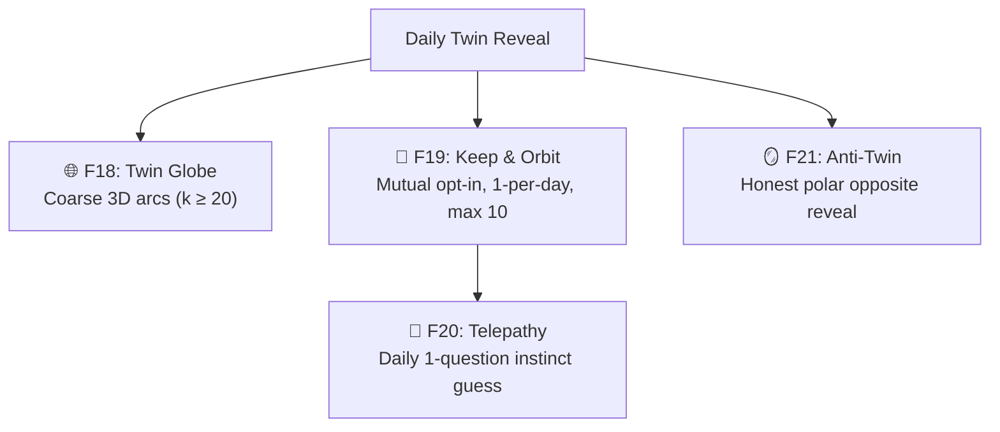

# Connection Features Analysis & Architecture (F18 to F23)

<!-- visual:start connection-topology-flowchart -->

<!-- visual:end connection-topology-flowchart -->

> **Document Version:** v1.0 | **Date:** 2026-11-14  
> **Status:** Stage F0 Analysis & Documentation (No Code)  
> **Scope:** Analysis for F18 (Twin Globe), F19 (Keep & Orbit), F20 (Telepathy), F21 (Anti-twin), F22 (Oddly Deck [v1.5]), and F23 (Friend-Invite Orbit [v1.5]).

---

## 1. Conflict Analysis & Resolution

| Conflict Area | Original Rule / Baseline Constraint | Connection Feature Requirement | Resolution & Governance Applied |
|---|---|---|---|
| **Exposing Pick Labels** | `rules.md` Rule 4 strictly prohibits exposing raw pick vectors or individual answers of another player to anyone. | F20 (Telepathy) requires the guesser to see whether their guess matched their Orbit partner's actual choice on that question. | **Rule 4 Amendment:** Scoped exception approved by Founder. The partner's pick label is revealed *only* for the single designated Telepathy question, *only* inside an active mutual Orbit, and *only after* the viewer's own guess is permanently locked. No other pick or vector is ever exposed. |
| **Out-of-Scope Scope Creep** | `rules.md` Rule 6 & `product.md` Non-Goals strictly forbid chat, profiles, leaderboards, and friends groups. | Adding Orbit and persistent connection could drift toward messaging, social media profiles, or contact exchange. | **Strict Architectural Guardrails:** 1. *No Chat / Free Text:* Only fixed 6-sticker tray (The Wave). Zero free-form text input. 2. *No Profiles:* Users remain anonymous aliases ("Twin #382") with coarse region and age band. 3. *No Contact Exchange:* Handle swaps, DMs, phone numbers, and external links are permanently listed in Non-Goals as Not Planned. 4. *No Leaderboards:* Telepathy Sync score is private to the pair; zero rankings between pairs. |
| **Guilt & Nagging Copy** | `rules.md` Section 3 prohibits dark patterns, artificial urgency, and emotional manipulation. | Features with streaks or mutual participation often use nagging notifications ("Your twin is waiting for you!"). | **Prohibition Added to Section 3:** Explicit rule forbidding guilt or nagging copy. If a co-streak breaks, it resets quietly without drama. Pushes are capped at 2/day and honor quiet hours. |
| **Bundle Budget Degradation** | `/play` route has an approved initial JS bundle budget exception of 159.5 KB (R2-PATCH-3). | Adding interactive maps, 3D globes, or large gesture trays would bloat the bundle. | **Route Isolation:** All new features are split into lazy-loaded routes (`/globe`, `/orbit/:id`). Twin Globe strictly uses a static SVG map with zero WebGL/Three.js or map library dependencies. Play route bundle impact is **0 KB**. |
| **Hot Path Latency Saturation** | `architecture.md` mandates that heavy matching, calculations, and rendering remain off the HTTP submit path. | Anti-twin and live globe arcs require heavy comparative computation across thousands of players. | **Asynchronous Worker Offloading:** Anti-twin is computed asynchronously via background worker job (`ComputeAntiTwinJob`) only on first view, not on submit. Globe arcs are pre-computed in 5-minute background batch jobs. Core submit path remains strictly unchanged. |

---

## 2. Infrastructure & Component Reuse

The connection features maximize leverage of existing v1 architecture:

1. **`users` Table & Authentication:**  
   Reuses existing `users` table and Google OAuth JWT verification from Phase 7 (`auth.ts`). Guest players are seamlessly upgraded using existing soft sign-in modals without losing state.
2. **`matches` & `submissions` Repositories:**  
   The final batch matching output (`matches.repo.ts`) provides the verified symmetrical Dice similarity score and final twin pairings needed to offer "Keep this twin".
3. **`privacy.ts` Coarse Region Aggregation:**  
   Existing k-anonymity helpers (`formatTwinLocation`, `coarseRegionMap`, `kAnonymityCheck`) are directly reused for Globe arcs, Orbit cards, and Anti-twin displays.
4. **`FlipCard.tsx` & Satori Renderer (`share-cards.ts`):**  
   The 3D flip card anatomy, sealed back, holographic sheen, and Satori PNG generation pipeline (`renderFrontCardPng`, `renderBackCardPng`, `renderCompositeStoryPng`) are directly reused to produce Orbit anniversary and Anti-twin share cards.
5. **Push Notifications Pipeline:**  
   Reuses BullMQ `notification-dispatch` worker, VAPID delivery, and daily quiet-hours capping logic (`send-push.ts`), introducing only a new `"Orbit"` category.
6. **Matching Algorithm Strategies:**  
   Anti-twin candidate scanning reuses the existing `MatchingStrategy` bounded comparator architecture, simply inverting the objective to locate the minimum similarity candidate within a bounded 2,000-candidate pool.

---

## 3. Scale & Capacity Model (10k, 100k, 10 Lakh DAU)

### Key Assumptions:
- **Keep Adoption:** 8% of finishers tap "Keep" on their final twin.
- **Acceptance Rate:** 35% of Keep requests are accepted $\rightarrow$ ~2.8% of daily players form an active Orbit.
- **Orbit Cap:** Maximum 3 active Orbits per player. Average active Orbits per connected player: 1.6.
- **Telepathy Participation:** 60% of active Orbit pairs play daily Telepathy.
- **Anti-Twin Engagement:** 25% of finishers open the Anti-twin view.

### Scale Projections:

| Metric | 10,000 DAU | 100,000 DAU | 1,000,000 DAU (10 Lakh) |
|---|---|---|---|
| **Daily Keep Requests (`twin_keeps`)** | 800 rows/day | 8,000 rows/day | 80,000 rows/day |
| **New Orbits Formed/Day (`orbits`)** | 280 pairs (560 players) | 2,800 pairs | 28,000 pairs |
| **Cumulative Active Orbits** | ~1,200 active Orbits | ~12,000 active Orbits | ~120,000 active Orbits |
| **Daily Expressions (`orbit_expressions`)** | ~960 rows/day | ~9,600 rows/day | ~96,000 rows/day |
| **Daily Telepathy Guesses (`telepathy_guesses`)** | ~1,440 rows/day | ~14,400 rows/day | ~144,000 rows/day |
| **Anti-Twin Computations (`anti_twin_results`)** | 2,500 jobs/day | 25,000 jobs/day | 250,000 jobs/day |
| **Anti-Twin Worker Load (p95 execution)** | ~1.2 ms/job $\rightarrow$ 3 sec total CPU/day | ~1.2 ms/job $\rightarrow$ 30 sec total CPU/day | ~1.2 ms/job $\rightarrow$ 300 sec total CPU/day |
| **Redis Memory (Counters & Cache)** | 1.8 MB | 14.2 MB | 118.5 MB |
| **Database Storage Added / Day** | ~0.6 MB / day | ~5.8 MB / day | ~58 MB / day |

*Conclusion:* Even at 10 lakh DAU, connection features produce only ~58 MB/day of relational data. With range partitioning and 90-day retention on `telepathy_guesses` and 7-day retention on `anti_twin_results`, database capacity remains exceptionally lean and well within budget.

---

## 4. Client Bundle Budget & Code Splitting Plan

The play route (`/play` or `/`) bundle must strictly preserve its approved 159.5 KB v1 ceiling.

### Code Splitting Strategy:
1. **Zero Play Route Infiltration:** No Globe map SVG, Orbit management logic, or Telepathy guessing components are imported on the landing or question pages.
2. **Independent Next.js App Routes:**
   - **`/globe` (Twin Globe):** Dedicated chunk. SVG map, arc geometry calculations, and WebSocket/polling subscriber. Expected chunk size: **~8.4 KB gzip**.
   - **`/orbit/[id]` (Orbit Detail & Telepathy):** Dedicated chunk. 5-stage progress dots, expression tray, and Telepathy option selector. Expected chunk size: **~11.2 KB gzip**.
   - **`/anti-twin` (Opposite Result):** Lazy-loaded dynamic component within results or dedicated route. Expected chunk size: **~4.1 KB gzip**.
3. **No Heavy Libraries:**
   - 3D WebGL globes (Three.js ~160 KB, Cesium ~800 KB) are **strictly rejected**.
   - Static SVG map is bundled natively using clean inline SVG paths (< 12 KB uncompressed).

---

## 5. Privacy, Safety & DPDP Compliance

Orbit and Telepathy introduce interpersonal relationship data. Compliance with India's **Digital Personal Data Protection (DPDP) Act 2023** requires:

1. **Clear Notice & Consent:**
   - When tapping "Keep this twin", the user receives explicit notice: *"By connecting, you agree to form an anonymous Orbit. You will share coarse region, age band, and future daily Drop sync scores. You can disconnect at any time with one tap."*
2. **Right to Erasure (Account Deletion):**
   - When a player requests account deletion under DPDP Section 12, their user ID, active Orbits, pending Keeps, expression rows, and Telepathy guesses are hard-deleted within 7 days.
   - The surviving partner in any affected Orbit sees a neutral notice: *"This orbit has ended."* Partner data is not deleted, but relationship linkages to the deleted player are permanently severed.
3. **Right to Data Portability (Export):**
   - JSON data export includes only the requesting user's own data: their sent Keeps, their sent expressions, their own Telepathy guesses, and anonymized summary stats. The partner's guesses or identifiers are never exported.
4. **Legal Review Items (For External Legal Counsel):**
   - Verify whether mutual non-verbal expression logs (The Wave) constitute "personal data" or anonymized interaction telemetry under DPDP.
   - Review the 48-hour silent expiration policy for incoming Keep requests under consumer privacy guidelines.

---

## 6. Abuse Cases & Threat Controls

| Attack Vector | Threat Description | Architectural Mitigation & Control |
|---|---|---|
| **Stalking via Repeated Keep** | A user repeatedly targets the same twin with connection requests. | **1 Keep Per Drop Cap:** A player can only send a Keep to their single final twin for that day. Once declined or expired, re-requesting the same user is blocked for 30 days (`orbit.cooldown_days`). |
| **Targeting Popular Twins** | High-similarity players get inundated with requests. | **Incoming Request Throttling:** Incoming requests are capped at 3 per day (`orbit.max_incoming_per_day`). Extra requests expire silently. |
| **Pick Snooping via Collusion** | Two colluding bad actors attempt to use Telepathy to discover the other's hidden answer vector. | **Lock-In Invariant:** The partner's choice is exposed *only* for the single designated question, and *strictly after* the guesser has locked their own answer. Only one pick is revealed; the remaining 4 picks remain completely confidential. |
| **Bot Farm Orbits** | Automated scripts create thousands of dummy accounts to form synthetic Orbits. | **Google OAuth Sign-In Gate:** Creating or accepting an Orbit strictly requires verified Google sign-in. Guest accounts cannot form Orbits. Device fingerprinting and Cloudflare Turnstile block automated scripted creation. |
| **Unwanted Persistence** | A user feels trapped or harassed in an active Orbit. | **Instant One-Tap Dissolution:** Either user can sever the Orbit instantly. No confirmation from the partner is required, no exit surveys, and no attribution of who ended it is ever displayed. Admin can also sever any Orbit (`/admin/v1/orbit/:id/sever`). |

---

## 7. Data Honesty & Transparency Rules

In alignment with Oddly's core brand promise (*"Real numbers only"*):

1. **Zero Fake Arcs on Twin Globe:**
   - Every arc rendered represents a genuine completed match between real players.
   - If live submission volume is under 50 per window, the system openly switches to Replay mode and displays: *"Quiet right now. Showing replay of yesterday's twins."*
2. **Honest Luck Baselines in Telepathy:**
   - The expected chance of random agreement ($\sum [p(a)]^2$) is calculated from observed Drop probabilities and displayed honestly (e.g. *"Strangers agree 32% of the time. You two agreed today!"*).
   - Never marketed as "mind reading", "telepathy", or "psychic ability" in any literal or misleading way.
3. **Zero Fabricated Opposites in Anti-Twin:**
   - If today's player pool is under 200 submissions, Anti-twin is gracefully hidden with honest copy: *"Not enough players yet today to find a genuine opposite. Check back this evening."*

---

## 8. Stage L0 Amendments: Lane-Aware Connection Features (2026-11-21)

### 8.1 Rule L2 Lane Isolation Invariant
Under Rule L2 (Founder-approved, L0), every connection artifact—Twin Globe arc, Keep request, Orbit relationship, Telepathy round, and Anti-twin comparison—belongs to **exactly one lane**, and that lane is explicitly displayed. The only cross-lane construct in Oddly is the **Super Twin** (F38).

### 8.2 Per-Feature Lane Adaptations

1. **F18 Twin Globe:**
   - Visualizes live and replayed connection arcs with a top **Lane Filter Bar** (Everyday default, Memes, etc.).
   - Arcs and counts are strictly lane-isolated.
   - If a lane has fewer than 50 submissions in the trailing 5-minute window, arcs for that lane are suppressed or switch to that lane's yesterday replay buffer in compliance with $k \ge 20$ anonymity.

2. **F19 Keep & Orbit:**
   - A player can send 1 Keep request per completed lane Drop (e.g. if playing Everyday and Memes, up to 1 Keep each).
   - The resulting Orbit relationship record stores `lane_id`.
   - The global player cap of **3 active Orbits** remains strictly enforced at the account level across all lanes combined, preventing social sprawl.
   - Subject-Sync (F28) utilizes the Orbit's originating lane as its primary anchor.

3. **F20 Telepathy (Instinct Alignment):**
   - Operates independently within any lane for questions conforming to $\le 4$ options (`pick1`, `scene`).
   - Agreement scores and luck baselines are computed from that lane's specific answer distribution.

4. **F21 Anti-Twin:**
   - Anti-twin search scans a bounded sample of 2,000 candidates strictly within the **same lane pool**.
   - Answers and difference counts ("You differed on N of 5") reflect only that lane's Drop.

5. **F38 Super Twin (Cross-Lane Feature):**
   - Evaluated during the 07:05 IST final recap for players completing 2 or more shared lanes on the same calendar date.
   - Awarded when two players achieve twin status (or $\ge 0.8$ similarity) in at least 2 distinct lanes.
   - Generates a distinct holographic dual-accent share card naming both lanes explicitly (*"Twins in Everyday & Memes"*).

---

### Interaction of Connection Features with Bonus Rounds (Stage L0-FIX2)

- **Operating Invariant:** F18 (Twin Globe), F19 (Keep & Orbit), F20 (Telepathy), share cards, and F38 (Super Twin) operate strictly and exclusively on the **locked twin** recorded in `twin_results` at the 07:05 IST final batch.
- **Additive Bonus Outcomes:** Bonus rounds are completely additive and write solely to `bonus_results`. They never rewrite `twin_results`. Consequently:
  - Orbit requests and established Orbits link only to the locked twin; sending a Keep or Orbit to a "closest in your group" participant is not supported in v1 (Founder question Q8b).
  - Globe arcs, Telepathy pairs, and share cards remain anchored to the locked twin and are completely unaffected by bonus results.
  - Zero Rule Disruption: Mutual pairing between original locked twins is never broken by asynchronous bonus participation.
