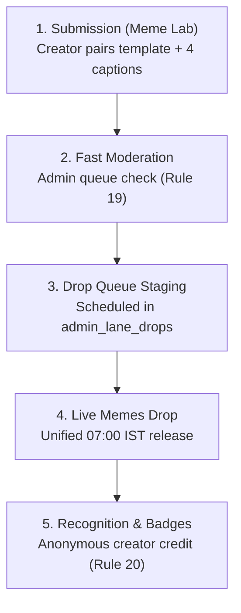

# Oddly — Architectural & Feasibility Analysis: Memes, Signals & Insights Engine (F24 to F31)

<!-- visual:start meme-lifecycle-flowchart -->

<!-- visual:end meme-lifecycle-flowchart -->

**Date:** 2026-11-15  
**Stage:** Stage M0 (Analysis and Documentation)  
**Author:** AI System Designer / Coding Agent  
**Companion Documents:** `rules.md`, `product.md`, `architecture.md`, `design.md`, `docs/admin-panel-spec.md`, `docs/event-dictionary.md`, `docs/capacity-model.md`.

---

## 1. Architectural Conflict Analysis & Resolutions

| Potential Conflict | Identified Tension | Resolution & Guardrail (Rules in Section 2) |
|---|---|---|
| **Drop Question Personalisation** | Product managers often desire tailoring daily questions to player taste. This violates the core ritual of the Drop. | **Rule 12 (Identical Drop Rule):** The 5 questions of a Drop are 100% identical globally. Personalisation applies strictly to non-Drop surfaces (optional Meme Corner card, notification send-hour cohorts, suggested share card themes). |
| **Analytics vs. Indian DPDP Act** | Silent behavioral telemetry without consent violates Section 6 and Section 12 of the DPDP Act 2023. | **Rule 13 (Consent Rule):** Separate, granular consent toggles in Settings (`analytics` vs. `personalisation`), default OFF. Pseudonymous `analytics_id` isolation. Instant deletion on withdrawal. |
| **Sensitive Inferences from Taste** | Humor and cultural choices can be abused to infer religion, political affiliation, or caste. | **Rule 14 (No Sensitive Inference):** Strict prohibition on inferring or storing protected classes. Subject taxonomy contains only neutral lifestyle categories. Build-fail unit test verifies zero tag overlap with forbidden topics. |
| **Individual Profiling & Dashboards** | Tracking friction or dwell times per user risks de-anonymization and surveillance feel. | **Rule 15 (No Identity-Joined Profiling):** Behavioral telemetry is keyed by `analytics_id`, never joined with email/user ID. Mission Control displays question quality only in groups of $k \ge 20$. |
| **A/B Testing Bias in Drop Ritual** | Experimenting with different question variants across user groups ruins parity and fairness. | **Rule 16 (Experiment Rule):** Experiments operate exclusively on non-Drop surfaces via feature flags with documented hypotheses and kill switches. |
| **Aggressive Monetisation (Oddly Plus)** | Subscription mechanics often resort to streak panic, fake timers, and guilt copy. | **Rule 17 (No Pressure to Pay):** Daily play is free forever. Max 1 offer per 14 days; 2 dismissals halt offers for 90 days. Offers are never shown at the moment of a broken streak. |
| **User Captioning vs. Rule 3 (No Free-Text)** | Rule 3 forbids user-authored free text to prevent abuse and harassment. | **Rule 18 (Free-Text Exception):** Scoped exception strictly for Meme Lab captions ($\le 100$ characters). Blocked from publication until passed through human moderation queue in Mission Control. Marked inactive until Stage M3 is approved. |
| **Orbit Subject Sync vs. Rule 4 (Zero Vectors)** | Displaying agreement on tags must not expose secret individual answer vectors. | **Rule 19 (Orbit Subject-Sync Amendment):** Shows aggregate agreement percentage per tag across shared Drops with a minimum threshold of 5 shared questions. Individual picks remain hidden. |

---

## 2. Infrastructure & Component Reuse Matrix

| Shipped Component / System | Shipped In | Reused For Memes, Signals & Insights | Architectural Benefit |
|---|---|---|---|
| **Illustration Registry (`D-015`)** | Stage 1 / D1 | Vector templates for meme questions and Meme Lab | Zero bundle bloat; SVG vector scalability; theme-aware colors |
| **Polymorphic Question Renderer** | Stage 4 | Meme question card presentation (`render_variant = "meme"`) | Reuses Type 1 and Type 4 option rows, focus rings, and selection states |
| **JSON Batch Importer** | Stage 2 / 6.7 | Question authoring with `tags`, `render_variant`, and `template_key` | Authoring path ready prior to admin panel build |
| **Validation Engine (`@oddly/shared`)** | Stage 2 / 3 | Zod schemas for tags, templates, events allowlist, and meme captions | Strict compile-time and runtime type safety |
| **Settings Screen & Consent Toggles** | Stage 8 | Granular DPDP consent toggles (`analytics` and `personalisation`) | Existing UI surface; zero new top-level routes required |
| **Push Notification Pipeline** | Stage 10 | Cohort notification timing derived from M4 insights | Improved open rates with zero changes to VAPID delivery |
| **Satori Share-Card Renderer** | Stage 6 | Achievement cards for Meme Lab creator recognition (M6) | Reuses 3D flip card, QR code generator, and PNG compilation |
| **Privacy Helpers (`privacy.ts`)** | Stage 2 | $k \ge 20$ anonymity enforcement on all admin and public views | Prevents identity leakage across small tag cohorts |
| **Admin Spec Automatic Checks** | Docs / Stage F0 | Extended with subject tagging, template licensing, and meme originality | Zero invalid questions enter review pipeline |

---

## 3. Scale, Ingestion & Storage Analysis

See [`docs/capacity-model.md`](file:///e:/Oddly/docs/capacity-model.md) Section 6 for full mathematical derivations.

### 3.1 Key Volumetric Findings
- **Events per Consented Player:** ~15 events per complete session.
- **Inflow at 10 Lakh DAU (40% Consent):** ~6,000,000 raw events / day (~1,333 events/sec peak).
- **HTTP Ingestion Volume:** With client-side micro-batching (averaging 6 events per batch), peak HTTP traffic to `POST /v1/events` is **~222 requests/sec**, consuming < 5% of a 3-instance API cluster.
- **Relational Storage Footprint:** `events_raw` produces **~1.80 GB / day** at 10 lakh DAU. 90-day retention totals **~162 GB**, easily partitioned and dropped via metadata DDL (`< 15 ms`).
- **Submit Hot Path Protection:** Confirmed: **Zero events are dispatched or ingested on `POST /v1/submissions`**. Telemetry runs asynchronously via `navigator.sendBeacon` and is handled on the Low priority lane (rank 7 load shedding).

---

## 4. Privacy, Legal & DPDP Compliance Framework

*Note: This analysis represents technical architecture and systems design; it does not constitute formal legal advice.*

### 4.1 Lawful Basis and Purpose Matrix

| Data Processing Purpose | Lawful Basis (DPDP Act 2023) | Consent Mechanism | Retention Period | Deletion Hook |
|---|---|---|---|---|
| **Core Game & Matching** | Contractual Necessity (Play Service) | Implicit by tapping "Play" + 18+ Age Gate | 90 days raw; compacted into user history | Account deletion (`DELETE /v1/me`) purges within 7 days |
| **Question-Quality Telemetry** | Explicit Consent (Section 6 DPDP) | Granular toggle in Settings (`analytics`), default OFF | 90 days in `events_raw`; dropped after rollup | Purged with `analytics_id` on account deletion |
| **Personalised Taste Insights** | Explicit Consent (Section 6 DPDP) | Granular toggle in Settings (`personalisation`), default OFF | Retained while consent active | Instant hard delete upon consent withdrawal |
| **Meme Lab Submissions** | User-Provided Content License | Checkbox attestation + Terms of Service | Retained while active; soft-retired on delete | Creator can delete submission at any time |
| **Security & Rate Limiting** | Legitimate Uses (Security / Fraud) | Operational standard (not analytics) | 60-second in-memory Redis rate limit counters | Automatic ephemeral expiration |

### 4.2 Legal Review Points Prior to Stage M3 (Meme Lab) Activation
Before the Founder activates Stage M3:
1. **Intermediary Guidelines Compliance:** Verify Section 79 safe-harbor requirements under India's IT Act (Grievance Officer notice, 24-36 hour takedown SLA for reported content).
2. **Originality & Intellectual Property:** Terms of Service must clearly specify user license to Oddly for captions, indemnity against third-party copyright claims, and prohibition of defamatory content.
3. **Children's Data Exclusion:** Confirm that 18+ adult verification strictly excludes minors from submitting captions or rating community memes.

---

## 5. Statistical Rigor, Honesty & Anti-Abuse Controls

### 5.1 Scientific Honesty & Sample Size Thresholds
1. **Meme Rating Confidence (Wilson Lower Bound):**
   - Naive percentages (e.g. 5 out of 5 "Funny" = 100%) are mathematically dishonest.
   - Ranking uses the Wilson score lower bound of the binomial confidence interval:
     $$W = \frac{\hat{p} + \frac{z^2}{2n} - z \sqrt{\frac{\hat{p}(1-\hat{p}) + \frac{z^2}{4n}}{n}}}{1 + \frac{z^2}{n}}$$
     where $\hat{p}$ is the proportion of "Funny" ratings, $n$ is total ratings, and $z = 1.96$ (95% confidence).
   - Memes require at least **$n \ge 200$ raters** before Wilson scores are used for ranking.
2. **Taste Sync Thin-Data Fallback:**
   - Inside an Orbit, Subject Sync is shown only after at least **5 shared questions** in that tag.
   - Fallback copy when data is sparse: *"Play more drops together to unlock Humour sync."*
3. **Question Quality Statistical Flags:**
   - Flags in Mission Control require at least **1,000 completed submissions** before triggering alerts, preventing early-morning sample volatility false alarms.

### 5.2 Abuse Threat Matrix & Engineered Controls

| Abuse Vector | Attack Mechanism | Engineered Countermeasure |
|---|---|---|
| **Rating Brigading** | Bad actors coordinate to down-vote ("Not for me") a specific meme to bury it. | 1. Memes served anonymously on Meme Corner; bad actors cannot target specific IDs. 2. 20% exploration share guarantees new memes receive impressions. 3. Rate limit: 1 rating per player per Drop. |
| **Caption Spam & Bot Submissions** | Automated bots flood Meme Lab with promotional, abusive, or nonsense captions. | 1. Mandatory Cloudflare Turnstile token on `POST /v1/memes/submissions`. 2. Daily submission cap per user (*config: 2/day*). 3. Strict max 100 character length. 4. Exact string and Levenshtein duplicate detection. |
| **Sockpuppet Creator Voting** | A creator creates multiple guest accounts to up-vote their own meme. | 1. Creator cannot rate their own meme. 2. Rating requires completing today's Drop. 3. Device + IP rate limiting blocks multi-account rating from the same hardware. |
| **Copyright & Meme Theft** | Submitting famous copyrighted punchlines or Twitter jokes. | 1. Originality attestation required on submit. 2. Admin queue checks caption against known web memes. 3. Post-publish report flag triggers one-click admin takedown. |

---

## 6. Client Bundle Budget & Performance Plan

1. **Initial Route Budget ($\le 159.5\text{ KB}$ Approved Exception):**
   - The play route (`/play` or `/`) initial bundle budget is strictly protected.
   - The lightweight event batcher adds **< 450 bytes** gzipped (native `navigator.sendBeacon` and micro-batching with zero external analytics SDKs).
2. **Lazy-Loading for Non-Drop Surfaces:**
   - Meme Corner card on recap screen: Dynamic import with `{ ssr: false }`, loaded only after submission completes.
   - Meme Lab (`/memes/new`, `/me/memes`): Separate client bundles chunked by Next.js App Router.
   - Badges & Achievement Cards: Satori rendering is 100% server-side; client loads only the resulting image asset.

---

## 7. Neutral Taxonomy Audit & Forbidden-Topics Lint

The 14 seed subject tags were audited against the Section 9.1 Forbidden Topic List:

| Seed Tag Key | Group | Associated Topics | Audit Finding |
|---|---|---|---|
| `humour` | Lifestyle | Relatable daily irony, mild self-deprecation, harmless silliness | **PASS:** Completely neutral; zero group mockery. |
| `daily-habits` | Lifestyle | Morning routines, coffee habits, organizing keys, desk setups | **PASS:** Universal human quirks. |
| `absurd-hypotheticals` | Whimsy | Cold pizza vs flat soda, elevator etiquette, time-travel quirks | **PASS:** Classic Oddly thought experiments. |
| `food-style` | Taste | Crust vs center, spicy vs sweet, midnight snacks | **PASS:** Neutral preference. Excludes religious dietary taboos. |
| `sleep-and-time` | Habits | Snooze button count, night owl vs early bird, clock watching | **PASS:** Harmless daily timing. |
| `decision-style` | Mindset | Overthinker vs impulsive, map reader vs lost wanderer | **PASS:** Cognitive quirks without mental health diagnostic labels. |
| `nostalgia` | Culture | Childhood snacks, 90s television tropes, physical media | **PASS:** Universally fond memories; excludes political history. |
| `phone-behaviour` | Modern Life | Unread notifications count, battery anxiety, phone brightness | **PASS:** Modern digital quirks. |
| `music-mood` | Culture | Earphones on vs off, repeat songs, driving playlists | **PASS:** Pure aesthetic preference. |
| `places` | Geography | Window seat vs aisle, mountains vs beaches, city vs village | **PASS:** Coarse preferences; zero regional stereotyping. |
| `word-and-mood` | Mindset | Word associations, favorite sounds, stationery preferences | **PASS:** Abstract instinct questions. |
| `colour-and-aesthetics` | Aesthetics | Minimalist vs maximalist, dark clothes vs bright colours | **PASS:** Shipped Type 3 palette questions. |
| `work-and-study-style` | Habits | Multiple tabs open, handwriting vs typing, messy desk | **PASS:** Neutral productivity styles; excludes income or career prestige. |
| `quirks` | Lifestyle | Walking on cracks, checking locked doors, volume knob on even numbers | **PASS:** Lighthearted common human instincts. |

**Audit Conclusion:** All 14 seed tags are strictly neutral lifestyle categories. An automated build-fail regression test in `packages/shared` will enforce that no tag key or translation string ever matches the Section 9.1 forbidden terms.

---

## 8. Stage L0 Amendments: Lane Dimension for Memes, Signals & Insights (2026-11-21)

### 8.1 F24 (Meme Questions) vs. F35 (Memes Lane) Distinction
- **F24 Meme Questions (Stage M1):** Defines the **question format and presentation variant** (`render_variant = 'meme'`). It pairs curated vector SVG templates with distinct text captions. Meme questions can appear as a minority in the Everyday lane (at most 1 of 5 per *config*).
- **F35 Memes Lane (Stage L4):** Defines the **dedicated subject lane** (`lane_id`). A Memes lane Drop consists 100% of humor, meme templates, and caption choices, blending `pick1`, `pick2of6`, and `slider7` formats.
- **Meme Lab Inflow (F26):** Community-authored memes created in Meme Lab feed **exclusively into the Memes lane**. Even after achieving top Wilson scores ($W \ge 0.70$) and dual-admin approval, community submissions are scheduled into Memes lane Drops, never Everyday Drops.

### 8.2 Lane Dimension for Signals and Insights (F25, F27)
- **Database Partitioning:** `events_raw`, `question_stats_daily`, and `tag_stats_daily` gain a `lane_id` dimension column.
- **Category Performance:** Category analytics (completion rate index, viral share lift, median dwell time) are computed per lane to identify subject affinities.
- **Privacy & Group Minimums:** The strict $k \ge 20$ anonymity guardrail is evaluated per lane; if a tag in a newly opened lane has fewer than 20 responses, stats remain suppressed.
- **Personalized Ranking (F27 / F30):** Personalization in the post-drop Meme Corner applies only to consented players ($N \ge 20$) and ranks memes within that lane. Drop questions remain 100% immune to taste personalization under Rule L1.
