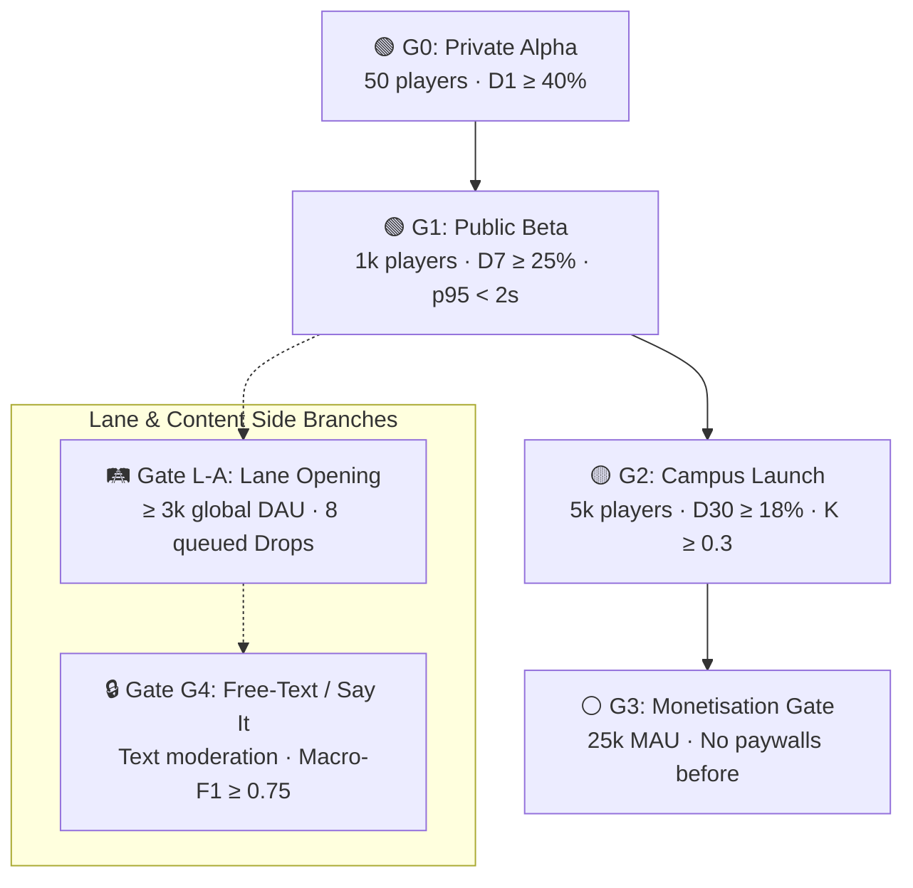
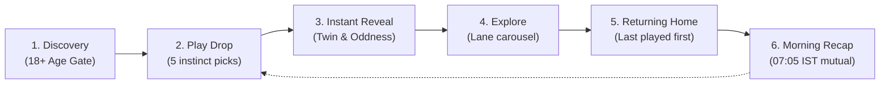
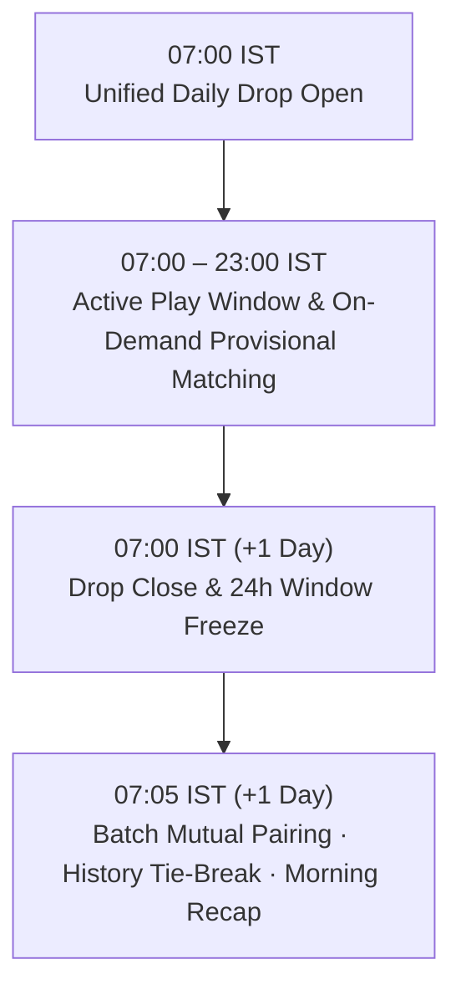
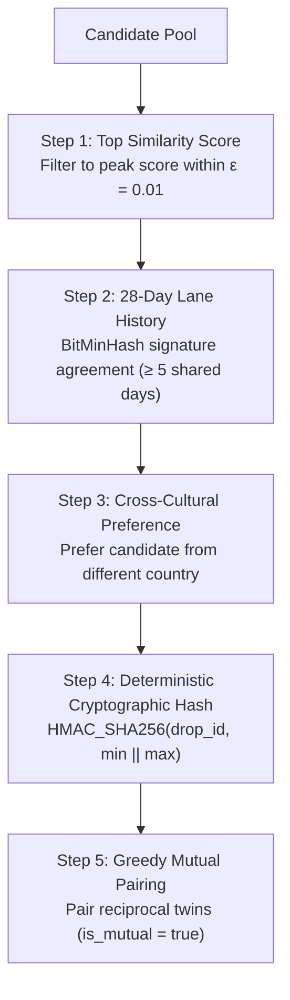

# Product Specification — Oddly v1

Project: Oddly v1 | Last updated: 2026-11-25 | Owner: Founder + AI agent
Purpose of this file: Definitive product blueprint, scope, user personas, brand identity, matching mechanics, feature definitions (F1–F17), edge cases, and legal/safety boundaries.

---

<!-- visual:start product-at-a-glance -->
> [!NOTE]
> **Oddly at a Glance**
> - **Core Loop:** Five instinct-based picks in under 30 seconds every morning at 07:00 IST.
> - **Lanes:** Pick a lane first (Everyday and Memes open today); each lane has its own daily Drop, twin and streak, and matching never crosses lanes.
> - **Honest Matching:** Find your Twin and your Oddness rarity percentile with no profiles or feeds. Chat can only unlock inside a mutual Orbit (unlock flow only; no messaging screen yet).
> - **Safe by Design:** Structured answers, 18+ only, zero shaming, no sensitive inference, non-political.
> - **Tactile Pop:** Physical paper sticker aesthetic on warm cream desk (`#FFF8F0`) with ink outlines and hard shadows.
<!-- visual:end product-at-a-glance -->

## 0. Product Definition (Founder-confirmed, 2026-11-25): read this first

> [!IMPORTANT]
> This section is the current definition of the product up to chat unlock. Where any later section of this file, `rules.md`, `architecture.md` or a stage report disagrees, **this section wins**. Sources: the Oddly Walkthrough (24 Nov 2026), founder decisions D1–D8 (`docs/build-b0-conflicts.md`), and the code deep dive `docs/audit/b0-deep-dive-2026-11-25.md`.

### 0.1 How the app is organised

1. Player opens the web app → confirms 18+ (recorded on the server with a timestamp) → **lane picker is the first screen** (returning players also see "Continue in <last lane>").
2. A lane is the whole structure, not a feature. **Every lane has its own daily Drop of 5 questions at 07:00 IST**, its own twin, its own recap and its own streak.
3. A player may play several lanes on the same day: one Drop per lane per day.
4. **Memes is a lane** (`slug = memes`). Meme content lives only in the Memes lane. There are no meme questions inside other lanes and no "themed Drops".
5. Open lanes today: Everyday, Memes. Others are planned.

### 0.2 How a twin is found (inside one lane)

- **Pool:** only players of the same lane and the same Drop. No age-band split: age band is shown on the twin card but never splits the pool *(default; founder may override)*.
- **Score per question** (0 to 1): pick-one same = 1, else 0. Slider loses 1/6 per step. Pick-2-of-6 uses overlap. Rank-3 loses 1/3 per swapped pair.
- **Weight:** each question is weighted by how rare the answers are, I = log2(1/share), averaged over both players' answers so S(u,v) = S(v,u). **S = Σ(w·s) / Σw.** Sharing a rare answer counts more than sharing a popular one. This weighted formula is the only one production may use.
- **Conditions, in order:**
  - C1: alone in the lane → no twin, nothing invented.
  - C2: fewer than 20 players, or fewer than 20 in a region → region widened.
  - C3: fewer than 200 → "Closest so far", no "1 in N".
  - C4: never a candidate: yourself, same device or network, blocked either way, flagged.
  - C5: a question is pulled → compare on the rest.
  - C6: highest S wins.
  - C7: everyone within 0.01 of the best is a tie group (up to 32). Break the tie in strict order: 28-day lane history (at least 5 shared days), then a different country, then a reproducible hash.
  - C8: mutual pairs; with an odd number, one player keeps the best non-mutual twin.
  - C9: the provisional twin refreshes about every 5 minutes. An upgrade push goes out only for +0.10 or for 3→4 of 5 matched picks, at most once a day.
  - C10: the 07:00 batch locks every twin, the recap arrives at 07:05, and a locked twin never changes.
- **Result screen shows only real data:** the real count of exact matches ("N of 5"), the lane's real player count, the twin's coarse region and age band, the real tie-group size and the real mutual flag. **Never a placeholder, a default number or a sample city.**
- **Oddness tier:** percentile of today's pool in that lane; shows "Early" until the pool reaches the minimum size *(default; founder may override)*.

### 0.3 After the twin (all lane-tagged)

Share card (no name, photo or exact city) · per-lane streak plus an overall "days played" count · play another lane · **Keep** (one per Drop, only to your own locked twin, Google sign-in, a decline is silent) · **Orbit** (aliases, max 3, end with one tap, unlocks on Day 1/3/7/14/30, stickers, 30-day re-request cooldown) · **Telepathy** (one question per Drop, guess the partner, Sync score after 5 rounds) · **Sync by subject** (counting by tag inside the Orbit; at least 5 shared questions) · **Anti-twin** (sample up to 2,000, hidden below 200 players, no contact path) · **Twin Globe** (flat map, coarse regions, delayed, k ≥ 20, empty state or clearly labelled real replay, never invented arcs) · **Super twin** (same twin in 2 lanes, or S ≥ 0.8 in two lanes).
Documented only (not to be switched on): Meme Lab, Oddly Deck, Friend-invite Orbit and Friends Compare.

### 0.4 Bonus round (additive)

Offered at the 07:05 recap when the tie group is at least `bonus.min_tie_size` (default 3). It has 3 questions from an evergreen pool of about 40 per lane, chosen by a seeded draw. It is open for 24 hours. Questions that at least half of the tie group answered in the last 28 days are skipped. Results come at 07:01 the next day and need `bonus.min_participants` (default 3). At most 2 rounds. The result is an extra line, "Closest in your group", and **never changes the locked twin**. No Keep to the bonus person. Answers are deleted after 28 days.

### 0.5 Chat unlock (up to "Chat is ready", no messaging screen)

Twin locked → Keep → Orbit formed → **any one of the Three Doors** → both tap "Start chatting?" → `chat_ready` (stored on the server).
- **Door 1, Duo Trial:** both answer 8 two-option prompts within 24 hours. Pass = at least 5 of 8 the same; the pass mark drops by 1 after each fail, down to 3. Unlimited attempts, 10-minute cooldown, progress saved. **Scored on the server.**
- **Door 2, Streak:** 3 days where both play the lane's Drop and each sends a sticker. A missed day pauses the count; it doesn't reset it.
- **Door 3, Sync:** Sync score of at least 0.60 over 5 Telepathy rounds.
- **Blockers:** the Orbit ended, a block or report, a flagged account, not 18+, the kill switch, guests. No countdown, no pressure copy, **no payment or lives of any kind**.

### 0.6 Badges

Collector (twins in 2, 3 or 5 lanes with S ≥ 0.6), All-Lanes, Super-twin badge. **Private by default, shared only by opt-in** through a flip card with your alias. "Earned by X%" appears only from real counts above a minimum group; otherwise the card says "Early badge". Never ranked, bought or shown in a public list.

### 0.7 Later stages (not now)

Chat messaging screen → party rooms and games (Room Twins, Odd One Wins, Rank Together, Who Picked It?, Pin the Pick, Hot Seat; twin games; solo games). Leaderboards only as room, Orbit or friend boards and "top X% today" bands, unless the founder changes the rule.

### 0.8 Open founder decisions (defaults in force until answered)

| # | Question | Default used |
|---|---|---|
| 1 | Age bands split the pool? | No: one pool per lane |
| 2 | Oddness tiers | Percentile per lane, "Early" below minimum pool |
| 3 | Erasure: delete answers too, or only the account? | Not decided: currently account soft-delete only |
| 4 | Profile contents | Alias, region, age band, badges, no photo |

### 0.9 Superseded statements

- §4.2 "NO chat": amended. Chat may unlock inside a mutual Orbit (D7). Handle/contact exchange remains not planned.
- F9 single streak: superseded by per-lane streaks plus overall days played (D4).
- F24 "meme questions inside other Drops / themed Drops": superseded. Memes is its own lane (D3).
- Rule L10 "new player goes straight into Everyday": superseded. The lane picker comes first (D1).

---

## 1. What We Are Making

**Oddly** (working title: _Twin_) is a daily five-pick game web app designed to give every person a daily moment of unexpected human connection in under 30 seconds. Every day at 07:00 IST, Oddly drops five instinct-based questions—identical for everyone on Earth. Players answer on intuition without profiles, feeds, chat, or followers. Immediately upon submission, Oddly computes your **Twin**: the one stranger anywhere in the world who answered most like you today. It also computes your **Oddness**: an information-theoretic rarity percentile revealing how singular your combination of picks was compared to everyone else who played.

- **Working Title:** Twin
- **Brand Name:** Oddly (trademark, domain, app store, and social handle availability NOT yet verified; candidate alternates: _Twinly_, _SameHere_).
- **Primary Tagline:** _"Someone out there is oddly like you."_
- **Action Line:** _"Five picks. One twin."_
- **Share Line:** _"I matched a stranger in [place]. Can you beat my oddness?"_
- **Store Subtitle:** _"Find your daily twin in 30 seconds."_
- **Notification Hook:** _"Today's five are live. Who thinks like you?"_

---

## 2. Problem Statement and Opportunity

### 2.1 The Problem

People experience a pervasive sense of isolation alongside social media fatigue. They crave authentic, low-friction moments of human connection but are exhausted by infinite feeds, performance pressure, awkward dating chats, and the demand to curate online personas. Most existing question-matching or quiz applications (e.g., Hunch, 20 Questions, CHOOSE, Just Like You) either force users into open-ended messaging/dating, suffer from user-generated spam, or overwhelm players with endless quizzes.

### 2.2 The Opportunity

Oddly turns the **result itself into the entire product**. By stripping away chat, direct messaging, user profiles, and public rankings, Oddly provides a finite, 30-second ritual. It delivers:

1. **Validation of Individuality & Belonging:** Proving both that you are unique ("Oddness") and that you are never entirely alone ("Twin").
2. **Zero Effort Connection:** No bio to maintain, no photos to upload, no small talk to sustain.
3. **High Virality Without Social Toxicity:** Share cards focus on intriguing coincidences and rarity metrics rather than vanity or status competition.

---

## 3. Target Audience, Personas, and Jobs-to-be-Done

### 3.1 Target Personas

#### Persona 1: Riya (19, College Student — Ahmedabad)

- **Context:** Heavy user of Instagram, Snapchat, and WhatsApp. Plays casual games between classes, on the bus, or late at night.
- **Motivations:** Fun, novelty, comparing oddities with friends, sharing quirky story cards, maintaining daily streaks.
- **Pain Point:** Tired of toxic comment sections and high-maintenance dating apps. Wants a quick burst of amusement.
- **Oddly Moment:** Answers during a 5-minute lecture break, shares her 4/5 match card to her close friends' Instagram story with the caption _"Who matches me?"_

#### Persona 2: Karan (27, Software Engineer — Bengaluru)

- **Context:** Commutes via metro, drinks morning filter coffee, active on X (Twitter) and Reddit. Appreciates clean design, numbers, and probability.
- **Motivations:** Fascinated by entropy, rarity distributions, and global data points. Enjoys a structured morning routine.
- **Pain Point:** Dislikes bloated apps demanding sign-ups before providing value.
- **Oddly Moment:** Opens Oddly at 07:15 AM with his morning coffee, inspects his "Mythic Tier (98.4%)" oddness score, and posts his rarity breakdown on X.

#### Persona 3: Meera (46, High School Teacher — Pune)

- **Context:** Uses WhatsApp daily for family and school groups; reads news on her tablet. Joined via a challenge link sent by her daughter.
- **Motivations:** Wholesome, gentle daily habit that sparks lightweight conversation with family across cities.
- **Pain Point:** Intimidated by complex gaming mechanics, accounts requiring passwords, and unsolicited messages from strangers.
- **Oddly Moment:** Completes her picks after morning tea, forwards her result into the family WhatsApp group: _"Look, I matched someone in Kyoto today!"_

### 3.2 Jobs to Be Done (JTBD)

- **JTBD 1 (Boredom / Micro-break):** _When I have 30 seconds between tasks, I want a delightful, finished interactive moment so that I feel refreshed without falling down a social media rabbit hole._
- **JTBD 2 (Affirmation):** _When I feel alone or eccentric in my daily preferences, I want to see that another human across the globe shares my exact peculiar instincts so that I feel validated and connected._
- **JTBD 3 (Playful Social Sharing):** _When I get a surprising or humorous result, I want to share a beautiful, low-friction card with friends so that we can compare our quirks._
- **JTBD 4 (Daily Habit):** _When I wake up, I want a predictable, clean morning ritual that respects my time and keeps a streak going._

### 3.3 Regions and Languages

- **Launch Target:** India (English with a light, warm Indian-English / Hinglish conversational cadence).
- **Global Audience:** The daily Drop is universal worldwide (UTC synchronized, anchored to 07:00 IST for India launch).
- **Future Locales:** Architecture supports Hindi and Gujarati via dynamic string storage (`app_content`) and i18n question schemas (`text_i18n`).

---

## 4. Goals, Non-Goals, and Go/No-Go Gates

### 4.1 Goals for v1.0

- Build a rock-solid, responsive Web App (PWA) that loads in < 2 seconds on mid-range Android devices over 4G.
- Enable zero-friction guest play: users reach their provisional reveal in under 60 seconds on their first visit and under 30 seconds on return visits.
- Deliver an honest, mathematically rigorous matching engine with k-anonymity privacy safeguards.
- Implement server-side rendered, privacy-safe share cards (Story, Square, Link Preview) with high viral appeal.
- Maintain strict data minimisation: no free-text user chat, no profile pictures, no precise geolocation.

### 4.2 Non-Goals for v1.0 (Strictly Out of Scope)

- **NO chat, DMs, or handle/contact exchange:** Users cannot message their twin or exchange contact info. Handle swap, DMs, and external contact exchange are **Permanently Not Planned** (preventing abuse and stalking by design).
- **NO user profiles or avatars:** No profile bios, photos, or public user profiles.
- **NO public leaderboards:** No ranking players by "popularity", "oddness", or "sync score".
- **NO real-money prizes or betting:** Free-to-play, zero gambling mechanics (compliant with 2025 Indian online gaming regulations).
- **NO native iOS/Android apps in v1.0:** Web-first responsive PWA; native apps slated for v1.1 (Expo).
- **NO paid subscriptions or ads in v1.0:** Monetisation (streaks freeze, sponsored questions) is strictly deferred.
- **NO image uploads from users:** Users never upload photos, memes, avatars, or media. In Meme Lab (M3), players write captions for app-provided vector templates only.
- **NO selling or sharing user-level data:** Data is never sold, brokered, or shared with third parties.
- **NO propensity-to-buy model in v1:** No behavioural monetization profiling or dynamic pricing algorithms.
- **NO per-user change to Drop questions:** The five questions of the daily Drop are identical for every player across the globe. Personalisation never touches Drop questions.
- **Scope approvals recorded on 2026-11-14 & 2026-11-15:**
  - Founder approved adding F18 (Twin Globe), F19 (Keep this twin & Orbit), F20 (Telepathy), and F21 (Anti-twin) to v1.0. F22 (Oddly Deck) and F23 (Friend-invite Orbit) are approved for documentation only (v1.5). F12 (Wave) is superseded by F19.
  - Founder approved adding F24 (Meme questions & themed Drops, Stage M1) and F25 (Signals foundation, Stage M2) to v1.0.
  - F26 (Meme Lab, Stage M3), F27 (Insights engine, Stage M4), F28 (Taste dimension: Sync by subject, Stage M5), and F29 (Recognition, Stage M6) are documented fully and will be built only upon Founder command.
  - F30 (ML ranker, Stage M7) and F31 (Premium groundwork, Stage M8) are documented only.
  - All other Non-Goals remain strictly immutable.

- **Politics is NOT a lane:** Oddly will never host a Politics lane or allow political, electoral, party, religious, or caste questions anywhere in the product. "Hot Takes" is strictly limited to non-sensitive lifestyle debates (e.g. food, daily habits).
- **No Showing Raw User Text:** Typed answers in "Say It" (F37) are strictly machine-compared. Raw text is never exposed to twins, in share cards, or on public surfaces.
- **No Paywalled Lanes (Rule L8):** Lanes cannot be locked behind paywalls. Every open lane is accessible to all players with equal matching quality.
- **No Ranking of Human Value:** In the Situations lane (F36), results are descriptive behavioral style labels (e.g. Calm, Playful, Shy), never ranking or evaluative scores (no "sigma", "desperate", "loser", "alpha").
- **Maximum 80 Characters for Free Text:** Free-text responses are strictly capped at 80 characters.

### 4.3 Success Metrics

- **Completion Rate:** > 85% of users who tap "Play" finish all 5 questions.
- **Median Time to Complete:** ~30 seconds.
- **Day-1 Retention (D1):** > 25% during initial testing.
- **Day-7 Retention (D7):** > 12% across initial cohorts.
- **Share Rate:** > 15% of completing users trigger a share action or copy link.
- **Viral Coefficient (K-factor):** > 0.3 driven by challenge links (`/c/:shortId?challenge=1`).
- **Reliability & Availability SLO:** 99.9% monthly play-path uptime; 99.95% during the 07:00–08:00 IST peak window.
- **Submission Durability:** 100% (zero acknowledged submissions ever lost).
- **Monthly Error Budget:** Maximum 43.2 minutes of degraded service per month; releases freeze if > 50% burned.
- **Meme Question Quality:** Meme questions (`render_variant = "meme"`) must maintain equal or higher completion rate and at least +5% higher share rate compared to text questions after 2 weeks of live data.
- **Signals Pipeline Reliability:** 99.9% event ingestion reliability via beacon/batching with zero impact on submit-path latency.
- **Consent Strictness:** 100% adherence to zero-event ingestion prior to explicit, granular DPDP consent.


- **Lane Expansion Metrics (Stage L0 / F32):**
  - **Second-Lane Discovery:** $\ge 25\%$ of first-session players complete a second lane on day 1.
  - **Lane Completion Rate:** $\ge 85\%$ of started lane Drops are completed.
  - **D1 Return Per Lane:** $\ge 35\%$ 1-day retention within individual open lanes.
  - **Lane Share Rate:** $\ge 12\%$ of lane results generate an exported or shared result card.
  - **Small-Pool Rate:** $\le 5\%$ of lane Drops end in "Closest so far" in production open lanes.

### 4.4 Reliability Promises & Product Operating Principles

1. **Your Picks Are Never Lost:** Once a player completes their five picks and taps Submit, their choices are guaranteed durable persistence. Even under severe backend load or network disruption, picks are stored safely on the device and queued until verified by the server.
2. **Honest Status When Busy:** We never fake twins, fabricate counts, or pretend everything is normal when overloaded. If the matching engine is running slow, we state it plainly: *"Saved! Finding your twin... This may take a minute."*
3. **The Drop Is Always Reachable:** The daily five questions are pre-cached across global edge networks so that even if the primary database hiccups, the daily ritual remains accessible.
4. **Approximate Live Counters:** The header counter (*"3,482 players today"*) is approximate and cached at the edge to protect origin capacity.
5. **Transparent Provisional Labels:** Early-day matches and results calculated under high load are always clearly labeled *"Provisional Twin"* until the 07:00 IST recap locks the immutable global result.
6. **Campaign Gate by Scale Tier:** No marketing campaign or influencer push expected to drive traffic beyond the current scale tier (T0: 1k, T1: 10k, T2: 100k, T3: 1M) may be launched until that tier's formal k6 load test scenarios have passed and been certified.

### 4.5 Degraded-Experience Copy and UI Behaviors (L1 to L4)

When traffic surges trigger the Graceful Degradation Ladder, the user experience adapts transparently:

- **Level L1 (Conserve):** Minor latency elevation. Player counters show subtle freshness notice (*"Updated a minute ago"*). Share card pre-rendering switches to on-demand.
- **Level L2 (Protect Core):** Top brand-voiced status banner appears:
  > *"Busy right now! Thousands of strangers are playing. Your picks are safe."*
  Non-essential pages (history, world stats) serve slightly cached data.
- **Level L3 (Survive):** Mode B asynchronous ingestion active. Submit screen shows a calming, looping twin-dot animation:
  > *"Saved! Finding your stranger twin... This may take a minute."*
  Results update automatically with jittered polling.
- **Level L4 (Static Fallback):** Extreme origin failure. The client shell and Drop JSON are served from CDN edge. If submissions cannot reach the API, picks are encrypted and saved in client storage:
  > *"We are having trouble reaching our servers. Your picks are safely saved on this device and will send automatically the moment we are back."*

### 4.6 Go/No-Go Decision Gates

<!-- visual:start decision-gates-flowchart -->

<!-- visual:end decision-gates-flowchart -->

- **G0 (Private Alpha):** 50 players over 1 weekend. Metric: D1 retention $\ge 40\%$, zero crash reports, zero unhandled errors in telemetry.
- **G1 (Public Beta):** 1,000 players over 14 days. Metric: D7 retention $\ge 25\%$, share rate $\ge 15\%$, matching latency p95 < 2.0s.
- **G2 (Campus Launch):** 5,000 players across 3 campuses. Metric: D30 retention $\ge 18\%$, referral coefficient $K \ge 0.3$.
- **G3 (Monetisation Gate):** 25,000 MAU before introducing any paid features or brand drops. (Phase-1 is strictly non-monetised).
- **Gate L-A (Lane Opening Gate):** A planned lane may transition to `open` only when: (1) Founder approval in writing, (2) At least *config* 8 approved Drops queued in `admin_lane_drops`, (3) Moderation and safety checklist signed off, (4) Sustained global DAU $\ge 3,000$ to prevent candidate pool collapse. When daily lane players drop below *config* 500, marked "Early lane"; below *config* 200, results show "Closest so far".
- **Gate G4 (Free-Text / Say It Gate):** Free-text typed answers (`say_it`) remain strictly inactive in v1 and can only be enabled when all 5 criteria are verified: (1) Founder written approval, (2) Admin text moderation queue & archetype manager built (Phase 11 B6), (3) Labelled eval set of $\ge 300$ reply pairs with $\ge 80\%$ human agreement and macro-F1 $\ge 0.75$ on $\ge 200$ replies, (4) Legal counsel review of notice and retention, (5) Load test showing embedding queue handles $10\times$ volume with zero submit path latency impact.

## 5. Brand Identity and Voice

### 5.1 The Brand Story (Verbatim for About Page and Onboarding)

> Everyone has a thing. You pick odd numbers when you are nervous. You think lukewarm coffee is a crime. You see a colour and feel a Monday.
>
> You assume it is just you. It almost never is.
>
> Oddly asks you five tiny questions every day, the same five for everyone who picks the same lane. No quizzes to study for, no profile to build, no followers to chase. You answer on instinct, and then we do one simple thing: we look for the person, anywhere in the world, who answered most like you.
>
> You will never know their name. You will know they are real, that they are somewhere you have never been, and that today, for thirty seconds, two strangers were oddly in sync.
>
> That is the whole product. A small, daily reminder that the world is bigger than your feed and a little more like you than you thought.

### 5.2 Mission, Vision, and Core Values

- **Mission:** Give every person a daily moment of unexpected human connection, in under a minute.
- **Vision:** The shared daily ritual that reminds the world how alike strangers are.
- **Core Values:**
  1. **Tiny:** Respect human time. Never demand homework, quizzes, or profiles.
  2. **Kind:** Celebrate eccentricities. No shaming, no ranking, no losers.
  3. **Safe by Design:** Prevent abuse architecturally by keeping answers structured, never showing one player's typed words to another, and never showing precise locations. Any text answer or chat feature stays off until its safety gate passes.
  4. **Honest:** Never generate synthetic twins, bots, or fake rarity counts. If data is sparse, say so transparently.

### 5.3 Brand Voice Guidelines

| Do                                                                                          | Don't                                                                         |
| ------------------------------------------------------------------------------------------- | ----------------------------------------------------------------------------- |
| Celebrate quirky choices (_"Only 0.4% picked purple for Monday. Respect."_)                 | Mock or criticise any choice (_"Why would anyone pick cold pizza?"_)          |
| Use plain, warm, friendly language with short sentences.                                    | Use corporate jargon, growth-hacking hype, or tech buzzwords.                 |
| Be honest about early-day or weak matches (_"Closest so far: 3 of 5. Check back tonight."_) | Fake a 5/5 match or exaggerate rarity.                                        |
| Maintain playful self-awareness (_"Two strangers, thirty seconds, zero small talk."_)       | Write lengthy academic or psychological paragraphs.                           |
| Treat all demographic backgrounds with equal respect and warmth.                            | Touch religion, caste, politics, sexuality, health conditions, or body image. |

### 5.4 In-App Vocabulary

- **Drop:** The daily set of exactly five questions released at 07:00 IST.
- **Picks:** The five options a player chooses in a Drop.
- **Twin:** The closest eligible other player who answered today's Drop.
- **Oddness:** The information-theoretic rarity score of a player's five picks (percentile + tier).
- **Streak:** The number of consecutive Twin Days a player has submitted answers.
- **Recap:** The final locked summary of yesterday's Drop, twin, rarity, and global numbers revealed at 07:05 IST.
- **Wave:** _(v1.5 schema-ready)_ A one-tap mutual emoji greeting exchanged between twins.

---

- **Lane:** A thematic subject track (e.g. Everyday, Memes, Gaming). Drops and matching are isolated within each lane.
- **Everyday:** The default, universal lane played by all first-time visitors without login or picker screens.
- **Memes:** The meme-culture lane powered by meme templates and caption choices (F24/F35).
- **Early Lane:** A live lane with fewer than *config* 500 daily players, labelled honestly with an Early Lane chip.
- **Resting Lane:** A lane with no approved Drop scheduled for today; displays time until next Drop (Rule L9).
- **Tie Group:** The set of candidate players whose similarity score is within $\epsilon = 0.01$ of the best match. Real size is $T$.
- **Honest Group Size:** Transparent copy showing the exact or banded count of tied twins ("312 people matched you this way").
- **Mutual Twin:** A pairing where player A is B's twin and player B is A's twin (`is_mutual = true`).
- **Super Twin:** Rare cross-lane occurrence where two players are twinned in 2 or more distinct lanes on the same calendar day.
- **Say It:** Free-text question format (up to 80 chars) compared via semantic embeddings, gated behind Gate G4.
- **Style Archetype:** Descriptive behavioral style label in the Situations lane (e.g. Calm, Playful, Shy), never an evaluative rank.
- **Bonus Round:** An optional, asynchronous tie-break round (3 questions) offered after final recap to players in tie groups of `bonus.min_tie_size` (>= 2) members to find the closest twin.
- **Lane Twin:** A verified final twin result earned in a specific open lane on a day with >= 200 players and similarity >= 0.6 (`badge.min_similarity`).
- **Collector:** A cumulative badge recognizing players who have earned lane twins across multiple distinct open lanes (Tiers I, II, III, All-Lanes).
- **Super Twin Badge:** A rare badge recognizing players who achieve a Super Twin across >= 2 lanes within a rolling 7-day window.

## 6. Core Loop and Daily Timeline

### 6.1 The Player Core Loop

<!-- visual:start core-loop-flowchart -->

<!-- visual:end core-loop-flowchart -->

Oddly operates on a fast, tactile daily habit loop designed for rapid completion (~30 seconds) and high shareability, now lane-aware:

```
1. DISCOVERY & FIRST RUN
   First visit -> Age gate check (18+) -> Straight into Everyday Drop (Rule L10)
   (No login wall, no onboarding survey, no lane picker screen)
   
2. LANE DROP PLAY (Everyday or Player-Chosen Lane)
   5 tactile questions -> One at a time -> Sticker pop UI -> Haptic feedback
   
3. INSTANT LANE REVEAL
   Lane Chip & Accent -> Percentage match -> Honest group size ("312 people matched you this way")
   -> Oddness tier -> Anti-twin -> Tactile Share Card
   
4. LANE EXPLORATION (Post-Result)
   "Try another lane" carousel -> Open lanes (Memes) & "Coming Soon" planned tiles
   -> Optional "Tell me when it opens" opt-in
   
5. RETURNING VISITOR HOME
   Home screen displays active lane cards sorted with last played lane first (Rule L1)
   -> Lane status chips (Open, Early lane, Resting, Played) -> Pick any unplayed lane
   
6. MORNING RECAP & REVISIT (07:05 IST)
   Push notification per lane (max 2/day total) -> Final mutual twin reveal
   -> "Why you two?" rare agreement accordion -> Streak update (\ge 1 completed lane Drop)
```

### 6.2 The Daily "Twin Day" Timeline (All times IST, stored in UTC)

<!-- visual:start timeline-flowchart -->

<!-- visual:end timeline-flowchart -->

- **07:00 IST — Unified Daily Drop Open:** All open lanes release their daily Drop simultaneously. All Drops share the exact same 24-hour cycle. No staggered drop clocks in v1 to protect capacity and prevent duplicate peak load spikes.
- **07:00 to 23:00 IST — Active Play Window:** Peak traffic windows (07:00-09:30 morning commute, 12:30-14:00 lunch, 20:00-22:30 evening). Provisional twin matching runs on-demand via the BullMQ pipeline with sub-second response times.
- **07:00 IST (+1 Day) — Drop Close & Freeze:** The 24-hour play window closes. Unfinished Drops expire.
- **07:05 IST (+1 Day) — Final Matching & Morning Recap:** Final batch matching job runs per lane: builds $K=32$ candidate subgraphs, applies 28-day BitMinHash history tie-breaking, executes greedy mutual pairing, computes Super Twins across lanes, and dispatches Morning Recap notifications.

## 7. Dynamic Question System and Content Architecture

### 7.1 Everything Dynamic from the Database (Override Addendum)

No content, questions, palettes, illustrations, UI copy, notification templates, tier cut-offs, or configuration values are hard-coded in the application codebase.

- All questions, options, palettes, and assets are stored in PostgreSQL and managed through the Admin Panel.
- All UI strings live in `app_content` (PostgreSQL), served via a fast, cached endpoint `GET /v1/content/:locale`.
- Pure functions and generic components render questions dynamically based on schemas defined in `@oddly/shared`.

### 7.2 The Five Question Types and Richer Answer Formats

Oddly questions are designed for rapid, visceral reactions. In addition to legacy single-choice formats, richer answer formats expand the answer space to reduce tie collisions while maintaining the 30-second completion target:

| Format Key | Name | Player Interaction | State Space | Similarity Metric $s_q$ | Notes & Usage |
|---|---|---|---|---|---|
| `pick1` | Single Choice | Tap 1 of 2 to 4 options | 2 to 4 | $1$ if equal, else $0$ | Core format across all lanes; simple, immediate |
| `pick2of6` | Pick 2 of 6 | Tap exactly 2 of 6 options | $\binom{6}{2} = 15$ | Jaccard: $\frac{|A \cap B|}{|A \cup B|} \in \{0, \frac{1}{3}, 1\}$ | Ideal for taste, hobbies, and media preferences |
| `rank3` | Rank 3 | Drag or tap 3 items into order | $3! = 6$ | $1 - \frac{\text{KendallTau}(A, B)}{3}$ | Tap-to-order default on mobile; drag-and-drop accessible |
| `slider7` | Spectrum Slider | Select 1 to 7 on a labelled spectrum | 7 | $1 - \frac{|a - b|}{6}$ | Endpoints labelled with words; no raw numbers shown as "scores" |
| `scene` | Scenario Card | Pick 1 of 3 to 5 illustrated reaction cards | 3 to 5 | $1$ if equal, else $0$ | Used in Situations lane (F36); gender-neutral illustrated dilemmas |
| `say_it` | Say It | Type up to 80 characters | Open | $a \cdot [\text{archetype}] + (1-a) \cdot \text{cos}_{\text{cal}}$ | Gated behind Gate G4; machine-compared only; never shown to others |

**Legacy Formats Rule:** Legacy question formats (number 1-50, hex colour picker, picture tap, mood selector) are strictly restricted to the **Everyday** lane and may comprise at most 2 of 5 questions in any daily Drop. All non-Everyday lanes use modern formats (`pick1`, `pick2of6`, `rank3`, `slider7`, `scene`).

### 7.3 Editorial Rules for Writing a Drop

1. **Instinct, Never Knowledge:** Questions must have zero right or wrong answers.
2. **Entropy Spread:** Aim for balanced answer distributions. No option should exceed ~60% in binary questions or ~40% in multi-option questions (verified via panel testing).
3. **Strictly Forbidden Topics:** Religion, caste, politics, electoral opinions, sexual preferences, medical conditions, body weight/appearance, real living individuals, corporate brand endorsements (until sponsored questions exist), and anything causing shame or exclusion.
4. **Language-Light:** Questions must be effortlessly understood by non-native English speakers.
5. **No Consecutive Patterns:** Never place the same question type in the same slot on two consecutive days.
6. **Two-Person Rule:** An editor drafts; an independent approver must review and approve before scheduling.

### 7.4 Standard Seed: Sample Week of Drops (Draft Batch Demo)

_Seeded dynamically via JSON importer in `seed/oddly_batch_001_first_14_days.json`:_

| Day     | Q1: Pick One (Text)                                | Q2: Number (1–50)                 | Q3: Colour (12 Palette)       | Q4: Image (4 SVG Tiles)                                     | Q5: Word (6 Options)                                 |
| ------- | -------------------------------------------------- | --------------------------------- | ----------------------------- | ----------------------------------------------------------- | ---------------------------------------------------- |
| **Mon** | Pizza always cold OR Coffee always lukewarm        | Pick a number (1–50)              | Colour of Monday morning      | Sunrise / Storm / Starry Night / Overcast Sky               | Cozy, Restless, Curious, Sleepy, Bold, Calm          |
| **Tue** | Pause time 10 min/day OR Rewind 10 s/day           | Minutes you'd wait for a friend   | Colour of your last good idea | Red door / Wooden door / Glass door / Tiny door             | Hopeful, Hungry, Tired, Playful, Focused, Nostalgic  |
| **Wed** | Always window seat OR Always aisle seat            | Your lucky number                 | Colour of a Sunday afternoon  | Chai lane / Quiet park path / Neon market / Beach promenade | Rest, Adventure, Company, Quiet, Snacks, Sunshine    |
| **Thu** | Text back instantly OR Perfect reply an hour later | A number that feels friendly      | Colour of a rainy day         | Book / Guitar / Torch / Notebook (Desert Island)            | Plenty, Panic, Hopeful, Doomed, Charging, Eco-mode   |
| **Fri** | Dessert first OR Dessert last                      | A number that sounds like weekend | Colour of Friday evening      | Movie night / Road trip / Long nap / Street food crawl      | Rocket, Sloth, Disco, Cat, Owl, Chill                |
| **Sat** | Mountains OR Beach for one perfect day             | How many snacks is "a few"?       | Colour of your favourite song | Fruit / Books / Bangles / Sweets (Market Stall)             | Hero, Sidekick, Villain, Narrator, Extra, Plot Twist |
| **Sun** | Plan week tonight OR Let Monday surprise you       | A number for tomorrow             | Colour of a fresh start       | 4 distinct sunrise/sunset scenes                            | Steady, Wild, Gentle, Busy, Lucky, New               |

---

## 8. Result System and Honesty Rules

### 8.1 The Three-Stage Reveal Sequence
Results are revealed with playful suspense, emphasizing the tactile physical sticker metaphor:
1. **Stage 1: The Lane Match Stamp:** Universal Lane Chip and accent color animate in with a tactile ink stamp. Displays headline match percentage ($S \in [0, 100]\%$) and honest group size ("4 of 5 with someone in Lagos. 312 people matched you this way").
2. **Stage 2: Oddness & Twin Profile:** Shows the player's rarity percentile within that lane's daily cohort, the provisional twin's age band and country, and the Anti-twin.
3. **Stage 3: Deep Match Breakdown & "Why You Two?":** Displays question-by-question agreement indicators. For tied twins, reveals the "Why you two?" accordion listing rare answers shared by both players. Below the card, a "Play another lane" row invites immediate exploration of remaining open lanes.

### 8.2 Strict Honesty Protocol
Oddly's central brand promise is **radical mathematical honesty**. We never fabricate, inflate, or manipulate match data:
- **No Hallucinated Twins:** If fewer than *config* 200 players have completed the lane, the UI honestly displays "Closest so far". We never synthesize bot twins or fake accounts.
- **Honest Group Size:** When multiple players share identical similarity scores, we state the exact or banded group size ($T$). We never tell a player "You found your one and only soulmate" when 300 others gave the exact same answers.
- **Unique Twin Copy ($T=1$):** Only when exactly one person in the cohort produced that match profile does the UI state: "You and this person were the only ones who answered like this today."
- **Lane Isolation (Rule L2):** Oddness percentiles, twins, and recap statistics are computed strictly within each lane cohort. A player's Memes twin has no influence on their Everyday twin.

## 9. Mathematical Foundations and Matching Engine

### 9.1 Question-Level Similarity ($s_q$)

- For binary, colour, word, and image questions:
  $$s_q(u, v) = \begin{cases} 1.0 & \text{if } a_{u,q} = a_{v,q} \\ 0.0 & \text{otherwise} \end{cases}$$
- For number questions ($1 \le a \le 50$):
  $$s_q(u, v) = \begin{cases} 1.0 & \text{if } |a_{u,q} - a_{v,q}| = 0 \\ 0.5 & \text{if } |a_{u,q} - a_{v,q}| = 1 \\ 0.25 & \text{if } |a_{u,q} - a_{v,q}| = 2 \\ 0.0 & \text{if } |a_{u,q} - a_{v,q}| > 2 \end{cases}$$

### 9.2 Information Content and Weights

Let $p(a)$ be the empirical probability of option $a$ among all players of today's Drop, computed with Laplace add-one smoothing:
$$p(a) = \frac{C(a) + 1}{N + K_q}$$
where $C(a)$ is the selection count, $N$ is total drop submissions, and $K_q$ is the cardinality of question $q$.
The information content (in bits) is:
$$I(a) = \log_2\left(\frac{1}{p(a)}\right) = -\log_2(p(a))$$
The pair weight for question $q$ between users $u$ and $v$ is the symmetric mean information:
$$w_q(u, v) = \frac{I(a_{u,q}) + I(a_{v,q})}{2}$$

### 9.3 Overall Pairwise Similarity ($S(u, v)$)

The total similarity between two players $u$ and $v$ is the information-weighted sum of question similarities:
$$S(u, v) = \frac{\sum_{q=1}^{5} w_q(u, v) \cdot s_q(u, v)}{\sum_{q=1}^{5} w_q(u, v)}$$

- $S(u, v) \in [0.0, 1.0]$ and is strictly symmetric: $S(u, v) = S(v, u)$.
- Rare shared picks contribute significantly more to $S(u, v)$ than common shared picks (analogous to TF-IDF).

### 9.4 Oddness and Rarity Percentile

The total oddness of player $u$'s five picks is the sum of their information contents:
$$\text{Oddness}(u) = \sum_{q=1}^{5} I(a_{u,q})$$
The player's **Rarity Percentile** is:
$$\text{Percentile}(u) = 100 \times \frac{\#\{v \in \text{Players} \mid \text{Oddness}(v) < \text{Oddness}(u)\}}{N}$$
**Rarity Tiers:**

<!-- visual:start oddness-tier-chips -->
| Tier | Percentile Range | Visual Accent & Indicator |
|---|---|---|
| **Common** | 0.0% – 49.9% | ⚪ Slate / Ink outline (`#5B5780`) |
| **Uncommon** | 50.0% – 79.9% | 🟢 Mint (`#3DDBB0`) |
| **Rare** | 80.0% – 94.9% | 🟣 Violet (`#6C4CF1`) |
| **Mythic** | 95.0% – 100.0% | 🟡 Sun / Gold foil (`#FFD23F`) |
<!-- visual:end oddness-tier-chips -->

- **Common:** 0.0% – 49.9%
- **Uncommon:** 50.0% – 79.9%
- **Rare:** 80.0% – 94.9%
- **Mythic:** 95.0% – 100.0%

### 9.5 Scaling Stages for the Matching Engine

1. **Stage A (v1.0 — Up to 10,000 Daily Players):**
   - Brute-force pairwise evaluation against active in-memory / Redis vector representations.
   - Fits easily within ~10ms execution time on modern hardware.
   - Encapsulated behind the `MatchingStrategy` interface.
2. **Stage B (10,000 to 200,000 Daily Players):**
   - Combinatorial hash bucketing (1 exact 5-hash, 5 sub-hashes for 4/5 matches, 10 sub-hashes for 3/5 matches). Candidate pool evaluated via exact weighted formula.
3. **Stage C (> 200,000 Daily Players):**
   - Vector embeddings + Approximate Nearest Neighbors (ANN via pgvector HNSW index) followed by top-K exact rescoring.

### 9.6 Tie-Breaking, History Agreement, and Mutual Pairing

<!-- visual:start tie-break-pipeline-flowchart -->

<!-- visual:end tie-break-pipeline-flowchart -->


When thousands of players complete 5 questions, tie collisions naturally occur. Oddly resolves ties through a strictly deterministic, privacy-preserving, and mutual multi-stage process:

1. **Step 1: Top Similarity Score:** Candidates are initially filtered to those sharing the maximum similarity score $S(u, v)$. The tie group $T$ contains all candidates within $\epsilon = 0.01$ of this peak score.
2. **Step 2: 28-Day Lane History Agreement:**
   - For candidates in the tie group, the engine compares historical agreement over the past 28 days in that specific lane.
   - Evaluated using a compact, precomputed 32-byte BitMinHash signature (`lane_history_signature`).
   - Requires at least *config* 5 shared play dates. If fewer than 5 shared days exist, history agreement defaults to 0.
   - Requires player consent: players who toggle off "Use past answers to find closer twins" are assigned 0 history weight.
3. **Step 3: Different Country Preference:** If ties remain, candidates from a different country than the player are preferred to encourage delightful cross-cultural serendipity.
4. **Step 4: Deterministic Cryptographic Hash:**
   - Remaining ties are broken via a reproducible pseudorandom hash:
     $$\text{tiebreak}(u, v) = \text{HMAC\_SHA256}(\text{drop\_id}, \min(u, v) \parallel \max(u, v))$$
   - Guarantees full auditability and mathematical determinism across batch re-runs.
5. **Step 5: Greedy Mutual Pairing:**
   - In the 07:05 final matching run, candidate edges within each tie region are sorted by (similarity, history, different-country, hash).
   - The engine greedily pairs players mutually so that if player A is assigned twin B, player B is also assigned twin A (`is_mutual = true`).
   - Any leftover odd player receives their highest available candidate with `is_mutual = false`.
   - Edge candidates are bounded to top $K=32$ per player, keeping total graph matching complexity strictly linear at $O(N \cdot K \log K)$.
6. **Exclusions Protocol:**
   - Players are never paired with themselves.
   - Accounts sharing the same IP subnet, device fingerprint, or network signature are excluded by the anti-self engine.
   - Blocked players (via the Safety & Shield feature) are strictly excluded from mutual and provisional candidate pools.

*(Optional Post-Recap Tie-Breaking: For tie groups with 2 or more members after Drop finalisation, players may optionally narrow their match via asynchronous Bonus Rounds [F40].)*

### 9.7 Privacy via $k$-Anonymity

To prevent deanonymisation of players:

- **Region Safeguard:** A player's country or state is displayed to their twin ONLY if $\ge 20$ players from that geographic unit completed today's Drop. Otherwise, generalize to a continent/macro-region (e.g., _"Somewhere in Asia"_).
- **Age Band Safeguard:** Users are mapped into five standard bands: `18–24`, `25–34`, `35–44`, `45–54`, `55+`. If a band contains $< 20$ players today, merge with the adjacent band.
- **Zero Raw Vector Exposure:** Raw answer choices of other users are never queryable or exposed over public APIs.

---

## 10. Detailed Feature Specifications (F1 to F17)

### F1: Guest Play and Frictionless Onboarding

- **In v1?** Yes.
- **Specification:** No sign-up wall. When landing on `/`, player sees tagline and "Play today's five". On first tap, an Age Gate bottom sheet appears requiring confirmation of 18+ status. Upon confirmation, a unique anonymous device UUID (`oddly_did`) is created and persisted in `localStorage` and an `httpOnly` cookie.

### F2: Account and Authentication

- **In v1?** Google Sign-In: Yes. Phone OTP: Flagged / Deferred. Apple Sign-In: Slated for v1.1 iOS.
- **Specification:** Sign-in is never forced prior to play. After viewing results, user is prompted with _"Save your streak with Google"_. When authenticated, guest data (submissions, devices, streaks) seamlessly merges into the user account.

### F3: Daily Drop

- **In v1?** Yes.
- **Specification:** Exactly five questions per Twin Day. Served via cached endpoint `GET /v1/drop/today`. Before 07:00 IST, shows a countdown clock (S2). After 06:59:59 IST, submissions are locked and the Drop transitions to read-only.

### F4: Answering Flow

- **In v1?** Yes.
- **Specification:** Mobile-optimized, one question per screen. Progress dots at top. Selection automatically advances after 350ms (except Number, which has a tactile Confirm button). Back arrow allows changing previous answers before final review. Review screen (S4) displays compact summary chips and "Find my twin" CTA. Submission uses client-generated `request_id` for idempotency.

### F5: Provisional Twin Computation

- **In v1?** Yes.
- **Specification:** On `POST /v1/submissions`, server records answers, updates Redis counters, and synchronously computes the best available twin among players who have submitted so far. Returns provisional twin, match count, and coarse demographics.

### F6: Final Twin and Recap

- **In v1?** Yes.
- **Specification:** At 07:00 IST the following morning, the final batch worker calculates immutable final matches, locked rarity percentiles, and global highlights (total players, most controversial pick, rarest pick). User receives a recap notification leading to S9.

### F7: Oddness and Tier Computation

- **In v1?** Yes.
- **Specification:** Information-theoretic oddness score mapped to a percentile and assigned to one of four tiers (Common, Uncommon, Rare, Mythic). Distinct visual styling and badge for each tier.

### F8: Server-Rendered Share Cards

- **In v1?** Yes.
- **Specification:** Rendered using `satori` and `@resvg/resvg-js` in three formats: Story (1080x1920), Square (1080x1080), and Link Preview (1200x630). Cached by content hash in object storage. Includes score, coarse twin location, rarity highlight, streak flame, short URL, and QR code.

### F9: Streaks

- **In v1?** Yes (streak freezes deferred).
- **Specification:** Consecutive Twin Days with completed submissions increment `streak_current`. Missing a 24-hour Drop window resets the streak to 0. Milestone celebrations trigger at 7, 30, 100, and 365 days.

### F10: History

- **In v1?** Yes (Calendar & List view; mind map deferred to v1.5).
- **Specification:** Paginated archive of past Drops played by the user, showing date, picks, twin match, and rarity badge.

### F11 & F23: Friends Compare & Friend-Invite Orbit

- **In v1?** No (v1.5, documented only, schema not created).
- **Specification:** Reuses Orbit tables with a `kind = 'friend'` column added in v1.5 (expand/contract). Allows private invite links to compare picks with close friends and establish an Orbit with a known contact.

### F12: Wave (Superseded by F19)

- **In v1?** Superseded.
- **Specification:** The one-tap expressions inside F19 (Keep this twin and Orbit) ARE the Wave. F12 is no longer tracked as a separate v1.5 item. All wave functionality is fully realized inside F19.

### F13: Web Push Notifications

- **In v1?** Yes.
- **Specification:** Standard Web Push via VAPID keys. Hard cap: maximum 2 notifications per user per day. Strict quiet hours (default: 22:00 to 07:00 IST). Channels: Drop Live, Smart Nudge, Twin Upgrade, Recap Ready, Streak at Risk.

### F14: Settings and Privacy

- **In v1?** Yes.
- **Specification:** Granular notification toggles, theme selector (System/Dark/Light), sound/haptic toggles, reduce-motion toggle, region visibility toggle, one-click JSON data export, and complete account deletion.

### F15: Premium

- **In v1?** No (v1.5 / v2.0).
- **Specification:** Paid perks: streak freeze tokens, historical archive access, custom share card themes.

### F16: Report and Content Moderation

- **In v1?** Yes (reporting); User block deferred to v1.5.
- **Specification:** Kebab menu on cards/questions allows reporting for offensive, broken, or inappropriate content with an optional 140-character note. Reporting hides the question/card from the reporter and logs an admin queue entry.

### F17: Admin Question Tool

- **In v1?** Yes.
- **Specification:** Internal web application for creating, validating, bulk-importing, panel-testing, approving, and scheduling Drops. Supports two-person review, entropy warnings, and live question-pulling.

---

## 11. Edge Cases and System Behavior

| Scenario                                         | Operational Decision                                                                                                                                              |
| ------------------------------------------------ | ----------------------------------------------------------------------------------------------------------------------------------------------------------------- |
| **User loses connectivity during submit**        | Client caches answers in `localStorage` and automatically retries with identical `request_id` via exponential backoff (up to 5 attempts). Answers are never lost. |
| **Drop not yet open**                            | App displays Countdown screen (S2) with exact time remaining until 07:00 IST.                                                                                     |
| **Drop window has closed**                       | Submission rejected with HTTP 409 `DROP_CLOSED`. App redirects user to yesterday's recap and informs them when the next Drop goes live.                           |
| **Duplicate submission attempt**                 | Server enforces unique constraint on `(drop_id, user_id)`. Subsequent requests with identical `request_id` return the cached result idempotently.                 |
| **User travels across international time zones** | All Drops are strictly governed by UTC server time. Local display times adapt to client device locale; streaks never break due to timezone changes.               |
| **User declares age < 18**                       | Application displays a courteous screen explaining Oddly is restricted to adults. No cookies, device IDs, or user records are saved.                              |
| **Question pulled due to emergency/typo**        | Admin triggers pull action. Question is flagged as pulled. Matching engine dynamically re-scores based on the remaining 4 questions.                              |
| **Account deletion request**                     | User's submissions, device tokens, and PII are irrevocably purged or anonymized within 7 days. Public aggregate counts remain intact.                             |
| **Server downtime at 07:00 IST drop**            | Static Drop JSON is served directly from Cloudflare CDN edge. Submissions buffer gracefully on the client until API recovers.                                     |

---

## 11A. Connection Features (F18 to F23)

### F18: Twin Globe (Ambient Map of Twins Forming)

- **Purpose:** Provide a calm, ambient visual sense of global scale and shared human instinct by displaying anonymous arcs connecting matched regions as twins form around the world, plus persistent glowing lines for your active Orbits.
- **Exact Behaviour:**
  - Flat dotted world map rendered via a lightweight, static SVG loaded on its own dedicated route (`/globe`); **strictly no 3D globe and no external map libraries** to protect bundle budget ($\le 159.5\text{ KB}$ play route) and performance on mid-range Android devices.
  - Displays arcs between **coarse macro-regions** (e.g. Western Europe to Western India) when twins form. Region precision strictly enforces k-anonymity: a specific country is shown only if at least *(config: `globe.k_anonymity_min`, default: 20)* players from it completed the Drop today; otherwise, coarse continental macro-regions are displayed using `privacy.ts` helpers.
  - Arcs are batched and delayed (*(config: `globe.batch_window_minutes`, default: 5)* minute batches, *(config: `globe.delay_minutes`, default: 5 to 10)* minute delay). No individual player identification, no exact timestamps, and no counts below $k$.
  - **Live Mode vs. Replay Mode:**
    - **Live mode:** Uses real provisional matches from the most recent batch window.
    - **Replay mode:** Replays yesterday's verified final twins in a continuous loop, honestly labeled on screen: *"Replay of yesterday's twins"*.
    - The switch occurs automatically when live submission volume drops below *(config: `globe.live_volume_min`, default: 50)* submissions/window, and can be manually toggled by Admin. **Strictly zero synthetic or fake arcs** (Rule 2).
  - **Your Orbit Lines:** Persistent glowing lines representing your own active Orbits rendered on the map using violet 2.5px strokes (`#6C4CF1` per `design.md` Section 12; animate opacity only, never `stroke-dashoffset`).
  - **Placement:** Placed on a fourth tab "Globe" in the main navigation (Today, Globe, History, Me).
  - **Accessibility:** Pins and region touch areas have $\ge 44 \times 44\text{ px}$ hit targets, descriptive screen-reader alternatives, and a static non-animating view under `prefers-reduced-motion`.
- **Copy and Tone Rules:** Calm, wonder-inducing, never frantic. Static strings from `app_content`. Fallback label when volume is low: *"Twins are forming quietly. Showing replay of yesterday."*
- **Privacy Rules:** Enforces $k \ge 20$ region aggregation. No player IDs, no exact coordinates, no individual pick values.
- **Data Touched:** Reads `matches` (provisional/final aggregates) and user's own `orbits`. Cached at edge via `/v1/globe` with `s-maxage=60`.
- **Degradation Behaviour:**
  - **L1:** Refresh interval doubled (*(config)* from 60s to 120s).
  - **L2:** Real-time arcs paused; displays static cached map or switches to Replay mode.
  - **L3 / L4:** Globe route hidden or returns static offline map notice with honest copy. Priority rank 7 (shed alongside live counters).
- **Feature Flag:** `feature.globe` (kill switch).
- **Success Metric:** > 20% of daily active players visit Globe tab; average time spent 15–30 seconds.

---

### F19: Keep This Twin & Orbit

- **Purpose:** Enable matched strangers to mutually opt in to preserve their twin connection across daily Drops, fostering organic long-term kinship through lightweight shared rituals without chat, profiles, or social pressure.
- **Exact Behaviour:**
  - **Eligibility:** Available **only after the Drop's final twin is locked** (at recap, 07:05 IST). Provisional matches cannot be kept.
  - **Request Flow:**
    1. A player taps *"Keep this twin"* on the flip-card back or recap screen.
    2. Private request: **each player can send at most 1 Keep per Drop** (their own twin), mathematically eliminating mass-sending or spam.
    3. The recipient sees an anonymous Orbit request card displaying coarse region, age band, matched pick count (symmetric Dice score), with two buttons: **Accept** or **Not now**.
    4. Silent decline: A decline is completely silent. The sender only ever sees *"Waiting..."* and then, after expiry (*(config: `orbit.request_expiry_hours`, default: 48)*), *"No orbit this time"*.
    5. Daily recipient cap: A player sees at most *(config: `orbit.max_incoming_per_day`, default: 3)* incoming requests per day, sorted by highest similarity first; excess requests expire silently.
  - **Formation & Identity:**
    - Orbit forms **only when both sides agree**.
    - Both players see each other solely via an anonymous alias (e.g. *"Twin #482"*), coarse region, and age band. Strictly no names, handles, photos, or messaging.
  - **Sign-In Gate:** Requires Google sign-in to send or accept a Keep (ensuring the relationship survives a cleared browser cache). Guests clicking Keep see the standard soft sign-in modal with Orbit-specific value copy.
  - **Caps & Limits:**
    - Maximum *(config: `orbit.max_active_per_player`, default: 3)* active Orbits per player.
    - Re-requesting the same partner is blocked for *(config: `orbit.cooldown_days`, default: 30)* days after an Orbit ends.
  - **Severability:** Either player can end an Orbit at any time with one tap. Zero questions asked, zero exit surveys. The other player sees a neutral notice: *"This orbit has ended."* The identity of who ended it is never revealed.
  - **Inside an Active Orbit:**
    - **One-Tap Expressions (The Wave):** Picked from a fixed, curated database set (*(config: `orbit.expression_set`, default: 6 stickers)*, no free text), at most 1 expression per direction per day.
    - **Co-Streak:** Increments for consecutive Twin Days where both players completed today's Drop. If broken, resets quietly to 0. **Strictly zero guilt copy, zero nagging, and zero "your twin is waiting" pressure** (Rule 3).
    - **Staged Unlocks (Schedule from `app_content` data):**
      - *Day 1:* Glowing connection line rendered on Twin Globe.
      - *Day 3:* Shared pick overlap history across days.
      - *Day 7:* Telepathy Sync summary.
      - *Day 14:* Custom Orbit share card.
      - *Day 30:* Orbit anniversary badge and commemorative share card.
  - **Push Notifications:** New push channel `"Orbit"` (request received, request accepted). Counts toward the global hard cap of 2 pushes/user/day and strictly honors quiet hours (22:00–07:00 IST).
- **Copy and Tone Rules:** Kind, quiet, non-possessive, pressure-free. All copy served via `app_content`.
- **Privacy Rules:** Consent-scoped. Account deletion purges the player's Orbit memberships, expressions, and guesses within the 7-day retention window; partner sees neutral *"ended"* status. Data export includes only the requesting user's own actions. Admin can sever any Orbit.
- **Data Touched:** `twin_keeps`, `orbits`, `orbit_expressions`.
- **Degradation Behaviour:**
  - **L1:** Operational.
  - **L2:** New Keep requests paused; existing Orbits are read-only.
  - **L3 / L4:** Orbit tab hidden or read-only with honest banner. Priority rank 5 (shed alongside History and Settings).
- **Feature Flag:** `feature.orbit` (kill switch).
- **Success Metric:** > 8% Keep offer rate; > 35% acceptance rate; D30 Orbit retention > 40%.

---

### F20: Telepathy (Instinct Sync Inside Orbits)

- **Purpose:** Provide a playful daily instinct test between active Orbit partners on one shared question, quantifying how often they instinctively align beyond chance without enabling messaging or trivia competition.
- **Exact Behaviour:**
  - **Designated Question:** Exactly **one designated question per Drop** serves as the Telepathy question. Eligible questions: low-cardinality questions with 2 to 4 options (Type 1 text pick-one or Type 4 image 4-tile). Default: the Type 1 question. Admin question validation rejects any Drop lacking an eligible Telepathy question.
  - **Guessing Mechanism:**
    - Becomes active only after **both players in the Orbit have submitted today's Drop**.
    - Each player can lock in one guess regarding what their partner picked on the designated question.
    - A locked guess is permanent and cannot be modified.
  - **Pick Reveal Exception (Rule 4 Amendment):**
    - The partner's chosen pick label is revealed to the guesser **only after the guesser has locked their own guess**, and strictly for this single question. Zero other picks or profile data are ever revealed.
  - **Honest Statistical Scoring (Not Mind Reading):**
    - Stores the guess, hit/miss boolean, and the **luck baseline** for that Drop.
    - *Baseline calculation:* Expected agreement by random chance between two independent players = $\sum [p(a)]^2$ across the question's option distribution, computed during the daily final batch.
    - UI displays: *"Strangers agree X% of the time. You two agree Y%."*
    - Strictly never marketed or described as "psychic" or "mind reading"—labeled honestly as an instinct alignment / Sync score.
    - Overall Sync score is surfaced only after *(config: `telepathy.min_rounds_for_sync`, default: 5)* completed rounds to eliminate noisy variance.
    - Zero leaderboards, zero competitive ranking between Orbits.
- **Copy and Tone Rules:** Grounded, statistically honest, playful.
- **Privacy Rules:** Strictly scoped to the single designated question. Revealed only mutually after lock.
- **Data Touched:** `telepathy_guesses` (partitioned by `drop_date`, 90-day retention).
- **Degradation Behaviour:**
  - **L1:** Operational.
  - **L2 / L3 / L4:** Guess submission paused; displays cached Sync summary. Priority rank 7.
- **Feature Flag:** `feature.telepathy` (kill switch).
- **Success Metric:** > 60% of active Orbit pairs play Telepathy daily; median Sync lift > +10% over luck baseline.

---

### F21: Anti-Twin ("Your Opposite Today")

- **Purpose:** Celebrate the opposite end of the spectrum with equal warmth and delight by discovering the player whose instincts differed most from yours today, reinforcing that being "odd" is fun and normal.
- **Exact Behaviour:**
  - **Sampling & Computation:**
    - Computed **strictly off the critical submission path**.
    - First visit to the Anti-twin view enqueues an asynchronous, idempotent background worker job (`ComputeAntiTwinJob`). The frontend displays a placeholder skeleton and renders the result upon job completion.
    - Scans a bounded sample of *(config: `antitwin.candidate_sample_size`, default: 2,000)* candidates from today's submissions to locate the player with the lowest similarity score.
    - Tie-breaking: Prefers a candidate from a different country first, then falls back to the deterministic pseudo-random hash seeded by `drop_date` and both user IDs.
  - **Display Constraints:**
    - Displays: *"You differed on N of 5"*, coarse region, age band (k-anonymity applies), and which of **your own** questions differed.
    - **Strictly does not show the other player's pick labels** (Rule 4).
    - Honestly labeled: *"From a sample of 2,000 players today."*
  - **Minimum Threshold:**
    - Hidden entirely if the total daily player pool is under *(config: `antitwin.min_pool_size`, default: 200)* players. Never fabricates an opposite.
  - **Share Card:**
    - Dedicated "Opposite" share card face utilizing the standard flip anatomy (violet sealed back, warm paper front, kind copy: *"My stranger opposite today"*).
- **Copy and Tone Rules:** Kind, humorous, affirming, never negative or critical.
- **Privacy Rules:** Zero pick labels of the opposite player exposed. Strict $k \ge 20$ coarse region aggregation.
- **Data Touched:** `anti_twin_results` (7-day retention).
- **Degradation Behaviour:**
  - **L1:** Operational.
  - **L2 / L3 / L4:** Enqueuing and calculation disabled; card hidden. Priority rank 7.
- **Feature Flag:** `feature.antitwin` (kill switch).
- **Success Metric:** > 25% of players view their Anti-twin; > 8% share rate.

---

### F22: Oddly Deck (v1.5 Documented Only)

- **Status:** v1.5, not built, schema not created.
- **Concept:** A collectible procedural card deck generated from the player's personal pick history. Cards use the token palette only, styled with sticker borders, ink outlines, and foil frames based on rarity tiers (Common, Uncommon, Rare, Epic, Mythic per `design.md` Section 12).
- **Open Questions:**
  1. Does card minting occur on every Drop submission or solely upon milestone streaks?
  2. How will duplicate cards or trade binders work without violating the Non-Goal on user-to-user marketplaces?
  3. Should physical printing exports (print-ready PDF) be supported in v2.0?

---

### F23: Friend-Invite Orbit (v1.5 Documented Only)

- **Status:** v1.5, not built, schema not created.
- **Concept:** Enables a player to generate a private challenge link (`/c/:shortId?orbit=1`) to invite an existing real-world friend into an Orbit. Reuses the core `orbits` schema by introducing a `kind` column (`'twin'` vs `'friend'`) via expand-and-contract migration. Overlaps and unifies with F11 (Friends Compare).
- **Open Questions:**
  1. Should friend Orbits count against the 3-Orbit limit or have an independent cap (e.g. 5 friends)?
  2. Does Telepathy behave identically with friends, or should it feature historical instinct tracking across past Drops?
  3. How should asymmetric friend comparisons handle non-simultaneous Drop completions across different timezones?

---

## 11B. Memes, Signals and Insights (F24 to F31)

### F24: Meme Questions and Themed Drops (v1.0, Stage M1)

- **Purpose:** Introduce relatable, culturally sharp, and humorous instinct questions using vector illustrations to increase completion rates and organic card shares without modifying the underlying five-question matching mechanics.
- **Exact Behaviour:**
  - A meme question is an existing question type with a new presentation: `render_variant = "meme"`.
  - Reuses **Type 1** (2 to 4 text options) or **Type 4** (image options). The stored answer format, pure math functions (`similarity`, `entropy`, `oddness`), and matching engine remain 100% unchanged.
  - Images are vector templates loaded from the application's illustration registry (extending the D-015 registry). Each template defines an SVG illustration, alt text, and license note. No user uploads, no raster files, no real people, no living celebrities, and no commercial brands.
  - Captions are rendered as live DOM text by the client application (fully accessible, screen-reader friendly, translatable, and themed with `@oddly/ui-tokens`), never baked into an image.
  - Every question is assigned one or more **subject tags** from a database-managed neutral taxonomy (`tags` table). Seed tags: `humour`, `daily-habits`, `absurd-hypotheticals`, `food-style`, `sleep-and-time`, `decision-style`, `nostalgia`, `phone-behaviour`, `music-mood`, `places`, `word-and-mood`, `colour-and-aesthetics`, `work-and-study-style`, `quirks`.
  - Forbidden categories (religion, politics, caste, sexuality, health, body image, money, living people, sports teams) are strictly excluded by automated tests.
  - **Themed Drops:** Optional `drops.theme_key` allows grouping daily Drops by editorial themes (e.g., "Monday Slump", "Nostalgia Trip"). Themes are editorial labels and visual badges; they do not alter matching rules. The "no same question type in the same slot on consecutive days" rule remains inviolable.
- **Copy Rules:**
  - Zero right or wrong answers.
  - Language-light and universally relatable across Indian linguistic cohorts.
  - No group mockery or punching down.
  - Original-to-Oddly policy: never claim a meme is *"never seen on the internet"*; claim only that it was written for Oddly.
- **Privacy Rules:** Answers are anonymous instinct choices subject to standard k-anonymity matching.
- **Data Touched:** `tags`, `question_tags`, `meme_templates`, `questions.render_variant`, `questions.template_id`, `drops.theme_key`.
- **Degradation Behaviour:** If a template illustration fails to load, gracefully falls back to standard text presentation with zero layout shift.
- **Feature Flag:** `feature.meme_questions` (boolean, runtime dynamic via `app_config`).
- **Success Metric:** Completion rate and share rate equal to or exceeding baseline non-meme questions after 2 weeks of live Drop data.

---

### F25: Signals Foundation (v1.0, Stage M2)

- **Purpose:** A first-party, consented, privacy-safe event pipeline to measure question quality, UX friction, and viral funnel drops without third-party tracking dependencies or PII collection.
- **Exact Behaviour:**
  - Client event batcher sends telemetry via `POST /v1/events` using `navigator.sendBeacon` or batched fetch (202 Accepted, empty response).
  - Executed exclusively on Low priority lane (resource rank 7). Sampled 50% at degradation level L1, completely shed at L2+. Never executed on the HTTP submit path.
  - Client script size is strictly bounded (< 500 bytes added to play route bundle; 159.5 KB limit preserved).
  - Implements the strict Allowlisted Event Dictionary (`docs/event-dictionary.md`): `drop_viewed`, `question_shown`, `question_answered` (with dwell time, change count, back count), `drop_abandoned`, `submission_completed`, `reveal_viewed`, `card_flipped`, `share_tapped`, `share_completed`, `link_opened`, `notification_opened`, `install_prompt_shown`, `perf_vitals`.
  - Raw storage in `events_raw` (partitioned by day, 90-day retention default per ADR-013).
  - Nightly worker job rolls raw events into immutable aggregate statistics tables: `question_stats_daily` (dwell p50/p90, change rate, back rate, abandon rate, entropy) and `tag_stats_daily`.
  - **PostHog Reconciliation:** Unified single event dictionary. The first-party pipeline feeds PostgreSQL and Mission Control; PostHog (if enabled in Phase 12) receives identical allowlisted pseudonymous events. Zero double instrumentation.
- **Copy Rules:** Transparent, plain-English consent notices in Settings and first-run banner: *"Help us find confusing questions. Anonymous and optional."*
- **Privacy Rules:**
  - Separate, granular DPDP consent toggles in Settings (`analytics` vs. `personalisation`), default OFF until granted.
  - Behavioural data keyed exclusively by pseudonymous `analytics_id`, never by user ID, email, or IP.
  - Deletion and export hooks purge raw events and analytics mappings upon user request.
- **Data Touched:** `consents`, `events_raw`, `question_stats_daily`, `tag_stats_daily`, `analytics_ids`.
- **Degradation Behaviour:** Fully disabled at L2+ (first route shed).
- **Feature Flag:** `feature.signals` (boolean).
- **Success Metric:** 99.9% event ingestion reliability with 0ms impact on play submit latency.

---

### F26: Meme Lab (Stage M3 — Documented Fully, Build on Command)

- **Purpose:** Community caption authoring engine where players submit text captions for curated Oddly vector templates, feeding a rated candidate queue for future Drops.
- **Exact Behaviour:**
  - Signed-in, adult-confirmed players pick an illustration from the app's vector template registry and author a caption of at most 100 characters (*config: `meme_lab.max_caption_len`*).
  - Zero image uploads permitted from users (Rule 3).
  - Submissions enter an asynchronous admin moderation queue (`meme_submissions`).
  - Automated safeguards: duplicate string detection, blocklist check, Turnstile challenge, originality attestation checkbox (*"I wrote this myself"*).
  - **Rating Surface ("Meme Corner"):** After completing today's Drop, an optional post-recap card displays one approved meme with two simple reaction buttons: "Funny" and "Not for me".
  - **Scoring & Retirement:** Memes require at least *(config: `meme_lab.min_raters`, default: 200)* raters. Ranked via Wilson lower bound score. 20% exploration traffic allocated to fresh memes. Memes retire after *(config: `meme_lab.freshness_days`, default: 14)* days.
  - **Drop Candidate Pipeline:** Top-performing memes generate candidate suggestions in Mission Control. Memes are **never auto-published** into Drops; two-person admin approval and D-2 lock are strictly mandatory.
  - **Legal & Safety Gate:** Requires formal intermediary compliance review, grievance officer registration, and takedown SLA implementation prior to feature activation.
- **Copy Rules:** Friendly rejection notices (*"This one didn't fit our guidelines, but keep creating!"*); kind, supportive microcopy.
- **Privacy Rules:** Creator can delete their submission at any time. Public views show creator's pseudonymous alias and coarse region only ($k \ge 20$). Ratings are completely anonymous.
- **Data Touched:** `meme_submissions`, `meme_ratings`, `meme_stats`, `meme_exposures`, `moderation_actions`.
- **Degradation Behaviour:** Meme corner hidden at L2+.
- **Feature Flag:** `feature.meme_lab` (default: false).
- **Success Metric:** > 15% player participation on the post-drop Meme Corner with < 0.1% moderation flags.

---

### F27: Insights Engine, Statistics Only (Stage M4 — Documented Fully, Build on Command)

- **Purpose:** Provide explainable, statistical taste insights to optimize non-Drop surfaces and editorial Drop planning without black-box ML models.
- **Exact Behaviour:**
  - **Player Taste Profile (`player_taste`):** Computes smoothed affinity scores per subject tag based on ratings and answers, with exponential recency weighting. Generated only if player has granted personalisation consent and rated $\ge 20$ items in that tag cluster.
  - **Non-Drop Personalisation Only:** Taste data is used exclusively to rank optional Meme Corner cards, optimize notification send-hour cohorts, suggest Orbit conversation prompts, and customize suggested share card themes. **Drop questions remain 100% identical for all players globally (Rule 12).**
  - **Category Performance Dashboard:** Aggregate completion rate, share rate, and dwell time by subject tag.
  - **Question Quality Alerts:** Automatically flags confusing questions in Mission Control (high dwell > 15s, high option toggling > 3, high abandon rate).
  - **Editor Suggestions:** Suggests balanced tag combinations for upcoming Drops to avoid topic fatigue.
- **Copy Rules:** Explainable transparency: *"Based on 25 questions you answered..."*
- **Privacy Rules:** Consent-gated (`personalisation`). Instant hard deletion upon consent withdrawal. Zero sensitive inferences (Rule 14).
- **Data Touched:** `player_taste`, `notification_timing_stats`, `editor_suggestions`.
- **Degradation Behaviour:** Computed via scheduled background worker; zero runtime impact.
- **Feature Flag:** `feature.insights` (default: false).
- **Success Metric:** +10% lift in notification engagement through cohort timing optimization.

---

### F28: Taste Dimension: Sync by Subject (Stage M5 — Documented Fully, Build on Command)

- **Purpose:** Deepen mutual Orbit connections by revealing thematic instinct alignment across shared daily Drops without disclosing secret individual answer vectors.
- **Exact Behaviour:**
  - For an active Orbit pair, calculates the agreement percentage on individual subject tags across Drops both players submitted (e.g. *"You agree on 80% of Humour questions"*).
  - Enforces a strict minimum threshold of at least *(config: `orbit.taste_sync_min_shared`, default: 5)* shared questions per tag before showing a percentage.
  - Unlocked automatically as an Orbit milestone (e.g. Day 7 co-streak).
  - Individual question choices remain strictly hidden (Rule 19), preserving the core mystery of the stranger twin.
- **Copy Rules:** Warm, celebratory copy celebrating shared human wavelengths; never displaying negative disagreement metrics.
- **Privacy Rules:** Aggregate percentage only. Zero raw answer vector exposure.
- **Data Touched:** Reads existing `orbits`, `answers`, and `question_tags`.
- **Degradation Behaviour:** Read-only endpoint; cached for 1 hour.
- **Feature Flag:** `feature.taste_sync` (default: false).
- **Success Metric:** Sustained co-streaks among Orbits that unlock the Subject Sync tab.

---

### F29: Recognition: Creator Badges & Featured Memes (Stage M6 — Documented Fully, Build on Command)

- **Purpose:** Celebrate high-performing meme creators and consistent community contributors with collectible sticker badges and shareable achievement cards.
- **Exact Behaviour:**
  - **Creator Badges:** Awarded when a creator's meme crosses verified statistical benchmarks in Meme Lab (e.g., $\ge 500$ raters and $\ge 70\%$ "Funny" rating).
  - **Achievement Cards:** Satori-rendered, 3D-flippable sticker card celebrating the milestone. Displays the creator's chosen alias and macro-region ($k \ge 20$). Sharing is 100% opt-in.
  - **Featured Memes:** Curated "Meme of the Week" showcase surface in the web app, manually selected by editors using Wilson scores as an advisory input.
  - **Strictly Zero Public Leaderboards:** No ranked lists of creators or competition walls (preserving peaceful, non-toxic brand ethos).
- **Copy Rules:** Whimsical, humble badge titles (*"Certified Wit"*, *"Absurd Instinct"*).
- **Privacy Rules:** Alias and macro-region only; creator can delete their meme, which revokes the public share card.
- **Data Touched:** `badge_definitions`, `creator_badges`, `featured_memes`.
- **Degradation Behaviour:** Static CDN cached; zero live origin compute.
- **Feature Flag:** `feature.recognition` (default: false).
- **Success Metric:** Viral sharing of achievement cards with positive K-factor lift.

---

### F30: ML Ranker for Optional Surfaces (Stage M7 — Documented Only)

- **Purpose:** Explore lightweight machine learning ranking for non-Drop optional surfaces (Meme Corner ordering, notification cohorting) once sufficient scale is reached.
- **Prerequisites to Start:**
  - At least tens of thousands of verified rating events.
  - Stable active user base (> 50,000 DAU).
  - Offline statistical baseline from M4 established to beat.
  - Strict shadow-mode validation prior to any production traffic.
- **Operating Invariants:**
  - Explainable linear model or gradient boosted trees (GBDT); **strictly no black-box LLMs or generative hallucination**.
  - Applies **strictly to non-Drop surfaces** (Drop questions remain identical globally).
  - Instant administrative kill switch to revert to statistical Wilson scoring.
  - Zero sensitive attributes as model features (Rule 14).
- **Feature Flag:** `feature.ml_ranker` (default: false).

---

### F31: Premium Groundwork (Stage M8 — Documented Only, After Gate G3)

- **Purpose:** Architectural groundwork for optional subscriptions ("Oddly Plus") honoring the non-negotiable "No pressure to pay" standard.
- **Prerequisites:** Must pass product Gate G3 (Monetisation Feasibility Review) and obtain explicit Founder authorization.
- **Operating Invariants:**
  - Daily play is 100% free forever.
  - Strictly zero guilt copy, fake urgency, streak death countdowns, or scarcity pressure (Rule 17).
  - Offers never presented at the moment of a broken streak.
  - Frequency cap: maximum 1 offer per 14 days; if dismissed twice, halt offers for 90 days.
  - Cancellation is self-service and requires exactly one tap.
  - Architecture: Provider-agnostic entitlements engine (`plans`, `entitlements`, `subscriptions`). Payment provider (e.g. Razorpay/Stripe with UPI autopay) to be evaluated under Rule 9.
- **Feature Flag:** `feature.premium` (default: false).

---

## 11C. Lanes, Twin Depth and Text Answers (F32 to F39)

### Master Lane Catalogue

Oddly categorises daily play into distinct, thematic **Lanes**. Each lane is an isolated universe of Drops, matching, streaks, and statistics (Rule L2).

| Lane ID | Display Name | Theme & Content Style | Formats Used | Status at Launch | Opening Criteria |
|---|---|---|---|---|---|
| `everyday` | 🟪 Everyday | Daily life dilemmas, food, small habits, light "would you rather" | `pick1`, `pick2of6`, `rank3`, `slider7`, legacy (max 2) | 🟢 **Open** | Universal default; always open; first visit route (Rule L10) |
| `memes` | 🟨 Memes | Internet culture, meme templates, caption pairing (F24/F35) | `pick1`, `pick2of6`, `rank3` | 🟢 **Open** | Core launch lane; feeds from Meme Lab |
| `gaming` | 🟩 Gaming | Playstyles, genres, rage moments, gaming debates (no real brands) | `pick1`, `pick2of6`, `rank3`, `slider7` | ⚪ Planned | Gate L-A ($\ge 3,000$ global DAU, 8 queued Drops) |
| `screen_sound` | 🟪 Screen & Sound | Films, television, music moods, fandom-neutral preferences | `pick1`, `pick2of6`, `rank3`, `slider7` | ⚪ Planned | Gate L-A |
| `food_habits` | 🟧 Food & Habits | Taste nuances, daily routines, sleep, study/work quirks | `pick1`, `pick2of6`, `rank3`, `slider7` | ⚪ Planned | Gate L-A |
| `hot_takes` | 🟥 Hot Takes | Harmless debates (pineapple on pizza, reply vs seen); zero politics | `pick1`, `slider7` | ⚪ Planned | Gate L-A; strict editorial non-politics enforcement |
| `how_you_think`| 🟪 How You Think | Playful decision styles (fast vs careful, plan vs wing it); non-clinical | `pick1`, `slider7`, `rank3` | ⚪ Planned | Gate L-A; strict non-diagnostic disclaimer |
| `situations` | 🟨 Situations | "What would you do" scenes; illustrated cards; style archetypes | `scene` (v1), `say_it` (v2 behind G4) | ⚪ Planned | Gate L-A; Rule L7 safety review; cards first |
| `brain` | 🟦 Brain | Knowledge & trivia dilemmas; twin means "made the same mistakes" | `pick1`, `pick2of6` | 📄 Documented | Unscheduled; documented for architecture parity |

---

### F32 Lanes (v1, Stage L1)

<!-- visual:start card-f32 -->
> [!NOTE]
> **Stage:** Stage L1 | **Status:** 🟢 In Progress | **Feature Flag:** `feature.lanes`
<!-- visual:end card-f32 -->


- **Purpose:** Allow players to choose the subject matter they enjoy, matching them exclusively with players who chose the same subject, while preserving the 30-second loop and no-login first run.
- **Player Journey:**
  1. *First Visit:* Age gate check (18+), then routed directly into the Everyday Drop. No lane picker or account creation screen (Rule L10).
  2. *First Result:* After viewing results, a "Try another lane" carousel introduces open lanes (Memes) and planned lanes with a "Tell me when it opens" opt-in button.
  3. *Returning Visit:* The home screen presents today's lane cards: lane name, accent color, icon, status chip (Open, Early lane, Resting, Played, Closed), time remaining, and "Last played" hint. The last played lane appears first (Rule L1).
  4. *Playing a Lane:* Tap a lane card -> play that lane's 5 questions -> instant reveal with Universal Lane Chip, percentage match, honest group size, oddness tier, and share card.
  5. *Recap:* Morning Recap at 07:05 IST provides lane-specific recaps (max 2 push notifications per day total).
  6. *Streak:* Daily streak increments when at least one lane Drop is completed (Rule L11).
- **Exact Copy Keys (`app_content`):**
  - `lane.picker.title`: "Pick Your Lane"
  - `lane.picker.subtitle`: "5 questions. One twin who gets you."
  - `lane.status.open`: "Open"
  - `lane.status.early`: "Early lane"
  - `lane.status.resting`: "Resting"
  - `lane.status.played`: "Played"
  - `lane.status.closed`: "Closed"
  - `lane.interest.button`: "Tell me when it opens"
  - `lane.interest.saved`: "We'll let you know"
  - `lane.result.play_another`: "Play another lane"
- **States and Edge Cases:**
  - *Lane Retires Mid-Orbit:* If a lane is retired, existing Orbits remain visible in read-only mode; new Keeps for that lane are disabled.
  - *Device Switch Mid-Drop:* In-progress answers are synced to server for authenticated players; guest progress is held in local storage.
  - *Concurrent Multi-Device Play:* First submitted Drop wins; subsequent submissions on the same lane date reject with 409 Conflict.
  - *Partial Drop Failure:* If 4 of 5 questions are approved but 1 fails, the lane enters `resting` status; partial Drops are never served.
  - *Timezone Handling:* Drop dates are anchored strictly to 07:00 IST globally.
- **Privacy Rules:** Lane interest votes (`lane_interest`) store only an aggregated counter per lane and an anonymized player opt-in ID. No tracking cookies or external analytics.
- **Data Produced:** `lanes`, `lane_interest`, `player_lane_prefs`, plus `lane_id` foreign keys on `drops`, `questions`, `answers`, `twin_results`, `oddness_results`, `anti_twin_results`.
- **Degradation Behaviour:** If Redis is down (L2), lane picker serves cached metadata with 5-minute TTL. If DB fails (L3), serves offline static Everyday Drop.
- **Feature Flags & Config:** `lanes_enabled` (bool), `lane_min_players_early` (default: 500), `lane_min_players_honest` (default: 200).
- **Success Metrics:** $\ge 25\%$ first-session players play a second lane; $\ge 85\%$ completion rate; $\ge 35\%$ D1 lane return.
- **Out of Scope:** Paywalled lanes (Rule L8), politics lanes, user-generated custom lanes, cross-lane ranking.

---

### F33 Richer Answer Formats (v1, Stage L2)

<!-- visual:start card-f33 -->
> [!NOTE]
> **Stage:** Stage L2 | **Status:** ⚪ Planned | **Feature Flag:** `feature.richer_formats`
<!-- visual:end card-f33 -->


- **Purpose:** Expand the combinatorial outcome space of questions to drastically reduce tie collisions while maintaining instant, visceral playability.
- **Player Journey:**
  1. *Pick 1 of N (`pick1`):* Tap 1 option. Immediate selection state.
  2. *Pick 2 of 6 (`pick2of6`):* Tap first option (highlighted); tap second option (both locked; submit button enables). Tap selected to unselect.
  3. *Rank 3 (`rank3`):* Three items presented. On mobile, tap items in order 1-2-3 (or drag handles on desktop). Displays numerical badge (1st, 2nd, 3rd). Reset button allows re-ordering.
  4. *Spectrum Slider (`slider7`):* 7-stop discrete physical slider. Tactile ticks on each stop. Endpoints labelled with words (e.g. "Never" vs "Always"). No raw numbers shown.
  5. *Scenario Cards (`scene`):* 3 to 5 illustrated reaction cards. Tapping a card expands brief contextual preview; double tap or confirm button submits.
- **Exact Copy Keys (`app_content`):**
  - `format.pick2of6.instruction`: "Pick exactly 2"
  - `format.rank3.instruction`: "Rank your top 3 (tap in order)"
  - `format.rank3.reset`: "Reset order"
  - `format.slider7.instruction`: "Where do you stand?"
  - `format.scene.instruction`: "How do you react?"
- **States and Edge Cases:**
  - *Rapid Tapping:* Double-tapping options in `pick2of6` handles debouncing cleanly without state desync.
  - *Accessibility / Screen Readers:* `rank3` provides accessible up/down button controls for non-pointer users. `slider7` supports standard arrow keys.
  - *Incomplete Input:* Submit is disabled until exact required inputs are satisfied (e.g. exactly 2 selected).
- **Privacy Rules:** Formats generate categorical IDs or discrete integer indices (0-6). Zero personal data captured.
- **Data Produced:** Stored polymorphically in `answers.answer_value` as JSON (`{"selected": [1, 4]}`, `{"ranking": [2, 0, 1]}`, `{"stop": 5}`).
- **Degradation Behaviour:** If format assets fail to load, falls back to plain text list options.
- **Feature Flags & Config:** `rich_formats_enabled` (bool), `match.weight_cap` (default: 3.5 bits), `match.weight_cap_enabled` (bool).
- **Success Metrics:** $\ge 90\%$ format completion rate without abandonment; format understanding error rate $< 1%$.
- **Out of Scope:** Free-form text in v1 (reserved for F37 behind G4), multi-select of variable length, continuous non-discrete sliders.

---

### F34 Twin Depth & Mutual Pairing (v1, Stage L3)

<!-- visual:start card-f34 -->
> [!NOTE]
> **Stage:** Stage L3 | **Status:** ⚪ Planned | **Feature Flag:** `feature.twin_depth`
<!-- visual:end card-f34 -->


- **Purpose:** Eliminate identical-answer tie dilution, make twin relationships genuinely mutual, and present transparent, honest group sizes.
- **Definitions:**
  - `Tie group T = all candidates whose similarity is within 0.01 (config match.tie_epsilon) of the top similarity score.`
  - `Each player keeps at most 32 candidates (config match.neighbour_limit_k). This keeps the pairing work around N * K * log(K) instead of N squared.`
- **Selection & Pairing Order:**
  1. *Similarity:* Maximum score $S(u, v)$ on today's Drop.
  2. *28-Day Lane History:* Information-weighted historical agreement over past 28 days ($\ge 5$ shared days required) via 32-byte BitMinHash signature.
  3. *Different Country:* Candidate from different country preferred.
  4. `Deterministic hash: HMAC_SHA256(drop_id, min(user_a, user_b) || max(user_a, user_b)). The same two players always get the same hash for the same Drop, so the result is repeatable.`
  5. *Greedy Mutual Pairing:* Edge pairing algorithm assigns pairs mutually (`is_mutual = true`). Odd leftover gets best twin with `is_mutual = false`.
- **What the Player Sees:**
  - Standard Group: "4 of 5 with a person in Lagos, 18 to 24. **312 people** matched you this way."
  - Unique Match ($T=1$): "You and this person were the only ones who answered like this today."
  - Small Cohort ($< 200$): "Closest so far."
  - Accordion: "Why you two?" reveals rare shared answers without revealing full profiles.
- **Exact Copy Keys (`app_content`):**
  - `twin.group_size.band`: "{{count}} people matched you this way"
  - `twin.group_size.unique`: "You and this person were the only ones who answered like this today"
  - `twin.small_pool`: "Closest so far"
  - `twin.why_you_two.title`: "Why you two?"
  - `twin.why_you_two.rare_item`: "You both picked '{{option}}' (only {{percent}}% chose this)"
  - `twin.mutual.badge`: "Mutual Twin"
- **States and Edge Cases:**
  - *Odd Count of Players:* The single unpartnered player receives their best available candidate marked `is_mutual = false`.
  - *Zero Shared History:* When $< 5$ shared days exist, history weight is 0; ties fall back cleanly to country and hash.
  - *History Opt-Out:* Players who disable "Use my past answers" have history term set to 0.
- **Privacy Rules:** The 32-byte BitMinHash signature is a one-way mathematical summary. Cannot be reversed into individual answers. Purged immediately on account deletion.
- **Data Produced:** `twin_results` gains `lane_id`, `tie_group_size`, `is_mutual`, `tie_break_reason`, `history_days`. New table `lane_history_signature`.
- **Degradation Behaviour:** If batch mutual job times out, falls back to greedy provisional twin assignments.
- **Feature Flags & Config:** `feature.twin_depth` (bool, default false until Stage L3 is built), `match.history_tiebreak_enabled` (bool), `match.tie_epsilon` (0.01), `match.neighbour_limit_k` (32), `match.history_window_days` (28), `match.history_min_shared_days` (5).
- **Success Metrics:** Median tie group size reduced by $> 80%$; $\ge 98\%$ of paired twins are mutual; zero duplicate pairings across devices.
- **Out of Scope:** Infinite candidate graphs ($K > 32$), cross-lane history mixing (Rule L2).

---

### F35 Memes Lane Launch (v1, Stage L4)

<!-- visual:start card-f35 -->
> [!NOTE]
> **Stage:** Stage L4 | **Status:** ⚪ Planned | **Feature Flag:** `feature.memes_lane`
<!-- visual:end card-f35 -->


- **Purpose:** Provide a high-engagement, dedicated culture lane using meme templates and caption choices, directly utilizing the F24 question infrastructure developed in Stage M1.
- **Relationship to F24:** F24 defines the Meme Question format and Meme Lab authoring engine. F35 is the **dedicated live lane** on the home screen that runs daily meme Drops.
- **Player Journey:**
  1. Player selects the Memes lane from the lane picker.
  2. Encounters 5 meme-centric questions: visual templates paired with relatable dilemmas and humorous reaction choices.
  3. Receives instant Memes Twin reveal and custom Memes Share Card featuring the day's hero meme template with sticker outline.
- **Exact Copy Keys (`app_content`):**
  - `lane.memes.name`: "Memes"
  - `lane.memes.tagline`: "Relatable takes & internet culture"
  - `lane.memes.card_footer`: "Oddly / Memes Drop"
- **States and Edge Cases:**
  - *Asset Loading:* Meme image assets are pre-cached and delivered via CDN with responsive WebP formatting. If image fails, fallback accessible text displays.
  - *Content Moderation:* All meme templates and captions pass the Stage M3 moderation pipeline before scheduling.
- **Privacy Rules:** Full compliance with Rule M3 (no sensitive inference, no facial recognition, no biometric data).
- **Data Produced:** Uses standard `drops`, `questions`, and `answers` with `lane_id = 'memes'`.
- **Degradation Behaviour:** If CDN degrades, serves low-resolution placeholder with crisp high-contrast SVG sticker border.
- **Feature Flags & Config:** `lane_memes_enabled` (bool).
- **Success Metrics:** $\ge 30\%$ of active daily players play Memes Drop; share rate $\ge 15\%$.
- **Out of Scope:** User-submitted memes in v1 (editorial curation only), video memes, audio clips.

---

### F36 Situations Lane (Stage L5, Card Version First)

<!-- visual:start card-f36 -->
> [!NOTE]
> **Stage:** Stage L5 | **Status:** ⚪ Planned | **Feature Flag:** `feature.situations_lane`
<!-- visual:end card-f36 -->


- **Purpose:** Present relatable, playful social scenarios ("What would you do?") yielding a descriptive behavioral style label, without ranking, shaming, or evaluating human worth.
- **Card-First Launch Architecture:** In accordance with Founder decisions, Situations launches with **illustrated scenario cards (`scene`)**, completely avoiding free-text NLP risks until Gate G4.
- **Rule L7 Safety & Editorial Mandates:**
  - All scenes are strictly **gender-neutral**.
  - No pursuit, romantic pressure, harassment, or non-consensual dynamics.
  - Strictly 18+ contextual dilemmas (e.g. workplace etiquette, friend dilemmas, social awkwardness).
  - Descriptive behavioral style labels only: **Calm, Playful, Shy, Bold, Guarded, Over-the-moon, Deflecting, Curious**.
  - Absolutely NO toxic or evaluative archetypes (no "sigma", "desperate", "simp", "loser", "alpha").
  - Zero ranking, zero percent scores of "attractiveness", zero leaderboard mechanics.
- **Exact Copy Keys (`app_content`):**
  - `lane.situations.name`: "Situations"
  - `lane.situations.tagline`: "How do you react when life gets weird?"
  - `archetype.calm.title`: "The Calm Anchor"
  - `archetype.calm.desc`: "Unfazed, steady, lets the storm pass."
  - `archetype.playful.title`: "The Playful Spark"
  - `archetype.playful.desc`: "Finds the joke, keeps it light, disarms with humor."
  - `archetype.bold.title`: "The Direct Mover"
  - `archetype.bold.desc`: "Speaks plainly, cuts through hesitation, acts first."
  - `archetype.shy.title`: "The Quiet Observer"
  - `archetype.shy.desc`: "Reads the room first, speaks when ready, observant."
- **States and Edge Cases:**
  - *Mixed Responses:* If answers span multiple archetypes, the dominant centroid is selected; ties broken deterministically by question order.
- **Privacy Rules:** Answers are strictly confidential. Twin card displays behavioral style label only; individual scenario choices are never shown.
- **Data Produced:** `drops`, `questions` with format `scene`, `text_archetypes`, `style_tags`.
- **Degradation Behaviour:** Falls back to standard single-choice display if scenario illustration fails.
- **Feature Flags & Config:** `lane_situations_enabled` (bool).
- **Success Metrics:** $\ge 80\%$ positive sentiment on style labels; zero safety complaints or takedown requests.
- **Out of Scope:** Free-text typing in v1 (deferred to F37 behind Gate G4), dating or romance matching.

---

### F37 Say It: Free-Text Answers (Stage L6, Gated Behind Gate G4)

<!-- visual:start card-f37 -->
> [!NOTE]
> **Stage:** Stage L6 | **Status:** 🔒 Gated (Gate G4) | **Feature Flag:** `feature.say_it`
<!-- visual:end card-f37 -->


- **Purpose:** Match players on short, typed responses (up to 80 chars) based on semantic meaning using a self-hosted ONNX model, without exposing text to other players.
- **The 7-Step Processing Pipeline:**
  1. *Normalize:* Unicode NFKC normalization, strip non-printable characters, collapse whitespace, lowercase.
  2. *Screen PII & Abuse:* Regex screening for phone numbers, email addresses, social handles, and abuse blocklist. If rejected: friendly notice ("That one can't be used. Try saying it another way.") and one allowed retry. Three rejections in 24 hours trigger a 7-day text cooldown (play remains enabled).
  3. *Embed:* BullMQ worker embeds text using a self-hosted ONNX multilingual model (`paraphrase-multilingual-MiniLM-L12-v2` or `multilingual-e5-small`) running on CPU (~18ms latency, zero cloud API calls, zero third-party data egress).
  4. *Tag Archetype:* Nearest centroid over pre-labelled archetype exemplar vectors. Yields archetype ID and confidence score.
  5. *Calibrate Similarity:*
     $$s = a \cdot [\text{same archetype}] + (1 - a) \cdot \text{calibrate}(\cos(\mathbf{u}, \mathbf{v}))$$
     Where $a = 0.5$ (*config*), and $\text{calibrate}$ maps raw cosine into $[0, 1]$ based on empirical distribution. Local rarity weighting applies: rare phrasing has higher match weight than common phrasing.
  6. *Search:* Top-$K$ neighbour search via pgvector HNSW or in-memory worker index.
  7. *Retention:* Raw text is hard-deleted after **7 days** (Rule L5(f)). Embeddings and archetype tags are hard-deleted after **28 days**. Immediate hard deletion upon account erasure.
- **Abuse Cases & Threat Matrix:**
  - *Prompt Injection:* Harmless by design; text is solely fed into an embedding vectorizer, never into a generative LLM.
  - *Copycat Farming:* Players copying famous quotes or lyrics match many users; rarity weighting dampens common phrases, and duplicate collision monitors flag anomalous clusters.
  - *PII Probing:* Players cannot discover what others typed because raw text is never rendered to twins.
- **Honest Limit of Semantic Models:** Meaning models match **topic and wording far better than tone or emotional attitude**. Two answers with similar words but opposite emotional valence may score artificially high. The archetype centroid layer mitigates this limitation, and card-based options remain the primary fallback.
- **Gate G4 Requirements (Strictly Inactive until all 5 verified):**
  1. Founder written approval.
  2. Admin text moderation queue and archetype manager built (Phase 11 B6).
  3. Labelled eval dataset of $\ge 300$ reply pairs with $\ge 80\%$ human agreement and macro-F1 $\ge 0.75$ on $\ge 200$ replies.
  4. Legal counsel review of notice, DPDP Act 2023 compliance, and retention schedule.
  5. Load test verifying embedding worker handles $10\times$ projected peak volume with zero latency impact on submission path.
- **Exact Copy Keys (`app_content`):**
  - `format.say_it.placeholder`: "Type your reaction (up to 80 chars)..."
  - `format.say_it.counter`: "{{count}}/80"
  - `format.say_it.rejected`: "That one can't be used. Try saying it another way."
  - `format.say_it.cooldown`: "Text answers paused for 7 days. You can still play all card lanes."
  - `format.say_it.privacy_hint`: "Your words are never shown to other players. Compared privately by AI."
- **Data Produced:** `answer_text` table (`player_id`, `drop_id`, `question_id`, `raw_text` [7d purge], `embedding` [28d purge], `archetype_id`, `moderation_status`).
- **Feature Flags & Config:** `feature.say_it` (false in v1), `text.raw_retention_days` (7), `text.history_retention_days` (28), `text.max_chars` (80).
- **Success Metrics:** Human-model agreement $\ge 80\%$; zero PII leakage incidents; embedding queue p95 $< 100$ms.
- **Out of Scope:** Generative AI responses, chatbot twins, displaying text to twins, audio/voice input.

---

### F38 Super Twin and Lane-Aware Connection Features (Stage L7)

<!-- visual:start card-f38 -->
> [!NOTE]
> **Stage:** Stage L7 | **Status:** ⚪ Planned | **Feature Flag:** `feature.super_twin`
<!-- visual:end card-f38 -->


- **Purpose:** Recognize the rare, delightful occurrence when two players match as twins across multiple distinct lanes on the same calendar day, and adapt connection features (Globe, Keep/Orbit, Telepathy, Anti-twin) to be lane-aware.
- **Super Twin Mechanics:**
  - Triggered when player A and player B are paired as twins in **2 or more lanes** on the same date, or achieve $\ge 0.80$ similarity across $\ge 2$ lanes.
  - Distinct tactile card face: dual-accent split border celebrating both lanes (e.g. Everyday Cream + Memes Electric Yellow).
  - Copy explicitly celebrates the intersection: "Super Twin: Twinned in Memes and Everyday!"
  - Rare by construction: never forced or artificially inflated.
- **Lane-Aware Connection Features:**
  - *Globe (F19):* Arcs are lane-specific. Interactive lane filter chips (Everyday default). Small lanes hide arcs to maintain $k$-anonymity.
  - *Keep & Orbit (F18):* A Keep request is made from a specific lane Drop. The resulting Orbit displays a Universal Lane Chip. Subject sync (F28) reflects the originating lane. Overall active Orbit cap remains unchanged.
  - *Telepathy (F20):* Operates across any lane for questions with $\le 4$ options (`pick1`, `scene`).
  - *Anti-Twin (F22):* Computed strictly within the lane cohort.
- **Exact Copy Keys (`app_content`):**
  - `supertwin.badge`: "Super Twin"
  - `supertwin.headline`: "Double Alignment!"
  - `supertwin.copy`: "You and this person were twins in both {{lane1}} and {{lane2}} today."
  - `globe.filter.all_lanes`: "All Lanes"
- **Data Produced:** `super_twin_results` (`player_a_id`, `player_b_id`, `drop_date`, `lane_ids`, `mean_similarity`).
- **Feature Flags & Config:** `feature.super_twin` (bool), `super.min_lanes` (2), `super.min_similarity` (0.80).
- **Success Metrics:** Super twin card share rate $\ge 35\%$; zero false positive lane collisions.
- **Out of Scope:** Paid super twin boosts, guaranteed super twins.

---

### F39 Brain Lane (Stage L8, Documented Only)

<!-- visual:start card-f39 -->
> [!NOTE]
> **Stage:** Stage L8 | **Status:** 📄 Documented Only | **Feature Flag:** `None (Documented Only)`
<!-- visual:end card-f39 -->


- **Purpose:** Knowledge and trivia dilemma lane where "twin" means something unique: you made the **same intuitive leaps and the exact same mistakes**.
- **Status:** Documented only; unscheduled for implementation. Preserved for architectural completeness and future roadmap evaluation.

---

### F40 Bonus Rounds (Stage L9, Built After Stage L4)

<!-- visual:start card-f40 -->
> [!NOTE]
> **Stage:** Stage L9 | **Status:** ⚪ Planned | **Feature Flag:** `feature.bonus_rounds`
<!-- visual:end card-f40 -->

- **Purpose:** Provide an optional, asynchronous mechanism for players in large tie groups to answer a few extra evergreen questions to find who is closest, transforming "meet one of them" into "meet the closest of them" without ever altering the daily Drop questions or experience.
- **When a Bonus Round Exists:**
  - After a lane's Drop is finalised (07:05 IST morning recap), a player whose tie group has at least `bonus.min_tie_size` (default 2) members and whose lane has at least `bonus.pool_min_per_lane` (default 40) approved evergreen questions is offered "Break the tie" on their result screen.
  - Never offered on lanes under `lane.closest_so_far_below` (200) players that day (nothing to break).
  - Never offered in the `say_it` format; never offered for provisional results.
  - A round has `bonus.questions_per_round` (default 3) questions. Maximum `bonus.max_rounds` (default 2) rounds per tie group per Drop. Maximum 6 bonus questions per player per Drop.
- **Deterministic Selection (Pool & Seed):**
  - Pool: A separate evergreen pool per lane, admin-managed, adhering to the same editorial and forbidden-topic rules as Drops (Rules L6, L7), entropy-checked.
  - Selection & Exclusion Rules:
    1. Round 2 never repeats a question from round 1 of the same tie group on the same Drop.
    2. Exclude a question if a majority (50% or more) of the current tie-group members answered it as a bonus question within `bonus.retention_days` (default 28 days).
    3. The engine sorts the remaining eligible pool by predicted split power (highest Shannon entropy first) and deterministically selects questions using `HMAC_SHA256(drop_id || tie_group_id || round_number)` as seed.
    4. If fewer than `bonus.questions_per_round` (3) questions remain, do NOT offer a round (honest hide, Rule B2). Never reuse a question to fill the gap.
  - Invariant: Everyone in the tie group receives the exact same questions in the exact same order. Zero personalisation (Rule L1 spirit, Rule B1).
- **How It Plays (Asynchronous, Optional, Additive, No Pressure):**
  - The round opens at recap (07:05 IST) and closes at the end of that Drop's play window (06:59:59 IST the next morning; `bonus.window_hours`, default 24h, serves as the cap). The background job `bonus.close_and_compute` runs at 07:01 IST the next morning, before the 07:05 final batch, and is pausable at degradation L2+. A second round, if still needed, opens at the next 07:05 recap. Nobody needs to be online simultaneously.
  - Playing is 100% optional. Non-players stay in the tie group but are not compared in the bonus round.
  - When the round closes, the engine computes outcomes among participating players only using the information-weighted bonus formula, and writes the narrowed result strictly to `bonus_results`.
  - The original twin in `twin_results` is immutable and never rewritten. Mutual pairing of the original Drop is never broken.
  - Single-participant honesty: If only one member plays, they keep their original twin and the app displays: *"Nobody else from your group played the tie-break. Your twin stays the same."*
  - UI Presentation: The narrowed result is displayed as an extra line, "Closest in your group", under the unchanged twin on the recap screen.
  - Keeps, Orbits, Telepathy, share cards, and the Globe remain strictly anchored to the locked twin; sending a Keep to the "closest in your group" participant is out of scope in v1 (Founder question Q8b).
  - Mutual pairing for bonus results is run among participants only and recorded in `bonus_results`. Non-participants are never affected.
- **Exact Copy Keys (`app_content`):**
  - `bonus.offer.title`: "Break the tie?"
  - `bonus.offer.body`: "{{count}} people matched you. 3 quick extra questions can find the closest one. Totally optional."
  - `bonus.result.narrowed`: "Tie-break: {{k}} of 3 matched with {{m}} of the {{n}} who played." (Counts follow Rule L4: exact below 1,000).
  - `bonus.result.alone`: "Nobody else from your group played the tie-break. Your twin stays the same."
  - `bonus.closed`: "This tie-break has ended."
  - Forbidden copy: No countdown timers, no "your twin is waiting", no "only X players left", no streak or reward attached to playing (Rules 17, "Never Do").
- **Rules Invariants:** Rules B1, B2, B3, B4. Bonus answers do not change oddness, percentile, tier, streak, or badges. Retained only for `bonus.retention_days` (default 28) and purged under history signature deletion rules.
- **Degradation:** If the bonus background job fails, the original twin stands and the offer is hidden (never show a broken round).
- **Config & Flags:** `bonus.min_tie_size` (2), `bonus.questions_per_round` (3), `bonus.max_rounds` (2), `bonus.pool_min_per_lane` (40), `bonus.window_hours` (24), `bonus.retention_days` (28), `bonus.min_participants` (2), flag `feature.bonus_rounds` (default false).
- **Success Metrics & Guardrails:** Participation rate among offered players, median tie group size before and after, share of rounds with >1 participant. Guardrail: If participation falls below 10% for 14 days, flag for review rather than push harder (no growth tricks).

---

### F41 Badges (Stage L10, Built After Stage L7)

<!-- visual:start card-f41 -->
> [!NOTE]
> **Stage:** Stage L10 | **Status:** ⚪ Planned | **Feature Flag:** `feature.badges`
<!-- visual:end card-f41 -->

- **Purpose:** Reward the thing that is unique to Oddly—finding twins across multiple subject lanes—through private, unranked collectible badges without leaderboards, public counts, or social pressure.
- **Lane Collector Badge (Cumulative, Never Lost):**
  - Earning condition: A "lane twin" is earned when the player receives a final (not provisional) twin result in an `open` lane on a day when that lane had at least `lane.closest_so_far_below` (200) players, with similarity at or above `badge.min_similarity` (default 0.6).
  - Tiers:
    - Collector I: `badge.tier1_lanes` (default 2) distinct open lanes.
    - Collector II: `badge.tier2_lanes` (default 3) distinct open lanes.
    - Collector III: `badge.tier3_lanes` (default 5) distinct open lanes.
    - All-Lanes: Every lane that was `open` on the day the player earned their last required lane twin.
  - Invariants: Once earned, a badge is never removed because a new lane opens. A newly opened lane simply appears as a new empty slot, never a lost badge. Only lanes with status `open` count (not `preview`, not `planned`).
- **Super Twin Badge (Rare, Time-Windowed):**
  - Earning condition: Awarded when a player achieves a Super Twin per F38 (matched with the same person in >= `super.min_lanes` lanes with similarity >= `super.min_similarity`) within a rolling `badge.super_window_days` (default 7) window.
  - Multiplicity: Earned again each time it occurs; displayed with count ("Super twin x3").
  - Privacy: Names the matched lanes, never the person.
- **Player Journey & Surfaces:**
  - Result-screen toast: Brief notification on recap screen (< 600 ms, skippable, strictly honors `prefers-reduced-motion`).
  - "My badges" page: Private showcase displaying earned sticker badges and empty slots for unearned lanes. No public badge display, no leaderboards, no count of other players holding a badge, and no comparison between players (Rule B5).
  - Share card: Optional tactile sticker share card showing badge artwork with no player count and no rank.
- **Rules Invariants:** Rules B5, B6, B7. Badges are private, unranked, unbuyable, and tamper-evidenced with stored lane IDs, Drop IDs, and rule version. Revoked upon account suspension for abuse.
- **Data Touched:** `collector_badge_definitions`, `collector_badges`.
- **API Route:** `GET /v1/me/collector-badges` (integrated with M6 `GET /v1/badges/mine` on `/me/badges` screen).
- **Config & Flags:** `badge.min_similarity` (0.6), `badge.tier1_lanes` (2), `badge.tier2_lanes` (3), `badge.tier3_lanes` (5), `badge.super_window_days` (7), flag `feature.badges` (default false).
- **Success Metrics & Guardrails:** Share of active players who open "My badges", multi-lane play rate. Guardrail: If multi-lane play rises while next-day return falls, review immediately (badges must never become a chore).

## 12. Business Model and Monetisation Philosophy

### 12.1 Phase-1: Pure Focus on Retention

For the first six months, Oddly generates zero revenue. Success is measured purely by completion rates, organic K-factor, and D7/D30 retention. Daily play will **always remain 100% free**.

### 12.2 Future Monetisation (v1.5+)

- **Oddly Plus (Subscription):** Hypothesized at ₹79/month (~$0.99/mo). Includes 2 monthly streak freezes, full historical archive access, and bespoke share card colorways.
- **Sponsored Daily Questions (v2.0):** At > 20,000 DAU, offer a single, tasteful, clearly labelled sponsored question per week (e.g., _"Filter coffee vs. Cold brew"_ sponsored by a coffee roaster).
- **Aggregate Insights (v2.0):** Anonymized cultural trend reports at > 100,000 DAU.

### 12.3 What Oddly Will NEVER Sell

1. Individual user answers or pick vectors.
2. Identifiable user records, email addresses, phone numbers, or device IDs.
3. Precise geolocation data.
4. Any demographic segment representing fewer than 1,000 individuals.

---

### 12.4 Lane Parity Rule (Rule L8)
Under no circumstances will Oddly paywall any lane or offer paid matching advantages:
- Every open lane is 100% free to play for all users.
- Paid subscribers never receive preferential matching, larger candidate pools, or artificial twin boosts.
- Monetisation is strictly limited to cosmetic tactile customization, archive exploration, and supporter badges (Phase 10K).


## 13. Safety, Legal, and Privacy Framework

> **DISCLAIMER:** _This document does not constitute formal legal advice. A formal review by qualified legal counsel is required prior to public commercial launch._

### 13.1 Compliance with India's DPDP Act 2023

- **Age Restriction (18+):** Under the Digital Personal Data Protection Act 2023, processing data of minors requires verifiable parental consent. Oddly restricts service strictly to users aged 18 and older via explicit gatekeeping.
- **Data Minimisation:** No real names, avatars, free-text chats, or exact GPS coordinates are gathered.
- **Purpose Limitation & Consent:** Granular, separate opt-in consent for notifications and analytics.
- **Right to Erasure & Portability:** Native in-app buttons for one-click JSON data export and account deletion.

### 13.2 Online Gaming Regulations (India 2025)

Oddly involves zero real-money stakes, zero entry fees, and zero financial payouts. It is classified as an entertainment micro-game, exempt from real-money gaming restrictions.

---

## 14. Risks Register and Open Founder Decisions

### 14.1 Key Risks & Mitigations

1. **Low Density at Launch (Cold Start Problem):** If only 50 people play, twins will feel weak.
   _Mitigation:_ Honest UI messaging (_"Closest so far"_) and emphasis on the personal Oddness rarity score.
2. **Bot Infiltration & Timing Attacks:** Scripted bots flooding the API to distort probability weights.
   _Mitigation:_ Cloudflare Turnstile bot challenges, rate limiting, and minimum-answer-time thresholds (< 3 seconds flagged).
3. **Launch-Spike Outage at 07:00 IST:** Simultaneous countdown expiration and push notification openings causing a severe connection storm.
   _Mitigation:_ Immutable Drop JSON pre-staged at 06:30 IST; Cloudflare origin shielding; client-side randomized jitter (0 to 4 s); staggered push dispatch in 5k slices.
4. **Viral Surge Overload:** Sudden spike when a prominent influencer shares a card (up to 500,000 visitors in 10 minutes).
   _Mitigation:_ Static share landing pages (`/c/:shortId`) cached at edge for 24h with > 95% edge hit ratio; origin processing strictly bounded.
5. **Client Retry Storms:** Network hiccup causing tens of thousands of mobile clients to retry simultaneously in lockstep.
   _Mitigation:_ Exponential backoff with full jitter on client; `@fastify/under-pressure` load shedding; strict adherence to HTTP `Retry-After`.
6. **Cost Runaway:** Command-priced cloud services or unmonitored autoscaling generating bill shock.
   _Mitigation:_ Hard autoscaling instance caps per tier; fixed-price Redis instances; strict telemetry sampling (1–5%); automated budget alerts at 150% of forecast.
7. **Bad Deploy During Morning Peak:** Uncoordinated release during the 07:00 IST window taking down the live drop.
   _Mitigation:_ Mandatory **deploy freeze** from 06:30 to 08:30 IST daily and anytime system is at L2+; automated canary analysis with instant rollback.
8. **Submission Data Loss:** Database crash during high-concurrency ingestion.
   _Mitigation:_ Strict idempotency via `request_id`; client persistence in localStorage until acknowledged; dual-mode ingestion (Mode B async persist at peak); continuous PITR database backups.

### 14.2 Open Decisions for the Founder

1. **Brand Trademark & Domain:** Formal availability clearance for "Oddly" (vs. "Twinly" or "SameHere").
2. **SMS Provider Selection (for Phone OTP):** Approval of SMS gateway (e.g., Twilio, Gupshup) and DLT registration in India when Phone OTP is unflagged.
3. **Legal Counsel Sign-Off:** Review of Draft Privacy Notice and Terms of Service.

---

## 15. Product Glossary

| Term | Definition |
|---|---|
| **Anti-Twin** | The player whose answers across today's Drop were mathematically most dissimilar to yours ($S \le 0.20$), celebrating cosmic opposites. |
| **BitMinHash Signature** | A 32-byte compact sketch used to evaluate 28-day historical agreement between players without storing or comparing raw answer matrices. |
| **Daily Drop** | The synchronized 5-question experience released daily at 07:00 IST for each active lane. |
| **Early Lane** | A live lane with fewer than *config* 500 daily active players, transparently flagged with an Early Lane chip. |
| **Everyday Lane** | The default, universal Oddly lane accessible to first-time visitors with zero friction or account creation. |
| **Gate L-A** | The mandatory product gate requiring Founder sign-off, $\ge 8$ approved Drops, safety audit, and $\ge 3,000$ global DAU before opening a new lane. |
| **Gate G4** | The strict readiness gate governing the introduction of free-text (`say_it`) questions. |
| **Honest Group Size ($T$)** | The exact or banded count of players who achieved identical top similarity scores with a player ("312 people matched you this way"). |
| **Information Content ($I(a)$)** | The rarity metric of an answer option: $I(a) = \log_2(1 / p(a))$. Rarer answers carry higher matching weight. |
| **Lane** | A dedicated thematic subject track (e.g. Everyday, Memes, Situations). All questions, Drops, twins, and stats are strictly lane-isolated. |
| **Mutual Twin** | A twin relationship where player A is player B's top match and player B is player A's top match (`is_mutual = true`). |
| **Oddness Tier** | The rarity percentile of a player's answer combination compared to all daily players in that lane (Tier 1: 0-20% Common through Tier 5: 95-100% Cosmic Unicorn). |
| **Orbit** | A persistent mutual connection between two players formed via reciprocal Keeps, allowing ongoing mutual sync tracking. |
| **Provisional Twin** | The best available twin match computed instantly upon Drop submission, refined during morning recap. |
| **Resting Lane** | A lane that has no approved Drop scheduled for the current calendar day; displays countdown to next release. |
| **Richer Formats** | The polymorphic question formats (`pick1`, `pick2of6`, `rank3`, `slider7`, `scene`, `say_it`) designed to expand the answer outcome space. |
| **Say It** | The 80-character free-text question format compared via self-hosted sentence embeddings, gated behind Gate G4. |
| **Situations** | The reaction-style lane exploring social scenarios through illustrated cards and behavioral style archetypes. |
| **Style Archetype** | A non-evaluative, descriptive behavioral style label in the Situations lane (e.g. Calm, Playful, Shy). |
| **Super Twin** | The rare occurrence where two players match as twins in two or more distinct lanes on the exact same date. |
| **Telepathy** | Real-time live synchronization reveal when two players in an active Orbit answer a question identically. |
| **Tie Group** | The cohort of players whose similarity score to a given player falls within $\epsilon = 0.01$ of the top match. |

---

## 16. Change Log

- 2026-11-22: Added Section 11C features F40 (Bonus Rounds) and F41 (Badges), glossary additions (Bonus Round, Lane Twin, Collector, Super Twin Badge), and tie-breaking cross-reference in Section 9.6, Stage L0-ADD.
- 2026-11-22: Founder-approved edit to 5.1, Stage L0-FIX.

