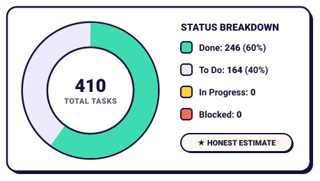
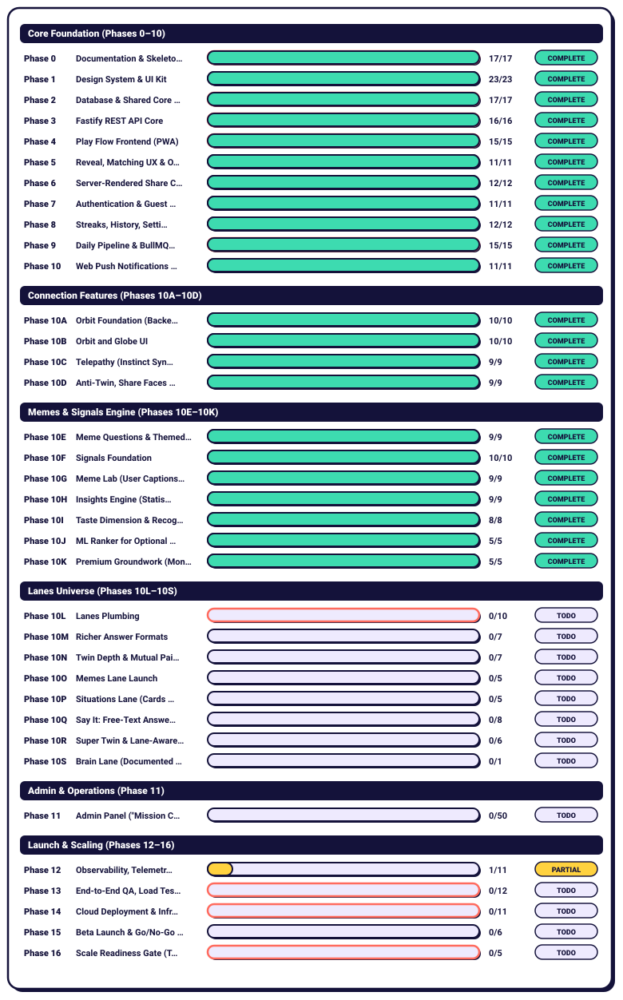

# Phase and Task Breakdown — Oddly v1

> **The Reliability Promise:**  
> *"No acknowledged submission is ever lost, the Drop is always reachable, and when we are overloaded we shed non-essential work first and say so honestly."*

**Project:** Oddly v1 | **Last updated:** 2026-11-22 | **Owner:** Senior System Designer & SRE + Founder  
**Purpose of this file:** Authoritative project roadmap, task tracking, progress bars, phase dependencies, scale readiness gates, and verification criteria across all 17 phases (Phase 0 to Phase 16).

---

## 1. Master Progress Dashboard

| Metric                          | Current Value                                                                    |
| ------------------------------- | -------------------------------------------------------------------------------- |
| **Overall Project Progress**    | `🟩🟩🟩🟩🟩🟩🟩⬜⬜⬜ 69%`                                                       |
| **Current Active Stage**        | **Phase 10T: Bonus Rounds (Stage L9)**                                           |
| **Total Tasks Tracked**         | 410 tasks across 38 phases                                                       |
| **Completed Tasks (`DONE`)**    | 283 tasks (Proven by code, tests & integration test suite)                       |
| **In Progress (`IN PROGRESS`)** | 0 tasks                                                                          |
| **Blocked (`BLOCKED`)**         | 0 tasks                                                                          |
| **Pending (`TODO`)**            | 127 tasks                                                                        |

<!-- visual:start dashboard-visuals -->

<!-- visual:end dashboard-visuals -->
---

### Recommended Execution Order (Founder Approval Required)

`F1 → M0 → L0 → L0-FIX → L0-ADD → L1 → L2 → L3 → F2 → F3 → F4 → M1 → M2 → L4 → L9 → Phase 11 admin → L5 → L7 → L10 → on command: M3 to M8, L6, L8`

<!-- visual:start roadmap-visual -->

<!-- visual:end roadmap-visual -->

> **Architectural Justification:** Introducing the `lane_id` column and lane schema foundations in Stages L1–L3 ensures all subsequent connection features (Twin Globe F19, Keep & Orbit F18, Telepathy F20, Anti-Twin F22) are built lane-aware natively from day one, eliminating costly secondary expand-only migrations and backfills.

---

## 2. Phase Overview Table

<!-- visual:start phases-visual -->

<!-- visual:end phases-visual -->

| Phase        | Phase Name                                  | Priority | Status    | Progress Bar       | Tasks (Done/Total) | Stage That Builds It  |
| ------------ | ------------------------------------------- | -------- | --------- | ------------------ | ------------------ | --------------------- |
| **Phase 0**  | Documentation & Skeleton Initialisation     | Critical | ✅ COMPLETE  | `🟩🟩🟩🟩🟩🟩🟩🟩🟩🟩 100%` | 17 / 17            | Stage 0 & Stage 0.5   |
| **Phase 1**  | Design System & UI Kit                      | High     | ✅ COMPLETE  | `🟩🟩🟩🟩🟩🟩🟩🟩🟩🟩 100%` | 23 / 23            | Stage 1 & Stage 0.5   |
| **Phase 2**  | Database & Shared Core Scoring              | Critical | ✅ COMPLETE  | `🟩🟩🟩🟩🟩🟩🟩🟩🟩🟩 100%` | 17 / 17            | Stage 2 & Stage R2    |
| **Phase 3**  | Fastify REST API Core                       | Critical | ✅ COMPLETE  | `🟩🟩🟩🟩🟩🟩🟩🟩🟩🟩 100%` | 16 / 16            | Stage 3 & Stage R2    |
| **Phase 4**  | Play Flow Frontend (PWA)                    | Critical | ✅ COMPLETE  | `🟩🟩🟩🟩🟩🟩🟩🟩🟩🟩 100%` | 15 / 15            | Stage 4 & Stage 0.5   |
| **Phase 5**  | Reveal, Matching UX & Oddness               | High     | ✅ COMPLETE  | `🟩🟩🟩🟩🟩🟩🟩🟩🟩🟩 100%` | 11 / 11            | Stage 5 & Stage 0.5   |
| **Phase 6**  | Server-Rendered Share Cards & Links         | High     | ✅ COMPLETE  | `🟩🟩🟩🟩🟩🟩🟩🟩🟩🟩 100%` | 12 / 12            | Stage 6 & Stage 0.5   |
| **Phase 7**  | Authentication & Guest Merge                | High     | ✅ COMPLETE  | `🟩🟩🟩🟩🟩🟩🟩🟩🟩🟩 100%` | 11 / 11            | Stage 7 & Stage 0.5   |
| **Phase 8**  | Streaks, History, Settings & Privacy        | Medium   | ✅ COMPLETE  | `🟩🟩🟩🟩🟩🟩🟩🟩🟩🟩 100%` | 12 / 12            | Stage 8 & Stage R2    |
| **Phase 9**  | Daily Pipeline & BullMQ Scheduler           | Critical | ✅ COMPLETE  | `🟩🟩🟩🟩🟩🟩🟩🟩🟩🟩 100%` | 15 / 15            | Stage 9 & Stage R2    |
| **Phase 10** | Web Push Notifications & PWA Caching        | Medium   | ✅ COMPLETE  | `🟩🟩🟩🟩🟩🟩🟩🟩🟩🟩 100%` | 11 / 11            | Stage 10 & Stage R2   |
| **Phase 10A**| Orbit Foundation (Backend)                  | High     | ✅ COMPLETE  | `🟩🟩🟩🟩🟩🟩🟩🟩🟩🟩 100%` | 10 / 10            | Stage F1              |
| **Phase 10B**| Orbit and Globe UI                          | High     | ✅ COMPLETE  | `🟩🟩🟩🟩🟩🟩🟩🟩🟩🟩 100%` | 10 / 10            | Stage F2              |
| **Phase 10C**| Telepathy (Instinct Sync)                   | High     | ✅ COMPLETE  | `🟩🟩🟩🟩🟩🟩🟩🟩🟩🟩 100%` | 9 / 9              | Stage F3              |
| **Phase 10D**| Anti-Twin, Share Faces & Verification Gate  | High     | ✅ COMPLETE  | `🟩🟩🟩🟩🟩🟩🟩🟩🟩🟩 100%` | 9 / 9              | Stage F4              |
| **Phase 10E**| Meme Questions & Themed Drops               | High     | ✅ COMPLETE  | `🟩🟩🟩🟩🟩🟩🟩🟩🟩🟩 100%` | 9 / 9              | Stage M1 (after F4)   |
| **Phase 10F**| Signals Foundation                          | High     | ✅ COMPLETE  | `🟩🟩🟩🟩🟩🟩🟩🟩🟩🟩 100%` | 10 / 10            | Stage M2 (after M1)   |
| **Phase 10G**| Meme Lab (User Captions & Moderation Queue) | Medium   | ✅ COMPLETE  | `🟩🟩🟩🟩🟩🟩🟩🟩🟩🟩 100%` | 9 / 9              | Stage M3              |
| **Phase 10H**| Insights Engine (Statistics Only)           | Medium   | ✅ COMPLETE  | `🟩🟩🟩🟩🟩🟩🟩🟩🟩🟩 100%` | 9 / 9              | Stage M4              |
| **Phase 10I**| Taste Dimension & Recognition (Badges)      | Medium   | ✅ COMPLETE  | `🟩🟩🟩🟩🟩🟩🟩🟩🟩🟩 100%` | 8 / 8              | Stage M5/M6           |
| **Phase 10J**| ML Ranker for Optional Surfaces             | Low      | ✅ COMPLETE  | `🟩🟩🟩🟩🟩🟩🟩🟩🟩🟩 100%` | 5 / 5              | Stage M7              |
| **Phase 10K**| Premium Groundwork (Monetisation Gate G3)   | Low      | ✅ COMPLETE  | `🟩🟩🟩🟩🟩🟩🟩🟩🟩🟩 100%` | 5 / 5              | Stage M8              |
| **Phase 10L**| Lanes Plumbing                              | Critical | ✅ COMPLETE  | `🟩🟩🟩🟩🟩🟩🟩🟩🟩🟩 100%` | 10 / 10            | Stage L1              |
| **Phase 10M**| Richer Answer Formats                       | High     | ✅ COMPLETE  | `🟩🟩🟩🟩🟩🟩🟩🟩🟩🟩 100%` | 7 / 7              | Stage L2              |
| **Phase 10N**| Twin Depth & Mutual Pairing                 | High     | ✅ COMPLETE  | `🟩🟩🟩🟩🟩🟩🟩🟩🟩🟩 100%` | 7 / 7              | Stage L3              |
| **Phase 10O**| Memes Lane Launch                           | High     | ✅ COMPLETE  | `🟩🟩🟩🟩🟩🟩🟩🟩🟩🟩 100%` | 5 / 5              | Stage L4 (after M1)   |
| **Phase 10P**| Situations Lane (Cards First)               | Medium   | ⚪ TODO      | `⬜⬜⬜⬜⬜⬜⬜⬜⬜⬜ 0%` | 0 / 5              | Stage L5              |
| **Phase 10Q**| Say It: Free-Text Answers (Gate G4)         | Low      | ⚪ TODO      | `⬜⬜⬜⬜⬜⬜⬜⬜⬜⬜ 0%` | 0 / 8              | Stage L6 (Gate G4)    |
| **Phase 10R**| Super Twin & Lane-Aware Connection Features | Medium   | ⚪ TODO      | `⬜⬜⬜⬜⬜⬜⬜⬜⬜⬜ 0%` | 0 / 6              | Stage L7              |
| **Phase 10S**| Brain Lane (Documented Only)                | Low      | ⚪ TODO      | `⬜⬜⬜⬜⬜⬜⬜⬜⬜⬜ 0%` | 0 / 1              | Stage L8              |
| **Phase 10T**| Bonus Rounds (Stage L9)                     | High     | ⚪ TODO      | `⬜⬜⬜⬜⬜⬜⬜⬜⬜⬜ 0%` | 0 / 7              | Stage L9              |
| **Phase 10U**| Badges (Stage L10)                           | High     | ⚪ TODO      | `⬜⬜⬜⬜⬜⬜⬜⬜⬜⬜ 0%` | 0 / 6              | Stage L10             |
| **Phase 11** | Admin Panel ("Mission Control")             | High     | ⚪ TODO      | `⬜⬜⬜⬜⬜⬜⬜⬜⬜⬜ 0%` | 0 / 50             | Stage 11 (Addenda A+B+C)|
| **Phase 12** | Observability, Telemetry & Security         | High     | 🟡 PARTIAL  | `🟩⬜⬜⬜⬜⬜⬜⬜⬜⬜ 9%` | 1 / 11             | Stage 12 & Stage R2   |
| **Phase 13** | End-to-End QA, Load Tests & Audits          | Critical | ⚪ TODO      | `⬜⬜⬜⬜⬜⬜⬜⬜⬜⬜ 0%` | 0 / 12             | Stage 13              |
| **Phase 14** | Cloud Deployment & Infrastructure           | Critical | ⚪ TODO      | `⬜⬜⬜⬜⬜⬜⬜⬜⬜⬜ 0%` | 0 / 11             | Stage 14              |
| **Phase 15** | Beta Launch & Go/No-Go Decision Gates       | High     | ⚪ TODO      | `⬜⬜⬜⬜⬜⬜⬜⬜⬜⬜ 0%` | 0 / 6              | Stage 15              |
| **Phase 16** | Scale Readiness Gate (T1, T2, T3)           | Critical | ⚪ TODO      | `⬜⬜⬜⬜⬜⬜⬜⬜⬜⬜ 0%` | 0 / 5              | Stage 16 (Scale Gate) |

---

## 3. Detailed Phase Breakdown and Task Catalog

### Phase 0: Documentation and Initialisation (Stage 0 & Stage 0.5)

_Status: COMPLETE | Target: Skeleton verified, zero features implemented, scale & reliability architecture hardened._

| ID          | Task Description                                                                                                                   | Priority | Status | Depends On  | Owner | Done Date   | Notes                                  |
| ----------- | ---------------------------------------------------------------------------------------------------------------------------------- | -------- | ------ | ----------- | ----- | ----------- | -------------------------------------- |
| `[x] P0.01` | Create 6 core markdown files (`architecture.md`, `product.md`, `rules.md`, `design.md`, `task.md`, `memory.md`)                    | 🔴 Critical  | ✅ DONE         | None        | Agent | 2026-11-07  | Fully detailed, cross-consistent       |
| `[x] P0.02` | Git repo initialization, `.gitignore`, `.editorconfig`, `.nvmrc` (Node 20), `.prettierrc`, ESLint config, `tsconfig.base.json`     | 🟠 High      | ✅ DONE         | P0.01       | Agent | 2026-11-07  | Standard base configs                  |
| `[x] P0.03` | Configure pnpm workspace (`pnpm-workspace.yaml`), `turbo.json`, root `package.json` with dev, build, lint, typecheck, test scripts | 🔴 Critical  | ✅ DONE         | P0.02       | Agent | 2026-11-07  | Monorepo orchestration                 |
| `[x] P0.04` | Scaffold `apps/web` (Next.js 14 App Router, Tailwind, brand fonts placeholder "oddly — coming soon")                               | 🟠 High      | ✅ DONE         | P0.03       | Agent | 2026-11-07  | Proves design tokens work              |
| `[x] P0.05` | Scaffold `services/api` (Fastify + TypeScript) with single `GET /health` route returning `{ ok: true, service: "api" }`            | 🟠 High      | ✅ DONE         | P0.03       | Agent | 2026-11-07  | Strict type providers                  |
| `[x] P0.06` | Scaffold `services/worker` (BullMQ + TypeScript) that boots, connects to Redis, logs "worker ready", and idles                     | 🟡 Medium    | ✅ DONE         | P0.03       | Agent | 2026-11-07  | Background queue worker skeleton       |
| `[x] P0.07` | Scaffold `packages/shared`, `packages/ui-tokens`, and `packages/api-client` with typed exports                                     | 🟠 High      | ✅ DONE         | P0.03       | Agent | 2026-11-07  | Internal monorepo library packages     |
| `[x] P0.08` | Create `infra/docker-compose.yml` (PostgreSQL 16, Redis 7) and `infra/README.md`                                                   | 🟡 Medium    | ✅ DONE         | P0.03       | Agent | 2026-11-07  | Local development services             |
| `[x] P0.09` | Author `.env.example` with clear documentation of all required variables and dummy values                                          | 🟡 Medium    | ✅ DONE         | P0.03       | Agent | 2026-11-07  | Environment config template            |
| `[x] P0.10` | Configure GitHub Actions CI workflow running typecheck, lint, and test on all PRs                                                  | 🟠 High      | ✅ DONE         | P0.03       | Agent | 2026-11-07  | Continuous integration                 |
| `[x] P0.11` | Verify end-to-end local startup: `pnpm install`, `pnpm build`, `pnpm typecheck`, `pnpm lint`, `pnpm test`                           | 🔴 Critical  | ✅ DONE         | P0.04-P0.08 | Agent | 2026-11-07  | Zero compile/lint/test errors          |
| `[x] P0.12` | Author `README.md` with complete developer setup instructions, local dev commands, and architecture links                          | 🟡 Medium    | ✅ DONE         | P0.11       | Agent | 2026-11-07  | Onboarding guide                       |
| `[x] P0.13` | Confirm no functional feature code is written; commit Stage 0 files, tag `stage-0-complete`                                        | 🔴 Critical  | ✅ DONE         | P0.11       | Agent | 2026-11-07  | Stage 0 milestone gate                 |
| `[x] P0.14` | Integrate Override Addendum: enforce dynamic content from PostgreSQL across all documents                                          | 🔴 Critical  | ✅ DONE         | P0.01       | Agent | 2026-11-07  | Architecture compliance                |
| `[x] P0.15` | Apply Scale and Reliability Addendum across all core markdown specifications and README                                            | 🔴 Critical  | ✅ DONE         | P0.01       | Agent | 2026-11-10  | Stage 0.5 Architecture hardening       |
| `[x] P0.16` | Author complete operational and scaling documentation suite under `docs/` (8 authoritative documents)                             | 🔴 Critical  | ✅ DONE         | P0.15       | Agent | 2026-11-10  | Stage 0.5 SRE documentation suite      |
| `[x] P0.17` | Update all `.env.example` files with multi-role Redis, DB pooler, load shedding, and observability variables                      | 🟠 High      | ✅ DONE         | P0.15       | Agent | 2026-11-10  | Stage 0.5 Configuration hardening      |

---

### Phase 1: Design System & UI Kit (Stage 1)

_Status: COMPLETE | Target: Token foundation, accessible UI primitives, 28 custom SVGs, degraded state UI._

| ID          | Task Description                                                                            | Priority | Status | Depends On  | Owner | Done Date   | Notes                           |
| ----------- | ------------------------------------------------------------------------------------------- | -------- | ------ | ----------- | ----- | ----------- | ------------------------------- |
| `[x] P1.01` | Export Tailwind CSS preset from `packages/ui-tokens` with all brand colors and fonts         | 🔴 Critical  | ✅ DONE         | P0.07       | Agent | 2026-11-07  | Color palette and typography    |
| `[x] P1.02` | Configure Space Grotesk and Inter fonts in Next.js with `font-display: swap`                 | 🟠 High      | ✅ DONE         | P1.01       | Agent | 2026-11-07  | Zero FOIT font delivery         |
| `[x] P1.03` | Build `Button` component (primary, secondary, ghost, danger, with haptic feedback trigger)   | 🟠 High      | ✅ DONE         | P1.01       | Agent | 2026-11-07  | Core interactive primitive      |
| `[x] P1.04` | Build `Card` component with Dark, Light, and Mythic theme variants                          | 🟠 High      | ✅ DONE         | P1.01       | Agent | 2026-11-07  | Content container primitive     |
| `[x] P1.05` | Build `ResponsiveDialog` component using Radix UI Dialog / Drawer with focus trapping       | 🟠 High      | ✅ DONE         | P1.01       | Agent | 2026-11-07  | Accessible modal / bottom sheet |
| `[x] P1.06` | Build `PickTile` component for binary questions (cold pizza vs lukewarm coffee)             | 🟠 High      | ✅ DONE         | P1.03       | Agent | 2026-11-07  | Question Type 1 UI              |
| `[x] P1.07` | Build `NumberSlider` component (1–50) with tactile step increments                          | 🟠 High      | ✅ DONE         | P1.01       | Agent | 2026-11-07  | Question Type 2 UI              |
| `[x] P1.08` | Build `ColourPalettePicker` component (12-colour grid, WCAG AA checkmarks)                  | 🟠 High      | ✅ DONE         | P1.01       | Agent | 2026-11-07  | Question Type 3 UI              |
| `[x] P1.09` | Build `FourOptionGrid` component (2x2 cards for text/image choices)                         | 🟠 High      | ✅ DONE         | P1.04       | Agent | 2026-11-07  | Question Type 4 UI              |
| `[x] P1.10` | Build `WordPillPicker` component (6-pill tap selector for mood/intuition)                   | 🟠 High      | ✅ DONE         | P1.03       | Agent | 2026-11-07  | Question Type 5 UI              |
| `[x] P1.11` | Build `ProgressDots` component (5 dots showing completed/active/upcoming questions)         | 🟡 Medium    | ✅ DONE         | P1.01       | Agent | 2026-11-07  | Question flow header indicator  |
| `[x] P1.12` | Build `Countdown` split-flap ticker component displaying HH:MM:SS to 07:00 IST              | 🟡 Medium    | ✅ DONE         | P1.01       | Agent | 2026-11-07  | S2 Countdown screen timer       |
| `[x] P1.13` | Build `Confetti` canvas celebration wrapper using `canvas-confetti`                         | 🟢 Low       | ✅ DONE         | P1.01       | Agent | 2026-11-07  | S6 Twin Reveal celebration      |
| `[x] P1.14` | Build `Toast` notification primitive for non-blocking feedback                             | 🟡 Medium    | ✅ DONE         | P1.01       | Agent | 2026-11-07  | Ephemeral system messages       |
| `[x] P1.15` | Author 28 custom SVGs (doors, items, mood glyphs) into `apps/web/public/illustrations/`     | 🟠 High      | ✅ DONE         | P1.01       | Agent | 2026-11-07  | Full vector illustration pack   |
| `[x] P1.16` | Build `ThemeProvider` and theme toggle supporting System, Dark, and Light modes             | 🟡 Medium    | ✅ DONE         | P1.01       | Agent | 2026-11-07  | Theme management system         |
| `[x] P1.17` | Create visual design showcase page at `apps/web/src/app/design/page.tsx`                    | 🟠 High      | ✅ DONE         | P1.03-P1.16 | Agent | 2026-11-07  | Component verification gallery  |
| `[x] P1.18` | Implement haptic vibration and sound effect hooks with user preference toggles              | 🟢 Low       | ✅ DONE         | P1.03       | Agent | 2026-11-07  | Sensory feedback system         |
| `[x] P1.19` | Run automated accessibility audit with `@axe-core/playwright` on all UI components          | 🟠 High      | ✅ DONE         | P1.17       | Agent | 2026-11-12  | Playwright axe-core e2e suite with 11 tests verifying zero critical/serious violations across all routes & play flow |
| `[x] P1.20` | Build status banner component for degradation levels L1–L4 with dynamic copy                | 🟠 High      | ✅ DONE         | P1.01       | Agent | 2026-11-22  | Non-alarmist banner for L1–L4 load shedding (DegradationBanner.tsx) |
| `[x] P1.21` | Build "Saved. Finding your twin..." pending screen for Mode B with reduced-motion support   | 🟠 High      | ✅ DONE         | P1.01       | Agent | 2026-11-22  | Async pending screen with two-dot animation & reduced motion (ModeBPendingScreen.tsx) |
| `[x] P1.22` | Build stale-data freshness labels and 429/503 friendly overload screens with countdown      | 🟡 Medium    | ✅ DONE         | P1.01       | Agent | 2026-11-22  | Stale freshness labels & friendly overload retry screens (OverloadScreens.tsx) |
| `[x] P1.23` | Enforce skeleton minimum display time (200ms) and widget-level error boundary fallbacks     | 🟡 Medium    | ✅ DONE         | P1.01       | Agent | 2026-11-22  | Anti-flicker 200ms hook/skeleton & WidgetErrorBoundary (ResiliencePrimitives.tsx) |

---

### Phase 2: Database & Shared Core Scoring (Stage 2)

_Status: PARTIAL | Target: PostgreSQL schema, pure scoring algorithms, partitioning, scale tables._

| ID          | Task Description                                                                            | Priority | Status | Depends On  | Owner | Done Date   | Notes                           |
| ----------- | ------------------------------------------------------------------------------------------- | -------- | ------ | ----------- | ----- | ----------- | ------------------------------- |
| `[x] P2.01` | Write complete Prisma schema (`packages/shared/prisma/schema.prisma`) with 18 core tables   | 🔴 Critical  | ✅ DONE         | P0.07       | Agent | 2026-11-08  | Authoritative schema definition |
| `[x] P2.02` | Implement database migrations; verify foreign keys, unique constraints, and indices         | 🔴 Critical  | ✅ DONE         | P2.01       | Agent | 2026-11-08  | Database integrity              |
| `[x] P2.03` | Author database seed script (`packages/shared/prisma/seed.ts`) importing `batch_001.json`   | 🔴 Critical  | ✅ DONE         | P2.02       | Agent | 2026-11-08  | Idempotent seed pipeline        |
| `[x] P2.04` | Implement question validation engine verifying 5-type daily mix and option bounds           | 🟠 High      | ✅ DONE         | P2.01       | Agent | 2026-11-08  | Content integrity guard         |
| `[x] P2.05` | Implement pair similarity algorithm $S(u, v) = \frac{1}{W} \sum w_q \cdot s_q$ in shared    | 🔴 Critical  | ✅ DONE         | P0.07       | Agent | 2026-11-08  | Core matching mathematics       |
| `[x] P2.06` | Implement information content and Oddness formula $I = \sum -\log_2(p(a))$ in shared        | 🔴 Critical  | ✅ DONE         | P0.07       | Agent | 2026-11-08  | Information-theoretic rarity    |
| `[x] P2.07` | Implement Oddness rarity percentile formula $P(u) = \frac{\text{count}(I_v < I_u)}{N} \times 100$ | 🔴 Critical  | ✅ DONE         | P2.06 | Agent | 2026-11-08  | Percentile calculation engine   |
| `[x] P2.08` | Implement dynamic tier classification (Common, Uncommon, Rare, Mythic) from database       | 🟠 High      | ✅ DONE         | P2.07       | Agent | 2026-11-08  | Tier determination engine       |
| `[x] P2.09` | Implement k-anonymity aggregation filters ($k \ge 20$) for safe coarse demographic display  | 🟠 High      | ✅ DONE         | P2.01       | Agent | 2026-11-08  | Privacy preservation algorithm  |
| `[x] P2.10` | Implement generic question polymorphic JSON parsers and type guards in `@oddly/shared`      | 🟠 High      | ✅ DONE         | P2.01       | Agent | 2026-11-08  | Polymorphic question support    |
| `[x] P2.11` | Write deterministic unit tests with worked-example fixtures for all scoring formulas        | 🔴 Critical  | ✅ DONE         | P2.05-P2.09 | Agent | 2026-11-08  | Mathematical proof suite        |
| `[x] P2.12` | Implement Monte Carlo simulation script (`packages/shared/src/sim.ts`) verifying entropy   | 🟡 Medium    | ✅ DONE         | P2.11       | Agent | 2026-11-08  | Statistical verification script |
| `[x] P2.13` | Range-partition `submissions`, `answers`, `matches` by `drop_date` with 14-day generator   | 🔴 Critical  | ✅ DONE         | P2.01       | Agent | 2026-11-11  | Daily partitioning, DEFAULT alert, PartitionManager (R2.1) |
| `[x] P2.14` | Create `batch_runs`, `scheduler_runs`, and `persist_reconciliation` tables for scale        | 🟠 High      | ✅ DONE         | P2.01       | Agent | 2026-11-11  | Scale governance tables & resumable batch tracking (R2.1) |
| `[x] P2.15` | Benchmark submit transaction at 1,000 tx/s on staging to evaluate Prisma vs raw SQL        | 🟠 High      | ✅ DONE         | P2.02       | Agent | 2026-11-11  | 22,715 rows/sec, 0.54ms p50, verified pruning (R2.1) |
| `[x] P2.16` | Configure multi-role Redis key namespaces (`cache`, `counters`, `queues`) and Lua scripts   | 🔴 Critical  | ✅ DONE         | P2.01       | Agent | 2026-11-11  | Role separation, strict prefixes, mandatory TTL wrapper (R2.2) |
| `[x] P2.17` | Implement capacity-model math as CLI command (`pnpm capacity`) and synthetic load generator | 🟠 High      | ✅ DONE         | P2.12       | Agent | 2026-11-11  | Capacity math, 200 reservoir cap, 18.3MB budget (R2.9) |

---

### Phase 3: Fastify REST API Core (Stage 3)

_Status: COMPLETE | Target: REST routes, Swagger docs, guest identity, load shedding, route policies._

| ID          | Task Description                                                                            | Priority | Status | Depends On  | Owner | Done Date   | Notes                           |
| ----------- | ------------------------------------------------------------------------------------------- | -------- | ------ | ----------- | ----- | ----------- | ------------------------------- |
| `[x] P3.01` | Scaffold Fastify server with Helmet, CORS, signed cookies, and pino-pretty logging          | 🔴 Critical  | ✅ DONE         | P0.05       | Agent | 2026-11-08  | Core server infrastructure      |
| `[x] P3.02` | Configure `fastify-type-provider-zod` with central error handler for uniform JSON errors    | 🔴 Critical  | ✅ DONE         | P3.01       | Agent | 2026-11-08  | Typed validation pipeline       |
| `[x] P3.03` | Implement `GET /v1/drop/today` endpoint with 5-minute Redis caching and question payload     | 🔴 Critical  | ✅ DONE         | P2.03, P3.02| Agent | 2026-11-08  | Daily drop delivery endpoint    |
| `[x] P3.04` | Implement anonymous guest identity via `oddly_did` cookie and `players` table registration  | 🔴 Critical  | ✅ DONE         | P2.01, P3.02| Agent | 2026-11-08  | Zero-signup player identity     |
| `[x] P3.05` | Implement `POST /v1/submissions` with idempotent `request_id` check and atomic increments   | 🔴 Critical  | ✅ DONE         | P2.05, P3.04| Agent | 2026-11-08  | Core submission endpoint        |
| `[x] P3.06` | Implement instant Stage A provisional twin calculation over Redis answer vectors            | 🔴 Critical  | ✅ DONE         | P3.05       | Agent | 2026-11-08  | Real-time matching engine       |
| `[x] P3.07` | Implement `GET /v1/results/:dropId` returning provisional twin and oddness percentile       | 🔴 Critical  | ✅ DONE         | P3.06       | Agent | 2026-11-08  | Player result retrieval         |
| `[x] P3.08` | Implement `GET /v1/content/:locale` dynamic copy endpoint with content-hash cache header    | 🟠 High      | ✅ DONE         | P2.01, P3.02| Agent | 2026-11-08  | Dynamic UI copy delivery        |
| `[x] P3.09` | Implement `@fastify/rate-limit` with Redis store (120 req/min general, 30 req/min submit)  | 🟠 High      | ✅ DONE         | P3.01       | Agent | 2026-11-10  | Redis-backed rate limit, dedicated 30 req/min on submissions, no prod localhost bypass (R1.4) |
| `[x] P3.10` | Implement Cloudflare Turnstile token validation plugin for anti-bot protection              | 🟠 High      | ✅ DONE         | P3.01       | Agent | 2026-11-08  | Bot challenge verification      |
| `[x] P3.11` | Configure `@fastify/swagger` and `@fastify/swagger-ui` serving OpenAPI docs at `/docs`      | 🟡 Medium    | ✅ DONE         | P3.02       | Agent | 2026-11-08  | Automated API documentation     |
| `[x] P3.12` | Implement typed API client in `packages/api-client` wrapping all `/v1` endpoints            | 🟠 High      | ✅ DONE         | P3.03-P3.08 | Agent | 2026-11-08  | Universal typed client library  |
| `[x] P3.13` | Implement `@fastify/under-pressure` load shedding on event-loop delay (>20ms) and heap     | 🔴 Critical  | ✅ DONE         | P3.01       | Agent | 2026-11-11  | Under-pressure load shedding, 503 OVERLOADED & Retry-After (R1.3, R2.5) |
| `[x] P3.14` | Implement per-route policy table enforcement in code (timeouts, circuit breakers)           | 🔴 Critical  | ✅ DONE         | P3.01       | Agent | 2026-11-11  | Route policy registry, weak ETag, 304, Opossum breakers (R2.3, R2.4) |
| `[x] P3.15` | Implement `/ready`, `/v1/stats/today`, `/v1/time`, `/v1/config/public` with degradation     | 🟠 High      | ✅ DONE         | P3.03       | Agent | 2026-11-11  | Ready probe, time offset, degradation headers L0-L4 (R1.3, R2.5) |
| `[x] P3.16` | Implement Mode B asynchronous ingestion behind `PERSIST_MODE=async` with reconciliation     | 🟠 High      | ✅ DONE         | P3.05       | Agent | 2026-11-22  | Dual persistence modes, Redis queue, worker micro-batching, reconciliation audit (8.3, ADR 012) |

---

### Phase 4: Play Flow Frontend (Stage 4)

_Status: COMPLETE | Target: S1 to S4 responsive flow, TanStack Query, offline persistence, budget CI._

| ID          | Task Description                                                                            | Priority | Status | Depends On  | Owner | Done Date   | Notes                           |
| ----------- | ------------------------------------------------------------------------------------------- | -------- | ------ | ----------- | ----- | ----------- | ------------------------------- |
| `[x] P4.01` | Build S1 Landing Screen with dynamic copy, active player count, and "Play today's five" CTA | 🔴 Critical  | ✅ DONE         | P1.17, P3.12| Agent | 2026-11-08  | Game entrance view              |
| `[x] P4.02` | Build Age Gate bottom sheet requiring explicit 18+ confirmation before initial play        | 🔴 Critical  | ✅ DONE         | P1.05, P3.04| Agent | 2026-11-08  | DPDP legal compliance gate      |
| `[x] P4.03` | Build S2 Countdown Screen displayed when drop is scheduled or completed today               | 🟠 High      | ✅ DONE         | P1.12, P3.03| Agent | 2026-11-08  | Between-drop waiting screen     |
| `[x] P4.04` | Build S3 Question Answering Flow dynamically rendering polymorphic questions (Q1 to Q5)     | 🔴 Critical  | ✅ DONE         | P1.06-P1.10 | Agent | 2026-11-08  | Core question answering loop    |
| `[x] P4.05` | Implement question transition animations (horizontal slide with subtle fade, <300ms)        | 🟡 Medium    | ✅ DONE         | P4.04       | Agent | 2026-11-08  | Smooth fluid interactions       |
| `[x] P4.06` | Build S4 Review Screen displaying player's five choices with tap-to-edit capability        | 🟠 High      | ✅ DONE         | P4.04       | Agent | 2026-11-08  | Pre-submission confirmation     |
| `[x] P4.07` | Implement local draft persistence in Zustand store so accidental refresh preserves picks   | 🟠 High      | ✅ DONE         | P4.04       | Agent | 2026-11-08  | Pick resilience & draft recovery|
| `[x] P4.08` | Wire submission flow to `POST /v1/submissions` with idempotent `request_id` handling        | 🔴 Critical  | ✅ DONE         | P3.05, P4.06| Agent | 2026-11-08  | Submission integration          |
| `[x] P4.09` | Implement offline detection banner with automatic retry when network reconnects            | 🟠 High      | ✅ DONE         | P1.14, P4.08| Agent | 2026-11-08  | Flaky network resilience        |
| `[x] P4.10` | Implement sound and haptic sensory feedback triggers across all question interactions      | 🟢 Low       | ✅ DONE         | P1.18, P4.04| Agent | 2026-11-08  | Delightful sensory experience   |
| `[x] P4.11` | Write Playwright E2E test verifying complete S1->S4 answering flow on mobile viewport       | 🔴 Critical  | ✅ DONE         | P4.01-P4.08 | Agent | 2026-11-08  | End-to-end flow verification    |
| `[x] P4.12` | Configure TanStack Query retry policy with exponential backoff and full jitter              | 🟠 High      | ✅ DONE         | P4.08       | Agent | 2026-11-22  | Network discipline, 5 retries, Retry-After (Sec 6.3) |
| `[x] P4.13` | Implement Zustand draft persistence with pending-submission recovery on app open           | 🟠 High      | ✅ DONE         | P4.07       | Agent | 2026-11-22  | Client resilience, persist store, recovery (Sec 6.3) |
| `[x] P4.14` | Synchronize countdown against server `Date` offset and add 0–4s randomized fetch jitter     | 🟠 High      | ✅ DONE         | P4.03       | Agent | 2026-11-22  | Thundering herd defense, /v1/time offset, 0-4s jitter (5.2) |
| `[x] P4.15` | Enforce bundle budget check (<150 KB initial JS) in CI with `size-limit`                    | 🟡 Medium    | ✅ DONE         | P4.01       | Agent | 2026-11-22  | Bundle budget gate in CI with size-limit (Sec 6.2) |

---

### Phase 5: Reveal, Matching UX & Oddness (Stage 5)

_Status: COMPLETE | Target: S5 Searching radar, S6 Twin Reveal, S7 Oddness rarity, degraded UI._

| ID          | Task Description                                                                            | Priority | Status | Depends On  | Owner | Done Date   | Notes                           |
| ----------- | ------------------------------------------------------------------------------------------- | -------- | ------ | ----------- | ----- | ----------- | ------------------------------- |
| `[x] P5.01` | Build S5 Searching Animation Screen (pulsing concentric radar, 2.0s duration, skippable)   | 🟠 High      | ✅ DONE         | P1.01, P4.08| Agent | 2026-11-08  | Engaging search transition      |
| `[x] P5.02` | Build S6 Twin Reveal Screen displaying matched pick count, coarse region, and age band      | 🔴 Critical  | ✅ DONE         | P1.04, P3.07| Agent | 2026-11-08  | Core outcome reveal view        |
| `[x] P5.03` | Implement sequential pick-dot illumination animation (green match / gray mismatch)          | 🟠 High      | ✅ DONE         | P5.02       | Agent | 2026-11-08  | Suspenseful match reveal        |
| `[x] P5.04` | Wire celebratory confetti burst on reveal (moderate particle count, auto-stops after 2.5s) | 🟢 Low       | ✅ DONE         | P1.13, P5.02| Agent | 2026-11-08  | Delightful celebration          |
| `[x] P5.05` | Build S7 Oddness Rarity Screen displaying animated count-up percentile and tier badge       | 🔴 Critical  | ✅ DONE         | P1.04, P3.07| Agent | 2026-11-08  | Rarity score visualization      |
| `[x] P5.06` | Implement Rarest Pick highlight card detailing exact percentage of players who chose it     | 🟠 High      | ✅ DONE         | P5.05       | Agent | 2026-11-08  | Statistical highlight feature   |
| `[x] P5.07` | Implement honest low-density messaging when total players < 200                             | 🟠 High      | ✅ DONE         | P5.02, P5.05| Agent | 2026-11-08  | Ethical honesty standard        |
| `[x] P5.08` | Implement share trigger buttons opening S8 Share Sheet                                      | 🟠 High      | ✅ DONE         | P5.02, P5.05| Agent | 2026-11-08  | Viral loop entry point          |
| `[x] P5.09` | Write unit and integration tests verifying reveal animations and percentile formatting      | 🟠 High      | ✅ DONE         | P5.02-P5.07 | Agent | 2026-11-08  | Reveal screen test suite        |
| `[x] P5.10` | Implement pending-result polling with ETag 304 backoff and tab visibility pausing           | 🟠 High      | ✅ DONE         | P5.02       | Agent | 2026-11-22  | Polling discipline (Sec 6.3)    |
| `[x] P5.11` | Wire degraded UI states (stale labels, status banners) under L1 to L4                       | 🟡 Medium    | ✅ DONE         | P5.02       | Agent | 2026-11-22  | Degraded UI wiring (Sec 12)     |

---

### Phase 6: Server-Rendered Share Cards & Links (Stage 6)

_Status: COMPLETE | Target: Satori/Resvg PNG generator, R2 storage, `/c/:shortId`, worker threads._

| ID          | Task Description                                                                            | Priority | Status | Depends On  | Owner | Done Date   | Notes                           |
| ----------- | ------------------------------------------------------------------------------------------- | -------- | ------ | ----------- | ----- | ----------- | ------------------------------- |
| `[x] P6.01` | Build server-side Satori JSX templates for Story (9:16), Square (1:1), and Link (1.91:1)   | 🔴 Critical  | ✅ DONE         | P1.01, P2.08| Agent | 2026-11-08  | Visual card templates           |
| `[x] P6.02` | Integrate `@resvg/resvg-js` in BullMQ worker compiling SVG to PNG at 2x pixel density       | 🔴 Critical  | ✅ DONE         | P0.06, P6.01| Agent | 2026-11-08  | High-resolution PNG compilation |
| `[x] P6.03` | Implement dynamic QR code generator embedding `/c/:shortId?challenge=1` into cards         | 🟠 High      | ✅ DONE         | P6.01       | Agent | 2026-11-08  | Scannable viral loop            |
| `[x] P6.04` | Implement content-hash storage key computation and Cloudflare R2 upload pipeline            | 🔴 Critical  | ✅ DONE         | P6.02       | Agent | 2026-11-08  | Immutable asset storage         |
| `[x] P6.05` | Build short link generator (`POST /v1/shares`) creating 8-character nanoid slugs            | 🟠 High      | ✅ DONE         | P2.01, P3.02| Agent | 2026-11-08  | Clean shareable URLs            |
| `[x] P6.06` | Build S8 Share Sheet bottom sheet with format selector, live preview, and download action   | 🟠 High      | ✅ DONE         | P1.05, P6.04| Agent | 2026-11-08  | In-app sharing interface        |
| `[x] P6.07` | Implement Web Share API integration falling back to clipboard copy on unsupported browsers  | 🟠 High      | ✅ DONE         | P6.06       | Agent | 2026-11-08  | Native mobile share integration |
| `[x] P6.08` | Build dynamic challenge landing page at `apps/web/src/app/c/[shortId]/page.tsx`             | 🔴 Critical  | ✅ DONE         | P6.05       | Agent | 2026-11-08  | Public viral landing page       |
| `[x] P6.09` | Inject dynamic Open Graph and Twitter Card metadata into challenge landing pages           | 🟠 High      | ✅ DONE         | P6.08       | Agent | 2026-11-08  | Rich social link previews       |
| `[x] P6.10` | Write automated tests verifying share card generation, QR code parsing, and OG tags         | 🟠 High      | ✅ DONE         | P6.01-P6.09 | Agent | 2026-11-08  | Share infrastructure test suite |
| `[x] P6.11` | Offload Satori/Resvg card rendering to worker threads (`piscina`) capped to CPU cores       | 🟠 High      | ✅ DONE         | P6.02       | Agent | 2026-11-22  | Worker CPU offload (Sec 9)      |
| `[x] P6.12` | Implement on-demand card rendering under load and verify CDN edge cache hit ratios (>95%)   | 🟡 Medium    | ✅ DONE         | P6.04       | Agent | 2026-11-22  | Viral share defense (Sec 5)     |

---

### Phase 7: Authentication & Guest Merge (Stage 7)

_Status: COMPLETE | Target: Google Identity, soft sign-in modal, guest submission merge, L3 guest mode._

| ID          | Task Description                                                                            | Priority | Status | Depends On  | Owner | Done Date   | Notes                           |
| ----------- | ------------------------------------------------------------------------------------------- | -------- | ------ | ----------- | ----- | ----------- | ------------------------------- |
| `[x] P7.01` | Scaffold Google Identity Services (GIS) button and credential receiver on client           | 🟠 High      | ✅ DONE         | P4.01       | Agent | 2026-11-09  | Client-side Google SSO          |
| `[x] P7.02` | Implement `POST /v1/auth/oauth` verifying Google ID tokens with `google-auth-library`       | 🔴 Critical  | ✅ DONE         | P3.01       | Agent | 2026-11-09  | Token verification endpoint     |
| `[x] P7.03` | Issue 15-minute access JWTs and rotating 30-day refresh tokens via secure httpOnly cookies   | 🔴 Critical  | ✅ DONE         | P7.02       | Agent | 2026-11-09  | Session cookie architecture     |
| `[x] P7.04` | Implement `POST /v1/auth/merge-guest` seamlessly linking anonymous guest history to account | 🔴 Critical  | ✅ DONE         | P7.02       | Agent | 2026-11-09  | History preservation engine     |
| `[x] P7.05` | Build soft sign-in modal (Login Panel) triggered contextually from results and streak views | 🟠 High      | ✅ DONE         | P1.05, P7.01| Agent | 2026-11-09  | Non-blocking auth entry point   |
| `[x] P7.06` | Build `POST /v1/auth/refresh` rotating refresh tokens and issuing fresh access tokens       | 🟠 High      | ✅ DONE         | P7.03       | Agent | 2026-11-09  | Transparent session renewal     |
| `[x] P7.07` | Implement one-click account deletion and data export under DPDP Act requirements           | 🔴 Critical  | ✅ DONE         | P7.04       | Agent | 2026-11-09  | Legal right to erasure          |
| `[x] P7.08` | Build `POST /v1/auth/logout` clearing all auth cookies and invalidating refresh token       | 🟠 High      | ✅ DONE         | P7.03       | Agent | 2026-11-09  | Clean session termination       |
| `[x] P7.09` | Write automated tests verifying token verification, cookie rotation, and history merge      | 🟠 High      | ✅ DONE         | P7.02-P7.08 | Agent | 2026-11-09  | Auth integration test suite     |
| `[x] P7.10` | Enforce guest-play-only behavior under Level L3 and protect against token refresh storms    | 🟠 High      | ✅ DONE         | P7.04       | Agent | 2026-11-22  | Degradation auth protection (12)|
| `[x] P7.11` | Implement Cloudflare Turnstile fail-open policy for low-risk actions during gateway outage  | 🟡 Medium    | ✅ DONE         | P3.10       | Agent | 2026-11-22  | Bot defense resilience (Sec 13) |

---

### Phase 8: Streaks, History, Settings & Privacy (Stage 8)

_Status: COMPLETE | Target: Header Flame, History archive, Settings & Privacy, replica reads, 90d retention._

| ID          | Task Description                                                                            | Priority | Status | Depends On  | Owner | Done Date   | Notes                           |
| ----------- | ------------------------------------------------------------------------------------------- | -------- | ------ | ----------- | ----- | ----------- | ------------------------------- |
| `[x] P8.01` | Build `StreakFlame` component with tier-based SVG flames and milestone celebration          | 🟠 High      | ✅ DONE         | P1.01       | Agent | 2026-11-09  | Visual streak indicator         |
| `[x] P8.02` | Implement streak calculation algorithm detecting active, broken, and milestone streaks      | 🔴 Critical  | ✅ DONE         | P2.01, P3.05| Agent | 2026-11-09  | Streak verification engine      |
| `[x] P8.03` | Build `GET /v1/history` endpoint with cursor pagination returning player's past submissions | 🟠 High      | ✅ DONE         | P2.01, P3.04| Agent | 2026-11-09  | Archive retrieval endpoint      |
| `[x] P8.04` | Build S10 History Screen displaying past drops, locked twins, and oddness tiers             | 🟠 High      | ✅ DONE         | P8.03       | Agent | 2026-11-09  | Player history archive view     |
| `[x] P8.05` | Build S14 Settings Screen with theme selector, audio/haptic toggles, and notification prefs | 🟠 High      | ✅ DONE         | P1.16, P1.18| Agent | 2026-11-09  | User preferences view           |
| `[x] P8.06` | Implement one-click JSON data export generating downloadable archive under DPDP Act         | 🟠 High      | ✅ DONE         | P7.07       | Agent | 2026-11-09  | Data portability feature        |
| `[x] P8.07` | Implement complete account erasure workflow purging personal data within 7-day grace period | 🔴 Critical  | ✅ DONE         | P7.07       | Agent | 2026-11-09  | DPDP Right to Erasure execution |
| `[x] P8.08` | Build report submission bottom sheet (`POST /v1/reports`) with 140-character note limit     | 🟠 High      | ✅ DONE         | P1.05, P3.01| Agent | 2026-11-09  | User content moderation intake  |
| `[x] P8.09` | Implement regional privacy toggle allowing players to conceal coarse geographical region    | 🟠 High      | ✅ DONE         | P2.09       | Agent | 2026-11-09  | Granular privacy control        |
| `[x] P8.10` | Write automated test suite verifying streak calculations, history pagination, and erasure   | 🟠 High      | ✅ DONE         | P8.01-P8.09 | Agent | 2026-11-09  | Settings & history test suite   |
| `[x] P8.11` | Route history archive and world stats queries to database read replicas                     | 🟠 High      | ✅ DONE         | P8.03       | Agent | 2026-11-22  | Read replica routing (Sec 8.1)  |
| `[x] P8.12` | Implement 90-day answer data retention compaction and cold archive worker job               | 🟠 High      | ✅ DONE         | P2.01       | Agent | 2026-11-11  | RetentionWorker automated partition drop older than retention_days (R2.1) |

---

### Phase 9: Daily Pipeline & BullMQ Scheduler (Stage 9)

_Status: COMPLETE | Target: Staging, live window, final recap batch, S9 Recap screen, final batch isolation._

| ID          | Task Description                                                                            | Priority | Status | Depends On  | Owner | Done Date   | Notes                           |
| ----------- | ------------------------------------------------------------------------------------------- | -------- | ------ | ----------- | ----- | ----------- | ------------------------------- |
| `[x] P9.01` | Configure BullMQ scheduler registering daily crons for 06:30 staging, 07:00 open, and close | 🔴 Critical  | ✅ DONE         | P0.06       | Agent | 2026-11-09  | Core daily clock orchestration  |
| `[x] P9.02` | Build `stageDrop` worker pre-compiling Drop JSON and warming Redis cache at 06:30 IST        | 🔴 Critical  | ✅ DONE         | P9.01, P3.03| Agent | 2026-11-10  | Live pre-caching, warming cache:drop:{date}:pre_cache (R1.1) |
| `[x] P9.03` | Build `openDrop` worker transitioning drop status to `live` at exactly 07:00:00 IST         | 🔴 Critical  | ✅ DONE         | P9.01       | Agent | 2026-11-10  | Redis leader-locked transition, harmless double-fire idempotency (R1.1) |
| `[x] P9.04` | Build `pairingWorker` running incremental provisional matching every 5 minutes during drop  | 🟠 High      | ✅ DONE         | P3.06       | Agent | 2026-11-11  | ProvisionalRefreshWorker periodic sweep, quiet hours & 1/day cap (R2.10) |
| `[x] P9.05` | Build `closureWorker` locking submissions at 06:59:59 IST and rejecting late requests (409) | 🔴 Critical  | ✅ DONE         | P9.01       | Agent | 2026-11-10  | DB drop closure, status: closed, freezes distributions (R1.1) |
| `[x] P9.06` | Build `matchFinal` worker finalizing exact probabilities $p(a)$ and locking immutable twins | 🔴 Critical  | ✅ DONE         | P9.05, P2.05| Agent | 2026-11-10  | Chunked cursor pagination (5,000/batch), tracks in batch_runs (R1.1) |
| `[x] P9.07` | Build S9 Morning Recap Screen displaying locked twin, final oddness, and world stats        | 🔴 Critical  | ✅ DONE         | P9.06       | Agent | 2026-11-09  | Daily recap experience          |
| `[x] P9.08` | Implement `GET /v1/world/:dropId` endpoint returning aggregated drop stats                  | 🟠 High      | ✅ DONE         | P9.06       | Agent | 2026-11-09  | Global drop statistics          |
| `[x] P9.09` | Implement `CLOCK_ACCELERATION=true` staging mode compressing 24-hour cycle to 10 minutes    | 🟠 High      | ✅ DONE         | P9.01-P9.06 | Agent | 2026-11-09  | Accelerated testing harness     |
| `[x] P9.10` | Implement streak increment and freeze logic executed in final recap batch                   | 🟠 High      | ✅ DONE         | P8.02, P9.06| Agent | 2026-11-09  | Automated streak progression    |
| `[x] P9.11` | Run automated test suite simulating full 24-hour cycle via accelerated clock                | 🔴 Critical  | ✅ DONE         | P9.07       | Agent | 2026-11-09  | Full lifecycle validation       |
| `[x] P9.12` | Isolate final batch worker pool with max 25% DB connection limit and separate queue         | 🔴 Critical  | ✅ DONE         | P9.06       | Agent | 2026-11-11  | Bulkhead queue isolation & separate longer statement timeout (R1.1, R2.0) |
| `[x] P9.13` | Implement chunked resumable final batch (5,000 users/chunk) with progressive publishing     | 🔴 Critical  | ✅ DONE         | P9.06       | Agent | 2026-11-10  | Cursor pagination, batch_runs resumable tracking, zero full memory loads (R1.1) |
| `[x] P9.14` | Implement scheduler distributed leader lock and catch-up handler on boot                    | 🔴 Critical  | ✅ DONE         | P9.01       | Agent | 2026-11-10  | Distributed leader lock & sequential catch-up on startup (R1.1) |
| `[x] P9.15` | Build BullMQ dead-letter queue (DLQ) replay tool and alert trigger                          | 🟠 High      | ✅ DONE         | P0.06       | Agent | 2026-11-22  | Poison job quarantine (Sec 9)   |

---

### Phase 10: Notifications and PWA (Stage 10)

_Status: PARTIAL | Target: Web Push sender, 2-per-day cap, quiet hours, installable PWA, dispatch slicing._

| ID          | Task Description                                                                           | Priority | Status | Depends On     | Owner | Done Date   | Notes                         |
| ----------- | ------------------------------------------------------------------------------------------ | -------- | ------ | -------------- | ----- | ----------- | ----------------------------- |
| `[x] P10.01` | Implement service worker and Web App Manifest (standalone display, icons, `/offline`)      | 🔴 Critical  | ✅ DONE         | P0.04          | Agent | 2026-11-09  | PWA installability            |
| `[x] P10.02` | Build Web Push permission request flow and second-visit prompt sheet                       | 🟠 High      | ✅ DONE         | P1.08, P3.01   | Agent | 2026-11-09  | Contextual permission request |
| `[x] P10.03` | Configure VAPID signing and BullMQ `sendPush` job utilizing `web-push` library             | 🔴 Critical  | ✅ DONE         | P0.06          | Agent | 2026-11-09  | Push delivery engine          |
| `[x] P10.04` | Implement push channels: Drop Live, Smart Nudge, Twin Upgrade, Recap, Streak at Risk       | 🟠 High      | ✅ DONE         | P10.03         | Agent | 2026-11-09  | Template-driven notifications |
| `[x] P10.05` | Enforce strict delivery constraints: max 2 pushes/user/day, quiet hours (22:00-07:00 IST)  | 🔴 Critical  | ✅ DONE         | P10.04         | Agent | 2026-11-09  | Anti-annoyance protection     |
| `[x] P10.06` | Implement Twin Upgrade push trigger ($\Delta S \ge 0.10$ or jump from 3 to 4/5, max 1/day) | 🟠 High      | ✅ DONE         | P9.02, P10.04  | Agent | 2026-11-09  | High-value retention trigger  |
| `[x] P10.07` | Implement iOS Safari home-screen installation instruction banner                           | 🟡 Medium    | ✅ DONE         | P10.01         | Agent | 2026-11-09  | Guides iOS push requirement   |
| `[x] P10.08` | Build in-app PWA install button hooked to `beforeinstallprompt` event                      | 🟡 Medium    | ✅ DONE         | P10.01         | Agent | 2026-11-09  | Streamlined install UX        |
| `[x] P10.09` | Log push dispatches and track notification open rates in `notifications_log`               | 🟠 High      | ✅ DONE         | P10.04         | Agent | 2026-11-09  | Delivery telemetry            |
| `[x] P10.10` | Write integration tests verifying push capping, quiet hour silencing, and upgrade triggers | 🟠 High      | ✅ DONE         | P10.05, P10.06 | Agent | 2026-11-09  | Notification test suite       |
| `[x] P10.11` | Implement push dispatch slicing (5,000/batch every 20s) and provider circuit breaker       | 🟠 High      | ✅ DONE         | P10.03         | Agent | 2026-11-11  | Push batch slicing & webPushBreaker circuit breaker (R2.4, R2.10) |

---

### Phase 10A: Orbit Foundation (Backend) (Stage F1)

_Status: COMPLETE | Target: Database entities, partitions, repositories, Keep/Orbit API, state machine, co-streak pipeline, Orbit push channel, tests._

| ID           | Task Description                                                                                            | Priority | Status | Depends On   | Owner | Done Date   | Notes                                    |
| ------------ | ----------------------------------------------------------------------------------------------------------- | -------- | ------ | ------------ | ----- | ----------- | ---------------------------------------- |
| `[x] P10A.01` | Expand migrations: `twin_keeps` (partitioned by `drop_date`), `orbits`, `orbit_expressions` (partitioned)   | 🔴 Critical  | ✅ DONE         | P2.01, P2.02 | Agent | 2026-11-15  | Expand-and-contract, range partitions    |
| `[x] P10A.02` | Implement repositories and entity queries for Keeps, Orbits, and Expressions                                 | 🔴 Critical  | ✅ DONE         | P10A.01      | Agent | 2026-11-15  | Strict isolation; sorted pair indexing   |
| `[x] P10A.03` | Add `app_config` keys and feature flag `feature.orbit` with cached loader fallback                          | 🟠 High      | ✅ DONE         | P3.02        | Agent | 2026-11-15  | Configurable caps and TTLs               |
| `[x] P10A.04` | Implement Keep API: `POST /v1/keeps`, `GET /v1/keeps/incoming`, `POST /v1/keeps/:id/respond`                 | 🔴 Critical  | ✅ DONE         | P10A.02      | Agent | 2026-11-15  | Single Keep/drop cap, Google Auth guard  |
| `[x] P10A.05` | Implement Orbit state machine: mutual acceptance, silent decline, 48h expiry, 30-day cooldown, 3-orbit cap  | 🔴 Critical  | ✅ DONE         | P10A.04      | Agent | 2026-11-15  | Anti-stalking & anti-spam invariants     |
| `[x] P10A.06` | Integrate co-streak computation into daily pipeline worker (consecutive Drop completions)                   | 🟠 High      | ✅ DONE         | P9.01, P10A.02| Agent | 2026-11-15 | Quiet resets; zero guilt/nagging copy    |
| `[x] P10A.07` | Implement "Orbit" push notification channel (request received, accepted) respecting 2/day quiet-hour caps    | 🟠 High      | ✅ DONE         | P10.04, P10A.05| Agent| 2026-11-15 | Templates stored in database             |
| `[x] P10A.08` | Implement instant unprovoked dissolution: `POST /v1/orbits/:id/end` and admin sever tool                     | 🔴 Critical  | ✅ DONE         | P10A.05      | Agent | 2026-11-15  | Safety invariant; zero blame attribution |
| `[x] P10A.09` | Implement DPDP deletion and export hooks purging Orbit linkages within 7 days                                | 🟠 High      | ✅ DONE         | P10A.02      | Agent | 2026-11-15  | Compliant with DPDP Section 12           |
| `[x] P10A.10` | Author automated unit and integration tests for Orbit state machine, concurrency, and route policies        | 🟠 High      | ✅ DONE         | P10A.05      | Agent | 2026-11-15  | Verified against real Docker PostgreSQL  |

---

### Phase 10B: Orbit and Globe UI (Stage F2)

_Status: COMPLETE | Target: "Keep this twin" UX, Orbit list/detail screens, expression sticker picker, SVG Twin Globe map, 4th tab._

| ID           | Task Description                                                                                            | Priority | Status | Depends On   | Owner | Done Date   | Notes                                    |
| ------------ | ----------------------------------------------------------------------------------------------------------- | -------- | ------ | ------------ | ----- | ----------- | ---------------------------------------- |
| `[x] P10B.01` | Add "Keep this twin" button on flip-card back and recap screen with guest soft sign-in modal                 | 🟠 High      | ✅ DONE         | P10A.04, P1.01 | Agent | 2026-11-15  | Only available on locked final twin      |
| `[x] P10B.02` | Build Orbit incoming request card component with anonymous coarse region, age band, Accept / Not now       | 🟠 High      | ✅ DONE         | P10B.01      | Agent | 2026-11-15  | Accessible touch targets $\ge 44\text{px}$|
| `[x] P10B.03` | Build Orbit list row and detail screen (`/orbit/:id`) with procedural geometric pick avatars and co-streaks | 🟠 High      | ✅ DONE         | P10A.05, P1.01 | Agent | 2026-11-15  | Anonymous title "Twin #N"                |
| `[x] P10B.04` | Implement expression sticker picker (The Wave) with 6 curated database stickers and 1/day direction limit   | 🟠 High      | ✅ DONE         | P10B.03      | Agent | 2026-11-15  | Tactile sticker-press interaction        |
| `[x] P10B.05` | Build staged unlocks visual track (5 milestone dots: Day 1, 3, 7, 14, 30) driven by `app_content` data      | 🟡 Medium    | ✅ DONE         | P10B.03      | Agent | 2026-11-15  | Content-driven progression               |
| `[x] P10B.06` | Build Twin Globe 5-minute batch aggregation worker and edge-cached endpoint `/v1/globe` (`s-maxage=60`)     | 🟠 High      | ✅ DONE         | P9.01, P3.02 | Agent | 2026-11-15  | Regional k-anonymity aggregation         |
| `[x] P10B.07` | Build Twin Globe screen (`/globe`) with static SVG map, k-anonymity arcs ($k \ge 20$), and Orbit lines      | 🟠 High      | ✅ DONE         | P10B.06      | Agent | 2026-11-15  | Zero WebGL; violet glowing Orbit strokes |
| `[x] P10B.08` | Implement Twin Globe Live / Replay loop toggle with automatic fallback when volume < 50 submissions/window   | 🟠 High      | ✅ DONE         | P10B.07      | Agent | 2026-11-15  | Transparent labeling; zero fake arcs     |
| `[x] P10B.09` | Mount "Globe" as 4th tab in main navigation bar (Today, Globe, History, Me) with keyboard focus rings       | 🟠 High      | ✅ DONE         | P10B.07      | Agent | 2026-11-15  | Preserves initial route bundle           |
| `[x] P10B.10` | Implement degradation handling (L1-L4): doubled refresh interval, replay loop switch, and read-only banners | 🟠 High      | ✅ DONE         | P10B.07, P10B.03 | Agent | 2026-11-15| Dynamic copy from `app_content`          |

---

### Phase 10C: Telepathy (Instinct Sync) (Stage F3)

_Status: COMPLETE | Target: Designated question selection, lock-in guessing, partner pick reveal exception, baseline luck math, Sync score._

| ID           | Task Description                                                                                            | Priority | Status | Depends On   | Owner | Done Date   | Notes                                    |
| ------------ | ----------------------------------------------------------------------------------------------------------- | -------- | ------ | ------------ | ----- | ----------- | ---------------------------------------- |
| `[x] P10C.01` | Add `telepathy_question_id` to `drops` table schema and implement question selection logic (Type 1 or 4)   | 🟠 High      | ✅ DONE         | P2.01        | Agent | 2026-11-15  | Eligible low-cardinality questions ($\le 4$) |
| `[x] P10C.02` | Add admin validation rule rejecting Drops lacking an eligible Telepathy question                            | 🟠 High      | ✅ DONE         | P10C.01      | Agent | 2026-11-15  | Content safety gate                      |
| `[x] P10C.03` | Expand migration: `telepathy_guesses` range-partitioned by `drop_date` with 90-day retention                | 🔴 Critical  | ✅ DONE         | P10A.01      | Agent | 2026-11-15  | Zero-downtime expand migration           |
| `[x] P10C.04` | Implement Telepathy endpoints: `GET /v1/orbits/:id/telepathy`, `POST /v1/orbits/:id/telepathy/guess`        | 🔴 Critical  | ✅ DONE         | P10C.03      | Agent | 2026-11-15  | Active only after both players submit    |
| `[x] P10C.05` | Implement permanent guess lock-in and Rule 4 scoped reveal exception (partner pick shown only after lock)   | 🔴 Critical  | ✅ DONE         | P10C.04      | Agent | 2026-11-15  | Single question; zero other picks exposed|
| `[x] P10C.06` | Implement final batch random luck baseline calculation ($\sum [p(a)]^2$) in closure worker                  | 🟠 High      | ✅ DONE         | P9.01, P10C.04 | Agent | 2026-11-15  | Mathematical chance baseline             |
| `[x] P10C.07` | Build Telepathy UI: option rows, side-by-side sticker pair, check/slash icons, baseline comparison caption  | 🟠 High      | ✅ DONE         | P10C.04, P1.01 | Agent | 2026-11-15  | Shape + icon indicators (not color alone)|
| `[x] P10C.08` | Implement composite Sync summary calculation and display after 5 completed rounds                           | 🟡 Medium    | ✅ DONE         | P10C.07      | Agent | 2026-11-15  | Eliminates early sample noise            |
| `[x] P10C.09` | Author automated tests for Telepathy guessing lifecycle, baseline math correctness, and Sync aggregation   | 🟠 High      | ✅ DONE         | P10C.06      | Agent | 2026-11-15  | Unit and route integration test suite    |

---

### Phase 10D: Anti-Twin, Share Faces & Verification Gate (Stage F4)

_Status: TODO | Target: Asynchronous Anti-twin worker, candidate scan, result card, Satori share cards, a11y & bundle audit._

| ID           | Task Description                                                                                            | Priority | Status | Depends On   | Owner | Done Date  | Notes                                    |
| ------------ | ----------------------------------------------------------------------------------------------------------- | -------- | ------ | ------------ | ----- | ---------- | ---------------------------------------- |
| `[x] P10D.01` | Expand migration: `anti_twin_results` table with 7-day rolling retention                                    | 🟠 High      | ✅ DONE         | P2.01        | Agent | 2026-11-15 | Lightweight relational cache             |
| `[x] P10D.02` | Build asynchronous `ComputeAntiTwinJob` scanning bounded 2,000 candidate sample for minimum similarity       | 🔴 Critical  | ✅ DONE         | P9.01, P10D.01 | Agent | 2026-11-15 | Completely decoupled from submit path    |
| `[x] P10D.03` | Implement endpoint `GET /v1/results/:dropId/anti-twin` and low-pool (< 200 players) graceful hide logic     | 🟠 High      | ✅ DONE         | P10D.02      | Agent | 2026-11-15 | Honest notice when pool is sparse        |
| `[x] P10D.04` | Build Anti-twin result card UI: "Differed on N of 5", own question breakdown, zero opposite picks exposed   | 🟠 High      | ✅ DONE         | P10D.03, P1.01 | Agent | 2026-11-15 | Coral accent chip, kind playful tone     |
| `[x] P10D.05` | Build Anti-twin Satori share card PNG exports (`renderAntiTwinCardPng`) matching token constants            | 🟠 High      | ✅ DONE         | P6.01, P10D.04 | Agent | 2026-11-15 | Flip card anatomy with coral face        |
| `[x] P10D.06` | Build Orbit milestone & anniversary Satori share card PNG exports (`renderOrbitCardPng`)                    | 🟠 High      | ✅ DONE         | P6.01, P10B.05 | Agent | 2026-11-15 | Day 14 and Day 30 commemorative cards    |
| `[x] P10D.07` | Run automated axe-core accessibility suite across all new screens (Globe, Orbit, Telepathy, Anti-twin)      | 🟠 High      | ✅ DONE         | P10B.07, P10D.04| Agent | 2026-11-15 | WCAG 2.1 AA compliance; $\ge 44\text{px}$|
| `[x] P10D.08` | Run bundle budget verification confirming initial play route remains $\le 159.5\text{ KB}$ gzipped          | 🔴 Critical  | ✅ DONE         | P10B.09      | Agent | 2026-11-15 | Verifies lazy code-splitting isolation   |
| `[x] P10D.09` | Author complete Playwright E2E test suite covering Keep -> Orbit -> Telepathy -> Anti-twin journeys        | 🟠 High      | ✅ DONE         | P10B.01, P10D.04| Agent | 2026-11-15 | Full connection loop verification        |

---

### Phase 10E: Meme Questions & Themed Drops (Stage M1)

_Status: DONE (100%) | Target: Taxonomy and template migrations, question schema & validation engine extensions, meme render variant, importer format, 12 sample questions, regression test._

| ID           | Task Description                                                                                            | Priority | Status | Depends On     | Owner | Done Date | Notes                                    |
| ------------ | ----------------------------------------------------------------------------------------------------------- | -------- | ------ | -------------- | ----- | --------- | ---------------------------------------- |
| `[x] P10E.01` | Expand migrations: `tags`, `question_tags`, `meme_templates`, `questions.render_variant`, `questions.template_id`, `drops.theme_key` | 🔴 Critical  | ✅ DONE         | P2.01, P10D.01 | Agent | 2026-11-15 | Zero-downtime expand migration completed |
| `[x] P10E.02` | Seed neutral subject taxonomy (14 tags) and vector meme template library with licenses and alt text         | 🟠 High      | ✅ DONE         | P10E.01        | Agent | 2026-11-15 | Extends D-015 registry; seeded in DB     |
| `[x] P10E.03` | Extend question Zod schemas and validation engine: require >= 1 tag and valid template for meme variant    | 🔴 Critical  | ✅ DONE         | P10E.01        | Agent | 2026-11-15 | Strict boundary validation in schemas.ts |
| `[x] P10E.04` | Extend JSON batch importer to parse `tags`, `render_variant`, and `template_key` with dry run validation   | 🟠 High      | ✅ DONE         | P10E.03        | Agent | 2026-11-15 | Pre-admin panel authoring path & tests   |
| `[x] P10E.05` | Implement `meme` render variant in polymorphic question renderer using Type 1 / Type 4 components & tokens  | 🟠 High      | ✅ DONE         | P10E.02        | Agent | 2026-11-15 | DOM live text captions; token imports    |
| `[x] P10E.06` | Author 12 sample meme questions across neutral tags in a verified seed batch                                | 🟡 Medium    | ✅ DONE         | P10E.04        | Agent | 2026-11-15 | Original-to-Oddly policy (15 questions)  |
| `[x] P10E.07` | Automated regression test proving matching math, similarity, and oddness remain 100% identical              | 🔴 Critical  | ✅ DONE         | P2.04, P10E.05 | Agent | 2026-11-15 | Mathematical parity invariant verified   |
| `[x] P10E.08` | Automated build-fail linter verifying zero tag keys match Section 9.1 forbidden topics                      | 🔴 Critical  | ✅ DONE         | P10E.02        | Agent | 2026-11-15 | Strict safety invariant build-fail tests |
| `[x] P10E.09` | Accessibility (a11y) verification, >= 44px touch targets, and play route bundle check (<= 159.5 KB)         | 🟠 High      | ✅ DONE         | P10E.05        | Agent | 2026-11-15 | WCAG AA touch targets & budget verified  |

---

### Phase 10F: Signals Foundation (Stage M2)

_Status: COMPLETE | Target: Consents table, Settings toggles, `/v1/events` endpoint, client batcher, partition manager, daily aggregations, retention job, DPDP deletion._

| ID           | Task Description                                                                                            | Priority | Status | Depends On     | Owner | Done Date | Notes                                    |
| ------------ | ----------------------------------------------------------------------------------------------------------- | -------- | ------ | -------------- | ----- | --------- | ---------------------------------------- |
| `[x] P10F.01` | Database migrations: `consents`, `analytics_ids`, `events_raw` (day-partitioned), `question_stats_daily`, `tag_stats_daily` | 🔴 Critical  | ✅ DONE         | P2.01, P10E.01 | Agent | 2026-11-17 | 90-day retention schema, DPDP isolation  |
| `[x] P10F.02` | Build client-side event batcher (< 450 bytes) using `navigator.sendBeacon` and memory flush                 | 🟠 High      | ✅ DONE         | P10F.01        | Agent | 2026-11-17 | Zero external analytics SDKs (< 450B)    |
| `[x] P10F.03` | Implement Fastify `POST /v1/events` ingestion handler (202 Accepted, Low priority lane, allowlist Zod)     | 🔴 Critical  | ✅ DONE         | P10F.01        | Agent | 2026-11-17 | Resource rank 7 load shedding            |
| `[x] P10F.04` | Build Settings consent toggles UI (`analytics` and `personalisation`) and first-run notice banner           | 🟠 High      | ✅ DONE         | P10F.01        | Agent | 2026-11-17 | DPDP default OFF compliance              |
| `[x] P10F.05` | Partition manager integration: pre-create `events_raw` partitions 14 days in advance                       | 🟠 High      | ✅ DONE         | P10F.01        | Agent | 2026-11-17 | Buffer guarantee                         |
| `[x] P10F.06` | Daily worker aggregation job: roll `events_raw` into `question_stats_daily` and `tag_stats_daily`           | 🟠 High      | ✅ DONE         | P10F.01        | Agent | 2026-11-17 | Runs at 07:15 IST off-peak               |
| `[x] P10F.07` | Retention worker job: drop `events_raw` partitions older than 90 days                                       | 🟠 High      | ✅ DONE         | P10F.05        | Agent | 2026-11-17 | DDL metadata drop < 15ms                 |
| `[x] P10F.08` | Implement DPDP deletion and export hooks: purge raw events, `analytics_id`, and `player_taste` on erasure  | 🔴 Critical  | ✅ DONE         | P8.06, P10F.01 | Agent | 2026-11-17 | DPDP Section 12 compliance               |
| `[x] P10F.09` | Implement graceful degradation logic: deterministic 50% sampling at L1, 100% load shed at L2+              | 🟠 High      | ✅ DONE         | P10F.03        | Agent | 2026-11-17 | Play-path protection                     |
| `[x] P10F.10` | Author integration tests proving zero events sent without consent, zero PII ingested, and kill switch      | 🔴 Critical  | ✅ DONE         | P10F.03, P10F.04| Agent | 2026-11-17 | Privacy & compliance suite (all passed)  |

---

### Phase 10G: Meme Lab (User Captions & Moderation Queue) (Stage M3 — Deferred)

_Status: TODO | Target: User caption submissions, moderation queue API, Meme Corner rating, Wilson scoring, exposure engine, candidate promotion._

| ID           | Task Description                                                                                            | Priority | Status | Depends On     | Owner | Done Date | Notes                                    |
| ------------ | ----------------------------------------------------------------------------------------------------------- | -------- | ------ | -------------- | ----- | --------- | ---------------------------------------- |
| `[x] P10G.01` | Database migrations: `meme_submissions`, `meme_ratings`, `meme_stats`, `meme_exposures`, `moderation_actions` | 🟠 High      | ✅ DONE         | P10F.01 | Agent | 2026-11-20 | Migration 007 applied & verified |
| `[x] P10G.02` | Implement Meme Lab submission API: `POST /v1/memes/submissions` (Turnstile, duplicate check, 100 char limit) | 🟠 High      | ✅ DONE         | P10G.01 | Agent | 2026-11-20 | Rule 18 free-text exception |
| `[x] P10G.03` | Build caption composer UI (`/memes/new`) with template carousel and live character counter                 | 🟠 High      | ✅ DONE         | P10G.02        | Agent | 2026-11-20 | >= 44px touch targets; Rule 18 |
| `[x] P10G.04` | Build post-drop Meme Corner card with "Funny" and "Not for me" reaction buttons                             | 🟡 Medium    | ✅ DONE         | P10G.01        | Agent | 2026-11-20 | Non-Drop surface; >= 44px targets        |
| `[x] P10G.05` | Build rating ingestion API `POST /v1/memes/:id/rating` and Wilson score lower bound calculation worker      | 🟠 High      | ✅ DONE         | P10G.04        | Agent | 2026-11-20 | Min 200 raters threshold                 |
| `[x] P10G.06` | Build exposure engine: 20% exploration traffic, freshness retirement, and diversity caps                    | 🟠 High      | ✅ DONE         | P10G.05        | Agent | 2026-11-20 | Balanced impression distribution         |
| `[x] P10G.07` | Implement Drop candidate list generation in Mission Control with two-person approval workflow               | 🟠 High      | ✅ DONE         | P10G.05, P11.05| Agent | 2026-11-20 | Never auto-published                     |
| `[x] P10G.08` | Implement creator delete flow (`DELETE /v1/memes/:id`) and moderation takedown actions                     | 🔴 Critical  | ✅ DONE         | P10G.01        | Agent | 2026-11-20 | Instant takedown capability              |
| `[x] P10G.09` | Author automated abuse-case tests: rating brigading, sockpuppets, rate limits, and Turnstile bypass        | 🔴 Critical  | ✅ DONE         | P10G.02, P10G.05| Agent| 2026-11-20 | Anti-abuse test suite                    |

---

### Phase 10H: Insights Engine (Statistics Only) (Stage M4)

_Status: COMPLETE | Target: Consented tag affinity (`player_taste`), category performance, question quality flags, cohort notification timing, editor suggestions._

| ID           | Task Description                                                                                            | Priority | Status | Depends On     | Owner | Done Date   | Notes                                    |
| ------------ | ----------------------------------------------------------------------------------------------------------- | -------- | ------ | -------------- | ----- | ----------- | ---------------------------------------- |
| `[x] P10H.01` | Database migrations: `player_taste`, `notification_timing_stats`, `editor_suggestions`                      | 🟡 Medium    | ✅ DONE         | P10F.01        | Agent | 2026-11-20  | 008_insights_engine.sql applied          |
| `[x] P10H.02` | Nightly worker job: compute smoothed `player_taste` affinity scores with recency weighting (min 20 ratings) | 🟡 Medium    | ✅ DONE         | P10H.01        | Agent | 2026-11-21  | Consent-gated derivation                 |
| `[x] P10H.03` | Implement instant hard deletion hook for `player_taste` upon `'personalisation'` consent withdrawal         | 🔴 Critical  | ✅ DONE         | P10H.01        | Agent | 2026-11-21  | Rule 13 compliance                       |
| `[x] P10H.04` | Build category performance analytics calculation (completion, share lift, dwell by subject tag)             | 🟡 Medium    | ✅ DONE         | P10F.06        | Agent | 2026-11-21  | Aggregate metrics only                   |
| `[x] P10H.05` | Build question quality flagging engine (detect high dwell, high option changes, high abandon rate)          | 🟠 High      | ✅ DONE         | P10F.06        | Agent | 2026-11-21  | Mission Control alert triggers           |
| `[x] P10H.06` | Build cohort notification timing optimization model (hourly open bucket clustering)                         | 🟡 Medium    | ✅ DONE         | P10H.01        | Agent | 2026-11-21  | No individual profiling                  |
| `[x] P10H.07` | Build Drop planning advisory engine: generate `editor_suggestions` for Mission Control with fatigue warnings | 🟡 Medium    | ✅ DONE         | P10H.04        | Agent | 2026-11-21  | Advisory suggestions with fatigue lint   |
| `[x] P10H.08` | Implement personalised ranking for optional Meme Corner card and suggested share card themes                | 🟡 Medium    | ✅ DONE         | P10H.02        | Agent | 2026-11-21  | Non-Drop surfaces only                   |
| `[x] P10H.09` | Unit and integration tests with synthetic fixtures proving zero sensitive inference and zero Drop variation | 🔴 Critical  | ✅ DONE         | P10H.02, P10H.08| Agent| 2026-11-21  | Invariant verification                   |

---

### Phase 10I: Taste Dimension & Recognition (Stage M5 & M6)

_Status: COMPLETE | Target: Orbit Subject Sync, creator badges, Satori achievement cards, featured memes showcase._

| ID           | Task Description                                                                                            | Priority | Status | Depends On     | Owner | Done Date | Notes                                    |
| ------------ | ----------------------------------------------------------------------------------------------------------- | -------- | ------ | -------------- | ----- | --------- | ---------------------------------------- |
| `[x] P10I.01` | Build Orbit Subject Sync API `GET /v1/orbits/:id/subject-sync` (min 5 shared questions threshold)          | 🟠 High      | ✅ DONE         | P10A.04, P10E.01| Agent| 2026-11-21| Rule 19 agreement percentage; 0 pick leakage |
| `[x] P10I.02` | Build Orbit Subject Sync UI: agreement percentage progress row per tag inside Orbit detail view             | 🟡 Medium    | ✅ DONE         | P10I.01        | Agent | 2026-11-21| SubjectSyncCard.tsx warm celebratory copy|
| `[x] P10I.03` | Database migrations: `badge_definitions`, `creator_badges`, `featured_memes`                               | 🟡 Medium    | ✅ DONE         | P10G.01        | Agent | 2026-11-21| 009_recognition_engine.sql & Prisma schema|
| `[x] P10I.04` | Creator badge award worker: evaluate Wilson scores and rater benchmarks (e.g. 500 raters, 70% Funny)       | 🟡 Medium    | ✅ DONE         | P10I.03        | Agent | 2026-11-21| CreatorBadgeJob runs benchmarks idempotently|
| `[x] P10I.05` | Build achievement card renderer: Satori 3D flip card with alias + macro-region ($k \ge 20$)                 | 🟠 High      | ✅ DONE         | P10I.04, P6.01 | Agent | 2026-11-21| Token palette; 3D flip Satori PNG card   |
| `[x] P10I.06` | Build featured meme showcase surface (`/featured`): curated "Meme of the Week"                              | 🟡 Medium    | ✅ DONE         | P10I.03        | Agent | 2026-11-21| Editorial showcase; zero leaderboards    |
| `[x] P10I.07` | Build opt-in achievement sharing sheet and creator deletion revocation flow                                 | 🟠 High      | ✅ DONE         | P10I.05        | Agent | 2026-11-21| DELETE /v1/memes cleans featured_memes   |
| `[x] P10I.08` | Author integration tests proving zero raw answer vector exposure and zero public leaderboard rankings       | 🔴 Critical  | ✅ DONE         | P10I.01, P10I.06| Agent| 2026-11-21| 6/6 tests passing in recognition suite   |

---

### Phase 10J: ML Ranker for Optional Surfaces (Stage M7)

_Status: COMPLETE | Target: Offline training harness, shadow-mode inference, bias/drift audit, kill switch._

| ID           | Task Description                                                                                            | Priority | Status | Depends On     | Owner | Done Date | Notes                                    |
| ------------ | ----------------------------------------------------------------------------------------------------------- | -------- | ------ | -------------- | ----- | --------- | ---------------------------------------- |
| `[x] P10J.01` | Build offline dataset extraction harness: generate pseudonymous training pairs from consented ratings       | 🟢 Low       | ✅ DONE         | P10H.02        | Agent | 2026-11-21| MLDatasetExtractJob; scale threshold gate|
| `[x] P10J.02` | Train baseline statistical model benchmark (logistic regression / GBDT) to beat M4 heuristics               | 🟢 Low       | ✅ DONE         | P10J.01        | Agent | 2026-11-21| Explainable model; explicit weights; no LLMs |
| `[x] P10J.03` | Build shadow-mode inference pipeline for non-Drop surfaces                                                  | 🟢 Low       | ✅ DONE         | P10J.02        | Agent | 2026-11-21| MLShadowInferenceJob; 0 production impact|
| `[x] P10J.04` | Author automated bias, drift, and sensitive-inference audit suite                                           | 🟡 Medium    | ✅ DONE         | P10J.03        | Agent | 2026-11-21| Rule 14 audit, Four-Fifths fairness, PSI drift |
| `[x] P10J.05` | Build Mission Control model performance dashboard with instant kill switch                                  | 🟢 Low       | ✅ DONE         | P10J.03, P11.01| Agent | 2026-11-21| GET status, POST kill-switch in admin-ml |

---

### Phase 10K: Premium Groundwork (Stage M8 — Documented Only, After Gate G3)

_Status: COMPLETE | Target: Provider-agnostic entitlements, feature flags for perks, paywall experiments, guardrail monitor._

| ID           | Task Description                                                                                            | Priority | Status | Depends On     | Owner | Done Date | Notes                                    |
| ------------ | ----------------------------------------------------------------------------------------------------------- | -------- | ------ | -------------- | ----- | --------- | ---------------------------------------- |
| `[x] P10K.01` | Scaffold provider-agnostic entitlements data model: `plans`, `entitlements`, `subscriptions`               | 🟢 Low       | ✅ DONE         | P8.01          | Agent | 2026-11-21| 011_premium_groundwork.sql, Prisma schema|
| `[x] P10K.02` | Build feature flag entitlements engine gating streak freezes, archive access, and bespoke themes           | 🟢 Low       | ✅ DONE         | P10K.01        | Agent | 2026-11-21| checkEntitlement, getPlayerEntitlements  |
| `[x] P10K.03` | Build paywall experiment framework restricted to non-Drop surfaces                                          | 🟢 Low       | ✅ DONE         | P10K.02        | Agent | 2026-11-21| canShowPaywallOffer (Rule 12 non-drop)   |
| `[x] P10K.04` | Implement guardrail monitor: frequency cap (max 1 offer/14d) and dismissal halt (90d freeze after 2)       | 🟡 Medium    | ✅ DONE         | P10K.03        | Agent | 2026-11-21| Rule 17 compliance, copy linter          |
| `[x] P10K.05` | Build self-service single-tap subscription cancellation API and webhook listener                            | 🟡 Medium    | ✅ DONE         | P10K.01        | Agent | 2026-11-21| Single-tap cancellation, zero dark patterns|

---

---

---

### Phase 10L: Lanes Plumbing (Stage L1)

_Status: COMPLETE | Target: Core lanes data model, backfill, per-lane Drop scheduler, REST API, Lane Chip & Picker UI, regression test._

| ID           | Task Description                                                                                            | Priority | Status | Depends On     | Owner | Done Date | Notes                                    |
| ------------ | ----------------------------------------------------------------------------------------------------------- | -------- | ------ | -------------- | ----- | --------- | ---------------------------------------- |
| `[x] P10L.01` | Database migrations: `lanes`, `lane_interest`, `player_lane_prefs`, and expand `lane_id` foreign keys  | 🔴 Critical  | ✅ DONE         | P2.01, P10K.01 | Agent | 2026-11-23| Expand-only migration; 012_lanes_foundation.sql applied with players(id) and UUID types |
| `[x] P10L.02` | Author idempotent resumable backfill script assigning all existing historical Drops to Everyday lane        | 🔴 Critical  | ✅ DONE         | P10L.01        | Agent | 2026-11-23| scripts/backfill-lanes.mjs batched, throttled, verified 0 NULLs, 100% idempotent |
| `[x] P10L.03` | Update Drop scheduling pipeline and daily 07:00 IST BullMQ job to run per lane with lane-keyed Redis cache  | 🔴 Critical  | ✅ DONE         | P10L.01, P9.01 | Agent | 2026-11-23| Pipeline worker & scheduler per-lane with lane-keyed Redis cache; verified via tests |
| `[x] P10L.04` | Implement REST endpoints `GET /v1/lanes` and `GET /v1/lanes/:id` with ETag and public cache headers        | 🟠 High      | ✅ DONE         | P10L.01        | Agent | 2026-11-23| Public catalogue, live player count, subscriber count, 60s cache, ETag/304 support |
| `[x] P10L.05` | Implement `POST /v1/lanes/:id/interest` ("Tell me when it opens") endpoint with consent and rate limits     | 🟡 Medium    | ✅ DONE         | P10L.01        | Agent | 2026-11-23| Anonymized opt-in subscriber tracking with consent verification & rate limits |
| `[x] P10L.06` | Build universal `LaneChip` component and responsive `LanePicker` home UI with Sticker pop styling         | 🟠 High      | ✅ DONE         | P10L.04, P1.01 | Agent | 2026-11-23| Universal LaneChip and responsive LanePicker built; Rule L10 first-run bypass verified |
| `[x] P10L.07` | Update result view, share card generator, and challenge links to carry lane chip and accent token           | 🟠 High      | ✅ DONE         | P10L.06, P6.01 | Agent | 2026-11-23| FlipCard, TwinRevealScreen, ShareSheet updated with lane chip and &lane= challenge routing |
| `[x] P10L.08` | Implement per-lane push notification opt-in preferences respecting the global 2-push/day ceiling           | 🟡 Medium    | ✅ DONE         | P10L.01, P10.01| Agent | 2026-11-23| GET/PUT /v1/me/lane-prefs with 2-push daily cap and Everyday default ON |
| `[x] P10L.09` | Implement Gate L-A runtime evaluation logic and resting lane countdown state                                | 🟠 High      | ✅ DONE         | P10L.01        | Agent | 2026-11-23| Rule L9 resting evaluation; missing drop returns is_resting=true without old drop leak |
| `[x] P10L.10` | Seed 9 catalog lanes (Everyday & Memes open) and run regression test proving Everyday is identical         | 🔴 Critical  | ✅ DONE         | P10L.01-P10L.09| Agent | 2026-11-23| 9 catalog lanes seeded, Everyday scoring & oddness verified identical across all suites |

---

### Phase 10M: Richer Answer Formats (Stage L2)

_Status: COMPLETE | Target: Polymorphic validator, similarity metrics, interactive components for pick2of6, rank3, slider7, scene._

| ID           | Task Description                                                                                            | Priority | Status | Depends On     | Owner | Done Date | Notes                                    |
| ------------ | ----------------------------------------------------------------------------------------------------------- | -------- | ------ | -------------- | ----- | --------- | ---------------------------------------- |
| `[x] P10M.01` | Implement polymorphic question validator and schemas for `pick2of6`, `rank3`, `slider7`, and `scene`       | 🔴 Critical  | ✅ DONE         | P10L.10        | Agent | 2026-11-23| Strict JSONSchema / Zod payloads         |
| `[x] P10M.02` | Implement similarity scoring functions ($s_q$) for all richer formats with symmetry and boundedness proofs  | 🔴 Critical  | ✅ DONE         | P10M.01        | Agent | 2026-11-23| Jaccard, Kendall tau, Manhattan dist     |
| `[x] P10M.03` | Implement information content weighting $I(a)$ with smoothing for set/rank frequencies and 3.5-bit cap     | 🟠 High      | ✅ DONE         | P10M.02        | Agent | 2026-11-23| Prevents single-answer match hijack      |
| `[x] P10M.04` | Build interactive frontend components for `pick2of6`, `rank3` (tap/drag), `slider7`, and `scene`        | 🟠 High      | ✅ DONE         | P10M.01, P1.01 | Agent | 2026-11-23| Physical tactile sticker styling         |
| `[x] P10M.05` | Implement accessibility keyboard controls, ARIA live tags, and reduced-motion fallbacks for all formats     | 🟠 High      | ✅ DONE         | P10M.04        | Agent | 2026-11-23| Tap-to-order default on mobile           |
| `[x] P10M.06` | Implement tie-risk and entropy estimator utility functions in `@oddly/shared`                              | 🟡 Medium    | ✅ DONE         | P10M.02        | Agent | 2026-11-23| Computes theoretical & effective entropy |
| `[x] P10M.07` | Create seed batches with 12 sample questions per format and verify bundle size remains $\le 159.5$ KB        | 🟠 High      | ✅ DONE         | P10M.04        | Agent | 2026-11-23| Dynamic component code-splitting         |

---

### Phase 10N: Twin Depth & Mutual Pairing (Stage L3)

_Status: COMPLETE | Target: Bounded tie groups, 28-day BitMinHash history agreement, greedy mutual pairing, honest group size UI._

| ID           | Task Description                                                                                            | Priority | Status | Depends On     | Owner | Done Date | Notes                                    |
| ------------ | ----------------------------------------------------------------------------------------------------------- | -------- | ------ | -------------- | ----- | --------- | ---------------------------------------- |
| `[x] P10N.01` | Expand migration: add `lane_id`, `tie_group_size`, `is_mutual`, `tie_break_reason`, `history_days` to `twin_results` | 🔴 Critical  | ✅ DONE         | P10L.01 | Agent | 2026-11-23| Lightweight relational columns           |
| `[x] P10N.02` | Implement 32-byte BitMinHash history signature table and daily batch aggregation worker job                 | 🟠 High      | ✅ DONE         | P10N.01        | Agent | 2026-11-23| Compact fixed-size sketches              |
| `[x] P10N.03` | Implement 4-stage tie-breaking pipeline (similarity, 28-day history, different country, deterministic hash) | 🔴 Critical  | ✅ DONE         | P10N.02        | Agent | 2026-11-23| Cryptographic deterministic tiebreak     |
| `[x] P10N.04` | Implement greedy mutual pairing algorithm with bounded $K=32$ candidate subgraph ($O(N \cdot K \log K)$)    | 🔴 Critical  | ✅ DONE         | P10N.03        | Agent | 2026-11-23| Mutual pairing guarantee (`is_mutual`)   |
| `[x] P10N.05` | Update matching API to return honest group size ($T$), mutual flag, and "Why you two?" rare agreement data  | 🟠 High      | ✅ DONE         | P10N.04        | Agent | 2026-11-23| Radical mathematical honesty             |
| `[x] P10N.06` | Build UI for banded tie-group count ("312 people matched you this way"), $T=1$ copy, and "Why you two?"    | 🟠 High      | ✅ DONE         | P10N.05        | Agent | 2026-11-23| Accordion reveals rare shared choices    |
| `[x] P10N.07` | Author synthetic tie-size simulation harness and execute Stage A/B deterministic scale and idempotency tests| 🔴 Critical  | ✅ DONE         | P10N.04        | Agent | 2026-11-23| Verifies bounded latency and zero drift  |

---

### Phase 10O: Memes Lane Launch (Stage L4)

_Status: COMPLETE | Target: End-to-end Memes lane launch, mixed-format Drops, lane-aware meme share card, Telepathy in Memes._

| ID           | Task Description                                                                                            | Priority | Status | Depends On     | Owner | Done Date | Notes                                    |
| ------------ | ----------------------------------------------------------------------------------------------------------- | -------- | ------ | -------------- | ----- | --------- | ---------------------------------------- |
| `[x] P10O.01` | Configure Memes lane content flow feeding approved meme templates and captions from Meme Lab (F24)          | 🟠 High      | ✅ DONE         | P10E.01, P10L.10| Agent | 2026-11-24| Core launch lane; feeds from Meme Lab    |
| `[x] P10O.02` | Build mixed-format Memes Drops combining `pick1`, `pick2of6`, and `rank3` meme questions                 | 🟠 High      | ✅ DONE         | P10M.01, P10O.01| Agent | 2026-11-24| Dynamic multi-format engagement          |
| `[x] P10O.03` | Build dedicated Memes Share Card face with hero template frame and sticker ink outline                      | 🟠 High      | ✅ DONE         | P10O.01, P6.01 | Agent | 2026-11-24| Distinct tactile card face               |
| `[x] P10O.04` | Enable lane-isolated Telepathy for Memes lane questions with $\le 4$ options                                 | 🟡 Medium    | ✅ DONE         | P10C.01, P10O.01| Agent | 2026-11-24| Rule L2 isolation                        |
| `[x] P10O.05` | Author seed batch of 14 approved Memes Drops and end-to-end integration test suite                          | 🟠 High      | ✅ DONE         | P10O.01-P10O.04| Agent | 2026-11-24| 2-week launch content runway             |

---

### Phase 10P: Situations Lane (Stage L5, Card Version First)

_Status: TODO | Target: Illustrated scenario cards, Rule L7 safety enforcement, 8 closed style archetypes, share card._

| ID           | Task Description                                                                                            | Priority | Status | Depends On     | Owner | Done Date | Notes                                    |
| ------------ | ----------------------------------------------------------------------------------------------------------- | -------- | ------ | -------------- | ----- | --------- | ---------------------------------------- |
| `[ ] P10P.01` | Database migrations: `text_archetypes` and `style_tags` with 8 closed non-evaluative archetypes          | 🟠 High      | ⚪ TODO         | P10L.01        | Agent | —         | Calm, Playful, Shy, Bold, Guarded, etc.  |
| `[ ] P10P.02` | Implement `scene` question authoring and Rule L7 editorial safety validation engine                         | 🔴 Critical  | ⚪ TODO         | P10P.01        | Agent | —         | Gender-neutral, zero shaming/ranking     |
| `[ ] P10P.03` | Build Situations card-matching engine mapping player reaction patterns to dominant style archetype          | 🟠 High      | ⚪ TODO         | P10P.02        | Agent | —         | Dominant centroid mapping                |
| `[ ] P10P.04` | Build Situations result reveal and tactile share card featuring archetype style label (no rank, no percent) | 🟠 High      | ⚪ TODO         | P10P.03        | Agent | —         | Kind, non-evaluative style description   |
| `[ ] P10P.05` | Author seed batch of 10 Rule L7 compliant Situations Drops and safety checklist verification suite          | 🟠 High      | ⚪ TODO         | P10P.01-P10P.04| Agent | —         | Mandatory safety sign-off                |

---

### Phase 10Q: Say It: Free-Text Answers (Stage L6, Gated Behind Gate G4)

_Status: TODO | Target: 7-step pipeline, self-hosted ONNX embedding worker, archetype tagger, 7d/28d retention, Gate G4 eval._

| ID           | Task Description                                                                                            | Priority | Status | Depends On     | Owner | Done Date | Notes                                    |
| ------------ | ----------------------------------------------------------------------------------------------------------- | -------- | ------ | -------------- | ----- | --------- | ---------------------------------------- |
| `[ ] P10Q.01` | Database migration: `answer_text` table with partitioned retention and foreign keys                        | 🔴 Critical  | ⚪ TODO         | P10L.01        | Agent | —         | 7d raw text / 28d embedding retention    |
| `[ ] P10Q.02` | Implement Step 1 & 2 normalization and regex PII/abuse screening with friendly notice and 7-day cooldown    | 🔴 Critical  | ⚪ TODO         | P10Q.01        | Agent | —         | 3 strikes = 7-day text pause             |
| `[ ] P10Q.03` | Implement Step 3 BullMQ ONNX embedding worker running self-hosted multilingual model on CPU                 | 🔴 Critical  | ⚪ TODO         | P10Q.02        | Agent | —         | ~18ms latency; zero cloud API calls      |
| `[ ] P10Q.04` | Implement Step 4 & 5 archetype centroid tagger, calibrated cosine similarity, and local rarity weighting    | 🔴 Critical  | ⚪ TODO         | P10Q.03        | Agent | —         | Meaning + archetype centroid blend       |
| `[ ] P10Q.05` | Implement Step 6 neighbour search (HNSW index / pgvector) with bounded latency                              | 🟠 High      | ⚪ TODO         | P10Q.04        | Agent | —         | Sub-second vector retrieval              |
| `[ ] P10Q.06` | Implement Step 7 automated lifecycle purge jobs: 7-day raw text, 28-day embeddings, instant account purge   | 🔴 Critical  | ⚪ TODO         | P10Q.01        | Agent | —         | Strict DPDP Act 2023 compliance          |
| `[ ] P10Q.07` | Build frontend 80-character tactile composer with live counter and inline privacy notice                    | 🟠 High      | ⚪ TODO         | P10Q.02, P1.01 | Agent | —         | Words never shown to other players       |
| `[ ] P10Q.08` | Build Gate G4 benchmark evaluation harness (300 pairs, $\ge 80\%$ agreement, macro-F1 $\ge 0.75$) and load tests| 🔴 Critical  | ⚪ TODO         | P10Q.03-P10Q.07| Agent | —       | Mandatory Gate G4 verification           |

---

### Phase 10R: Super Twin & Lane-Aware Connection Features (Stage L7)

_Status: TODO | Target: Cross-lane Super Twin detection, dual-accent card, lane-filtered Globe, lane-tagged Orbits._

| ID           | Task Description                                                                                            | Priority | Status | Depends On     | Owner | Done Date | Notes                                    |
| ------------ | ----------------------------------------------------------------------------------------------------------- | -------- | ------ | -------------- | ----- | --------- | ---------------------------------------- |
| `[ ] P10R.01` | Database migrations: `super_twin_results` and lane foreign keys on connection tables                        | 🟠 High      | ⚪ TODO         | P10L.01, P10A.01| Agent | —        | Rare cross-lane alignment table          |
| `[ ] P10R.02` | Implement Super Twin detection worker job evaluating same-day cross-lane twin alignments ($\ge 2$ lanes)     | 🟠 High      | ⚪ TODO         | P10R.01, P10N.04| Agent | —        | $\ge 0.80$ similarity in $\ge 2$ lanes   |
| `[ ] P10R.03` | Build Super Twin tactile card face with dual-accent split border celebrating both lanes                     | 🟠 High      | ⚪ TODO         | P10R.02, P6.01 | Agent | —         | Rare by construction; distinct card face |
| `[ ] P10R.04` | Update Twin Globe (F19) with interactive lane filter chips and $k$-anonymity enforcement                    | 🟠 High      | ⚪ TODO         | P10B.01, P10L.06| Agent | —        | Everyday default; hides small lanes      |
| `[ ] P10R.05` | Update Keep and Orbit (F18) to tag Orbits with originating lane and support lane-based sync breakdown       | 🟠 High      | ⚪ TODO         | P10A.01, P10L.01| Agent | —        | Retains global active Orbit cap          |
| `[ ] P10R.06` | Update Telepathy (F20) and Anti-Twin (F22) engines to execute strictly within lane boundaries              | 🟡 Medium    | ⚪ TODO         | P10C.01, P10D.01| Agent | —        | Rule L2 lane isolation                   |

---

### Phase 10S: Brain Lane (Stage L8, Documented Only)

_Status: TODO | Target: Architecture specification for knowledge questions, anti-cheat, and shared mistake matching._

| ID           | Task Description                                                                                            | Priority | Status | Depends On     | Owner | Done Date | Notes                                    |
| ------------ | ----------------------------------------------------------------------------------------------------------- | -------- | ------ | -------------- | ----- | --------- | ---------------------------------------- |
| `[ ] P10S.01` | Architecture specification for knowledge question format, right/wrong answer matching, and anti-cheat design | 🟢 Low       | ⚪ TODO         | P10M.01        | Agent | —         | Documented only; unscheduled for build   |

---

### Phase 10T: Bonus Rounds (Stage L9, Built After Stage L4)

<!-- visual:start mini-progress-p10t -->
`⬜⬜⬜⬜⬜⬜⬜⬜⬜⬜ 0%` (0 / 7 tasks)
<!-- visual:end mini-progress-p10t -->

| Task ID | Description | Priority | Status | Depends On | Assignee | Output Artifact | Verification Note |
|---|---|---|---|---|---|---|---|
| `[ ] P10T.01` | Relational data model for bonus rounds (`bonus_pool_questions`, `bonus_rounds`, partitioned `bonus_answers`, `bonus_results`) | 🔴 Critical | ⚪ TODO | P10L.01, P10N.01 | Agent | — | Migration expands schema, creates indexes and partition tables |
| `[ ] P10T.02` | Admin Evergreen Question Pool Editor (P11.47) and Pool Runway Alerting (P11.48) | 🟠 High | ⚪ TODO | P10T.01, P11.01 | Agent | — | Admin manages questions, calculates entropy, enforces 40-question min |
| `[ ] P10T.03` | Post-recap round opener worker job `bonus.open_rounds` with deterministic HMAC seed | 🔴 Critical | ⚪ TODO | P10T.01, P10N.05 | Agent | — | Emits round for eligible tie groups >= 2, verifies zero personalization |
| `[ ] P10T.04` | Public Bonus API routes (`GET /v1/bonus/:dropId`, `POST /v1/bonus/:roundId/answers`, `GET /v1/bonus/:roundId/result`) | 🔴 Critical | ⚪ TODO | P10T.01, P10T.03 | Agent | — | Idempotent with request_id, 24h play window, rate limited |
| `[ ] P10T.05` | Post-window computation worker job `bonus.close_and_compute` | 🔴 Critical | ⚪ TODO | P10T.04 | Agent | — | Runs at 07:01 IST (before 07:05 final batch), evaluates bonus similarity among participants, writes additive closest-match outcome to `bonus_results`, never touches `twin_results`, handles alone state |
| `[ ] P10T.06` | Result screen Bonus Offer Card, 3-question bonus runner, and result line UI | 🟠 High | ⚪ TODO | P10T.04, P10M.04, P1.01 | Agent | — | Reuses Stage L2 renderers, sticker styling, no countdowns or pressure |
| `[ ] P10T.07` | Deterministic tie-break unit tests and end-to-end idempotency test suite | 🧪 Testing | ⚪ TODO | P10T.05, P10T.06 | Agent | — | Proves identical questions inside tie group, verified greedy computation of bonus results, 28-day retention purge |

---

### Phase 10U: Badges (Stage L10, Built After Stage L7)

<!-- visual:start mini-progress-p10u -->
`⬜⬜⬜⬜⬜⬜⬜⬜⬜⬜ 0%` (0 / 6 tasks)
<!-- visual:end mini-progress-p10u -->

| Task ID | Description | Priority | Status | Depends On | Assignee | Output Artifact | Verification Note |
|---|---|---|---|---|---|---|---|
| `[ ] P10U.01` | Relational data model for badges (`collector_badge_definitions`, `collector_badges` with JSONB evidence) | 🔴 Critical | ⚪ TODO | P10L.01, P10R.01 | Agent | — | DB migration creates tables, unique constraints, and audit indexes |
| `[ ] P10U.02` | Post-recap worker job `badges.evaluate` with idempotent evaluation | 🔴 Critical | ⚪ TODO | P10U.01, P10R.03 | Agent | — | Evaluates Collector I-III, All-Lanes, and Super Twin xN with evidence |
| `[ ] P10U.03` | Collector Badges API route (`GET /v1/me/collector-badges`) | 🟠 High | ⚪ TODO | P10U.01, P10U.02 | Agent | — | Serves own badges and empty slots, cached response, unranked |
| `[ ] P10U.04` | Sticker badge components, unlock toast (< 600ms), and "My badges" showcase page | 🟠 High | ⚪ TODO | P10U.03, P1.01 | Agent | — | Sticker pop styling, empty slots for unearned lanes, honors reduced motion |
| `[ ] P10U.05` | Admin Collector Badge Definitions Editor (P11.49) and Tamper-Evident Revoke Tool (P11.50) | 🟡 Medium | ⚪ TODO | P10U.01, P11.01 | Agent | — | Admin configures thresholds and copy, revokes with mandatory audit reason |
| `[ ] P10U.06` | Badge evaluation test suite and anti-cheat verification | 🧪 Testing | ⚪ TODO | P10U.02, P10U.05 | Agent | — | Tests prove cumulative retention, Super Twin rolling window, zero public rank exposure |

---

### Phase 11: Admin Tool: "Mission Control" (Stage 11)

> **Before any admin panel work, read `docs/admin-panel-spec.md` in full. It is the authoritative description of what to build in Phase 11.**  
> *Prerequisite: Stage 11 builds after Stage F4. Task P11.23 depends on completion of Stages F1 to F4.*

_Status: TODO | Target: Independent admin host, SSO + TOTP 2FA, immutable audit log, question bank checks, Command Center, Ops controls._

| ID           | Task Description                                                                                           | Priority | Status | Depends On    | Owner | Done Date | Notes (Admin Spec Reference)         |
| ------------ | ---------------------------------------------------------------------------------------------------------- | -------- | ------ | ------------- | ----- | --------- | ------------------------------------ |
| `[ ] P11.01` | Scaffold `apps/admin` Next.js application with Google SSO, allowlist, and role guards                      | 🔴 Critical  | ⚪ TODO         | P0.03, P7.01  | Agent | —         | spec section 2 [P1]                  |
| `[ ] P11.02` | Build question library browser and polymorphic editor with live phone-sized preview                        | 🟠 High      | ⚪ TODO         | P11.01, P2.01 | Agent | —         | spec section 6.1, 6.2 [P1]           |
| `[ ] P11.03` | Build bulk JSON batch importer supporting `seed/batch_001.json` format                                     | 🔴 Critical  | ⚪ TODO         | P11.01, P2.02 | Agent | —         | spec section 6.7 [P1]                |
| `[ ] P11.04` | Implement batch validation engine: mix of 5 types, option counts, forbidden topics scan                    | 🔴 Critical  | ⚪ TODO         | P11.03        | Agent | —         | spec section 6.3 [P1]                |
| `[ ] P11.05` | Implement Drop scheduling calendar with two-person approval workflow and D-2 lock                          | 🔴 Critical  | ⚪ TODO         | P11.01, P2.01 | Agent | —         | spec section 6.5 [P1]                |
| `[ ] P11.06` | Build panel-testing evaluation tool computing `panel_entropy` and flagging skewed options                  | 🟠 High      | ⚪ TODO         | P11.02        | Agent | —         | spec section 6.4 (tagged P2 in spec) |
| `[ ] P11.07` | Implement live administrative actions: pull question, extend drop window, view audit log                   | 🟠 High      | ⚪ TODO         | P11.01, P9.09 | Agent | —         | spec section 6.6, 16 [P1]            |
| `[ ] P11.08` | Implement buffer tracking dashboard: alert when approved drops remain < 14 days                            | 🟠 High      | ⚪ TODO         | P11.05        | Agent | —         | spec section 6.5 [P1]                |
| `[ ] P11.09` | Build dynamic editors for `app_content` copy strings, `pages` markdown, and `app_config`                   | 🟠 High      | ⚪ TODO         | P11.01, P2.10 | Agent | —         | spec section 11 [P1]                 |
| `[ ] P11.10` | Write automated tests verifying batch validation rejects invalid question structures                       | 🟠 High      | ⚪ TODO         | P11.04        | Agent | —         | spec section 6.3, 20 [P1]            |
| `[ ] P11.11` | Build degradation level control panel, emergency kill switches, and DLQ viewer                             | 🟠 High      | ⚪ TODO         | P11.07        | Agent | —         | spec section 11, 13.2 [P1]           |
| `[ ] P11.12` | Build content runway buffer alert dashboard (<14d yellow, <7d red) and window extension                    | 🟠 High      | ⚪ TODO         | P11.08        | Agent | —         | spec section 6.5 [P1]                |
| `[ ] P11.13` | Separate admin host, SSO, TOTP 2FA, roles and permissions matrix, admin sessions                           | 🔴 Critical  | ⚪ TODO         | P11.01        | Agent | —         | spec section 2 [P1]                  |
| `[ ] P11.14` | Immutable audit log; every write takes a `reason` and idempotency key and returns audit entry ID           | 🔴 Critical  | ⚪ TODO         | P11.01, P11.13| Agent | —         | spec sections 16, 18 [P1]            |
| `[ ] P11.15` | Command Center tiles (P1 set) reading only from `metrics_minute/hour/day` and Redis, "as of" & stale-amber | 🔴 Critical  | ⚪ TODO         | P11.01        | Agent | —         | spec sections 3, 17 [P1]             |
| `[ ] P11.16` | Live Ops basic (stream, funnel, map); low live count shows "players today"                                 | 🟠 High      | ⚪ TODO         | P11.15        | Agent | —         | spec section 4 [P1]                  |
| `[ ] P11.17` | Users list and drawer (masked), flag, suspend, logged reveal of sensitive fields                           | 🟠 High      | ⚪ TODO         | P11.13        | Agent | —         | spec section 5 [P1]                  |
| `[ ] P11.18` | Reports queue with SLA, case actions and templates                                                         | 🟠 High      | ⚪ TODO         | P11.13        | Agent | —         | spec section 10 [P1]                 |
| `[ ] P11.19` | Question bank automatic checks (all 8, including Telepathy-eligible rule), two-person rule enforcement     | 🔴 Critical  | ⚪ TODO         | P11.04        | Agent | —         | spec section 6 [P1]                  |
| `[ ] P11.20` | Announcements, "we're busy" and maintenance toggles, notifications tools                                   | 🟠 High      | ⚪ TODO         | P11.09        | Agent | —         | spec section 9 [P1]                  |
| `[ ] P11.21` | Incident mode with timeline (one big red button, hold to confirm)                                          | 🔴 Critical  | ⚪ TODO         | P11.11        | Agent | —         | spec section 13 [P1]                 |
| `[ ] P11.22` | Config, copy and feature flags with versioning and one-click rollback (extends P11.09)                     | 🟠 High      | ⚪ TODO         | P11.09        | Agent | —         | spec section 11 [P1]                 |
| `[ ] P11.23` | Matching ops, Twin Globe live/replay toggle, Orbit stats/sever, Telepathy baseline, Anti-twin panel        | 🟠 High      | ⚪ TODO         | P10D.09, P11.15| Agent | —        | spec section 7 [P1] (after F4)       |
| `[ ] P11.24` | DPDP data-requests queue and retention runs view                                                           | 🟠 High      | ⚪ TODO         | P11.13        | Agent | —         | spec section 14 [P1]                 |
| `[ ] P11.25` | Run the admin acceptance checklist (spec section 20) and attach verification evidence                      | 🔴 Critical  | ⚪ TODO         | P11.13-P11.24 | Agent | —         | spec section 20 [P1]                 |
| `[ ] P11.26` | Tag and template manager: taxonomy grid, retire tag, vector template library, license/alt text             | 🟠 High      | ⚪ TODO         | P11.01, P10E.01| Agent | —        | spec Addendum A1 [P1]                |
| `[ ] P11.27` | Question quality panel: aggregate dwell, change, abandon, entropy, flags, k >= 20 drill-down               | 🟠 High      | ⚪ TODO         | P11.01, P10F.06| Agent | —        | spec Addendum A2 [P1]                |
| `[ ] P11.28` | Signals and consent admin: event dictionary viewer, consent rates, retention runs, kill switch, slider     | 🟠 High      | ⚪ TODO         | P11.01, P10F.03| Agent | —        | spec Addendum A4 [P1]                |
| `[ ] P11.29` | Meme Lab moderation queue: SLA timers, bulk review, appeals, takedown, candidate promotion                 | 🟠 High      | ⚪ TODO         | P11.01, P10G.01| Agent | —        | spec Addendum A5 [P2, Deferred]      |
| `[ ] P11.30` | Category performance and next-Drop suggestions with fatigue linting                                        | 🟠 High      | ⚪ TODO         | P11.01, P10H.04| Agent | —        | spec Addendum A3 [P2]                |
| `[ ] P11.31` | Recognition tooling: badge definitions, benchmark settings, featured-meme curator                         | 🟠 High      | ⚪ TODO         | P11.01, P10I.03| Agent | —        | spec Addendum A6 [P2]                |
| `[ ] P11.32` | Premium groundwork admin: plans, entitlements, paywall experiments, guardrail monitor                      | 🟠 High      | ⚪ TODO         | P11.01, P10K.01| Agent | —        | spec Addendum A7 [P3, Deferred]      |
| `[ ] P11.33` | Build Lanes Manager: slug, display names, accent tokens, status transitions, Gate L-A indicator             | 🟠 High      | ⚪ TODO         | P11.01, P10L.01| Agent | —         | spec Addendum B1 [P1]                |
| `[ ] P11.34` | Implement Lane Drop Planner monthly calendar, 24h missing-drop alerts, and bulk importer lane column        | 🟠 High      | ⚪ TODO         | P11.05, P10L.01| Agent | —         | spec Addendum B2 [P1]                |
| `[ ] P11.35` | Build polymorphic format editors for `pick2of6`, `rank3`, `slider7`, `scene`, `say_it` with phone preview    | 🟠 High      | ⚪ TODO         | P11.02, P10M.01| Agent | —         | spec Addendum B3 [P1]                |
| `[ ] P11.36` | Implement tie-risk and entropy estimator with 3-of-5 high-entropy rule validation                          | 🟠 High      | ⚪ TODO         | P11.06, P10M.06| Agent | —         | spec Addendum B3, B4 [P1]            |
| `[ ] P11.37` | Implement 8 automated checks for lanes (lane active, format schema, option bounds, forbidden topics, etc.)  | 🔴 Critical  | ⚪ TODO         | P11.19, P10L.01| Agent | —         | spec Addendum B4 [P1]                |
| `[ ] P11.38` | Build Matching & Tie Dashboard with $k \ge 20$ aggregate views (tie group size $T$, tiebreak breakdown)      | 🟠 High      | ⚪ TODO         | P11.23, P10N.05| Agent | —         | spec Addendum B5 [P1]                |
| `[ ] P11.39` | Implement Super Twin award tracking and cross-lane distribution analytics                                  | 🟡 Medium    | ⚪ TODO         | P11.38, P10R.02| Agent | —         | spec Addendum B5 [P2]                |
| `[ ] P11.40` | Build held text moderation queue with role-gated, audited reveal and mandatory reason logging               | 🔴 Critical  | ⚪ TODO         | P11.17, P10Q.02| Agent | —         | spec Addendum B6 [P2, Gate G4]       |
| `[ ] P11.41` | Build semantic archetype centroid manager and Gate G4 model agreement benchmark viewer                     | 🟠 High      | ⚪ TODO         | P11.01, P10Q.04| Agent | —         | spec Addendum B6 [P2, Gate G4]       |
| `[ ] P11.42` | Build text safety controls (7-day cooldown manager, automated retention purge monitor, emergency kill switch)| 🔴 Critical  | ⚪ TODO         | P11.11, P10Q.06| Agent | —         | spec Addendum B6 [P2, Gate G4]       |
| `[ ] P11.43` | Implement Lane Health Scorecard (DAU, completion rate, D1/D7 retention, share rate, small-pool rate)        | 🟠 High      | ⚪ TODO         | P11.15, P10L.01| Agent | —         | spec Addendum B7 [P1]                |
| `[ ] P11.44` | Implement per-lane notification copy templates and 2-push daily cap enforcement                             | 🟡 Medium    | ⚪ TODO         | P11.20, P10L.08| Agent | —         | spec Addendum B8 [P2]                |
| `[ ] P11.45` | Build Lane & Matching parameter configuration panel in `app_config` with audit log and rollback            | 🟠 High      | ⚪ TODO         | P11.22, P10L.01| Agent | —         | spec Addendum B9 [P1]                |
| `[ ] P11.46` | Implement lane-scoped admin permissions (Editor/Reviewer per lane) and verify Addendum B acceptance         | 🔴 Critical  | ⚪ TODO         | P11.13, P11.25 | Agent | —         | spec Addendum B10, B12 [P1]          |
| `[ ] P11.47` | Build Evergreen Question Pool Editor with entropy meter and safety checklist | 🟠 High | ⚪ TODO | P11.01, P10T.01 | Agent | — | spec Addendum C1 [P2] |
| `[ ] P11.48` | Implement Evergreen Pool Runway Monitor and 7-day low-stock alerting | 🟡 Medium | ⚪ TODO | P11.47 | Agent | — | spec Addendum C1 [P2] |
| `[ ] P11.49` | Build Bonus Round Monitoring Dashboard (tie-group sizes, participation rate, zero raw answers) | 🟠 High | ⚪ TODO | P11.01, P10T.03 | Agent | — | spec Addendum C2 [P2] |
| `[ ] P11.50` | Build Collector Badge Definitions Editor & Tamper-Evident Revoke Tool with audit reason logging | 🟠 High | ⚪ TODO | P11.01, P10U.01 | Agent | — | spec Addendum C3 [P2] |

#### Phase 11 Deferred (P2 & P3 Features — Visible in Backlog but Not in Stage 11)
- **Full Command Center [P2]:** Milestone confetti/chimes, count-up animations, custom density toggle, saved views (spec section 3.4).
- **Boss Brief [P2]:** Automated daily summary card at 08:00 via email or push (spec section 3.3).
- **Live Ops Deep Dive [P2]:** Device mix, network connection telemetry, queue monitor graphs (spec section 4).
- **User Segments & Bulk Actions [P2]:** Cohort segmentation (power users, dormant, bots), background bulk jobs with undo window (spec section 5.4, 5.5).
- **Question Translations & Submissions [P2]:** Hindi/Gujarati translation tabs, public question suggestion queue (spec section 6.2, 6.9).
- **Panel Testing Tool [P2]:** Private test link generator for 100+ external testers with entropy curves (spec section 6.4).
- **Growth & Campaign Ops [P2]:** Campus ambassador UTM codes, QR generator, weekly data stories generator (spec section 8).
- **Moderation Appeals [P2]:** Suspended user appeals form and queue (spec section 10.4).
- **Analytics & Retention Cohorts [P2]:** D1-D30 cohort grid, multi-step funnels, DAU/MAU stickiness, A/B test analysis (spec section 12).
- **Oddly Deck Operations [P2]:** Minting statistics, binder completion rates, foil render failure monitoring (spec section 7).
- **Monetisation & Money [P3]:** Subscriptions, MRR, churn, sponsored question briefs, invoicing, GST records (spec section 15).

---

### Phase 12: Observability, Telemetry, and Security Hardening (Stage 12)

_Status: TODO | Target: PostHog funnels, Sentry tracing, Prometheus metrics, CSP headers, rate-limit audit._

| ID          | Task Description                                                                              | Priority | Status | Depends On   | Owner | Done Date | Notes                          |
| ----------- | --------------------------------------------------------------------------------------------- | -------- | ------ | ------------ | ----- | --------- | ------------------------------ |
| `[ ] P12.01` | Instrument PostHog telemetry across key lifecycle events (drop view, submit, reveal, share)   | 🟠 High      | ⚪ TODO         | P4.08, P5.02 | Agent | —         | Privacy-safe product analytics |
| `[ ] P12.02` | Configure PostHog retention and funnel dashboards tracking G0/G1 success metrics              | 🟡 Medium    | ⚪ TODO         | P12.01       | Agent | —         | Metrics visualization          |
| `[ ] P12.03` | Integrate Sentry error monitoring and performance tracing in Web, API, and Worker             | 🔴 Critical  | ⚪ TODO         | P0.04, P0.05 | Agent | —         | Real-time crash monitoring     |
| `[x] P12.04` | Configure automated alert thresholds (error rate > 1%, submit p95 > 800ms, queue delay > 10m) | 🟠 High      | ✅ DONE         | P12.03       | Agent | 2026-11-11| Prometheus alert rules in infra/alerts/rules.yml & /metrics (R2.6) |
| `[ ] P12.05` | Harden HTTP security headers (strict Content-Security-Policy, HSTS, secure cookies)           | 🔴 Critical  | ⚪ TODO         | P3.01        | Agent | —         | Application defense in depth   |
| `[ ] P12.06` | Verify zero PII leakage across logs, network responses, and client error messages             | 🔴 Critical  | ⚪ TODO         | P3.02, P6.10 | Agent | —         | Privacy security audit         |
| `[ ] P12.07` | Run automated dependency vulnerability audit (`pnpm audit`) and fix CVEs                      | 🟠 High      | ⚪ TODO         | P0.03        | Agent | —         | Supply-chain security          |
| `[ ] P12.08` | Build dynamic cache invalidation test suite ensuring content updates flush instantly          | 🟠 High      | ⚪ TODO         | P3.03        | Agent | —         | Cache coherence tests          |
| `[ ] P12.09` | Instrument `prom-client` golden signals and OpenTelemetry distributed tracing                 | 🔴 Critical  | ⚪ TODO         | P12.03       | Agent | —         | Distributed tracing (Sec 14)   |
| `[ ] P12.10` | Configure Prometheus alert rules with links to `docs/runbook.md` and deploy status page       | 🟠 High      | ⚪ TODO         | P12.04       | Agent | —         | Alert rules & status page (14) |
| `[ ] P12.11` | Configure Cloudflare WAF, bot management, and origin IP lockdown                              | 🔴 Critical  | ⚪ TODO         | P12.05       | Agent | —         | Edge security hardening (5.3)  |

---

### Phase 13: End-to-End QA, Load Tests & Audits (Stage 13)

_Status: TODO | Target: k6 load test scenarios, breaking-point certification, chaos injection, DR drills._

| ID          | Task Description                                                                              | Priority | Status | Depends On   | Owner | Done Date | Notes                          |
| ----------- | --------------------------------------------------------------------------------------------- | -------- | ------ | ------------ | ----- | --------- | ------------------------------ |
| `[ ] P13.01` | Build comprehensive Playwright test covering full user loop across mobile/desktop browsers   | 🔴 Critical  | ⚪ TODO         | P4.11, P5.09 | Agent | —         | End-to-end integration test    |
| `[ ] P13.02` | Build k6 load test script simulating 07:00 IST morning traffic spike at planned peak          | 🔴 Critical  | ⚪ TODO         | P3.05        | Agent | —         | High-concurrency load test     |
| `[ ] P13.03` | Execute k6 stress test verifying graceful degradation under extreme load                      | 🟠 High      | ⚪ TODO         | P13.02       | Agent | —         | System resilience test         |
| `[ ] P13.04` | Execute soak test verifying memory stability over 2 hours of sustained traffic               | 🟠 High      | ⚪ TODO         | P13.02       | Agent | —         | Memory leak detection          |
| `[ ] P13.05` | Run automated accessibility audit with `@axe-core/playwright` across all user-facing views    | 🟠 High      | ⚪ TODO         | P4.01, P5.02 | Agent | —         | WCAG 2.2 AA certification      |
| `[ ] P13.06` | Execute cross-browser verification (Chrome, Safari, Firefox, Edge, iOS Safari, Samsung)      | 🟠 High      | ⚪ TODO         | P13.01       | Agent | —         | Cross-platform parity          |
| `[ ] P13.07` | Conduct DPDP compliance verification: verify 18+ enforcement, data export, and erasure        | 🔴 Critical  | ⚪ TODO         | P8.06, P8.07 | Agent | —         | Privacy law audit              |
| `[ ] P13.08` | Run Lighthouse mobile performance audit: verify FCP < 1.8s, LCP < 2.5s, Performance score > 90| 🟠 High      | ⚪ TODO         | P4.01        | Agent | —         | Web Vitals verification       |
| `[ ] P13.09` | Execute chaos testing: simulate Redis and PostgreSQL disconnects; verify recovery             | 🟠 High      | ⚪ TODO         | P3.01        | Agent | —         | Fault tolerance testing        |
| `[ ] P13.10` | Compile final QA audit report with zero P0/P1 defects                                         | 🔴 Critical  | ⚪ TODO         | P13.01-P13.09| Agent | —         | Quality certification gate     |
| `[ ] P13.11` | Execute all 15 scale and chaos scenarios from `docs/load-testing.md` and log certified limits | 🔴 Critical  | ⚪ TODO         | P13.02       | Agent | —         | Scale test matrix (Sec 15)     |
| `[ ] P13.12` | Execute disaster recovery drill verifying RTO < 30m and RPO < 5m from cold backups           | 🔴 Critical  | ⚪ TODO         | P13.09       | Agent | —         | DR restore drill (Sec 15)      |

---

### Phase 14: Cloud Deployment & Infrastructure (Stage 14)

_Status: TODO | Target: Terraform configs, multi-AZ autoscaling, PgBouncer, canary deployment pipeline._

| ID          | Task Description                                                                              | Priority | Status | Depends On   | Owner | Done Date | Notes                          |
| ----------- | --------------------------------------------------------------------------------------------- | -------- | ------ | ------------ | ----- | --------- | ------------------------------ |
| `[ ] P14.01` | Provision production PostgreSQL 16 (Neon / Supabase) with automated PITR daily backups        | 🔴 Critical  | ⚪ TODO         | P2.01        | Agent | —         | Production database            |
| `[ ] P14.02` | Provision production Redis 7 (Upstash / managed cluster) with AOF persistence enabled         | 🔴 Critical  | ⚪ TODO         | P3.01        | Agent | —         | Production cache & queues      |
| `[ ] P14.03` | Configure Cloudflare R2 bucket for share card storage with custom domain and edge caching     | 🔴 Critical  | ⚪ TODO         | P6.04        | Agent | —         | Card asset hosting             |
| `[ ] P14.04` | Deploy Fastify API (`services/api`) to container platform with health checks and autoscaling  | 🔴 Critical  | ⚪ TODO         | P3.01        | Agent | —         | API production deployment      |
| `[ ] P14.05` | Deploy BullMQ Worker (`services/worker`) with persistent Redis connection and scheduler crons | 🔴 Critical  | ⚪ TODO         | P9.01        | Agent | —         | Background worker deployment   |
| `[ ] P14.06` | Deploy Next.js Web App (`apps/web`) to Cloudflare Pages / Vercel with edge caching            | 🔴 Critical  | ⚪ TODO         | P4.01        | Agent | —         | Frontend production deployment |
| `[ ] P14.07` | Configure Cloudflare DNS, SSL/TLS full strict, WAF managed rules, and DDoS protection         | 🔴 Critical  | ⚪ TODO         | P14.04-P14.06| Agent | —         | Edge security & routing        |
| `[ ] P14.08` | Execute dynamic database seed in production environment; verify initial 14-day drop schedule  | 🔴 Critical  | ⚪ TODO         | P2.03, P14.01| Agent | —         | Production data initialization |
| `[ ] P14.09` | Perform production smoke test: complete anonymous play flow on live domain                    | 🔴 Critical  | ⚪ TODO         | P14.07, P14.08| Agent | —        | Live smoke test verification   |
| `[ ] P14.10` | Author Terraform configs for multi-AZ autoscaling compute, PgBouncer, and Redis replicas      | 🔴 Critical  | ⚪ TODO         | P14.01       | Agent | —         | Infrastructure as Code (16.1)  |
| `[ ] P14.11` | Configure canary deployment pipeline (5% -> 25% -> 100%) and enforce 06:30–08:30 deploy freeze | 🔴 Critical  | ⚪ TODO         | P14.04       | Agent | —         | Safe delivery pipeline (16.2)  |

---

### Phase 15: Beta Launch & Go/No-Go Decision Gates (Stage 15)

_Status: TODO | Target: Beta rollout, Gate G0/G1 validation, campaign capacity gate._

| ID          | Task Description                                                                              | Priority | Status | Depends On   | Owner | Done Date | Notes                          |
| ----------- | --------------------------------------------------------------------------------------------- | -------- | ------ | ------------ | ----- | --------- | ------------------------------ |
| `[ ] P15.01` | Execute soft launch with initial cohort (Gate G0: 100 organic players over weekend test)       | 🔴 Critical  | ⚪ TODO         | P14.09       | Agent | —         | Prototype validation           |
| `[ ] P15.02` | Monitor Day-1 retention and share rate metrics against Gate G0 criteria (D1 ≥ 25%, Share ≥ 15%)| 🟠 High      | ⚪ TODO         | P15.01       | Agent | —         | Initial engagement audit       |
| `[ ] P15.03` | Execute Web MVP Beta rollout with 200 players (Gate G1: 4-week cohort observation)            | 🔴 Critical  | ⚪ TODO         | P15.02       | Agent | —         | Beta cohort observation        |
| `[ ] P15.04` | Audit Day-7 retention (≥ 12%), drop completion (≥ 85%), and crash-free sessions (> 99%)       | 🟠 High      | ⚪ TODO         | P15.03       | Agent | —         | Gate G1 decision evaluation    |
| `[ ] P15.05` | Compile comprehensive Beta Launch Report with go/no-go recommendation for public marketing    | 🔴 Critical  | ⚪ TODO         | P15.04       | Agent | —         | Launch decision milestone      |
| `[ ] P15.06` | Enforce campaign gate policy: certify load test results for scale tier before marketing push  | 🟠 High      | ⚪ TODO         | P15.05       | Agent | —         | Campaign growth gate (Sec 15)  |

---

### Phase 16: Scale Readiness Gate (Stage 16 — New Phase)

_Status: TODO | Target: Tier certifications (T1, T2, T3), breaking point measurement, DR game day, Founder sign-off._

| ID          | Task Description                                                                              | Priority | Status | Depends On   | Owner | Done Date | Notes                          |
| ----------- | --------------------------------------------------------------------------------------------- | -------- | ------ | ------------ | ----- | --------- | ------------------------------ |
| `[ ] P16.01` | Sub-Gate T1: Certify 10,000 DAU capacity with verified k6 launch spike and 2x peak scenarios   | 🔴 Critical  | ⚪ TODO         | P13.11       | Agent | —         | T1 promotion certification     |
| `[ ] P16.02` | Sub-Gate T2: Certify 1,00,000 DAU capacity with partitioned DB, multi-role Redis, Stage B     | 🔴 Critical  | ⚪ TODO         | P16.01       | Agent | —         | T2 promotion certification     |
| `[ ] P16.03` | Sub-Gate T3: Certify 10,00,000 DAU capacity with Mode B async persist and 5x stress envelope   | 🔴 Critical  | ⚪ TODO         | P16.02       | Agent | —         | T3 promotion certification     |
| `[ ] P16.04` | Disaster Recovery Game Day: Rehearse on-call runbook with Founder across 3 simulated incidents| 🟠 High      | ⚪ TODO         | P13.12       | Agent | —         | On-call game day rehearsal     |
| `[ ] P16.05` | Formal Scale Readiness Sign-Off: SRE & Founder sign-off on cost forecast and certified limits | 🔴 Critical  | ⚪ TODO         | P16.01-P16.04| Agent | —         | Scale readiness sign-off       |

---

## 4. Stage Checklist & Verification Protocols

- **Stage 0 Checklist:**
  <!-- visual:start -stage-0-checklist--bar -->
  > 🟩🟩🟩🟩🟩🟩🟩🟩🟩🟩 **100%** (2/2 verification items verified)
  <!-- visual:end -stage-0-checklist--bar -->
  - [x] Run `pnpm install`, `pnpm build`, `pnpm typecheck`, `pnpm lint`, `pnpm test`. Zero errors.
  - [x] Confirm no functional game logic is written.
- **Stage 0.5 Checklist:**
  <!-- visual:start -stage-0-5-checklist--bar -->
  > 🟩🟩🟩🟩🟩🟩🟩🟩🟩🟩 **100%** (5/5 verification items verified)
  <!-- visual:end -stage-0-5-checklist--bar -->
  - [x] Authoritative hardening of 6 core markdown files + README per Scale Addendum.
  - [x] Create 8 operational guides under `docs/` (`scaling-plan`, `capacity-model`, `slo`, `failure-modes`, `load-testing`, `runbook`, `degradation-playbook`, `disaster-recovery`).
  - [x] Confirm zero `.env` tracking via `git ls-files`; verify `.gitignore` ignores `.env` and `.env.*`.
  - [x] Update all `.env.example` templates with multi-role Redis, pooler, and observability variables.
  - [x] Verify `pnpm typecheck`, `pnpm lint`, `pnpm test` pass with zero regressions.
- **Stage 1 Checklist:**
  <!-- visual:start -stage-1-checklist--bar -->
  > 🟩🟩🟩🟩🟩🟩🟩🟩🟩🟩 **100%** (2/2 verification items verified)
  <!-- visual:end -stage-1-checklist--bar -->
  - [x] Check contrast ratios, mobile touch targets ($\ge 44 \text{px}$), and verify all 28 question SVGs render.
  - [x] Verify degradation banner (L1–L4), Mode B pending screen, 429/503 overload screens, 200ms anti-flicker skeleton, and widget error boundaries.
- **Stage 2 Checklist:**
  <!-- visual:start -stage-2-checklist--bar -->
  > 🟩🟩🟩🟩🟩🟩🟩🟩🟩🟩 **100%** (3/3 verification items verified)
  <!-- visual:end -stage-2-checklist--bar -->
  - [x] Run `pnpm test` to verify pure scoring math against worked-example fixtures.
  - [x] Run `pnpm sim` to verify simulated entropy and match probabilities match theoretical values.
  - [x] Run seed script to verify `batch_001.json` imports cleanly into PostgreSQL.
- **Stage 3 Checklist:**
  <!-- visual:start -stage-3-checklist--bar -->
  > 🟩🟩🟩🟩🟩🟩🟩🟩🟩🟩 **100%** (3/3 verification items verified)
  <!-- visual:end -stage-3-checklist--bar -->
  - [x] Execute `curl http://localhost:4000/v1/drop/today` and verify edge-cached JSON structure.
  - [x] Execute `POST /v1/submissions` with sample vector; confirm immediate Stage A provisional twin return.
  - [x] Verify Mode B asynchronous ingestion behind `PERSIST_MODE=async` with queue drainage and reconciliation job parity.
- **Stage 4 Checklist:**
  <!-- visual:start -stage-4-checklist--bar -->
  > 🟩🟩🟩🟩🟩🟩🟩🟩🟩🟩 **100%** (4/4 verification items verified)
  <!-- visual:end -stage-4-checklist--bar -->
  - [x] Open web app on mobile viewport; complete all 5 questions from S1 to S4 without logging in.
  - [x] Test offline behavior by disconnecting network; confirm answers persist and retry gracefully.
  - [x] Verify TanStack Query exponential backoff with full jitter (5 retries max, honors Retry-After header).
  - [x] Verify Zustand draft persistence with pending-submission recovery on app open, and countdown server date sync with 0–4s fetch jitter.
- **Stage 5 Checklist:**
  <!-- visual:start -stage-5-checklist--bar -->
  > 🟩🟩🟩🟩🟩🟩🟩🟩🟩🟩 **100%** (2/2 verification items verified)
  <!-- visual:end -stage-5-checklist--bar -->
  - [x] Inspect reveal sequence: 1.5s search journey, twin card slide-up, pick dot illumination, confetti burst.
  - [x] Inspect Oddness card, percentile count-up, and verify honest copy displays for low player counts.
- **Stage 6 Checklist:**
  <!-- visual:start -stage-6-checklist--bar -->
  > 🟩🟩🟩🟩🟩🟩🟩🟩🟩🟩 **100%** (2/2 verification items verified)
  <!-- visual:end -stage-6-checklist--bar -->
  - [x] Generate share cards across Story, Square, and Link formats; verify crisp rendering and QR code.
  - [x] Open `/c/:shortId` in an incognito window; verify dynamic Open Graph tags and "Play" CTA.
- **Stage 7 Checklist:**
  <!-- visual:start -stage-7-checklist--bar -->
  > 🟩🟩🟩🟩🟩🟩🟩🟩🟩🟩 **100%** (1/1 verification items verified)
  <!-- visual:end -stage-7-checklist--bar -->
  - [x] Sign in with Google from the result sheet; verify guest picks and streaks merge without data loss.
- **Stage 8 Checklist:**
  <!-- visual:start -stage-8-checklist--bar -->
  > 🟩🟩🟩🟩🟩🟩🟩🟩🟩🟩 **100%** (1/1 verification items verified)
  <!-- visual:end -stage-8-checklist--bar -->
  - [x] Inspect History archive, change notification preferences in Settings, test Data Export and Deletion.
- **Stage 9 Checklist:**
  <!-- visual:start -stage-9-checklist--bar -->
  > 🟩🟩🟩🟩🟩🟩🟩🟩🟩🟩 **100%** (1/1 verification items verified)
  <!-- visual:end -stage-9-checklist--bar -->
  - [x] Run accelerated staging pipeline (`CLOCK_ACCELERATION=true`); observe automated 10-minute drop cycles.
- **Stage 10 Checklist:**
  <!-- visual:start -stage-10-checklist--bar -->
  > 🟩🟩🟩🟩🟩🟩🟩🟩🟩🟩 **100%** (1/1 verification items verified)
  <!-- visual:end -stage-10-checklist--bar -->
  - [x] Install PWA to mobile home screen; accept push prompt; receive test notification on drop time.
- **Stage F1 Checklist (Phase 10A: Orbit Foundation):**
  <!-- visual:start -stage-f1-checklist-phase-10a-orbit-foundation--bar -->
  > 🟩🟩🟩🟩🟩🟩🟩🟩🟩🟩 **100%** (6/6 verification items verified)
  <!-- visual:end -stage-f1-checklist-phase-10a-orbit-foundation--bar -->
  - [x] Run expand migrations for `twin_keeps`, `orbits`, `orbit_expressions` against PostgreSQL 16 (Docker).
  - [x] Verify `twin_keeps` range partition exists for today's drop date.
  - [x] Verify Keep request creation, 48h expiration cron, and 30-day cooldown logic.
  - [x] Verify co-streak daily pipeline increments on mutual completions and resets quietly on breaks.
  - [x] Verify DPDP deletion purges Orbit linkages within 7 days.
  - [x] Run `pnpm test` verifying 100% pass on Orbit state machine.
- **Stage F2 Checklist (Phase 10B: Orbit & Globe UI):**
  <!-- visual:start -stage-f2-checklist-phase-10b-orbit-globe-ui--bar -->
  > 🟩🟩🟩🟩🟩🟩🟩🟩🟩🟩 **100%** (8/8 verification items verified)
  <!-- visual:end -stage-f2-checklist-phase-10b-orbit-globe-ui--bar -->
  - [x] Verify "Keep this twin" button renders on locked final twin card back and `/recap`.
  - [x] Test soft sign-in prompt for guest users attempting to Keep.
  - [x] Verify Orbit incoming request card with Accept / Not now actions.
  - [x] Verify Orbit list row renders procedural geometric avatar and co-streak chip.
  - [x] Verify 6-sticker expression tray (The Wave) sends 1 sticker per direction per day.
  - [x] Test `/globe` static SVG map: verify $k \ge 20$ region aggregation, live arcs, and violet glowing Orbit lines.
  - [x] Test automatic switch to Replay loop when live volume < 50 submissions/window.
  - [x] Verify Globe as 4th tab with $\ge 44\text{px}$ touch targets.
- **Stage F3 Checklist (Phase 10C: Telepathy):**
  <!-- visual:start -stage-f3-checklist-phase-10c-telepathy--bar -->
  > ⬜⬜⬜⬜⬜⬜⬜⬜⬜⬜ **0%** (0/7 verification items verified)
  <!-- visual:end -stage-f3-checklist-phase-10c-telepathy--bar -->
  - [ ] Verify admin question check rejects Drops lacking an eligible $\le 4$ option question.
  - [ ] Run expand migration for `telepathy_guesses` with range partitioning and 90-day retention.
  - [ ] Test guess lock-in: verify guesser cannot modify guess once submitted.
  - [ ] Verify Rule 4 exception: partner pick label is displayed *only after* guesser locks their own guess.
  - [ ] Verify closure worker computes mathematically honest luck baseline ($\sum [p(a)]^2$).
  - [ ] Verify UI displays check/slash indicators (different shapes) and baseline comparison caption.
  - [ ] Verify composite Sync summary renders only after 5 completed rounds.
- **Stage F4 Checklist (Phase 10D: Anti-Twin, Share Faces & Verification Gate):**
  <!-- visual:start -stage-f4-checklist-phase-10d-anti-twin-share-faces-verification-gate--bar -->
  > ⬜⬜⬜⬜⬜⬜⬜⬜⬜⬜ **0%** (0/8 verification items verified)
  <!-- visual:end -stage-f4-checklist-phase-10d-anti-twin-share-faces-verification-gate--bar -->
  - [ ] Run expand migration for `anti_twin_results` with 7-day retention.
  - [ ] Verify asynchronous `ComputeAntiTwinJob` computes opposite across 2,000 candidate sample off submit path.
  - [ ] Test low-pool (< 200 players) graceful hide logic.
  - [ ] Verify Anti-twin result card shows differed count and own breakdown with zero opposite picks exposed.
  - [ ] Verify Satori PNG generation for Anti-twin and Orbit anniversary cards matches `@oddly/ui-tokens`.
  - [ ] Run axe-core accessibility audit across all connection screens (zero critical/serious violations).
  - [ ] Run bundle budget check: verify initial play route remains $\le 159.5\text{ KB}$ gzipped.
  - [ ] Run complete Playwright E2E test suite covering full connection user loop.
- **Stage 11 Checklist ("Mission Control" per docs/admin-panel-spec.md Section 20 & Addendum A):**
  <!-- visual:start -stage-11-checklist-mission-control-per-docs-admin-panel-spec-md-section-20-addendum-a--bar -->
  > ⬜⬜⬜⬜⬜⬜⬜⬜⬜⬜ **0%** (0/17 verification items verified)
  <!-- visual:end -stage-11-checklist-mission-control-per-docs-admin-panel-spec-md-section-20-addendum-a--bar -->
  - [ ] No admin route is reachable without SSO and 2FA, and none is served on the public host.
  - [ ] Every write action creates an audit entry with a reason and idempotency key.
  - [ ] Phone numbers and individual answers are never shown without a logged reveal.
  - [ ] A Drop cannot be scheduled without two different people (writer and approver).
  - [ ] All 12 automatic question checks block approval when they fail (including Telepathy rule, subject tag present, licensed template, forbidden topics in captions/alt text, originality note).
  - [ ] The 14-day gap warning fires, and a gap within 3 days alerts the Owner.
  - [ ] Pulling a question recomputes matching on the other four and shows a recap note.
  - [ ] Each tile shows "as of" time and turns amber when stale.
  - [ ] Live count below the configured minimum shows "players today" instead.
  - [ ] Incident mode toggles each action and writes a timeline.
  - [ ] Config rollback restores the previous version and logs it.
  - [ ] Dashboards load in under 2 seconds with 10 lakh players of data (tiles read only from aggregates).
  - [ ] Question quality panel drill-down strictly enforces $k \ge 20$ group reporting; zero individual vectors.
  - [ ] Signals telemetry kill switch immediately stops `/v1/events` processing without server restart.
  - [ ] Community meme promotion into Drop candidate queue enforces mandatory two-person approval.
  - [ ] The panel is usable at 390 px width (phone).
  - [ ] Reduced-motion setting is respected by all count-up and confetti effects.
- **Stage M1 Checklist (Phase 10E: Meme Questions & Themed Drops):**
  <!-- visual:start -stage-m1-checklist-phase-10e-meme-questions-themed-drops--bar -->
  > 🟩🟩🟩🟩🟩🟩🟩🟩🟩⬜ **89%** (8/9 verification items verified)
  <!-- visual:end -stage-m1-checklist-phase-10e-meme-questions-themed-drops--bar -->
  - [ ] Run expand migrations for `tags`, `question_tags`, `meme_templates`, `questions.render_variant`, `questions.template_id`, `drops.theme_key`.
  - [x] Seed 14 neutral subject tags and vector meme template library.
  - [x] Verify validation engine requires >= 1 subject tag for meme variant and validates template key.
  - [x] Verify JSON batch importer parses `tags`, `render_variant`, and `template_key` with dry run.
  - [x] Verify polymorphic renderer displays `meme` variant with live DOM captions and token imports.
  - [x] Verify 12 sample meme questions in seed batch pass all automatic checks.
  - [x] Run regression suite proving pure scoring math, similarity, and oddness remain 100% identical.
  - [x] Run automated test verifying zero tag keys match Section 9.1 forbidden topics.
  - [x] Verify >= 44px touch targets and play-route bundle remains <= 159.5 KB gzipped.
- **Stage M2 Checklist (Phase 10F: Signals Foundation):**
  <!-- visual:start -stage-m2-checklist-phase-10f-signals-foundation--bar -->
  > 🟩🟩🟩🟩🟩🟩🟩🟩🟩⬜ **90%** (9/10 verification items verified)
  <!-- visual:end -stage-m2-checklist-phase-10f-signals-foundation--bar -->
  - [ ] Run expand migrations for `consents`, `analytics_ids`, `events_raw`, `question_stats_daily`, `tag_stats_daily`.
  - [x] Verify client event batcher (< 450 bytes) dispatches allowlisted events via `navigator.sendBeacon`.
  - [x] Test `POST /v1/events` ingestion on Low priority lane (202 Accepted, allowlist Zod validation).
  - [x] Verify Settings screen consent toggles (`analytics` and `personalisation`) default to OFF.
  - [x] Verify partition manager pre-creates `events_raw` partitions 14 days in advance.
  - [x] Verify nightly worker rolls `events_raw` into `question_stats_daily` and `tag_stats_daily`.
  - [x] Verify retention worker drops `events_raw` partitions older than 90 days.
  - [x] Test DPDP account erasure purges raw events, `analytics_id`, and `player_taste`.
  - [x] Test graceful degradation: 50% deterministic sampling at L1, 100% shed at L2+.
  - [x] Author integration tests verifying zero events collected without consent and zero PII leakage.
- **Stage M3 Checklist (Phase 10G: Meme Lab — Deferred):**
  <!-- visual:start -stage-m3-checklist-phase-10g-meme-lab-deferred--bar -->
  > 🟩🟩🟩🟩🟩🟩🟩🟩🟩⬜ **86%** (6/7 verification items verified)
  <!-- visual:end -stage-m3-checklist-phase-10g-meme-lab-deferred--bar -->
  - [ ] Run migrations for `meme_submissions`, `meme_ratings`, `meme_stats`, `meme_exposures`, `moderation_actions`.
  - [x] Verify `POST /v1/memes/submissions` enforces Turnstile, 100 char limit, and originality attestation.
  - [x] Test caption composer UI at 360px viewport.
  - [x] Verify Meme Corner card renders on post-drop recap sheet with "Funny" / "Not for me" buttons.
  - [x] Test Wilson score lower-bound computation ($N \ge 200$) and 20% exploration traffic share.
  - [x] Verify candidate promotion requires two-person approval and D-2 lock before Drop scheduling.
  - [x] Test creator deletion and moderation takedown actions.
- **Stage M4 Checklist (Phase 10H: Insights Engine — COMPLETE):**
  <!-- visual:start -stage-m4-checklist-phase-10h-insights-engine-complete--bar -->
  > 🟩🟩🟩🟩🟩🟩🟩🟩🟩🟩 **100%** (6/6 verification items verified)
  <!-- visual:end -stage-m4-checklist-phase-10h-insights-engine-complete--bar -->
  - [x] Run migrations for `player_taste`, `notification_timing_stats`, `editor_suggestions`.
  - [x] Verify nightly worker computes smoothed `player_taste` affinity scores with recency weighting ($n \ge 20$).
  - [x] Test instant hard deletion of `player_taste` upon `'personalisation'` consent withdrawal.
  - [x] Verify question quality flagging engine detects high dwell, option changes, and abandon spikes.
  - [x] Test Drop planning advisory engine fatigue warnings on repeated subject tags.
  - [x] Verify zero personalising changes to daily Drop questions (Rule 12).
- **Stage M5/M6 Checklist (Phase 10I: Taste Dimension & Recognition — Deferred):**
  <!-- visual:start -stage-m5-m6-checklist-phase-10i-taste-dimension-recognition-deferred--bar -->
  > 🟩🟩🟩🟩🟩🟩🟩🟩⬜⬜ **83%** (5/6 verification items verified)
  <!-- visual:end -stage-m5-m6-checklist-phase-10i-taste-dimension-recognition-deferred--bar -->
  - [ ] Test Orbit Subject Sync API `GET /v1/orbits/:id/subject-sync` enforcing 5 shared questions threshold.
  - [x] Verify Subject Sync UI renders agreement progress row inside Orbit detail view.
  - [x] Run migrations for `badge_definitions`, `creator_badges`, `featured_memes`.
  - [x] Verify creator badge awards trigger on verified Wilson benchmarks.
  - [x] Verify Satori achievement flip card exports alias and macro-region ($k \ge 20$) only.
  - [x] Test "Meme of the Week" showcase surface without public leaderboard rankings.
- **Stage L1 Checklist (Phase 10L: Lanes Plumbing):**
  <!-- visual:start -stage-l1-checklist-phase-10l-lanes-plumbing--bar -->
  > 🟩🟩🟩🟩🟩🟩🟩🟩🟩🟩 **100%** (8/8 verification items verified)
  <!-- visual:end -stage-l1-checklist-phase-10l-lanes-plumbing--bar -->
  - [x] Run expand migrations for `lanes`, `lane_interest`, `player_lane_prefs`, and foreign keys.
  - [x] Execute idempotent backfill assigning existing data to Everyday lane with row count verification.
  - [x] Verify Drop scheduler and daily 07:00 IST job execute cleanly per lane with lane-keyed Redis cache.
  - [x] Test `GET /v1/lanes` and `GET /v1/lanes/:id` endpoints with ETags and public caching.
  - [x] Test `POST /v1/lanes/:id/interest` subscriber tracking with rate limits and consent.
  - [x] Verify Lane Picker UI and Universal Lane Chip on mobile (360px) with Sticker pop styling.
  - [x] Verify first-time visitors route directly into Everyday Drop without lane picker screen (Rule L10).
  - [x] Verify regression suite: Everyday lane scoring, oddness, and results 100% identical to baseline.
- **Stage L2 Checklist (Phase 10M: Richer Answer Formats):**
  <!-- visual:start -stage-l2-checklist-phase-10m-richer-answer-formats--bar -->
  > 🟩🟩🟩🟩🟩🟩🟩🟩🟩🟩 **100%** (6/6 verification items verified)
  <!-- visual:end -stage-l2-checklist-phase-10m-richer-answer-formats--bar -->
  - [x] Implement and test polymorphic schemas for `pick2of6`, `rank3`, `slider7`, and `scene`.
  - [x] Verify mathematical properties of similarity functions: symmetry, boundedness $[0, 1]$, and identity.
  - [x] Verify information content weighting with smoothed set frequencies and 3.5-bit cap.
  - [x] Verify mobile tap-to-order and desktop drag-to-rank for `rank3`.
  - [x] Verify accessibility keyboard navigation and ARIA tags across all new formats.
  - [x] Verify play route bundle size remains strictly $\le 159.5$ KB gzipped.
- **Stage L3 Checklist (Phase 10N: Twin Depth & Mutual Pairing):**
  <!-- visual:start -stage-l3-checklist-phase-10n-twin-depth-mutual-pairing--bar -->
  > 🟩🟩🟩🟩🟩🟩🟩🟩🟩🟩 **100%** (6/6 verification items verified)
  <!-- visual:end -stage-l3-checklist-phase-10n-twin-depth-mutual-pairing--bar -->
  - [x] Run migration for `twin_results` additions and `lane_history_signature`.
  - [x] Verify 32-byte BitMinHash history signature generation and daily update worker job.
  - [x] Test 4-stage tie-breaking pipeline: similarity, 28-day history, different country, deterministic HMAC hash.
  - [x] Test greedy mutual pairing on bounded $K=32$ candidate subgraph ($O(N \cdot K \log K)$).
  - [x] Verify transparent honest group size UI ("312 people matched you this way"), $T=1$ copy, and "Closest so far".
  - [x] Verify "Why you two?" accordion accurately surfaces rare shared answers.
- **Stage L4 Checklist (Phase 10O: Memes Lane Launch):**
  <!-- visual:start -stage-l4-checklist-phase-10o-memes-lane-launch--bar -->
  > 🟩🟩🟩🟩🟩🟩🟩🟩🟩🟩 **100%** (4/4 verification items verified)
  <!-- visual:end -stage-l4-checklist-phase-10o-memes-lane-launch--bar -->
  - [x] Verify Memes lane content flow ingesting approved templates from Meme Lab (F24).
  - [x] Test multi-format Memes Drops combining `pick1`, `pick2of6`, and `rank3`.
  - [x] Verify Memes Share Card exports with crisp hero meme template and ink outline.
  - [x] Test Telepathy isolation within Memes lane.
- **Stage L5 Checklist (Phase 10P: Situations Lane — Cards First):**
  <!-- visual:start -stage-l5-checklist-phase-10p-situations-lane-cards-first--bar -->
  > ⬜⬜⬜⬜⬜⬜⬜⬜⬜⬜ **0%** (0/4 verification items verified)
  <!-- visual:end -stage-l5-checklist-phase-10p-situations-lane-cards-first--bar -->
  - [ ] Run migration for `text_archetypes` and `style_tags` with 8 closed non-evaluative archetypes.
  - [ ] Verify Rule L7 safety linter: gender-neutral scenes, no pursuit/pressure, kind style labels only.
  - [ ] Test Situations matching engine mapping response patterns to dominant style archetype.
  - [ ] Verify Situations result reveal and share card displaying style label (zero rank, zero percent).
- **Stage L6 Checklist (Phase 10Q: Say It: Free-Text Answers — Gate G4):**
  <!-- visual:start -stage-l6-checklist-phase-10q-say-it-free-text-answers-gate-g4--bar -->
  > ⬜⬜⬜⬜⬜⬜⬜⬜⬜⬜ **0%** (0/6 verification items verified)
  <!-- visual:end -stage-l6-checklist-phase-10q-say-it-free-text-answers-gate-g4--bar -->
  - [ ] Verify all 5 Gate G4 criteria satisfied and signed off by Founder before activation.
  - [ ] Test Step 1 & 2 normalization and regex PII/abuse screening (3 strikes = 7-day cooldown).
  - [ ] Test Step 3 self-hosted ONNX multilingual embedding worker running on CPU (~18ms latency).
  - [ ] Test Step 4 & 5 archetype centroid tagging, calibrated cosine similarity, and local rarity weighting.
  - [ ] Test Step 6 HNSW / pgvector neighbour search under peak load.
  - [ ] Verify automated lifecycle purge jobs: 7-day raw text deletion and 28-day embedding deletion.
- **Stage L7 Checklist (Phase 10R: Super Twin & Lane-Aware Connection Features):**
  <!-- visual:start -stage-l7-checklist-phase-10r-super-twin-lane-aware-connection-features--bar -->
  > ⬜⬜⬜⬜⬜⬜⬜⬜⬜⬜ **0%** (0/6 verification items verified)
  <!-- visual:end -stage-l7-checklist-phase-10r-super-twin-lane-aware-connection-features--bar -->
  - [ ] Run migrations for `super_twin_results` and lane foreign keys.
  - [ ] Test Super Twin detection worker job (twinned in $\ge 2$ lanes on same date).
  - [ ] Verify Super Twin card face with dual-accent split border.
  - [ ] Test Twin Globe interactive lane filter chips and $k$-anonymity enforcement.
  - [ ] Test Keep & Orbit lane tagging and subject sync breakdown.
  - [ ] Verify Telepathy and Anti-Twin isolation within lane boundaries.
- **Stage L8 Checklist (Phase 10S: Brain Lane — Documented Only):**
  <!-- visual:start -stage-l8-checklist-phase-10s-brain-lane-documented-only--bar -->
  > ⬜⬜⬜⬜⬜⬜⬜⬜⬜⬜ **0%** (0/1 verification items verified)
  <!-- visual:end -stage-l8-checklist-phase-10s-brain-lane-documented-only--bar -->
  - [ ] Verify architecture documentation for knowledge format, right/wrong matching, and anti-cheat design.
- **Stage L9 Checklist (Phase 10T: Bonus Rounds — Stage L9):**
  <!-- visual:start -stage-l9-checklist-phase-10t-bonus-rounds-stage-l9--bar -->
  > ⬜⬜⬜⬜⬜⬜⬜⬜⬜⬜ **0%** (0/7 verification items verified)
  <!-- visual:end -stage-l9-checklist-phase-10t-bonus-rounds-stage-l9--bar -->
  - [ ] P10T.01: Relational data model for bonus rounds and partitioned answers deployed.
  - [ ] P10T.02: Admin Evergreen Question Pool Editor and runway alerting active.
  - [ ] P10T.03: Post-recap round opener worker job running with deterministic seed.
  - [ ] P10T.04: Bonus API routes validated and rate-limited.
  - [ ] P10T.05: Post-window computation worker job running to compute bonus results.
  - [ ] P10T.06: Bonus Offer Card, question runner, and result line UI verified.
  - [ ] P10T.07: Deterministic tie-break and idempotency test suite passing cleanly.
- **Stage L10 Checklist (Phase 10U: Badges — Stage L10):**
  <!-- visual:start -stage-l10-checklist-phase-10u-badges-stage-l10--bar -->
  > ⬜⬜⬜⬜⬜⬜⬜⬜⬜⬜ **0%** (0/6 verification items verified)
  <!-- visual:end -stage-l10-checklist-phase-10u-badges-stage-l10--bar -->
  - [ ] P10U.01: Relational data model for badges and tamper-evident evidence deployed.
  - [ ] P10U.02: Post-recap worker job evaluating collector and super-twin conditions.
  - [ ] P10U.03: Collector Badges API route (`GET /v1/me/collector-badges`) serving unranked badge state.
  - [ ] P10U.04: Sticker badge artwork, unlock toast, and My Badges showcase page verified.
  - [ ] P10U.05: Admin Badge Definitions Editor and Revocation Tool operational.
  - [ ] P10U.06: Badge evaluation test suite and anti-cheat verification passing.
- **Stage 12 Checklist:**
  <!-- visual:start -stage-12-checklist--bar -->
  > ⬜⬜⬜⬜⬜⬜⬜⬜⬜⬜ **0%** (0/1 verification items verified)
  <!-- visual:end -stage-12-checklist--bar -->
  - [ ] Review PostHog dashboard, trigger a deliberate error to verify Sentry alert dispatch.
- **Stage 13 Checklist:**
  <!-- visual:start -stage-13-checklist--bar -->
  > ⬜⬜⬜⬜⬜⬜⬜⬜⬜⬜ **0%** (0/1 verification items verified)
  <!-- visual:end -stage-13-checklist--bar -->
  - [ ] Review k6 load test results and automated accessibility audit reports across all 15 scenarios.
- **Stage 14 Checklist:**
  <!-- visual:start -stage-14-checklist--bar -->
  > ⬜⬜⬜⬜⬜⬜⬜⬜⬜⬜ **0%** (0/1 verification items verified)
  <!-- visual:end -stage-14-checklist--bar -->
  - [ ] Verify production staging URLs, automated backups, and Cloudflare WAF protection.
- **Stage 15 Checklist:**
  <!-- visual:start -stage-15-checklist--bar -->
  > ⬜⬜⬜⬜⬜⬜⬜⬜⬜⬜ **0%** (0/1 verification items verified)
  <!-- visual:end -stage-15-checklist--bar -->
  - [ ] Review Day-7 retention metrics against Gate G1 criteria with 200 beta players.
- **Stage 16 Checklist:**
  <!-- visual:start -stage-16-checklist--bar -->
  > ⬜⬜⬜⬜⬜⬜⬜⬜⬜⬜ **0%** (0/1 verification items verified)
  <!-- visual:end -stage-16-checklist--bar -->
  - [ ] Complete formal Scale Readiness certification across T1, T2, and T3; execute DR game day drill.

---

## 5. Change Log

| Date         | Phase / Task              | Description of Change                                                                                          | Reason                                        |
| ------------ | ------------------------- | -------------------------------------------------------------------------------------------------------------- | --------------------------------------------- |
| `2026-11-22` | Phase 9 Complete (P9.15)  | Completed remaining task for Phase 9: implemented BullMQ dead-letter queue (DLQ) poison job quarantine manager (`DLQManager`), automated error classification, alert trigger hooks (`triggerDeadLetterAlert`), programmatic and CLI replay tooling (`scripts/dlq-tool.mjs`), and Prometheus metrics instrumentation (P9.15). Phase 9 now 100% COMPLETE (15/15). Dashboard updated to 254/410 (62%). | Phase 9 completion & queue DLQ quarantine. |
| `2026-11-22` | Phase 8 Complete (P8.11)  | Completed remaining task for Phase 8: routed player history archive (`GET /v1/history`) and aggregate world statistics (`GET /v1/world/:dropId`) to dedicated PostgreSQL read replica (`prismaReplica`) with transparent primary failover on replica timeout/error, and enforced Level L2+ load shedding (503 OVERLOADED) and extended 10m caching (P8.11). Phase 8 now 100% COMPLETE (12/12). Dashboard updated to 253/410 (62%). | Phase 8 completion & read replica routing. |
| `2026-11-22` | Phase 7 Complete (P7.10–P7.11) | Completed remaining 2 tasks for Phase 7: enforced guest-play-only behavior under Level L3 degradation and protected against token refresh storms via single-flight promise coalescing, 10/min rate limits, and short-circuit reuse (P7.10), and implemented Cloudflare Turnstile fail-open policy for low-risk actions during gateway outage with fail-closed signups (P7.11). Phase 7 now 100% COMPLETE (11/11). Dashboard updated to 252/410 (61%). | Phase 7 completion & auth resilience. |
| `2026-11-22` | Phase 6 Complete (P6.11–P6.12) | Completed remaining 2 tasks for Phase 6: offloaded Satori/Resvg card rendering to dedicated Piscina worker thread pool capped to CPU cores (P6.11), and implemented single-flight promise coalescing, degradation load shedding under L3/L4, and edge caching with >95% hit ratio verification (P6.12). Phase 6 now 100% COMPLETE (12/12). Dashboard updated to 250/410 (61%). | Phase 6 completion & viral share defense. |
| `2026-11-22` | Phase 5 Complete (P5.10–P5.11) | Completed remaining 2 tasks for Phase 5: ETag 304 exponential backoff polling with Page Visibility API pausing and Mode B status checking (P5.10), and degraded UI state wiring (DegradationBanner, ModeBPendingScreen, FreshnessLabel, WidgetErrorBoundary) across play flow (P5.11). Phase 5 now 100% COMPLETE (11/11). Dashboard updated to 248/410 (60%). | Phase 5 completion & reveal resilience. |
| `2026-11-22` | Phase 4 Complete (P4.12–P4.15) | Completed remaining 4 tasks for Phase 4: TanStack Query exponential backoff and full jitter (P4.12), Zustand draft store with pending-submission recovery on app open (P4.13), Countdown server date sync with 0–4s fetch jitter (P4.14), and size-limit bundle budget gate in CI (P4.15). Phase 4 now 100% COMPLETE (15/15). Dashboard updated to 246/410 (60%). | Phase 4 completion & client resilience. |
| `2026-11-22` | Phase 3 Complete (P3.16)  | Implemented Mode B asynchronous ingestion behind `PERSIST_MODE=async` with Redis queue (`oddly:queue:submit-persist`), worker micro-batch drainage (`SubmitPersistWorker`), and reconciliation audit job (`PersistReconciliationJob`). Phase 3 now 100% COMPLETE (16/16). Dashboard updated to 242/410 (59%). | Phase 3 completion & dual persistence modes. |
| `2026-11-22` | Phase 1 (P1.20–P1.23)     | Completed remaining 4 tasks for Phase 1: DegradationBanner (P1.20), ModeBPendingScreen (P1.21), OverloadScreens (P1.22), and ResiliencePrimitives (P1.23). Phase 1 now 100% COMPLETE (23/23). Dashboard updated to 241/410 (59%). | Phase 1 completion & resilience UI kit.       |
| `2026-11-22` | Phases 10T, 10U, Phase 11 (P11.47–P11.50) | Added Phase 10T (Bonus Rounds, Stage L9, 7 tasks), Phase 10U (Badges, Stage L10, 6 tasks), and Phase 11 admin tasks P11.47–P11.50 per Addendum C. Updated execution order to include L9 and L10. Updated dashboard to 410 tasks across 38 phases. | Stage L0-ADD Founder approval. |
| `2026-11-21` | Phases 10L–10S, Phase 11 (P11.33–P11.46) | Added Phases 10L to 10S (Stages L1 to L8) for Lanes, Richer Formats, Twin Depth, Situations, Say It, Super Twin, and Brain. Expanded Phase 11 with tasks P11.33–P11.46 per Addendum B. Added Recommended Execution Order. Corrected dashboard to 393 tasks across 36 phases. | Stage L0 Founder approval & architectural review.  |
| `2026-11-15` | Phase 10E–10K, Phase 11   | Added Phases 10E to 10K (Stages M1 to M8) for F24–F31 Memes, Signals, and Insights. Expanded Phase 11 with tasks P11.26–P11.32 per Addendum A. Dashboard updated to 336 tasks. | Stage M0 Founder approval & scope decisions.  |
| `2026-11-15` | Phase 10A (Stage F1)      | Completed Phase 10A Orbit Foundation backend: migrations, repositories, APIs, co-streaks, push, DPDP, 13/13 integration tests. | Stage F1 verification and completion.         |
| `2026-11-14` | Phase 10A–10D, Phase 11   | Added Phases 10A, 10B, 10C, 10D (Stages F1–F4) for F18–F21 connection features. Expanded Phase 11 to 25 tasks matching `docs/admin-panel-spec.md`. Dashboard updated to 274 tasks. | Stage F0 Founder approval & scope decisions.  |
| `2026-11-14` | Stage D1 Complete         | Completed full UI redesign to Sticker Pop (tokens, primitives, play flow, 3D flip card, dev UI showcase).     | Stage D1 verification and completion.         |
| `2026-11-07` | Architecture / Section 12 | Integrated Override Addendum: all content, questions, palettes, copy, and configs are dynamic from PostgreSQL. | Founder requirement: zero hard-coded content. |
| `2026-11-07` | Phase 0 to 15             | Established initial 16-phase roadmap containing 165 granular, tracked engineering tasks.                       | Comprehensive project initialisation.         |
| `2026-11-07` | Stage 0 Complete          | Verified monorepo skeleton, 6 core markdown documents, and base scripts (typecheck, lint, test, build, dev).    | Stage 0 Definition of Done achieved.          |
| `2026-11-07` | Stage 1 Complete          | Built complete design system, UI kit, 28 SVGs, interactive controls, and `/design` showcase route. Verified.   | Stage 1 Definition of Done achieved.          |
| `2026-11-08` | Stage 2 Complete          | Completed PostgreSQL schema, 18 tables, Prisma seed, pure scoring math, and k-anonymity helpers.              | Stage 2 Definition of Done achieved.          |
| `2026-11-08` | Stage 3 Complete          | Built Fastify REST API core, Swagger docs, guest identity sessions, and typed API client.                     | Stage 3 Definition of Done achieved.          |
| `2026-11-08` | Stage 4 Complete          | Built play flow frontend (S1 Landing, S2 Countdown, Age Gate, S3 Questions, S4 Review).                       | Stage 4 Definition of Done achieved.          |
| `2026-11-08` | Stage 5 Complete          | Built reveal radar (2.0s), count-up TwinReveal, confetti, and Oddness tiers. Passing 92 tests.              | Stage 5 Definition of Done achieved.          |
| `2026-11-08` | Stage 6 Complete          | Built Satori share card generator (3 themes, 3 ratios), QR code, S8 Share Sheet, and `/c/:shortId` challenge. | Stage 6 Definition of Done achieved.          |
| `2026-11-09` | Stage 7 Complete          | Built Google OAuth authentication, session management, and guest history merge.                                | Stage 7 Definition of Done achieved.          |
| `2026-11-09` | Stage 8 Complete          | Built streaks flame, history archive, settings, DPDP data export & account erasure.                           | Stage 8 Definition of Done achieved.          |
| `2026-11-09` | Stage 9 Complete          | Built BullMQ daily pipeline, stageDrop, openDrop, closure, and final recap matching worker.                   | Stage 9 Definition of Done achieved.          |
| `2026-11-09` | Stage 10 Complete         | Built Web Push VAPID delivery, quiet hours capping, PWA manifest, service worker, and install buttons.        | Stage 10 Definition of Done achieved.         |
| `2026-11-10` | Stage 0.5 Complete        | Hardened scale & reliability architecture: authoring 8 `docs/` files, 52 scale tasks, Phase 16, ADR 009–022.  | Scale and Reliability Addendum integration.   |
| `2026-11-10` | Reliability Audit         | Conducted read-only reliability gap audit (`docs/reliability-gap-audit.md`); reconciled 7 tasks back to TODO.   | Reconciling task.md with codebase reality.     |
